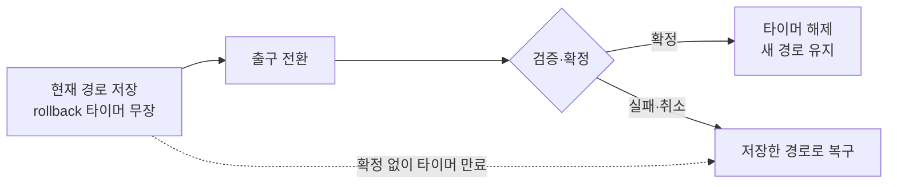

[English](README.md) | **한국어**

# edc

`edc`는 **시스템 작업을 위한 everyday carry**입니다. SE와 SRE가 terminal에서 호스트 상태를 확인하고, 자원 사용을 관측하고, 장애를 추적하며, 원격 작업을 실행하는 도구 모음입니다.

`info`로 호스트의 구성과 현재 상태를 확인하고, `top`으로 CPU·메모리·디스크·네트워크와 프로세스를 지켜봅니다. 여기서 디스크 사용량 조사, 연결 점검, 동작 추적, 기록과 비교로 이어집니다. Linux와 macOS에서 같은 CLI를 사용하며, 명령마다 지원하는 OS와 필요한 권한은 다릅니다.


현재 UI 렌더러에 데모 데이터를 넣어 캡처한 화면입니다. [캡처 재현 방법](docs/capture/README.md)을 참고하세요.

| 할 일 | 시작할 명령 | 자세한 안내 |
| --- | --- | --- |
| 호스트 상태와 자원 사용 확인 | `edc info`, `edc top` | [호스트 정보](docs/host.ko.md#호스트-정보), [대시보드](docs/monitoring.ko.md#top-대시보드) |
| 지금 고장 난 곳 찾기 | `edc check`, `edc check --group <group>` | [상태 점검](docs/host.ko.md#상태-점검-linux와-macos), [점검 루틴](docs/host.ko.md#점검-루틴) |
| 디스크를 차지하는 항목 찾기 | `edc du /var`, `edc clean` | [디렉터리 사용량](docs/disk-usage.ko.md#디렉터리-디스크-사용량-linux와-macos), [알려진 캐시](docs/disk-usage.ko.md#알려진-개발-캐시-사용량-linux와-macos) |
| 서비스·컨테이너 조사 | `edc svc`, `edc ctr` | [서비스](docs/host.ko.md#서비스-보기-linux), [컨테이너](docs/host.ko.md#container-보기-linux와-macos) |
| 연결 문제 확인 | `edc dns lookup example.com`, `edc tcp check example.com:443` | [네트워크 점검](docs/network.ko.md#네트워크-점검), [종합 진단](docs/network.ko.md#doctor-실시간-화면) |
| 애플리케이션과 커널 동작 추적 | `edc trace` | [추적과 패킷 캡처](#동작-추적과-패킷-캡처) — trace별 지원 조건 참고 |
| 실행 기록과 비교 | `edc top -w`, `edc history`, `edc log -- <command>` | [자원 사용 이력](docs/history.ko.md#top-저장과-이력-조회), [명령 로그](docs/history.ko.md#cron과-애플리케이션-로그) |
| 여러 호스트에서 작업 | `edc remote`, `edc clean --group <group>` | [원격 recipe](docs/remote.ko.md#remote-recipe), [원격 디스크 조사](docs/disk-usage.ko.md#여러-호스트의-clean) |

관측 명령은 호스트를 자동으로 복구하지 않습니다. 명시한 작업은 상태를 바꿀 수 있습니다. `remote`는 recipe의 명령을, `check <루틴>`은 설정한 루틴의 명령을, `watch fs --exec`와 `--rules`는 설정한 action을 실행하며, `route`, `disk`, `change`는 호스트 설정을 변경합니다. 기록, 로그 회전, 이력 삭제, 설정 저장, 업데이트도 파일을 쓰거나 삭제합니다. 자동화할 때는 각 명령의 실행 조건을 확인하세요.

[설치](#설치) · [빠른 시작](#빠른-시작) · [설정](docs/configuration.ko.md#command-기본값) · [소스 빌드](docs/configuration.ko.md#빌드) · [Exit code](#exit-code)

<a id="업데이트"></a>
<a id="빌드"></a>
<a id="언어"></a>
<a id="command-기본값"></a>
<a id="shell-completion"></a>

## 설치

Linux와 macOS의 `amd64`·`arm64` 실행 파일을 제공합니다. 설치 script가 환경에 맞는 파일을 선택하고 SHA-256 checksum을 검증합니다.

```bash
curl -fsSL https://raw.githubusercontent.com/x-mesh/edc/main/install.sh | sh
```

[설치 경로·PATH 설정·업데이트·소스 빌드 자세히 보기 →](docs/configuration.ko.md#설치)

## 빠른 시작

설치 후 버전을 확인하고, 외부 public IP 조회 없이 호스트 상태를 살펴봅니다.

```bash
edc version
edc info --public=false
```

`info`는 시스템, 메모리, 네트워크, 디스크와 프로세스 정보를 출력합니다. 이어서 실시간 자원 대시보드를 엽니다.

```bash
edc top
```

<details>
<summary>호스트 정보 화면 보기 (데모 데이터)</summary>


</details>

`q`로 종료합니다. 정해진 횟수만 관측하거나 script에서 사용하려면 표본 다섯 개를 JSON 줄로 출력합니다.

```bash
edc top --count 5 --json -
```

다음 명령은 위의 작업별 표에서 고르세요. `edc help`는 명령 목록을, `edc help top`은 해당 명령의 option을 보여 줍니다. 소스에서 빌드했다면 `edc` 대신 `./bin/edc`를 사용합니다.

<a id="호스트-정보"></a>
<a id="호스트-점검-linux"></a>
<a id="서비스-보기-linux"></a>
<a id="서비스-목록"></a>
<a id="container-보기-linux"></a>
<a id="container-목록"></a>
<a id="최근-호스트-변경-linux"></a>
<a id="커널과-systemd-이벤트-linux"></a>

## 호스트 점검

`info`로 구성, 메모리, 디스크와 listening port를 확인합니다. Linux와 macOS에서는 `check` 한 번으로 실패한 서비스, defunct process, 가득 찬 디스크, 메모리 부족 종료 같은 지금의 문제를 찾습니다. Linux에서는 systemd 서비스, 최근 변경과 커널 event를 확인합니다. Linux와 macOS에서는 Unix socket으로 Docker container를 조회합니다.

```bash
edc info --public=false
edc check
edc svc
edc ctr
edc changes --since 2h
```

[호스트 정보·상태 점검·서비스·컨테이너·audit·event 자세히 보기 →](docs/host.ko.md)

기본 `edc ctr`은 Docker Engine API 정보만 사용합니다. 선택형 로컬 Linux collector는 [container 안내](docs/host.ko.md#container-보기-linux와-macos)를 참고하세요.

<a id="top-임계값"></a>
<a id="top-대시보드"></a>
<a id="top-이벤트"></a>
<a id="top-json-출력"></a>
<a id="top-process-필터"></a>
<a id="프로세스-자원-한도-linux"></a>
<a id="-d로-cpu-대기와-io-지연-보기"></a>
<a id="ai-도구-사용량"></a>

## 실시간 관측

`top`에서 호스트 자원과 바쁜 프로세스를 관측합니다. CPU·메모리·디스크·네트워크 보기로 전환하고, process 필터로 서비스 하나에 집중합니다. `ai`에서는 로컬 Claude Code·Codex의 token 사용량과 계정 한도를 확인합니다. `ai sessions`는 입력이 필요한 세션을 보여 줍니다.

```bash
edc top --process postgres
edc ai
```

[대시보드 조작·process 필터·AI 사용량 자세히 보기 →](docs/monitoring.ko.md)

<a id="디렉터리-디스크-사용량-linux와-macos"></a>
<a id="알려진-개발-캐시-사용량-linux와-macos"></a>
<a id="프로젝트-빌드-폴더"></a>
<a id="여러-호스트의-clean"></a>
<a id="docker-엔진"></a>
<a id="옛-docker-데이터-디렉터리"></a>
<a id="큰-로그-snap-리비전-빌드-캐시"></a>
<a id="vm-디스크"></a>
<a id="worktree"></a>
<a id="재지-않는-유형"></a>

## 디스크 조사

**`du`는 디스크를 차지하는 항목을 빠르게 찾습니다.** 기본 4개 worker로 디렉터리를 병렬 탐색하고, 큰 항목부터 열어 볼 수 있습니다.

**`clean`은 사용량을 조사하는 읽기 전용 명령이며, 파일을 삭제하지 않습니다.** 알려진 캐시와 후보의 크기를 재고, 요청하면 정리 명령을 보여 줍니다. 실제 정리 명령은 사용자가 선택해 실행합니다.


```bash
edc du /var
edc clean
```

데모 데이터로 캡처한 화면입니다. 두 명령은 Linux와 macOS를 지원하며, 파일시스템·Docker 세부 기능은 OS에 따라 다릅니다.

**[디스크 사용량·캐시 조사 자세히 보기 →](docs/disk-usage.ko.md)**

<a id="장애-snapshot"></a>
<a id="스냅샷을-history-db에-기록"></a>
<a id="report-비교"></a>
<a id="report-뷰어"></a>
<a id="top-저장과-이력-조회"></a>
<a id="cron과-애플리케이션-로그"></a>
<a id="명령-실행-이력"></a>
<a id="로그-회전"></a>
<a id="재시작과-timeout"></a>

## 기록과 비교

자원 사용을 기록하고 이전 실행을 탐색하며 시간에 따른 지표 변화를 확인합니다. snapshot과 report로 호스트 상태를 비교하고, `log`로 명령 출력과 실행 이력을 남깁니다.


```bash
edc top -w
edc history trend
edc log -- ls -lh
```

`top`에서 `q`로 종료한 뒤 `history trend`로 기록을 조회합니다. 화면은 여러 날의 데모 이력이며, 새 기록에는 직접 수집한 표본부터 표시됩니다.

**[기록·추이·증가량·명령 이력 자세히 보기 →](docs/history.ko.md)**

<a id="packet-capture"></a>

## 동작 추적과 패킷 캡처

애플리케이션 요청과 커널 동작을 따라가며 장애를 조사합니다. HTTP trace는 요청 경로, 응답 상태와 측정한 지연 시간을 보여 줍니다. `i`를 누르면 event 목록 아래에서 message를 미리 볼 수 있습니다.


현재 UI에 데모 데이터를 넣어 캡처한 화면입니다. HTTP trace에는 Linux 5.15 이상과 eBPF 권한이 필요합니다. 필요한 권한을 갖춘 호스트에서 port 8080의 로컬 HTTP 서비스를 관측합니다.

```bash
sudo edc trace http --side server --port 8080
```

Ctrl-C로 수집을 멈추면 요약을 출력합니다. 지원하는 OS·커널·프로토콜은 trace마다 다릅니다.

**[HTTP 추적 자세히 보기 →](docs/tracing.ko.md#trace-http)** · [전체 trace와 패킷 캡처 안내 →](docs/tracing.ko.md)

<a id="remote-recipe"></a>
<a id="명령-형태"></a>
<a id="dry-run과-inventory-목록"></a>
<a id="인벤토리와-레시피-편집"></a>
<a id="host-tag"></a>
<a id="표-하나"></a>
<a id="자동화"></a>
<a id="ssh-터널"></a>
<a id="연결-시험"></a>

## 원격 작업

inventory 그룹과 recipe로 여러 호스트의 작업을 계획하고, 단계를 실행하며 결과를 검증합니다. 연결 설정은 OpenSSH를 사용합니다. recipe에는 실행할 명령을 직접 지정합니다.


```bash
edc remote --list
edc remote --dry-run --group <group> --recipe <recipe.yaml>
```

예제를 실행하려면 inventory와 recipe를 먼저 설정합니다. 데모는 예제 파일로 계획만 보여 주며 SSH 연결을 만들지 않습니다. `--dry-run`은 recipe의 명령을 실행하지 않고 계획을 출력합니다.

**[Inventory·recipe·작업 실행·SSH 터널 자세히 보기 →](docs/remote.ko.md)**

<a id="이름-조회"></a>
<a id="연결-확인"></a>
<a id="파일-감시와-action-linuxmacos"></a>
<a id="경로와-interface"></a>
<a id="어디에-있는가"></a>
<a id="probe-임계값"></a>
<a id="probe-진행-줄"></a>
<a id="빠진-인자"></a>
<a id="doctor-실시간-화면"></a>

## 네트워크 점검

필요한 계층을 개별 점검하거나, `doctor`로 종합 진단합니다.

```bash
edc dns lookup example.com
edc tcp check example.com:443
edc doctor https://example.com
```

[DNS·TCP·TLS·HTTP·doctor·quality·파일 감시 자세히 보기 →](docs/network.ko.md)

<a id="route-전환"></a>
<a id="출구-목록"></a>
<a id="안전장치"></a>
<a id="디스크-증설"></a>

## 보호된 호스트 변경

Linux에서 route를 전환하고, 디스크를 증설하거나, rollback을 갖춘 접근 설정 변경을 적용합니다. 실행 전에 필요한 권한·확인 절차·복구 조건을 확인하세요.

rollback 타이머가 정상적으로 무장된 route 전환은 다음과 같이 동작합니다.



[Route 전환·보호된 변경·디스크 증설 자세히 보기 →](docs/host-changes.ko.md)

## 사용 가이드

| 문서 | 내용 |
| --- | --- |
| [설치와 설정](docs/configuration.ko.md) | 설치·업데이트·빌드·언어·기본값·completion |
| [호스트 상태와 점검](docs/host.ko.md) | 호스트 정보·상태 점검·서비스·컨테이너·audit·변경·event |
| [실시간 자원 관측](docs/monitoring.ko.md) | top 조작·임계값·프로세스·AI 사용량 |
| [네트워크 점검](docs/network.ko.md) | DNS·TCP·TLS·HTTP·doctor·위치·파일 감시 |
| [디스크 사용량과 알려진 캐시](docs/disk-usage.ko.md) | 디렉터리 탐색·캐시·Docker·worktree·원격 조사 |
| [기록·이력·report](docs/history.ko.md) | 기록·snapshot·추이·증가량·report·명령 로그 |
| [원격 작업과 SSH 터널](docs/remote.ko.md) | inventory·recipe·실행 계획·SSH 터널 |
| [보호된 호스트 변경](docs/host-changes.ko.md) | route·rollback·디스크 증설 |
| [동작 추적과 패킷 캡처](docs/tracing.ko.md) | 애플리케이션 프로토콜·커널 추적·payload·PCAP |

## Exit code

- `0`: 성공 또는 warning만 존재
- `1`: 하나 이상의 probe 실패, 또는 `report diff`에서 악화된 probe 존재
- `2`: argument, config, log 시작, report parse 등 실행 오류
- `3`: privileged 작업의 권한 부족
- `4`: 사용자 취소 (선택 취소, `remote`와 `doctor`의 Ctrl-C 포함)
- `124`: 마지막 `log` 실행이 timeout을 초과함

## 현재 범위

| 기능 | 지원 환경 |
| --- | --- |
| 호스트 자원·디렉터리 사용량·캐시 조사·네트워크 probe | Linux와 macOS |
| systemd·호스트 audit·최근 변경·커널 event | Linux |
| 애플리케이션·커널 trace | trace·커널·권한에 따라 다름 |
| 원격 recipe | 로컬 OpenSSH 사용, 원격 명령은 호스트 환경에 따름 |

[지원 조건과 외부 조회](docs/host.ko.md#현재-범위) · [Trace 실행 조건](docs/tracing.ko.md) · [설정과 언어](docs/configuration.ko.md)

## 라이선스

MIT입니다. [LICENSE](LICENSE)를 보십시오.
