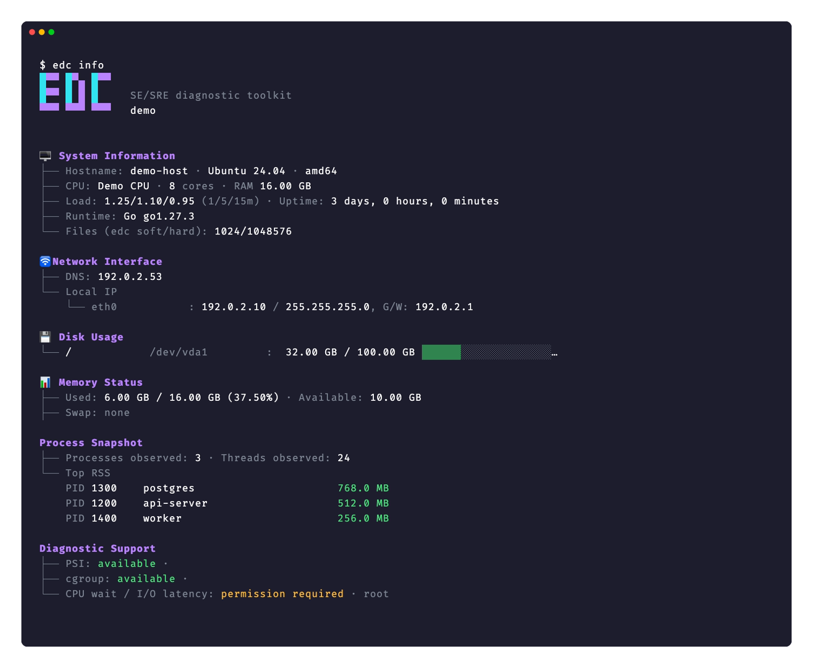
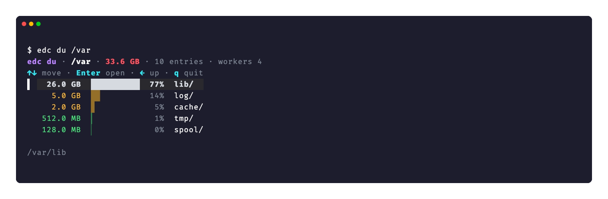
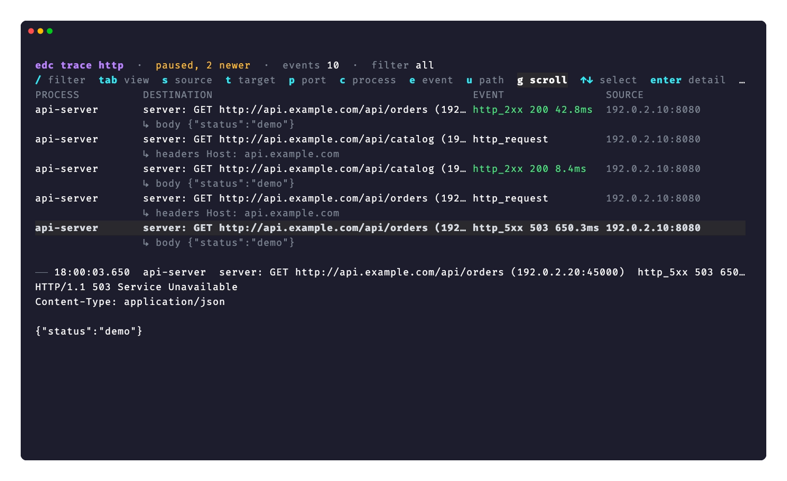
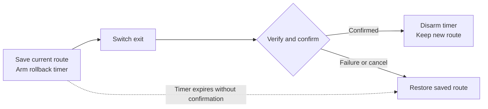

**English** | [한국어](README.ko.md)

# edc

`edc` is **everyday carry for systems work**: a terminal toolkit for SEs and SREs to inspect hosts, follow resource use, investigate failures, and run remote tasks.

Start with the host: `info` shows its configuration and current state, and `top` follows CPU, memory, disk, network, and processes. From there, inspect disk usage, check a connection, trace activity, or record what happened for later comparison. Linux and macOS share the CLI; individual commands have platform and privilege requirements.


The screen uses synthetic demo data with the current UI renderer. [Reproduce the captures](docs/capture/README.md).

| Task | Start here | Details |
| --- | --- | --- |
| Inspect a host and its resource use | `edc info`, `edc top` | [Host information](docs/host.md#host-information), [dashboard](docs/monitoring.md#top-dashboard) |
| Find where disk space goes | `edc du /var`, `edc clean` | [Directory usage](docs/disk-usage.md#disk-usage-of-a-directory-linux-and-macos), [known caches](docs/disk-usage.md#known-cache-sizes-linux-and-macos) |
| Investigate a service or container | `edc svc`, `edc ctr` | [Services](docs/host.md#service-view-linux), [containers](docs/host.md#container-view-linux) — Linux |
| Check a connection | `edc dns lookup example.com`, `edc tcp check example.com:443` | [Network checks](docs/network.md#network-checks), [combined diagnosis](docs/network.md#doctor-live-screen) |
| Trace application and kernel activity | `edc trace` | [Tracing and packet capture](#tracing-and-packet-capture) — support varies by trace |
| Record and compare runs | `edc top -w`, `edc history`, `edc log -- <command>` | [Resource history](docs/history.md#top-recordings-and-history), [command logs](docs/history.md#cron-and-application-logs) |
| Work across hosts | `edc remote`, `edc clean --group <group>` | [Remote recipes](docs/remote.md#remote-recipes), [remote disk survey](docs/disk-usage.md#clean-on-more-hosts) |

Inspection commands do not automatically repair the host. Explicit actions have effects: `remote` runs recipe commands, `watch fs --exec` and `--rules` run configured actions, and `route`, `disk`, and `change` modify host settings. Recording, log rotation, pruning, setup, and updates also write or delete data. See each command's requirements before using it in automation.

[Install](#install) · [Quick start](#quick-start) · [Configuration](docs/configuration.md#command-defaults) · [Build from source](docs/configuration.md#build) · [Exit codes](#exit-code)

<a id="update"></a>
<a id="build"></a>
<a id="language"></a>
<a id="command-defaults"></a>
<a id="shell-completion"></a>

## Install

Linux and macOS releases include `amd64` and `arm64` binaries. The install script selects the binary and verifies its SHA-256 checksum.

```bash
curl -fsSL https://raw.githubusercontent.com/x-mesh/edc/main/install.sh | sh
```

[Install paths, PATH setup, updates, and source builds →](docs/configuration.md#install)

## Quick start

After installation, check the version and inspect the host without a public IP lookup:

```bash
edc version
edc info --public=false
```

`info` prints system, memory, network, disk, and process information. Open the live resource dashboard next:

```bash
edc top
```

<details>
<summary>Host information screen (synthetic demo data)</summary>



</details>

Press `q` to exit. For bounded output or a script, collect five samples as JSON lines:

```bash
edc top --count 5 --json -
```

Use the task table above to choose the next command. `edc help` lists commands, and `edc help top` shows a command's options. Source builds use `./bin/edc` in place of `edc`.

<a id="host-information"></a>
<a id="host-audit-linux"></a>
<a id="service-view-linux"></a>
<a id="service-list"></a>
<a id="container-view-linux"></a>
<a id="container-list"></a>
<a id="recent-host-changes-linux"></a>
<a id="kernel-and-systemd-events-linux"></a>

## Host inspection

Inspect configuration, memory, disks, and listening ports with `info`. On Linux, inspect systemd services, containers, recent changes, and kernel events to narrow an incident.

```bash
edc info --public=false
edc svc
edc ctr
edc changes --since 2h
```

[Host information, service and container views, audit, and events →](docs/host.md)

<a id="top-thresholds"></a>
<a id="top-dashboard"></a>
<a id="top-events"></a>
<a id="top-json-output"></a>
<a id="filter-processes-in-top"></a>
<a id="process-resource-limits-linux"></a>
<a id="cpu-wait-and-io-latency-with--d"></a>
<a id="ai-tool-usage"></a>

## Live monitoring

Follow host resources and the busiest processes in `top`. Switch views to inspect CPU, memory, disk, or network activity; use process filters to focus on a service. `ai` shows local Claude Code and Codex token usage and account limits.

```bash
edc top --process postgres
edc ai
```

[Dashboard controls, process filters, and AI usage →](docs/monitoring.md)

<a id="disk-usage-of-a-directory-linux-and-macos"></a>
<a id="known-cache-sizes-linux-and-macos"></a>
<a id="project-build-folders"></a>
<a id="clean-on-more-hosts"></a>
<a id="docker-engine"></a>
<a id="old-docker-data-directory"></a>
<a id="large-logs-snap-revisions-and-build-caches"></a>
<a id="vm-disks"></a>
<a id="worktrees"></a>
<a id="what-edc-does-not-measure"></a>

## Disk usage

**`du` quickly finds where disk space goes.** It scans directories with 4 workers by default and lets you explore the largest entries first.

**`clean` is a read-only disk survey. It does not delete files.** It measures known caches and other candidates and shows cleanup commands when requested; you choose whether to run them.



```bash
edc du /var
edc clean
```

The screen uses synthetic demo data. Both commands support Linux and macOS; some filesystem and Docker details are platform specific.

**[Disk usage and cache inspection details →](docs/disk-usage.md)**

<a id="incident-snapshot"></a>
<a id="record-snapshots-in-the-history-database"></a>
<a id="report-diff"></a>
<a id="report-viewer"></a>
<a id="top-recordings-and-history"></a>
<a id="cron-and-application-logs"></a>
<a id="command-history"></a>
<a id="log-rotation"></a>
<a id="restart-and-timeout"></a>

## Record and compare

Record resource observations, browse earlier runs, and compare metrics over time. Snapshots and saved reports help compare host state; `log` keeps command output and execution history.


```bash
edc top -w
edc history trend
edc log -- ls -lh
```

Stop `top` with `q`, then open `history trend` to inspect the recording. The screen illustrates a multi-day history with synthetic data; a new recording starts with the samples you collect.

**[Recording, trends, growth, and command history details →](docs/history.md)**

<a id="packet-capture"></a>

## Tracing and packet capture

Follow application requests and kernel activity to investigate a failure. HTTP trace shows request paths, response status, and measured latency; press `i` to preview a message below the event list.



Screen rendered with synthetic demo data. HTTP tracing requires Linux 5.15 or later and eBPF privileges. On a host with the required capabilities, trace a local HTTP service on port 8080:

```bash
sudo edc trace http --side server --port 8080
```

Press Ctrl-C to stop collection and print the summary. Trace support varies by OS, kernel, and protocol.

**[HTTP tracing details →](docs/tracing.md#trace-http)** · [All traces and packet capture →](docs/tracing.md)

<a id="remote-recipes"></a>
<a id="command-shape"></a>
<a id="dry-run-and-inventory-listing"></a>
<a id="edit-the-inventory-and-the-recipe"></a>
<a id="host-tags"></a>
<a id="one-table"></a>
<a id="automation"></a>
<a id="ssh-tunnels"></a>
<a id="connection-test"></a>

## Remote tasks

Use inventory groups and recipes to plan work across hosts, execute steps, and verify results. OpenSSH supplies connection settings. Recipes execute the commands you configure.


```bash
edc remote --list
edc remote --dry-run --group <group> --recipe <recipe.yaml>
```

Configure an inventory and recipe before running these examples. The demo shows a plan using example files; it makes no SSH connections. `--dry-run` displays planned work without executing recipe commands.

**[Inventory, recipes, execution, and SSH tunnels →](docs/remote.md)**

<a id="name-lookup"></a>
<a id="connection-check"></a>
<a id="file-watching-and-actions-linux-and-macos"></a>
<a id="route-and-interfaces"></a>
<a id="where-am-i"></a>
<a id="probe-thresholds"></a>
<a id="probe-live-line"></a>
<a id="missing-arguments"></a>
<a id="doctor-live-screen"></a>

## Network checks

Check a specific layer, or use `doctor` for a combined diagnosis:

```bash
edc dns lookup example.com
edc tcp check example.com:443
edc doctor https://example.com
```

[DNS, TCP, TLS, HTTP, doctor, quality, and file watching details →](docs/network.md)

<a id="route-switching"></a>
<a id="exit-list"></a>
<a id="safety"></a>
<a id="disk-growth"></a>

## Protected host changes

On Linux, explicitly manage routes, grow disks, or apply protected access changes with rollback. Review the privilege, confirmation, and recovery requirements before applying a change.

For a route switch with an active rollback timer:



[Route switching, protected changes, and disk growth →](docs/host-changes.md)

## Guides

| Guide | Contents |
| --- | --- |
| [Installation and configuration](docs/configuration.md) | Installation, updates, build, language, defaults, completion |
| [Host inspection](docs/host.md) | Host information, services, containers, audit, changes, events |
| [Live resource monitoring](docs/monitoring.md) | Top controls, thresholds, processes, AI usage |
| [Network checks](docs/network.md) | DNS, TCP, TLS, HTTP, doctor, location, file watching |
| [Disk usage and known caches](docs/disk-usage.md) | Directory browser, caches, Docker, worktrees, remote surveys |
| [Recordings, history, and reports](docs/history.md) | Recordings, snapshots, trends, growth, reports, command logs |
| [Remote tasks and SSH tunnels](docs/remote.md) | Inventory, recipes, execution plans, SSH tunnels |
| [Protected host changes](docs/host-changes.md) | Routes, rollback, disk growth |
| [Tracing and packet capture](docs/tracing.md) | Application protocols, kernel traces, payloads, PCAP |

## Exit code

- `0`: success, or warnings only
- `1`: one or more probes fail, or `report diff` finds a worse probe
- `2`: a run error, such as an argument, a config, a log start, or a report parse error
- `3`: not enough privilege for a privileged task
- `4`: user cancel, which includes a cancelled selection and Ctrl-C in `remote` and `doctor`
- `124`: the final `log` attempt exceeds its timeout

## Current scope

| Capability | Platforms |
| --- | --- |
| Host resources, directory usage, cache inspection, network probes | Linux and macOS |
| systemd, host audit, recent host changes and kernel events | Linux |
| Application and kernel tracing | Varies by trace, kernel, and privileges |
| Remote recipes | Uses local OpenSSH; remote commands depend on each host |

[Platform requirements and external lookups](docs/host.md#current-scope) · [Trace requirements](docs/tracing.md) · [Configuration and language](docs/configuration.md)

## License

MIT. See [LICENSE](LICENSE).
