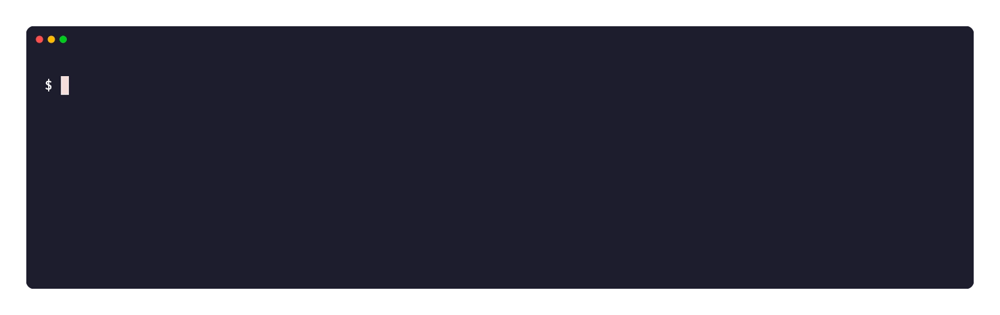
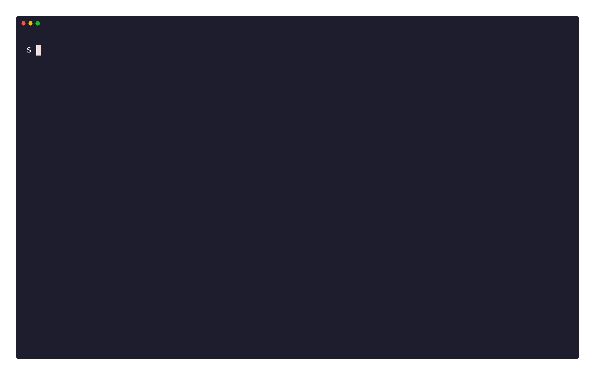
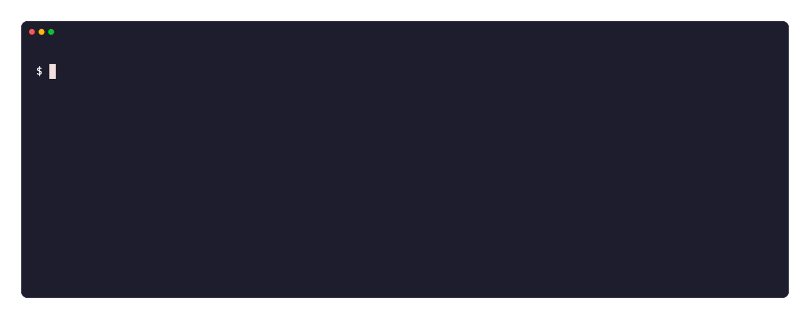
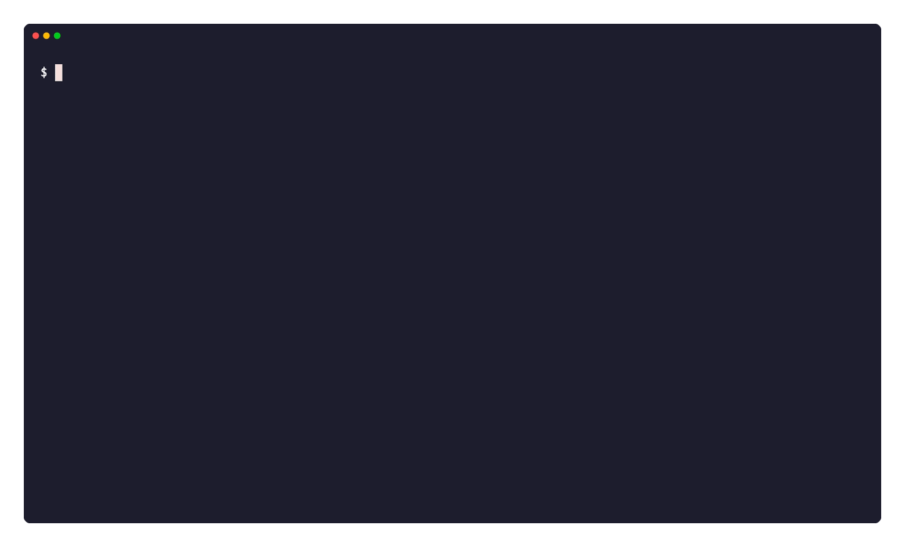

**English** | [한국어](README.ko.md)

# edc

`edc` is short for **everyday carry**. An everyday carry is the small kit you keep in a pocket and reach for first. `edc` is that kit for SE and SRE work in a terminal.

An incident starts with one question: is the fault here, in the network, or at the far end? `edc` answers it with one command. It runs DNS, TCP, TLS, HTTP, route, ping, interface, and socket probes in one pass, and every probe prints the same result format. It also reports host resources and host information on Linux and macOS, and it measures network responsiveness (RPM) and throughput: macOS runs `networkQuality`, and Linux runs a built-in test that follows the IETF responsiveness draft.

Diagnostic and observation commands are read-only. `watch fs` can execute commands explicitly configured with `--exec` or `--rules`. Observation alone finds the fault and stops there. It runs no DNS flush, no interface reset, and no firewall change, so it stays safe on a production host.

Only the `host changes` group changes a host: `edc route`, `edc disk`, and `edc change`. Each change needs a subcommand that you type, root, and a confirmation. `edc` does not add `sudo` itself.


The whole run takes about three seconds. Each line keeps the probe name, the target, and the result in the same columns, so you read down one column to find the failure.

After DNS, TCP, TLS, or HTTP warnings and failures, `edc doctor` shows manual command templates in investigation order.

Independent checks retain their recorded outcomes. The order does not establish a cause, and JSON reports contain no suggestions.

Replace the template placeholders with your target. Run a suggested command only when you need that check.

The source of each demo is a `.tape` file under [`docs/tape/`](docs/tape). To build one again, run `vhs docs/tape/doctor.tape`.

## Install

Install the latest release with the script. It reads the operating system and the architecture, checks the SHA-256, and installs the binary.

```bash
curl -fsSL https://raw.githubusercontent.com/x-mesh/edc/main/install.sh | sh
```

The script installs `edc` in `/usr/local/bin` on Linux and in `~/.local/bin` on macOS.

On Linux, `trace` and `capture` need root. The `sudo` path includes `/usr/local/bin`, but it often excludes `~/.local/bin`.

If a non-root user cannot write there, the script uses `sudo`. If root cannot write there on Linux, the script uses `~/.local/bin`.

Set `BINDIR` to use another directory. Set `EDC_VERSION` to install an earlier version.

```bash
curl -fsSL https://raw.githubusercontent.com/x-mesh/edc/main/install.sh | BINDIR="$HOME/.local/bin" sh
curl -fsSL https://raw.githubusercontent.com/x-mesh/edc/main/install.sh | EDC_VERSION=0.1.0 sh
```

Earlier versions of the script installed `edc` in `~/.local/bin` also on Linux. Ubuntu puts `~/.local/bin` before `/usr/local/bin` in `PATH`, so the shell runs that old copy. If the old copy is `edc`, the script removes it. The script checks the home of the user who runs it and, with `sudo`, the home of the user who ran `sudo`. Remove copies in other homes by hand, for example with `sudo rm /home/<user>/.local/bin/edc`.

If the install directory is not on `PATH`, the script finds your shell and prints the commands that add the directory. Set `EDC_MODIFY_PATH=1` to let the script add the line to the startup file of your shell, for example `~/.zshrc` or `~/.bashrc`. The script adds the line only once. The current shell does not get the new `PATH`. Open a new shell, or run the command that the script prints.

```bash
curl -fsSL https://raw.githubusercontent.com/x-mesh/edc/main/install.sh | EDC_MODIFY_PATH=1 sh
```

A release holds binaries for Linux and macOS on `amd64` and `arm64`.

## Update

`edc update` reads the latest release, checks the SHA-256, and replaces the running binary.

```bash
edc update           # confirm, then replace
edc update --check   # print the two versions only
edc update --yes     # skip the confirmation
```

`edc` writes the new file next to the old one and renames it. A failed download leaves the earlier binary in place. If you cannot write to the directory, `edc` uses `sudo` to copy and rename the new file, as the install script does. `edc` downloads and checks the file as your user. The confirmation shows `privilege sudo`, and `sudo` asks for your password once if it needs one. If `sudo` is not available or fails, `edc` stops with exit code `3` before it downloads anything.

## Build

`edc` needs Go 1.25 or later. The live screens use these dependencies.

- `charm.land/bubbletea/v2`
- `charm.land/bubbles/v2`
- `charm.land/lipgloss/v2`

```bash
make build VERSION=0.1.0-dev
./bin/edc version
```

Install `edc` in `~/.local/bin`.

```bash
make install VERSION=0.1.0-dev
~/.local/bin/edc version
```

Set `PREFIX` or `BINDIR` to use another install path.

```bash
make install PREFIX=/usr/local
```

## Language

`edc` prints English by default. It also carries Korean and Japanese.

Set the language in the config file. On Linux and macOS, `edc` reads `$XDG_CONFIG_HOME/edc/config.toml` when set, or `~/.config/edc/config.toml` by default.

```toml
lang = "ko"
```

If `config.toml` is absent, Linux still reads `~/.config/edc/config.yaml`, and macOS still reads `~/Library/Application Support/edc/config.yaml`. `edc setup` saves a new TOML file and leaves the YAML file intact.

Set `EDC_LANG` to change the language for one run. It wins over the config file.

```bash
EDC_LANG=ja edc where
```

`edc` accepts `en`, `ko`, and `ja`. It reads a locale name such as `ko_KR.UTF-8` and keeps the language part. An unknown value falls back to English, and so does a message that a language misses.

## Command defaults

The same config file can hold repeat-safe command defaults. Precedence is built-in default, config, then an explicit CLI option. Invalid keys, types, or ranges stop the command with exit code `2` instead of being ignored.

Run `edc setup` in a terminal to create or update the file. The wizard configures one section at a time, keeps existing values on Enter, removes an optional value with `!clear`, previews the complete config, and asks before an atomic mode `0600` save. The config directory is mode `0700`; cancel returns exit code `4`.

The following TOML example applies to both Linux and macOS.

```toml
lang = "en"

[defaults.common]
timeout = "15s"
verbose = false
redact = false

[defaults.doctor]
profile = "default"

[defaults.tls]
min_days = 14

[defaults.capture]
duration = "15s"
count = 500

[defaults.remote]
connect_timeout = "10s"
output_limit = 65536
parallel = 0

[defaults.du]
workers = 4

[defaults.history]
limit = 200

[defaults.changes]
since = "24h"

[defaults.snapshot]
since = "6h"

[defaults.events]
since = "6h"

[defaults.update]
timeout = "60s"

[defaults.quality]
timeout = "30s"
server = ""

[defaults.log]
stream = "both"
output = ""
command_display = "full"
max_size_mb = 10
keep_files = 3
restart = "never"
max_restarts = 3
restart_delay = "5s"
timeout = "0s"
kill_after = "5s"
history_limit = 20
```

Command-specific values override `defaults.common`. Positional targets, URLs, hosts, and remote groups are never stored, nor are action options such as `yes`, `force`, `dry-run`, `list`, and `check`. Persisted remote inventory and recipe paths must be absolute. Empty path values disable that default.

The setup wizard recommends automatic files for `edc log`.

An empty output path selects one file per run. Custom output paths require an existing parent directory.

The command also creates the parent for the legacy recommended `edc.log` path.

## Quick start

```bash
# live host resource dashboard (press q to quit)
./bin/edc top
# the earlier table output
./bin/edc top --interval 2s --count 10
# one JSON line for each sample
./bin/edc top --count 5 --json -

# Claude Code and Codex token use and account limits
./bin/edc ai

# system, network, and disk information, with the public IP
./bin/edc info
# skip the public IP lookup
./bin/edc info --public=false

# disk usage under a directory, largest entries first (Linux and macOS)
./bin/edc du /var

# known development cache sizes, read only (Linux and macOS)
./bin/edc clean

# default diagnosis
./bin/edc doctor https://example.com

# save a redacted machine-readable report (file mode 0600)
./bin/edc doctor --redact --json report.json https://example.com
./bin/edc report show report.json
# compare two reports (exit 1 if one probe gets worse)
./bin/edc report diff before.json after.json

# full diagnosis with bandwidth and responsiveness
./bin/edc doctor --profile full --timeout 60s example.com

# single probes
./bin/edc dns lookup example.com
./bin/edc dns compare example.com
./bin/edc tcp check example.com:443
./bin/edc tls check example.com:443
./bin/edc tls check --min-days 14 example.com:443
./bin/edc http check https://example.com
./bin/edc http check --expect-status 200 https://example.com
./bin/edc net route example.com
./bin/edc net ping example.com
./bin/edc net trace example.com
./bin/edc net interfaces
./bin/edc listen              # open ports, --unix or --all adds unix sockets
./bin/edc listen --watch -i 0.5 --duration 10s
sudo ./bin/edc audit           # read-only check of exposure and settings (Linux)
sudo ./bin/edc svc nginx       # one systemd service on one screen (Linux)
./bin/edc svc                  # the systemd services, failed first (Linux)
sudo ./bin/edc ctr             # the docker containers, failed first (Linux)
./bin/edc changes --since 2h   # recent package, /etc, and service changes (Linux)
sudo ./bin/edc events --since 6h   # kernel and systemd failure signals in time order (Linux)
./bin/edc quality --timeout 60s
./bin/edc quality --server https://example.com/.well-known/nq   # responsiveness config URL

# repeat a page check; omit --duration to run until Ctrl-C
./bin/edc watch http -i 0.1 --duration 10s https://example.com

# which region is near, and what shape is this network
./bin/edc where
./bin/edc where --provider aws --count 5

# shell completion
source <(./bin/edc completion zsh)

# update to the latest release
./bin/edc update --check
```

The common options are `--timeout`, `--json <path|->`, `--verbose`, and `--redact`. Go `flag` rules put an option before the target.

`edc info` gets the public IP by default. It sends one DNS query for `o-o.myaddr.l.google.com` to `ns1.google.com` over IPv4. `-v` also asks ipinfo.io for the provider, the city, the region, the country, and the time zone. A lookup stops after 3 seconds, and its line disappears. Use `--public=false` to skip the lookups, `--timeout` to change the limit, and `-v` to print the cause of a failure. If a network blocks DNS to external servers, the default output has no public IP.

`edc info` also shows memory status, a process snapshot, and diagnostic support.

The default output groups related values on one line. Use `-v` for kernel details, the memory calculation basis, shared-page notes, and the Python version. A shim such as pyenv can make the Python check take several hundred milliseconds, so the default output skips it.

On Linux, used memory is `MemTotal - MemAvailable`. Cache counters include `Cached`, `Buffers`, and reclaimable slab when present.

On macOS, available memory is an estimate from free and inactive Mach pages. File-backed memory and physical compression appear separately.

Memory detail counters can overlap. They do not measure memory pressure and must not be added together.

The process snapshot shows observed process and thread counts, plus the three processes with the highest RSS. Thread counts show coverage.

`edc info` also shows these signals by default. It reads them from files, syscalls, and sysctl, and runs no external command.

- `Platform`: the DMI vendor and product, for example `Amazon EC2 m5.large`. On Oracle Cloud, it adds `Oracle Cloud` from the chassis asset tag. On Linux, it adds `virtual machine` if the CPU reports a hypervisor or the DMI names QEMU or a virtual machine. It also adds the container runtime if it finds a marker. On macOS, it shows the model identifier.
- `Clock` (Linux): the kernel time synchronization state from `adjtimex`. It does not show an offset. The kernel error values are bounds that only grow between updates, not the real offset.
- `DNS`: the nameservers and search domains in `/etc/resolv.conf`. If the file points to the systemd-resolved stub, edc shows the upstream servers.
- `Pressure` and `OOM kills since boot` (Linux): PSI some avg10 for CPU, memory, and I/O, and the `oom_kill` counter in `/proc/vmstat`.
- A disk line ends with `(read-only)` or `(inodes N%)` if the mount is read-only or inode use is 80% or more. On macOS, the sealed system volume is read-only by design, so edc does not mark it.
- On Linux, a disk line also ends with `(deleted-open 12.0 GB in 3 files, java)` if a process still holds a file that was deleted. `du` does not see this space, but `df` counts it, and the file system frees it only when the last process closes the file. edc reads `/proc/<pid>/fd`, counts each inode once, and names the process that holds the largest file. `-v` lists the five largest files with the PID, the process, and the path. Without root, edc cannot read the files of other users, so the value is a lower bound and shows `≥`. edc stops after 200000 file descriptors.

`-v` adds the system-wide open files, the IPv6 default route (Linux), the MTU, MAC, link speed (Linux), and IPv6 addresses of each interface, and the options of each mount. It lists only interfaces with an IPv4 address or a non-link-local IPv6 address.

`Listening Ports` shows the count of TCP and UDP sockets that wait for connections. A socket on a loopback address adds to the count only. The other sockets show in a list of up to five rows with the port, the address, and the process. `-v` lists all TCP and UDP sockets. `edc listen` shows the full table. On macOS without root, the list does not include the sockets of other accounts.

Diagnostic support tests process I/O access for the current process and PSI availability. Access to other PIDs can differ.

The Linux eBPF check reads kernel BTF and effective capabilities. It does not load or attach programs.

`prerequisites met` does not guarantee attachment. Unsupported features, absent permissions, and failed checks show their reasons.

If memory or process collection fails, the command shows the error and returns exit code `1`.

On Linux, `edc info` adds `Network Limits`: conntrack occupancy, TCP memory pages against the `tcp_mem` ceiling with the orphan socket count, the local port range and reserved ports, accept/SYN backlog limits, socket buffer ceilings, receive backlog/budgets, neighbor limits, forwarding, and `rp_filter`. Use `-v` for TCP buffer settings, sysctl names, and reasons for unavailable values. Missing or inaccessible values are `unavailable`; these Linux limits are `unsupported` on macOS. Configuration alone does not establish a connection failure.

### Name lookup



Terminal and JSON output show actual IP addresses by default. Add `--redact` to hide them as `<ip:...>`.

`edc dns compare example.com` compares the system resolver with `1.1.1.1`. Repeat `--resolver IP[:port]` to choose other DNS servers. It compares A, AAAA, CNAME, and response status; TTL is shown for explicit resolvers but not used to mark a mismatch. A different answer is WARN, and a failed system lookup is FAIL.

### Connection check


A failed probe shows the phase and the cause in an ERROR block. It returns exit code `1`.

`edc watch http -i 0.1 https://example.com` checks the page until Ctrl-C.

`-i` accepts decimal seconds (minimum `0.1`) or a duration such as `100ms`. `--duration 1m` sets the observation duration.

Each sample shows HTTP status, body bytes read (up to 10 MiB), elapsed time, and available DNS/TCP/TLS/TTFB times.

If the resolved IP set changes, the output shows the new set.

For completed samples, the final summary shows min/avg/p95/max latency and the longest continuous failure.

`--json <path|->` emits JSON Lines with a final summary. The summary adds `observation_status` (`observed` or `no_samples`) and `stop_reason` (`duration` or `cancelled`).

Without completed samples, the text summary states the stop reason and omits latency statistics. The target health remains unknown.

Without completed samples, duration expiry returns exit code `2`, and cancellation returns `4`.

With completed samples, a failed sample returns exit code `1`. Otherwise, the exit code is `0`, including after cancellation.

`edc listen --watch` prints the current listeners once, then reports socket creation, closure, or process changes. Change lines use reverse video in a terminal. It accepts the same interval and duration options. The `--json` option emits a snapshot, events, and a summary as JSON Lines.

The SCOPE column and watch events identify the socket's bound address: loopback, all interfaces, specific address, Unix, or unknown.

For wildcard addresses, all interfaces refers to the observed address family. The scope does not establish external access, firewall rules, or IPv6 dual-stack behavior.

### File watching and actions (Linux and macOS)

`edc watch fs` observes changes directly below the current directory by default. Use `--recursive` for subdirectories, including newly created or moved-in directories. Existing files do not produce startup create events. Directory symlinks are not followed.

```bash
edc watch fs
edc watch fs ./src --recursive
edc watch fs --event create --match text.txt --exec 'git-kit pull'
edc watch fs ./src --recursive --event modify --match '**/*.go' --exec 'go test ./...'
edc watch fs --rules docs/examples/watch.yaml --dry-run
edc watch fs --duration 1m --json events.jsonl
```

Events are `create`, `modify`, `remove`, and `rename`. A rename reports the old path; the new name can produce a create event inside the watched scope. Reads/access and metadata-only changes are excluded. `--event` accepts a comma-separated list. Globs are relative to the watch root: `*.go` matches direct children, and `**/*.go` matches any depth. Watching those deeper paths also requires `--recursive`.

By default, `edc` excludes `.git`, `node_modules`, `.venv`, `venv`, `__pycache__`, `.mypy_cache`, `.pytest_cache`, `.ruff_cache`, `.tox`, `.next`, and `.gradle` at any depth. It does not exclude `build` or `dist`, because you can watch build output. Repeat `--exclude 'build/**'` to add exclusions. To watch the default directories too, use `--no-default-exclude`. Your `--exclude` patterns still apply.

On Linux, `--driver` selects how `edc` watches the tree. The default is `auto`.

- `fanotify` puts one mark on the whole filesystem. `edc` does not read the tree at startup, and the inotify watch limit does not apply. This driver needs root (`CAP_SYS_ADMIN`) and Linux 5.17 or later.
- `inotify` adds a watch to each directory before the first output. A large tree takes time. If stderr is a terminal, `edc` shows a notice during this step. If the tree has more directories than `fs.inotify.max_user_watches` allows, the watch stops with an error.

With `--recursive`, `auto` tries `fanotify` first. If `fanotify` cannot start, `edc` uses `inotify`. If stderr is a terminal, a line on stderr gives the reason. Without `--recursive`, `auto` uses `inotify`, because one watch is sufficient. The `driver` field of the `ready` record shows the driver in use. If you set `--driver fanotify` and `fanotify` cannot start, `edc` stops and shows the reason.

`fanotify` cannot start in these conditions:

- `edc` does not run as root.
- The kernel is older than Linux 5.17.
- The filesystem of the watch root does not supply the file handles that `fanotify` needs. A btrfs subvolume is an example.

One mark covers one filesystem. With `--recursive`, `edc` puts a mark on each filesystem that is mounted below the watch root. Some filesystems do not accept a mark, for example sysfs and devpts. The changes in a bind mount of a directory outside the watch root also cannot show inside the root. `edc` skips these mounts and names them in one line on stderr. Changes below a skipped mount are not reported. If you need these changes, use `--driver inotify`. `edc` does not mark a mount that `--exclude` covers.

`fanotify` receives the events of the whole filesystem, and `edc` discards the events outside the watch root. Thus a busy filesystem costs CPU time. When few events arrive, `edc` waits 5ms between reads. If the CPU cost is too high, use `--driver inotify`.

On macOS, `watch fs` uses FSEvents. One stream watches the whole tree, so the number of files does not use file descriptors. FSEvents collects changes for up to 50ms before it sends them. If macOS drops events, `watch fs` scans that directory again and reports the differences as `create`, `modify`, and `remove`. A move then shows as a `remove` and a `create`. One scan reads at most 200,000 entries. A line on stderr tells you about each scan, and it also tells you if the scan stopped at the limit. FSEvents also reports changes in excluded directories, and `edc` discards them.

If stdout is a terminal and `--json` is not set, the last line of the screen shows statistics. It shows the elapsed time, the number of each event type, the events per second over the last 10 seconds, the actions and failures when rules are set, and the time since the last event. The line updates each second. If the terminal is narrow, the line drops the time since the last event first, then the events per second. When the watch stops, the line goes away and the summary line stays. A pipe, a file, and JSON output do not get this line.

The JSON output file and regular files connected to stdout are excluded to avoid output feedback. `--event` and `--match` filter both event output and rule actions. There is no default action.

Rules use one strict YAML document. With no `directory`, the current working directory is watched. An explicit `directory` is relative to the rules file; a CLI directory overrides it. A rule's `cwd` is relative to the watch root and defaults to that root.

```yaml
recursive: true
exclude: [build/**]
rules:
  - name: pull-on-trigger
    events: [create]
    match: text.txt
    command: [git-kit, pull]
    debounce: 200ms
    timeout: 30s
  - name: test-on-go-change
    events: [create, modify]
    match: "**/*.go"
    command: [go, test, ./...]
    debounce: 500ms
```

```bash
edc watch fs --rules watch.yaml
```

`--exec` uses `/bin/sh -c`; YAML `command` executes argv directly. Shell aliases are not loaded. File paths are not interpolated into commands. Actions receive `EDC_WATCH_ROOT` (absolute), `EDC_WATCH_PATH` (relative), `EDC_WATCH_EVENT`, and `EDC_WATCH_RULE`. Quote shell variables such as `"$EDC_WATCH_PATH"`.

Actions run serially across all rules. The default debounce is 200ms, coalescing each rule's events to its latest event. Events during an action are coalesced into one pending action per rule and run after the active action ends. `--dry-run` reports matches without execution. Actions that change matching files can trigger themselves again; narrow the match or exclude generated paths.

Actions receive no stdin. Their default timeout is 30s. `--debounce` and `--timeout` supply defaults for rules without their own values. Combined stdout/stderr is capped at 64 KiB. Failures and timeouts do not stop watching, but produce final exit code `1`. `Ctrl-C` or the watch duration ends the active action's process group and discards pending actions. A normal observation with no events exits `0`; option/output errors exit `2`. Removing or renaming the root, watcher errors, and event overflow stop observation with an error.

JSON Lines uses `ready`, `event`, `action_start`, `action_result`, and `summary`. Child output stays inside `action_result.output`. This watches local filesystems; save operations can coalesce or generate multiple events. It is not a filesystem audit log.

### Route and interfaces


## Where am I

`edc where` answers two questions at once: which cloud region is near this host, and what shape the network has.

```bash
./bin/edc where
./bin/edc where --provider aws        # one provider only
./bin/edc where --count 5 -v          # more samples, every provider row
```

`edc` opens a TCP handshake to a public endpoint of each region and closes it. It sends no request and reads no body, so the number holds the round trip and nothing else. `edc` resolves each name once and connects to that address, which keeps the DNS time out of the distance value.

The table groups the endpoints by city and keeps the fastest provider of each city. Use `-v` to see every provider.

| provider | endpoint |
|---|---|
| `aws` | `s3.<region>.amazonaws.com` |
| `gcp` | `storage.<region>.rep.googleapis.com` |

Azure is absent. Its public addresses that carry a region name do not terminate in that region, so the numbers do not follow distance.

`edc where` also reports the public IP with its ASN, the Cloudflare PoP that anycast picks, and the shape of the local network:

- behind NAT, or a public address on the interface
- behind carrier-grade NAT, which `100.64.0.0/10` shows
- through a tunnel, which the default route interface shows

In a terminal, `edc` shows a progress line with the number of regions it has reached. Press `q` to cancel.

The screen keeps the addresses as they are by default. Add `--redact` to hide them in screen or JSON output.



The demo masks the public IP as `222.XXX.XXX.XXX` and replaces the route addresses with private example addresses.

`edc` states only what it confirms. It does not guess the line type from the jitter. The jitter column holds the number, and the reading stays with you.

## Host audit (Linux)

`edc audit` reads the exposure and the settings of a Linux host. It reads files, sysctl values, and the listening sockets. It changes nothing, and it sends nothing over the network. It ends in less than one second.

```bash
sudo edc audit
sudo edc audit -v               # add the values and the rules behind each result
sudo edc audit --json -         # one result for each check
```

| Check | Fail | Warn |
|---|---|---|
| `net.exposed` | a database or control port listens beyond loopback, and the host firewall accepts inbound traffic | the same port, but the firewall drops by default or edc cannot read it |
| `net.firewall` | | the input chains have no rule |
| `net.ip_forward` | | forwarding is on, and edc finds no container runtime |
| `ssh.root_login` | | `PermitRootLogin yes` |
| `ssh.password_auth` | `PermitEmptyPasswords yes` with password login | password login is on |
| `ssh.key_files` | another user can write `~/.ssh` or `authorized_keys` | |
| `user.uid0` | an account other than root has UID 0 | |
| `user.empty_pass` | an account has an empty password | |
| `user.sudo_nopass` | | a sudo rule runs every command without a password |
| `user.root_groups` | | the `docker` or `lxd` group has members |
| `file.sensitive` | other users can read `/etc/shadow`, or write `/etc/passwd`, `/etc/sudoers`, or `docker.sock` | |
| `file.path_writable` | other users can write a directory in the root `PATH`, or `PATH` has a relative entry | |
| `kernel.sysctl` | | a hardening value differs from the recommended value |
| `patch.reboot` | | a package asks for a reboot, or `/boot` has a newer kernel than the running kernel |
| `ctr.privileged` | edc holds every capability, so the container is privileged | |
| `ctr.docker_sock` | `/var/run/docker.sock` or `/run/docker.sock` is a socket in the container | |
| `ctr.root_user` | | edc runs as UID 0 in the container |
| `ctr.host_ns` | the container uses the PID namespace of the host | |

The database and control ports are 2375, 2379, 3306, 5432, 6379, 9200, 10250, 11211, and 27017.

The `ctr.*` checks run only inside a container. edc finds the container with the same markers as `edc info`: `KUBERNETES_SERVICE_HOST`, `/.dockerenv`, or `/run/.containerenv`. On a host, the report does not show these checks. If the container uses the PID namespace of the host, `ctr.host_ns` also compares the network namespace with the namespace of PID 1.

Run it as root. Without root, edc cannot read the firewall, `/etc/shadow`, `/etc/sudoers`, or the homes of other users. These checks show `skip`, not `pass`.

The firewall check reads `nft list ruleset`. If nft shows no input chain, it reads `iptables-save`. It counts the input rules, but it does not read the rule order. The check sees only this host. A cloud security group can still block a port, so a `fail` means that the host itself does not block the port.

The SSH checks read `sshd_config` and its `Include` files. The first value wins, as in sshd. A `Match` block applies only to some connections, so edc does not read it. Run `sshd -T` to see the effective values.

To accept a known finding, add an `[audit]` table to `config.toml`:

```toml
[audit]
accept = ["net.ip_forward", "user.root_groups"]
allow_ports = [5432]
```

`accept` holds check names from the table above. `net.exposed` does not judge the ports in `allow_ports`, and a warning names them. An unknown check name or a port outside 1 to 65535 makes the config invalid.

An accepted finding stays in the report. It shows as `skip`, and its summary starts with a marker such as `accepted (fail)`. The marker follows the language setting. In JSON, `metrics.accepted` is `true`, and `metrics.accepted_status` holds the original status. An accepted finding does not change the exit code.

If you run `sudo edc audit`, edc reads the config file of root, for example `/root/.config/edc/config.toml`. Put the `[audit]` table in that file.

`edc audit` does not match package versions against CVEs. It does not scan the whole file system, and it does not fix a finding.

## Service view (Linux)

`edc svc <unit>` shows one systemd service on one screen. It reads the unit state, the processes, the fds, the sockets, and the journal. It does not start, stop, or reload the unit.

```bash
sudo edc svc nginx
sudo edc svc -v nginx.service   # add the process rows, the fd rows, the sockets, and the journal lines
sudo edc svc --json - nginx     # one result for each view
```

Put the options before the unit name. `nginx` and `nginx.service` give the same unit. edc accepts letters, digits, and `:_.@-` only, and it refuses other unit types such as `.timer` or `.socket`.

| Result | Pass | Warn | Fail |
|---|---|---|---|
| `svc.state` | the unit is active, with no restart | the unit is active but restarted, or it is in a different state | the unit failed, or systemd cannot load it |
| `svc.processes` | edc lists the processes in the unit cgroup, with CPU% and RSS | | |
| `svc.fd` | each process uses less than 80% of its soft fd limit | a process uses 80% or more of its limit | |
| `svc.listen` | edc lists the TCP and UDP sockets that the unit processes own | | |
| `svc.journal` | the journal has no error line for the unit | the journal has error lines, and edc shows the last 5 | |

The process list shows the main process first and 10 rows at most. The count and the RSS include all processes in the unit cgroup.

Run it as root. Without root, edc cannot read the fds of other users, the socket owners, or the full journal. These results show `skip`, not `pass`. A unit with no process shows `skip` for the process views.

A socket that only systemd holds (socket activation) does not belong to a unit process. edc does not show that socket.

On macOS, or on Linux without systemd, `edc svc` shows one `skip` and exits with 0. If the unit does not exist, edc writes an error and exits with 1. A `fail` result also gives exit code 1. A usage error gives exit code 2.

### Service list

Run `edc svc` without a unit to list the services. The failed services come first. Then come the services that start or wait to restart, and then the services with restarts. The services that are not running stay out unless you add `--all`.

```bash
edc svc               # the list; a terminal opens it as a screen
edc svc --all         # also the services that are not running
edc svc --json -      # the list in metrics.services
```

In a terminal, the list refreshes every 2 seconds. Use `↑`/`↓` to select a service, `Enter` to open it, and `Esc` to go back. `/` filters by name, `f` shows only the failed services, `a` switches `--all`, `r` reads the list again, and `q` quits. An open service shows the same results as `edc svc -v <unit>`, and `r` reads it again.

In a pipe or with `--json`, edc prints one `svc.list` result and a table. A failed service makes the result `fail` and the exit code 1. A service that starts or waits to restart makes it `warn`. edc reads the list without root, but an open service needs root as above.

## Container view (Linux)

`edc ctr <container>` shows one docker container on one screen, as `edc svc` shows a unit. It asks `docker inspect` for the state, reads the processes, the fds, the sockets, and the cgroup limits of the container, and reads the last lines of `docker logs`. It does not start, stop, or restart the container.

```bash
sudo edc ctr web
sudo edc ctr -v 0123456789ab      # add the process rows, the fd rows, the sockets, and the log lines
sudo edc ctr --json - web         # one result for each view
```

The name or the ID accepts letters, digits, and `_.-/`. Options can come before or after the name.

| Result | Pass | Warn | Fail |
|---|---|---|---|
| `ctr.state` | the container runs, with no restart and no OOM kill | it runs but restarted, was OOM killed, or is unhealthy, or it is paused, created, or restarting. For an unhealthy container, a warning shows the output of the last failed health check | the container exited or is dead. The summary shows the exit code. A warning tells when the `on-failure` limit stops the restarts |
| `ctr.image` | the image reference points to the image that the container runs, or the reference is not on the host | the image reference points to a different image. Recreate the container to use it | |
| `ctr.processes` | edc lists the processes in the container cgroup, with CPU% and RSS | | |
| `ctr.limits` | memory, OOM kills, CPU throttling, and pids stay below the limits | memory use is 90% of the limit or more, the kernel killed a process in the container for memory, the CPU limit throttled 25% of the periods or more, or pids use 90% of the limit or more | |
| `ctr.fd` | each process uses less than 80% of its soft fd limit | a process uses 80% or more of its limit | |
| `ctr.listen` | edc lists the TCP and UDP sockets that the container processes own, and a process listens on each published port | no process in the container listens on a published port, or a process listens on it only on a loopback address | |
| `ctr.log` | the last 50 log lines have no error line | the log has error lines, and edc shows the last 5 | |
| `ctr.disk` | edc shows the size of the log file and of the writable layer | the json-file log has no `max-size` and is 1 GiB or more, or the writable layer is 10 GiB or more | |

The summary of `ctr.state` shows the restart policy, for example `1 restarts (on-failure:5)`. With `-v`, it shows the health checks that docker keeps, with the exit code and the first line of the output. edc reads them only for a container with a health check.

`ctr.image` asks `docker image inspect` for the image that the image reference of the container points to now. A `docker pull` or a build can move a tag to a new image. A running container keeps its old image until you recreate it.

`ctr.limits` reads the cgroup v2 of the container: `memory.current` and `memory.max`, `memory.events.local` for the OOM kills, `cpu.stat` for the throttled periods since the container started, and `pids.current` and `pids.max`. An error line is a line with `error`, `fatal`, `panic`, `exception`, `traceback`, or `oom`. edc reads the log with `docker logs --tail 50`, so a container that writes somewhere else shows no error line.

`ctr.listen` reads the sockets in the network namespace of the container. Docker sends a connection on a published port to the address of the container, so a listener on `127.0.0.1` or `::1` in the container does not get it. A container that starts can show this warn before it listens.

`ctr.disk` asks `docker inspect --size` for the writable layer and the log options, and reads the size of the log file. A json-file log without `max-size` does not rotate. A new container does not keep the data in the writable layer. Without root, edc cannot read the log file, and the log size shows `-`.

Run it as root, or as a member of the `docker` group with root for the fds. Without access to the docker daemon, the command shows one `skip`. Without root, edc cannot read the fds of other users or the socket owners, and these results show `skip`. A stopped container shows `skip` for the process views and still shows the log. The command needs the `docker` command and cgroup v2. On macOS, it shows one `skip` and exits with 0. If the container does not exist, edc writes an error and exits with 1.

### Container list

Run `edc ctr` without a container to list the containers. The failed containers come first: an exit with a code other than 0, an OOM kill, or the `dead` state. Then come the containers that restart, pause, are unhealthy, or were only created. Then come the containers with restarts. The containers that exited with code 0 stay out unless you add `--all`.

```bash
sudo edc ctr          # the list; a terminal opens it as a screen
sudo edc ctr --all    # also the containers that exited with code 0
sudo edc ctr --json - # the list in metrics.containers
```

The list makes two docker calls for any number of containers, and reads the memory of each running container from its cgroup. The terminal screen has the same keys as `edc svc`. `Enter` opens the same results as `edc ctr -v <container>`, and `Esc` goes back. At 80 columns, the `IMAGE` column drops first.

In a pipe or with `--json`, edc prints one `ctr.list` result and a table. A failed container makes the result `fail` and the exit code 1. A container that restarts, pauses, is unhealthy, or was only created makes it `warn`. Without access to the docker daemon, the list shows one `skip`.

## Recent host changes (Linux)

`edc changes` lists the changes on a Linux host in a time window. It reads package logs, the mtime of the files under `/etc`, and the systemd unit state. It changes nothing, and it sends nothing over the network. It ends in less than one second.

```bash
edc changes                     # the last 24 hours
edc changes --since 2h          # the last two hours
edc changes -v                  # all rows, not only the newest 50
edc changes --json -            # all changes in metrics.events
```

The output starts with one result for each source. A merged table follows, with the newest change first.

| Result | Source |
|---|---|
| `changes.packages` | `/var/log/dpkg.log`, `/var/log/dnf.rpm.log`, `/var/log/yum.log`, and their uncompressed rotated files |
| `changes.etc` | the mtime of each file and symlink under `/etc` |
| `changes.services` | the latest start of each service unit and its restart count |

If a boot is in the window, the table shows one `boot` row. That row holds the services that started during the boot.

If edc cannot read a source, the result is `skip` with the reason. A `skip` does not mean that nothing changed. Run it as root to read all sources. Without root, edc cannot read some directories under `/etc` and some package logs.

`edc changes` does not decompress rotated logs. If a compressed log is newer than the window start, edc shows a warning. It reads the mtime under `/etc`, not the file content, so it does not show the change inside a file. systemd keeps one start time for each unit, so a unit that restarted several times shows its latest start and the restart count. The `/etc` walk stops after 20000 entries and shows `warn`. edc does not run `dnf history` or `journalctl`.

## Disk usage of a directory (Linux and macOS)

`edc du` shows the disk usage under a directory. It counts the allocated blocks, as `du` does. A file with more than one hard link counts once. It changes nothing, and it sends nothing over the network.

```bash
edc du                          # the current directory
edc du /var                     # the largest entries under /var
edc du --top 40 /var            # 40 rows
edc du -B /var                  # show progress and size bars, then exit
edc du --no-browse /var         # the same as -B
edc du --workers 1 /var         # read one directory at a time
edc du --cross-mounts /var      # count the mounts below /var too
edc du --json - /var            # the rows in metrics.rows
```

In a terminal, `edc du` opens a screen. While edc reads, the screen shows the number of directories that it read. Press `q` to stop, and the screen shows what edc read. `Ctrl-C` stops and closes the screen. The screen lists the current directory, with the largest entry first. Press `Enter` or `→` to open a directory. Press `←`, `Backspace`, or `Esc` to go up. `↑`, `↓`, `PgUp`, `PgDn`, `g`, and `G` move the cursor. Press `q` to close the screen, and edc prints the result. The screen does not change or delete a file. In a pipe, with `--json`, or with `NO_COLOR` set, edc prints the result and opens no screen. For the screen, edc keeps the 10,000 largest files. In each directory, the other files show as one `(N other files)` row.

In a terminal, `--no-browse` or `-B` shows a spinner during the scan. When the scan ends, edc prints size bars and exits.

These options preserve color and disable directory navigation. With `NO_COLOR`, a pipe, or `--json`, edc uses static output.

The output starts with one `du.scan` result. It shows the total size, the number of entries, the time, and the number of workers. The rows follow. edc opens the largest entry first. When edc opens a directory, the entries in that directory become candidates. A directory row ends with `/`. The last row holds the entries that edc does not show. After the screen, the rows fit the terminal height. In a pipe, edc shows 20 rows. `--top` sets the rows of this printed result, not of the screen.

By default, edc counts one file system only. It does not go into a mount below the path. It lists each skipped mount with its file system type and the used space from `statfs`. A bind mount or an overlay mount shares a file system with another path, so its used space shows as `-`. edc counts a directory that is bind mounted onto itself, because its files have no other location.

edc uses 4 workers by default. Use `--workers` or `-w` to change the number. edc keeps one record for each directory and for the largest files only. The memory use grows with the number of directories, not with the number of files.

edc stops at the time limit, 60 seconds by default. Then the result is `warn`, `metrics.partial` is `true`, and the size includes only the directories that edc read. If the time limit or `q` stops edc, the last lines of the text output also say that the result is partial. After the time limit, these lines show the command with a longer `--timeout`. If edc cannot read a directory, the result is `warn`, and `-v` lists the directories. Run it as root to read all directories. On macOS, privacy permissions can also block access.

After the rows, edc shows the file system of the path. The line shows the mount point, the type, and the used and total space, as `df` shows them. On Linux, edc also shows the deleted files that a process still holds open on that file system. `df` counts these files, but `du` cannot see them. Each row shows the size, the process, and the old path. Restart the process, or make it open the file again, to free the space. The value is for the whole file system, not only for the path. Without root, edc cannot read the files of all processes, so the value starts with `≥`. If open deleted files take 10% of the file system or more, the result is `warn`.

On Linux, if the path is the mount point of a whole file system, edc also compares the numbers. `not found` is the used space minus the counted size and the open deleted files. Files under a mount point and file system metadata can use this space. edc compares only if it read all directories and all processes, and the time limit did not stop it. A bind mount or a subdirectory shows no comparison. The JSON holds these values in `metrics.filesystem`, `metrics.deleted_open`, and `metrics.not_found_bytes`.

On macOS, edc reads metadata in batches. It follows APFS firmlinks and uses the mount table for boundaries.

APFS volumes can share storage, and snapshots can retain blocks. The measured size does not predict the space that deletion will free. macOS shows no open deleted files or `not found` comparison.

To find the directories that grew, save two runs with `--json` and compare them with `edc report diff`. `metrics.largest_dirs` holds the 200 largest directories at any depth. `report diff` matches them by path and shows up to 10 directories with the largest change. If a subdirectory holds 90% or more of the change of its parent, edc shows the subdirectory and not the parent. If a directory is in only one list, its other value shows as `≤` the smallest size in that list. edc compares only two scans of the same path that both reached the end. A file with hard links in two directories counts in the directory that edc reads first, so its size can move between those directories from one run to the next.

On Linux, if `docker` is on the `PATH`, edc also asks docker for its containers with `docker ps` and `docker inspect`. The format reads only the name, the log path, the mounts, and the layer path of each container. edc then names the container of a log directory, a writable layer, the root file system of a running container, a volume, and a bind mount source, for example `volume pgdata of db-1`. The JSON holds the name in `label`. With the containerd image store, a stopped container has no writable layer name, because its layer is not mounted. If docker does not answer in 3 seconds, edc shows no names.

## Known cache sizes (Linux and macOS)

`edc clean` shows the disk usage of known development caches. It reads only. It does not delete or change a file.

```bash
edc clean                       # measure the known caches
edc clean -v                    # show every candidate, more groups, reasons, and cleanup commands
edc clean --timeout 2m          # give edc more time
edc clean --project ~/work      # also search ~/work for build folders
edc clean --project ~/a --project ~/b   # repeat the option for more roots
edc clean --json -              # the candidates in metrics.candidates
```

edc finds the location of each candidate in one of three ways. For `go-build`, `go-mod`, `npm`, `pnpm`, `uv`, `homebrew`, and `pip`, edc asks the tool that owns the cache. If the tool is not on the `PATH`, the status is `tool_absent`.

For the other candidates, edc reads the environment variables in the order of the table. The first variable that is set decides the path. If no variable is set, edc uses the default path. `located_by` shows which source edc used.

If the first variable that is set is empty or not an absolute path, the status is `unknown_location` with the reason `invalid_env`. edc does not try the next variable or the default path.

edc does not read tool configuration files such as `bunfig.toml`, `.npmrc`, and `.puppeteerrc`. If a file moved a cache, set the environment variable.

| Candidate | How edc finds it |
| --- | --- |
| `go-build`, `go-mod` | `go env GOCACHE GOMODCACHE` |
| `npm` | `npm config get cache` |
| `pnpm` | `pnpm store path` |
| `uv` | `uv cache dir` |
| `homebrew` | `brew --cache` |
| `pip` | `pip3 cache dir` |
| `xcode-derived-data` (macOS) | `~/Library/Developer/Xcode/DerivedData` |
| `swiftpm` (macOS) | `~/Library/Caches/org.swift.swiftpm` |
| `cargo-registry`, `cargo-git` | `$CARGO_HOME/registry`, `$CARGO_HOME/git`, then `~/.cargo/registry`, `~/.cargo/git` |
| `zig` | `$ZIG_GLOBAL_CACHE_DIR`, `$XDG_CACHE_HOME/zig`, then `~/.cache/zig` |
| `bun` | `$BUN_INSTALL_CACHE_DIR`, `$BUN_INSTALL/install/cache`, `$XDG_CACHE_HOME/.bun/install/cache`, then `~/.bun/install/cache` |
| `playwright` | `$PLAYWRIGHT_BROWSERS_PATH`, then `~/Library/Caches/ms-playwright` (macOS) or `$XDG_CACHE_HOME/ms-playwright`, `~/.cache/ms-playwright` (Linux) |
| `puppeteer` | `$PUPPETEER_CACHE_DIR`, then `~/.cache/puppeteer` |
| `node-gyp` | `$npm_config_devdir`, then `~/Library/Caches/node-gyp` (macOS) or `$XDG_CACHE_HOME/node-gyp`, `~/.cache/node-gyp` (Linux) |
| `electron` (macOS) | `$electron_config_cache`, then `~/Library/Caches/electron` |
| `xcode-device-support` (macOS) | The `*DeviceSupport` folders in `~/Library/Developer/Xcode` |
| `coresimulator-caches` (macOS) | `~/Library/Developer/CoreSimulator/Caches` |
| `app-updates` (macOS) | The `*.ShipIt` folders in `~/Library/Caches` |
| `app-logs` (macOS) | `~/Library/Logs` |
| `huggingface` | `$HF_HUB_CACHE`, `$HUGGINGFACE_HUB_CACHE`, `$HF_HOME/hub`, `$XDG_CACHE_HOME/huggingface/hub`, then `~/.cache/huggingface/hub` |
| `rustup-toolchains` | `$RUSTUP_HOME/toolchains`, then `~/.rustup/toolchains` |
| `ollama` (macOS) | `$OLLAMA_MODELS`, then `~/.ollama/models` |
| `journald` (Linux) | `/var/log/journal`. The detail line shows the limits in `journald.conf` and its drop-in files, in the order that systemd applies them. |
| `apt-archives` (Linux) | `/var/cache/apt/archives` |
| `app-caches` (macOS) | The other folders in `~/Library/Caches` |
| `dot-cache` (macOS) | The other folders in `~/.cache` |

On Linux, edc measures the candidates that the table does not mark as macOS. It does not measure the rest of `~/.cache` on Linux.

Each candidate has a priority. P1 holds the tool caches. P2 holds downloaded browsers, Xcode data, app caches, and logs. P3 holds models and toolchains. The text output lists P1 first. In each priority, the largest candidate comes first.

edc reuses the size code of `edc du`. It measures one candidate at a time. It does not go into a mount below a path. A symlink path shows the reported path and the real path, and edc measures the real path. DerivedData shows its folders grouped by app name. `rustup-toolchains` and `app-logs` show their folders by name.

Four candidates measure the first-level items of a folder one by one: `xcode-device-support`, `app-updates`, `app-caches`, and `dot-cache`. The first two measure only the items whose name ends with `DeviceSupport` or `.ShipIt`. If no item has such a name, the status is `absent`.

`app-caches` and `dot-cache` measure all other items. They skip every path that an earlier candidate measures. If an item holds such a path, edc measures only the rest of that item. `excludes` lists the skipped candidates. The result shows one group for each item name.

For these four candidates, edc does not follow a symlink. It skips an item on another device and marks the result `partial`. A hard link counts once for each item that edc measures.

edc does not know what an app keeps in its folders. The candidates `app-caches`, `dot-cache`, `app-updates`, and `app-logs` have `regenerable` set to `false`. Their cost to recreate is `unknown` or `lost`.

edc measures only the cache folder of a tool. For Hugging Face it measures `hub`. For Cargo it measures `registry` and `git`. For Ollama it measures `models`. It never measures a token or a credential file.

edc never calls Xcode Archives, simulator devices, `Application Support`, or `Containers` a cache.

Each candidate has one status.

| Status | Meaning |
| --- | --- |
| `measured` | edc read the whole path. The size is complete. |
| `partial` | The size is a lower bound. A directory is unreadable, a mount was skipped, or the time ended. |
| `absent` | The path does not exist, or no item has the name that the candidate needs. |
| `tool_absent` | The tool is not on the `PATH`. |
| `unknown_location` | The tool failed, timed out, or gave an unexpected answer. An environment variable that is not an absolute path gives this status too. |
| `unreadable` | A permission error or another error blocked the read. |
| `rejected` | The path covers `/`, the home directory, or a parent of it. edc does not measure it. |
| `duplicate` | An earlier candidate has the same real path or holds this path. |
| `not_scanned` | The time ended or you pressed `Ctrl-C` before edc reached the candidate. |

Only `measured` and `partial` have `usage_bytes`. No other status shows `0 B`. A candidate inside another candidate is not added twice to the sum.

The text output shows one line for each candidate that has a size or needs a check. It folds `absent`, `tool_absent`, and `duplicate` into one line for each status. A group list shows 3 items. `-v` shows every candidate and 30 items for each group. `--json` shows all items. The text output writes a path in the home directory with `~`. The JSON holds the full path.

The sum for each file system is usage. The text output shows it at the end. It is not the space that a cleanup frees. APFS clones and snapshots can make the sum larger than the freed space. A hard link counts once in one candidate. A hard link between two candidates counts twice. The pnpm store and the uv cache use hard links. No candidate has a reclaimable value. Only the Docker section shows one, and the engine reports it.

A candidate shows a cleanup command only if the tool documents one. The candidates `bun`, `pip`, `huggingface`, and `rustup-toolchains` show one. The candidates `cargo-registry`, `zig`, `app-caches`, and a few more show none. edc never runs a command.

With `-v`, edc also reads the date of the newest file in each candidate and in each folder group, for example `newest file 2026-10-19`. A cache that no tool has written to for months is a safer candidate than one that changed today. The date is the modification time of a regular file, not the access time. A `≥` before the date means that edc could not read some folders or stopped at a limit, so a newer file can exist. The JSON has `newest_write` and `newest_partial`. edc reads every file once more, so `edc clean -v` takes about as long as the measurement again.

Four more sections follow the candidates. Each section has its own key in `metrics`. A section is not a candidate.

| Key in `metrics` | Content |
| --- | --- |
| `candidates` | The caches in the table above |
| `filesystems` | The usage sum for each file system |
| `project_build_dirs` | The build folders in the roots that you give with `--project` |
| `docker` | The totals that the Docker engine reports |
| `docker_root` | The old Docker data directory that the engine no longer uses (Linux) |
| `system` | The large logs, the snap revisions that are not current, and the buildx cache folders (Linux) |
| `vm_disks` | The disk file of a virtual machine, for example OrbStack |
| `worktrees` | The git-kit worktrees in `~/.gk/worktree` |
| `not_measured` | The types that edc does not measure, and the reason |

edc runs the sections in this order: candidates, build folders, Docker, old Docker data, large logs and snaps, VM disks, and worktrees. They share one time limit.

Only the recreatable build folders join the sum of a file system. The engine totals, the old Docker data, the large logs, the VM disks, and the worktrees never join a sum.

### Project build folders

`--project DIR` names a root to search. Repeat the option for more roots. Without `--project`, edc does not search, and `project_build_dirs` has the status `no_project_root`. This state is normal.

edc reads the folders of a root to a depth of 6. It does not follow a symlink. It does not enter a mount on another device. It does not enter `.git`, a build folder, or a path that a candidate measures.

edc stops after 300,000 folders or 256 build folders. The section is then `partial` with the reason `project_limit`. A root that edc did not reach has the status `not_scanned`.

A root that does not exist has the status `absent`. A root that is a file has the status `rejected`. edc walks a root once. A root that equals another root, or lies inside it, has the status `duplicate`.

A build folder needs a marker file in the same parent folder.

| Folder | Marker file |
| --- | --- |
| `.zig-cache`, `zig-out` | `build.zig` |
| `target` | `Cargo.toml` |
| `node_modules` | `package.json` |
| `.build` | `Package.swift` |
| `build` | `build.gradle` or `build.gradle.kts` |

A folder with one of these names and no marker file can hold source. edc does not measure it. The root counts it in `unmarked`.

edc then asks git about each build folder. A folder outside a git repository is recreatable when it has a marker file. The `git` field is `none`.

Inside a repository, the folder must have no tracked file. If git tracks a file in it, `regenerable` is `false` with the reason `tracked_files`. A tracked file decides before an ignore rule. The `git` field is `ignored` or `not_ignored`.

If git fails or times out, `regenerable` is `false` with the reason `git_unknown`, and the `git` field is `unknown`. edc does not guess.

```json
{
  "kind": "cargo_target",
  "path": "/Users/me/work/app/target",
  "marker": "Cargo.toml",
  "git": "ignored",
  "regenerable": true,
  "status": "measured",
  "usage_bytes": 4831838208
}
```

A build folder with `regenerable` set to `false` is not in the sum. A build folder that equals the path of a candidate has the status `duplicate`. A build folder inside a candidate has `inside` and is not counted twice.

A build folder inside a worktree has `inside_worktree`. The worktree item shows the number of these folders in `build_dirs`. Without a search, `build_dirs` is `null`.

The text output shows the 10 largest build folders and the number of the rest. `-v` shows all of them. Each root shows the number of folders that edc read and the number of `unmarked` folders.

### Clean on more hosts

`edc clean --group <group>` runs `edc clean --json -` on each host of an `edc remote` inventory group and shows one table. It uses the inventory files and the OpenSSH settings of `edc remote`. `--inventory` sets the file. The `parallel` value of the inventory sets how many hosts run at the same time.

```bash
./bin/edc clean --group servers
./bin/edc clean --group servers --inventory ./.edc/inventory.yaml --json -
```

Each host must have edc on the PATH of its shell. edc does not install it. A host without edc shows `edc not found`. A host that SSH cannot reach shows `SSH failed` and the first error line.

The table shows the disk use of the root file system, the sum of the candidates, the old Docker data, the large logs, and the largest item. If a host has an older edc that does not report a value, the cell shows `—`. `--json` keeps one row for each host.

`clean` only reads, on each host. `--project` does not combine with `--group`, because each host measures its own folders.

### Docker engine

edc reads the engine with `GET` requests to the API socket. It sends no other method and runs no `prune` command.

edc asks `docker context inspect` for the socket path, so `DOCKER_HOST` and the current context apply. Only a `unix://` endpoint works. Any other endpoint gives `unsupported`.

If `docker` is not on the `PATH`, the status is `tool_absent`. If the socket file does not exist, the status is `not_running`. These two states are normal.

The engine needs API version 1.52 or later. An older engine gives `unsupported` with the reason `api_version`. edc does not compute the totals from the lists.

`types` has one entry each for `images`, `containers`, `build_cache`, and `volumes`. An entry holds `total_bytes`, `reclaimable_bytes`, `total_count`, and `active_count`. The values come from the engine.

If one request fails, only that type has the status `failed`, and the section is `partial`. The volume request can take up to 20 seconds.

`reclaimable_bytes` is the amount that the engine says a cleanup frees. It is the only reclaimable value in the output. The entry shows the cleanup command as text, for example `docker image prune -a`. edc never runs it.

Volumes hold user data. The `volumes` entry has `user_data` set to `true`. It has no `reclaimable_bytes` and no cleanup command.

`docker system df` rounds the sizes and uses units of 1000 bytes. The text output of edc uses units of 1024 bytes. The two numbers differ for this reason. The JSON holds exact bytes.

### Old Docker data directory

On Linux, edc checks `/var/lib/docker`. If the engine uses another data directory, the old directory is a candidate. The engine reports its directory in `docker.root_dir`. This works for an engine older than API 1.52 too.

edc does not decide if you can delete the data. It shows the facts that help you decide. It reads files only and runs no `docker` command.

Each entry in `docker_root.roots` has these facts:

- `usage_bytes` and `dirs`: the size of the directory and of each folder in it.
- `mounted` and `open_files`: whether a mount or an open file is under the directory. If `open_files_complete` is `false`, edc cannot read some processes.
- `last_container_stop` and `newest_volume_write`: the dates of the last activity.
- `containers`: the containers that the directory records, with image, Compose project, and stop time. `in_engine` and `project_in_engine` show if the engine has the same name.
- `overlay`: how the folder `overlay2` splits among owners. `image_bytes`, `container_bytes`, `unused_layer_bytes`, and `unknown_bytes` add up to `total_bytes`. A layer that a layer file names but no image uses is unused. A folder that no metadata names is unknown. `images` lists the largest images with their tags. `shared_bytes` is the part that another image also uses, so deleting this image alone does not free it. `containers` lists the writable layers. `in_engine` shows if the engine has an image with the same tag. edc reads the layer metadata of the classic overlay2 storage. If the metadata is absent, `overlay` is absent too.
- `volumes`: each volume with its size, the date of its newest file, and `used_by`, the containers that mounted it. `in_engine` shows if the engine has a volume with the same name.

The entry has `cleanup`, a `rm -rf --one-file-system` command for the directory. With `-v`, the text output shows it. edc never runs it. The command is empty if a mount or an open file is under the directory. It is also empty if edc cannot read the mount table or all of `/proc`.

Do not use `docker volume rm` for these volumes. The engine does not know the old directory. It removes the volume with the same name in its own directory.

A volume with an empty `used_by` has no container record. It can hold user data. Check it before you delete it.

edc shows the 20 largest volumes. `volumes_omitted` and `omitted_bytes` count the others. Without `-v`, the text output shows unnamed volumes as one line and does not list the containers.

edc reads the container name, image, labels, mounts, and times from `containers/*/config.v2.json`. It does not keep or print environment variables.

If the engine does not report its directory, the status is `unknown_location`. If `docker` is absent or the engine is off, the text output does not show the section, and `docker_root.status` is empty.

### Large logs, snap revisions, and build caches

On Linux, edc lists the files in `/var/log` of 100 MB or more. It skips `/var/log/journal`, which the `journald` candidate measures. It also lists the snap revisions that are not the current one.

edc does not delete a file. It shows the facts that help you decide.

Each entry in `system.large_logs` has the size and the date of the last change. `open_files` is the number of file descriptors that processes hold on the file. `logrotate` is the file with a logrotate rule for the path. edc follows `include` lines that have an absolute path. An empty value means that edc found no rule in the files it read. It does not prove that logrotate skips the file.

With `-v`, the text output shows a command as text. edc never runs it. For a file that a process holds open, the command is `truncate -s 0`. For a closed file, the command is `rm`. If edc cannot read `/proc`, no command appears.

Each entry in `system.snap_revisions` has the name, the revision, and the current revision. The current revision comes from the link `/snap/<name>/current`. The command is `snap remove <name> --revision=<revision>`. If edc cannot read the link, it skips the snap and counts it in `system.snaps_unknown`.

edc also finds the folders that `docker buildx build --cache-to type=local` writes. Such a folder is an OCI image layout. It has the files `oci-layout` and `index.json` and the folder `blobs`. edc checks the folders one and two levels below the home folder. It uses the structure and not the name, and it does not follow links. It stops after 50,000 folders.

Each entry in `system.build_caches` has the size, the date of the newest file, and `open_files`. `docker buildx prune` does not remove these folders. With `-v`, the text output shows `rm -rf <path>`. The command is empty if a process holds a file open or if edc cannot read all of `/proc`. `build_caches_incomplete` is `true` if the search stopped at the limit or at the time limit, or if edc could not measure a folder. In this case, more caches can exist.

edc shows the 10 largest entries of each list. `large_logs_omitted` and `build_caches_omitted` count the others.

### VM disks

On macOS, edc measures the OrbStack data disk in `~/Library/Group Containers/HUAQ24HBR6.dev.orbstack/data`. The file is sparse, so edc measures the allocated blocks and not the logical size.

The disk holds the Docker engine data and the Linux machines. When the engine is OrbStack, `docker.inside` is `orbstack`.

The engine totals and the disk size describe the same data in two ways. edc never adds them together or to a sum. The disk is user data, and `user_data` is `true`.

edc does not measure the disks of Docker Desktop or of other VMs. Linux has no VM disk entry.

### Worktrees

edc reads `~/.gk/worktree`, the folder of git-kit. It looks for a folder with `.git` to a depth of 5 and does not enter it. If the folder does not exist, the status is `absent`. This state is normal.

edc measures the root once and reads the size of each worktree from that tree. `leftover` is the size of the other files in the root.

edc decides the use of a worktree from the state of git. It does not read the modification time of a file. It runs only read commands of git with `GIT_OPTIONAL_LOCKS=0` and `core.fsmonitor=false`. The files in `.git` do not change. edc does not run `git status`, because it reads a changed file through the clean filter of the repository, for example git-lfs. It compares the file stat with the index instead, so a file that was only touched also counts as changed.

Each worktree has one `verdict`. edc picks the first match in this order.

| Verdict | Meaning |
| --- | --- |
| `unlinked` | The git directory of the worktree does not exist |
| `has_changes` | A file is changed or untracked |
| `state_unknown` | A git command failed, so edc cannot tell |
| `locked` | The worktree is locked |
| `not_merged` | The branch has commits that the base does not have |
| `base_unknown` | edc found no base branch to compare |
| `merged_clean` | The base has the branch, and no file changed |

The base is the `gk-parent` of the branch in the git configuration. If it does not exist, the base is `origin/HEAD`. edc never assumes `main`.

A `merged_clean` verdict needs every git command to succeed. edc cleans nothing. The output names `git-kit worktree cleanup` as the command to run.

### What edc does not measure

The output always lists the types that edc does not measure. Use `-v` to see the reason for each type.

- VM disks other than OrbStack, and databases
- Worktrees outside `~/.gk/worktree`
- Trash and downloads
- Simulator devices
- SDKs
- App data
- Caches of other tools whose location edc did not verify

The time limit is 60 seconds by default, and all candidates and sections share it. edc measures the P1 candidates first and the two remainder candidates last. A section that edc did not start has the status `not_scanned`. If the time ends, the result is `warn`, and `next` shows a command with a longer limit. `Ctrl-C` stops the run and keeps the results so far.

## Kernel and systemd events (Linux)

`edc events` reads the kernel log and the systemd journal for a time window. It finds failure signals and puts them in time order. It changes nothing, and it sends nothing over the network.

```bash
sudo edc events                 # the last 6 hours
sudo edc events --since 48h
sudo edc events -v              # add the events behind each result and the timeline
sudo edc events --json -        # one result for each category
```

| Result | Fail | Warn |
|---|---|---|
| `events.window` | | |
| `events.oom` | the kernel killed a process for memory | |
| `events.disk_io` | a disk or a file system reported an I/O error | |
| `events.fs_readonly` | a file system went read-only or shut down | |
| `events.lockup` | a CPU stayed in a soft or hard lockup, RCU reported a stall, or a workqueue locked up | |
| `events.oops` | the kernel reported a `BUG`, an `Oops`, a general protection fault, or a panic | the kernel issued a `WARNING`, or the kernel is tainted `D`, `L`, `M`, or `B` with no oops in the window |
| `events.link` | a network link went down and did not come back up | a link went down and came back up |
| `events.units` | the last event of a unit is a failure result | a unit failed and restarted, or restarted 3 times or more |
| `events.failed_units` | a unit is in the failed state now, also when it failed before the window | |
| `events.journal_errors` | | the journal has error lines (priority `err` or higher) in the window. The evidence counts them by unit and shows the latest line of the 10 busiest units |
| `events.segfault` | | a process stopped on a segfault or a general protection fault |
| `events.hung_task` | | a task stayed blocked for longer than the hung task limit, 120 seconds by default |
| `events.clock` | | the wall clock jumped 1 second or more |

`events.window` names the window and the sources. With `-v`, it also shows the 50 most recent signals of all categories in time order. Each other result shows its count, its latest event, and up to 20 recent events.

`events.failed_units` asks `systemctl list-units --state=failed` for the state now, so a unit that failed two days ago and stays failed appears with the default 6-hour window. `events.journal_errors` reads `journalctl -p err` for the window and groups the lines by `_SYSTEMD_UNIT`, or by the syslog identifier when a line has no unit. It leaves out kernel lines, because the kernel categories read them. An error line is a clue, not a failure, so this result warns. Without root or the `adm` or `systemd-journal` group, journalctl shows only your own lines, and the result shows `skip`. On a host without systemd as PID 1, `events.failed_units` shows `skip`.

`events.oops` also reads `/proc/sys/kernel/tainted`. The flags `D`, `W`, `L`, `M`, and `B` say that the kernel had an oops, a warning, a soft lockup, a machine check, or a bad page since boot, also when the log of that moment lies outside the window. The result shows the flags as evidence. Module flags such as `P`, `O`, and `E` appear in the evidence, but they do not change the result.

The kernel signals come from the journal entries of the kernel. If the journal has no kernel entry in the window, edc reads `/dev/kmsg`. `/dev/kmsg` holds the current boot only. The unit and clock signals come from the journal entries of PID 1. A clock jump counts only when the wall clock and the monotonic clock differ by 1 second or more, and by more than 0.1% of the time between two entries. Thus NTP slew does not count.

Run it as root, or as a member of the `adm` or `systemd-journal` group. Without that access, journalctl shows only your own entries, and `kernel.dmesg_restrict` can block `/dev/kmsg`. These results show `skip`, not `pass`. If journalctl is not installed, `events.units` and `events.clock` show `skip`.

edc reads at most 20000 journal entries, 32 MiB of journal output, and 100000 `/dev/kmsg` records. If it hits a limit, `events.window` gives a warning.

`edc events` does not show the full log. It does not follow new entries, and it does not read application logs.

## Probe thresholds

`edc tls check` gives a warning when the certificate expires in less than 30 days. Set `--min-days` to make an earlier expiry a failure.

`edc http check` gives a warning for a 4xx response and a failure for a 5xx response. Set `--expect-status` to accept one status code only. A different code is a failure.

If the target has no scheme, `edc http check` adds `http://`. `edc http check naver.com` requests `http://naver.com` and follows the redirect. The `url` metric holds the address that `edc` requested. Write `https://` to check a TLS endpoint directly.

If the server sends a redirect, `edc http check` lists each request in order: the status, the URL, the timings, and the peer. Add `-v` to see the headers of each response and the start of the last body. `edc` hides the values of `Authorization`, `Cookie`, `Set-Cookie`, and other credential headers. The JSON keeps each request in the `hops` metric. `edc doctor -v` shows the same list.

Use `-H 'Name: value'` to add a request header, as with `curl -H`. Repeat it for more headers. `-H 'Host: name'` sets the Host header. If a redirect goes to another host, that request does not carry `Authorization` and `Cookie`. Use `-v` to see the headers that each request sent.

Use `--body page.html` to save the whole body of the last response. Use `--body -` to write the body to stdout. Then the result goes to stderr. If stdout is a terminal, edc escapes the control characters in the body. `edc` reads 10 MiB of the body at most, and it tells you when it cuts the body. `--body` overwrites an existing file. Options can come before or after the URL.

```bash
./bin/edc http check http://example.com
./bin/edc http check -v -H 'Authorization: Bearer <token>' https://example.com/api
./bin/edc http check https://example.com/api --body - | jq .
```

```bash
./bin/edc tls check --min-days 14 example.com:443
./bin/edc http check --expect-status 200 https://example.com/health
```

A failure returns exit code `1`. Use these options in cron to get a synthetic check.




The demo shows one pass and one threshold failure for each command.

## Incident snapshot

`edc snapshot` saves the state of this host in the local history database by default. Add `--output <file>` to also save a JSON report. Take one snapshot before a change or an incident, and one after. Then compare the two with `edc report diff`.

The command collects diagnostic data and writes it to the history database and any requested output file. It sends nothing over the network, so it does not look up the public IP.

```bash
edc snapshot                              # default history database, no JSON file
sudo edc snapshot --output before.json    # root reads all audit and event sources
sudo edc snapshot --output after.json
sudo edc snapshot --du /var --output after.json   # also edc du of /var (Linux and macOS)
sudo edc snapshot -w --du /var --du /home         # record in the history database, no file
sudo edc report diff before.json after.json
edc snapshot --no-write --since 2h --output -  # JSON to stdout without DB recording
```

The report holds these results.

| Result | Content |
|---|---|
| `info.host` | OS, kernel release, CPU, uptime, load, swap, and open file limits |
| `info.memory` | total, available, and used memory. `warn` at 90% use or more. |
| `info.pressure` | PSI some avg10 and OOM kills since boot. `warn` at PSI 10% or more, or after an OOM kill. |
| `info.disk:<mount>` | one result for each mount that `edc info` shows. `warn` at 90% use, on a read-only mount, at 80% inode use, or when deleted files that a process still holds open take 10% of the mount or more. The largest deleted-open files are evidence. |
| `info.processes` | process and thread counts, and the 5 largest processes by RSS |
| `listen` | the listen sockets, as `edc listen` shows them |
| `audit.*` | the `edc audit` checks |
| `events.*` | the `edc events` signals in the `--since` window (default 6h) |
| `changes.*` | the `edc changes` sources in the `--since` window |
| `du.scan` | only with `--du <path>`: `edc du` of that path, with the largest directories for `report diff`. With two or more paths, each result is `du.scan:<path>`. |

A large tree can need a longer `--timeout` for `--du`. At the limit, the `du.scan` result is partial, and `report diff` does not compare its directories.

All sections run at the same time under one `--timeout` budget (default 15s). If a section does not finish within the budget and 2 more seconds, its result is `skip` with the reason. For `audit`, `events`, and `changes`, each check gets its own `skip`, so `report diff` compares the same IDs. `info.disk` cannot know the mounts, so it gets one `info.disk` skip. If a collector fails, its result is `fail` with the error. Every section is in the report.

On macOS, `audit`, `events`, `changes`, and `info.pressure` show `skip`. Without root on Linux, some audit and event sources show `skip`, not `pass`.

The file has mode 0600 because it holds account names, sudo rules, and process names. edc does not replace a file that is already at the output path, and it does not follow a symlink there. This refusal returns exit code `2`. Add `--force` to replace the file. edc then writes a new 0600 file and moves it onto the path.

`--redact` hides the host name, the home path, and IP addresses only. Account names, sudo rules, and process names stay in the report.

After saving, edc prints the database or file path, collected sections and their statuses, and commands to browse the saved data. The exit code is `1` if a result is `fail`, and `0` otherwise. Usage errors and write errors return `2`.

### Record snapshots in the history database

Snapshots are recorded by default in the SQLite database of [Top recordings and history](#top-recordings-and-history). `--write [path]` (`-w [path]`) remains supported and selects a different database when a path is supplied. Add `--output` to also create JSON. Use `--no-write --output <file|->` for JSON only; `--no-write` requires `--output` and cannot be combined with `-w` or `--write`. Records stay until deleted; preview retention cleanup with `edc history prune --older-than 90d --dry-run`.

```bash
sudo edc snapshot -w --du /var                              # one record in the default database
edc history list                                            # COMMAND shows snapshot or top
edc history export --run <run-id> --output before.json      # the same report as a snapshot file
edc report diff before.json after.json
```

To record a snapshot every hour, add a cron line for root:

```
0 * * * * /usr/local/bin/edc snapshot -w --du /var --timeout 2m >/dev/null
```

edc keeps each result in `snapshot_results`, so `history export` writes the same report again. In a terminal, `history export` without `--run` lets you pick one of the last 50 snapshots. It also keeps two tables for queries over time. `snapshot_metrics` holds each numeric metric of a result as `probe`, `key`, and `value`. `du_dirs` holds the largest directories of each `--du` path as `root`, `path`, and `bytes`. The database collects the account names, sudo rules, and process names of each snapshot. `--redact` applies to the record as it does to the file.

## Report diff

`edc report` views and compares **edc diagnostic results** saved with `--json`. It supports `doctor` and other edc diagnostic commands that use the same report format. General JSON files and comparison JSON from `report diff` are unsupported. `edc log` saves command output as text separately. `edc report list [directory]` lists valid JSON reports in the specified directory (the current directory by default), newest run first, with the run time and PASS/WARN/FAIL/SKIP counts. It does not search subdirectories.

```bash
./bin/edc doctor --json report.json https://example.com
./bin/edc report list
./bin/edc report show report.json
```

Without paths, `edc report show` and `edc report diff` let you choose from up to 20 recent reports or enter another JSON file path. If no report is found, they show an example of how to save one. `edc report diff` shows the reports on one screen, with the two newest selected. Press Space to change the selection, and Enter to compare. The earlier report is always the before side. To compare in the other order, give the two paths.

`edc report diff` compares two JSON reports by probe name. It shows the status change and the scalar metric differences of each probe.

```bash
./bin/edc doctor --json before.json https://example.com
./bin/edc doctor --json after.json https://example.com
./bin/edc report diff before.json after.json
./bin/edc report diff --json diff.json before.json after.json
```

Reports require schema version `1.0`, tool name `edc`, a nonblank tool version, a run ID, and a valid nonzero run start time.

Reports require `results` and a summary object. Empty results can be `null` or `[]`. Unknown extension fields are accepted.

Each result requires a probe name and a `pass`, `warn`, `fail`, or `skip` status. Durations and summary counts must be nonnegative.

Summary counts must match the results. Invalid report input returns exit code `2`.

`STATUS SAME` and `STATUS CHANGED` compare statuses only. The JSON `same` and `changed` fields retain this rule.

The output marks a probe as `WORSE` for pass-to-warn, pass-to-fail, or warn-to-fail changes. If one probe gets worse, the exit code is `1`.

Scalar metrics present in both reports and probe durations have separate deltas. Arrays, objects, and added or removed metric keys are excluded.

An absent delta does not establish equal measurements. The collapsed viewer shows the scalar and duration delta count.

The header shows both target URLs, target hosts, and collection hostnames. Different identities produce a notice and do not block the comparison.

Missing identities appear as unavailable. JSON diff sides can include the optional `target_url` and `target_host` fields beside the collection `hostname`.

## Report viewer

If stdin and stdout are terminals, `edc report show` and `edc report diff` open a full screen viewer.

| key | action |
|---|---|
| `f` | change the filter |
| `e` | show or hide the details |
| `↑` `↓` `PgUp` `PgDn` | scroll |
| `q` | quit |

`edc report show` filters by 전체, 실패와 경고, then 실패만. `edc report diff` filters by all entries, changed statuses, then worse statuses.

The viewer leaves no output on the screen. The exit code stays the same. A pipe, a file, or `--json` gets the earlier output.


The demo opens the viewer, changes the filter, shows the details, and then compares two reports.

## Top thresholds

`edc top` uses two colors. Yellow is a warning. Red is a risk. A normal value keeps the terminal color, so a color marks only a value that needs attention.

The table colors load, `usr%`, `sys%`, `i/o`, and `mem_%`. The dashboard colors these values and also `hot core`, `await`, `err`, `drop`, and the pressure values.

The load thresholds follow the core count of the host.

| value | warning | risk |
|---|---|---|
| load | 0.7 × cores | 1.0 × cores |
| usr%, sys% | 70 | 90 |
| i/o | 10 | 25 |
| mem_% | 90 | 95 |
| await | 20 ms | 50 ms |
| err, drop | 1/s | 50/s |
| psi | 10 | 25 |
| hot core | 90 | — |
| process READ, WRITE | 10 MB/s | 50 MB/s |

`hot core` shows the usage of one core, so it gets a warning at 90 and no risk level. A host with many cores keeps room when one core is full.

The process panel colors `READ` and `WRITE` with the thresholds above. It colors `iowait` in the `STATE` column yellow. It colors the CPU total of a process group red at 80%, the level of one busy core.

The dashboard gives no color to `iops`, `busy%`, `swap/s`, `steal%`, `blocked`, `queue`, the byte, packet, and TCP rates, and the `signal` column. These values have no threshold, or they show the level without a color. Aggregate `busy%` goes above 100 on a host with more than one busy disk, so a fixed threshold gives a wrong signal. The `cores` bar shows the level with `.`, `:`, `*`, and `#`.

To remove the colors, set `NO_COLOR`. A pipe or a file gets no colors.

`edc info` draws a bar for each disk. The bar uses the same thresholds as `mem_%`. One block is 5 percent. The bar shows the level without color, so a pipe keeps the information.

`edc info` counts the disk usage as the total minus the available space. On macOS, several APFS volumes share one container, so the `Used` column of a single volume misses the space that the other volumes take.

`edc info` lists only a file system that uses a storage device. It hides `tmpfs`, `overlay`, and the read only images that `snap` mounts. These use memory, or they count the same disk a second time. A loop device stays in the list, so a disk image that you mount yourself shows.

On macOS, `edc` reads the memory usage from the Mach `host_statistics64` call. It subtracts the free, speculative, and inactive pages. This matches `MemAvailable` on Linux. The `PhysMem` line of `top` includes the cache, so it stays above 97 percent.

## Top dashboard

If stdin and stdout are terminals, `edc top` opens a full-screen dashboard. The dashboard needs no `--count` limit.

| key | action |
|---|---|
| `q` | quit |
| `p` | pause and resume |
| `+` | make the interval longer |
| `-` | make the interval shorter |
| `1`, `c`, `m`, `d`, `n` | switch to all, CPU, memory, disk, or network columns. `1` is the first view. |
| `s` | switch to pressure columns |
| `o` | rank the process panel by CPU, `MEM`, or I/O. Press again to change the rank. The fourth press, or a view key, returns to the rank of the view. |
| `v` | Return to the box screen. |
| `f` | Open the signal view. Press again to select a process candidate. If a filter is active, open the process view. |
| `Tab` | Switch between history and process selection. |
| `?` | Open help. Use arrows to scroll. Press `Esc` to return. |
| `/` | type a process filter: a command name or a PID, comma-separated |
| `i` | Open a box with the interfaces and their traffic. Press `Space` to check an interface, `a` for all, or `p` for physical. `Enter` applies the selection from the next sample. While `-w` records, the key is off. |
| `Esc` | Go back one step. Esc closes help, a list, or process selection. Then it closes the detail or peaks panel, returns to the live row, drops the rank from `o`, and returns to the first view. Last, it clears the process filter. |
| `↑`, `↓`, `PgUp`, `PgDn`, `End` | select an earlier row, move one screen, or return to the live row |
| `Enter` | Show time details. If process selection is active, focus the selected PID. |
| `h` | show the load, CPU, iowait, and memory peaks from the last 60 seconds, each with its time |
| `e` | Open the event list. Use arrows to select an event. Press `Enter` to go to its start. Press `e` or `Esc` to return. |
| `[`, `]` | Go to the start of the previous or next event. |

The `signal` column shows the highest-priority host warning and the number of other warnings.

On Linux, the `signal` column shows `blocked N` when `i/o` is at the warning level and 4 or more tasks wait for I/O. macOS has no `i/o` value. The `U` state also covers page-in waits, so macOS shows `blocked N` when 4 or more processes are in the `U` state and `await` is at the warning level or the memory pressure level is `warn` or `critical`. On macOS, the `signal` column also shows `mem pressure warn` or `mem pressure critical` when the kernel raises the memory pressure level. A process group also gets a warning when its CPU total is 80% or more, or its I/O total is 50 MB/s or more. The warning shows the name and the process count, for example `gm (200) 100%`. Only the disk view calculates the I/O total, so the I/O warning of a group shows only in the disk view.

Network errors and drops count as a warning from one per second. Use the network view for packet counts.

The network values add the counters of all interfaces except loopback. On Linux, edc reads the interfaces of its own network namespace. On macOS, it reads the interfaces that are up. A bridge, a veth pair, or a tunnel also counts, so one packet can count on two or more interfaces. edc subtracts the counters of each interface separately. An interface that appears or disappears between two samples adds nothing to that interval.

Use `--interface` to add only some interfaces. Write interface names, glob patterns, or `physical`, separated by commas. `physical` selects the interfaces with a device under them. On Linux, `/sys/class/net/<name>/device` exists for these interfaces. `physical` leaves out bridges, veth pairs, bonds, VLANs, and tunnels, so a packet counts once on the NIC. `all` adds every interface, and it is the default.

```bash
edc top --interface physical
edc top --interface eth0,ens5
edc top --interface 'en*' --json -
```

The selection applies to the table, the dashboard, JSON, `--write`, and the device-side drops in the `n` view. If an interface name does not exist when edc starts, edc exits with code 2. If a glob or `physical` matches no interface, edc shows a warning. Until an interface that matches appears, the byte and packet rates stay at 0, `err` and `drop` show `—`, and JSON sets `network_health_supported` to `false`. With `--interface`, each JSON sample adds `interface_filter` and `interfaces`. `interfaces` holds the values of each selected interface with traffic in that interval. `edc history list` shows the selection in the `INTERFACES` column.

Set `defaults.top.interface` in the config file to use the same selection every time. `physical` is not available on macOS. There, edc shows a warning and adds every interface, so one config file can serve Linux and macOS hosts.

If you select an earlier row, collection continues. Press `End` to follow the latest row.

If collection fails, the dashboard keeps the last row and retries at the next interval.

The default table follows the terminal width. If the terminal is wider than 80 columns, the table adds columns in this order:

| terminal width | added columns |
|---|---|
| 84 | hot core |
| 96 | disk IOPS and `await` |
| 110 | packet in/out |
| 120 | network errors and drops |
| 125 | disk `busy` |
| 143 | CPU, memory, and I/O pressure (`psi`) |
| 149 | memory swap out (`swap`) |
| 161 | listen queue overflows (`listen`) and softnet drops (`soft`) |
| 167 | conntrack usage (`ct%`) |

The `signal` column gets 13 to 16 characters. That is room for at least one warning and the number of the other warnings. The other columns share the remaining width, so the table fills the terminal. The title line also adds the OS name, the memory size, and the CPU model when the terminal has room. The right edge of the title shows the view and `live` or `history`. It adds the edc version when the terminal has room. If the terminal becomes narrower, the table removes those columns immediately.

If the terminal has fewer than 80 columns, the overview shows CPU, memory, load, and signals. Other views omit columns that do not fit.

The minimum terminal size is 24 columns and 8 rows. Help supports scroll on small terminals.

Use `--split` to show several views at the same time. Each view gets a box with its own table of recent samples.

`--split` takes a list of names: `cpu`, `mem`, `disk`, `net`, and `psi`. Boxes appear in the order that you write them. `--split` without a list shows all five boxes. `--split none` starts with a single view.

Write each name once. An empty value, an unknown name, or a repeated name stops the command with exit code 2.

Set `defaults.top.split` in the config file to start the dashboard with the same list every time. The value uses the same syntax as `--split`. A `--split` option on the command line has priority over the config value.

The boxes keep the order of the list. The layout uses the smallest number of rows that fit the terminal width. It then divides the boxes so that the widest row is as narrow as possible. All rows share the height equally.

Every box omits the `signal` column. One line below the boxes shows the signals of the selected time. If the cpu box is on the screen, the mem and psi boxes omit `load`. If the mem box is on the screen, the psi box omits `mem%`. Only the first box in each row shows the `time` column. The other boxes in that row use the same times. The detail, peaks, and process panels appear below that line, as in the single view.

All boxes share the selected row. The arrow keys, `PgUp`, `PgDn`, and `End` move all boxes together. `PgUp` and `PgDn` move by the number of data rows in one box.

Press `1`, `c`, `m`, `d`, `n`, or `s` to leave the box screen. Press `v` to return.

Each box needs at least 3 data rows. If a box has fewer rows, the dashboard shows the first box as a single view. The status line explains this. A box that is wider than the terminal drops its last columns.

If the optional columns, such as `steal%` and `retr/s`, add a row of boxes, the boxes omit these columns.

A terminal with 80 columns and 24 rows shows only the CPU view for `--split`. At 80 columns, all five boxes need about 33 rows.

On macOS, the dashboard omits the `psi` box and shows a notice. The mem box shows the macOS memory pressure level. The config file can still list `psi`, so one file works on both systems.

`--split` works only in the dashboard. If you add `--split` to a run that prints the table, the command exits with code 2. That includes `--count`, `--json`, a pipe, and `NO_COLOR`. The same applies to `--process`. The config value does not stop those runs. With `--process`, the process view stays.

Use `--view` to choose the first view. The names are `all`, `cpu`, `memory`, `disk`, `network`, `pressure`, and `split`. `Esc` returns to this view. Set `defaults.top.view` to start with the same view every time.

Use `--panels` to keep panels below the table. The list takes `cpu`, `mem`, `disk`, `net`, `psi`, `ai`, and `events`, comma-separated. `none` removes all panels.

- `cpu`, `mem`, `disk`, and `psi` show three lines for the selected row: a summary, the peaks of the last 60 seconds, and the three processes that use the resource most. The process list on the right uses one order only, so these panels show the top processes of each resource. The `disk` panel makes edc read the I/O of each process. The `psi` panel shows the processes that wait for I/O. On macOS, edc does not collect PSI, so the `psi` panel has one line.
- `net` shows the network limits of the selected row. On macOS, edc does not collect these values, so the panel has one line.
- `ai` shows the Claude and Codex usage limits, as `edc ai` does. edc checks the limits every minute.
- `events` shows the newest events.

The first panel in the list gets space first. If a panel does not fit, the dashboard hides the full panel and shows `+net hidden` in the status line. A smaller panel later in the list can use the rows that are left. The table keeps at least 5 rows, and each box keeps at least 3 data rows.

Press `a` to show or hide the `ai` panel. edc reads the Claude and Codex data only after you turn on the panel. While `Enter` or `h` is open, that panel uses the panel area.

Set `defaults.top.panels` to start with the same list every time. If you do not set a list, the dashboard keeps its usual layout: the network view shows the `net` panel, and the events use the free space.

Set `defaults.top.process_sort` to `cpu`, `mem`, or `io` to choose the first order of the process list. `o` still changes the order.

Use `--columns` to choose the column groups of the all view. The list takes `net`, `cpu`, `mem`, `disk`, and `psi`, comma-separated, in the order that you want. `all` shows the five groups. Each group always shows its first columns, and the dashboard adds more columns while the width allows. If you remove a group, the other groups get its width. Add `+` after a name to add the columns of that group before the columns of other groups. For example, `--columns net+,cpu,mem` shows packets and network errors before `hot core`. Set `defaults.top.columns` to start with the same list every time.

Add `ai` to the list to show the Claude and Codex requests in a `claude` group and a `codex` group. Each row counts the requests that arrived after the previous row, up to its own time. Thus you can compare them with the other columns of the same row. In each group, `req` is the requests, and `tok` is the new input and output tokens together, the same value as `total` in `edc ai`. The columns do not include the tokens that the tool read from the prompt cache. `·` means 0. Claude Code writes a response to its log when the response ends, and edc reads the logs every 2 seconds, so the newest rows get their values 2 to 3 seconds later. `all` does not include `ai`. edc reads the Claude and Codex logs only when the list includes `ai`.

```toml
[defaults.top]
split = "net,disk"
view = "split"
panels = "net,ai,events"
process_sort = "io"
columns = "net+,cpu,mem"
```

`--view`, `--panels`, and `--columns` work only in the dashboard, as `--split` does. If you use `--view` with `--process`, the command exits with code 2. The config values do not stop runs that print the table.

Run `edc top setup` to choose these values with a live preview. The upper part lists the view, the column groups, the boxes, the panels, the process order, and the interval. The lower part shows the dashboard with real samples, and changes when you change a value.

- Use `↑` and `↓` to choose a row, and `←` and `→` to change a value or to choose a box or a panel.
- Press `Space` to turn a column group, a box, or a panel on or off. Press `[` and `]` to move it. On the columns row, press `+` to show more columns of a group first.
- Press `Tab` to show the preview at the full terminal size. The layout is the same as `edc top` after you save. Only the first status line shows the setup keys.
- Press `z` to show the preview at 80×24, then 120×30. edc skips sizes that do not fit the terminal. If a panel hides at the preview size, the panel row shows `+net hidden at 80×24`.
- Press `Enter` to see the `[defaults.top]` section, then `y` to save it.

`edc top setup` changes only the keys that you change. Other keys and sections keep their values. edc writes the whole file again and does not keep comments in the file. If the file changes while the setup is open, edc does not save and exits with code 2. If you quit with changes that you did not save, the command exits with code 4.

On macOS and Linux, the disk view shows IOPS and average `await` across physical disks.

On Linux, the disk view shows aggregate `busy%`, and the memory view shows memory pressure. Aggregate `busy%` can exceed 100 across multiple disks.

On Linux, some views also show optional columns. The CPU view shows `steal%` and `blocked`. `steal%` is the CPU time that the hypervisor gave to other guests. `blocked` is the number of tasks that wait for I/O now. The disk view shows `queue`, the average number of I/O requests in progress, added across physical disks. The network view shows TCP retransmitted segments (`retr/s`), sent resets (`rst/s`), and failed connection attempts (`fail/s`) per second. Optional columns appear only if all other columns fit and `signal` keeps at least 13 columns.

On macOS, the dashboard omits unsupported iowait, PSI, disk busy, file descriptor, listen overflow, softnet drop, conntrack, and I/O latency columns. The help page lists these limits. The memory and pressure views show `mem lvl`, the memory pressure level of the kernel (`kern.memorystatus_vm_pressure_level`): `normal`, `warn`, or `critical`. The CPU and pressure views show `blocked`, the number of processes in the `U` state. Linux counts tasks, so the two values are not the same unit.

On macOS and Linux, the network view shows interface errors and drops. On macOS, `edc` reads kernel interface statistics (`net.link.generic.ifdata`).

The memory view shows `swap/s`, the bytes per second that the kernel moves out to swap.

Press `s` for pressure. On macOS, it shows `mem lvl`, `blocked`, `load`, and `mem%`. On Linux, it shows CPU, memory, and I/O `some avg10`: the percentage of the last ten seconds during which at least some tasks waited for that resource. The `mem full` and `io full` columns show memory and I/O `full avg10`. This is the percentage of the last ten seconds during which all non-idle tasks waited at the same time. The Linux pressure view also shows `blocked`, the tasks that wait for I/O now, next to `io psi`. The CPU view shows the hottest core and an ASCII bar; on machines with more than 24 cores, the bar shows the first 24.

The detail view also lists the top three processes by CPU. The list refreshes in the background at most once a second, so it does not lengthen the observation interval. Without `--write`, only the dashboard collects it; the table and unfiltered `--json` output skip it. On Linux, `edc` compares the CPU ticks in `/proc/<pid>/stat` with the previous refresh, so the value covers the time since that refresh. On macOS, it uses the recent decaying average that `ps` reports.

The process panel shows `PID`, `COMMAND`, `STATE`, `CPU%`, and `MEM`. If the panel has room, it also shows `RSS` after `MEM`. `STATE` shows `run`, `sleep`, `iowait`, `zombie`, `stop`, `trace`, `idle`, `dead`, or `park`. `iowait` is the Linux `D` state: the process waits for I/O, and a signal cannot wake it. An `iowait` process waits for the disk. It does not prove that the process uses the disk.

If the terminal has 60 or more columns, the panel adds `READ` and `WRITE`. The disk view and `--process` always add them. Other views add them only when a value is available. These values are the bytes per second that reach the storage device, from `/proc/<pid>/io`. The panel shows `—` if `edc` cannot read the value. To read the processes of other users, run `edc top` as root.

`MEM` is the memory that the process holds. On macOS, it is the physical footprint, which includes compressed memory. On Linux, it is RSS plus swap (`VmSwap`). RSS does not count compressed or swapped pages, so a process with a memory leak can have a small RSS. If `edc` cannot read `MEM`, the panel shows RSS in a dim color. On macOS, `edc` cannot read this value for processes of other users, such as root or `_windowserver`. If you run `edc` with `sudo`, it reads them.

If the lowest `MEM` of each minute rises for 15 minutes, the `signal` column names the process, for example `node +360.0M/12m`. `edc` compares the lowest value of the first three minutes with the lowest value of the last three minutes, and the time is the gap between those two minutes. The rise must be 256 MiB or more, and at least half of the minutes must rise. A GC sawtooth or a single step does not count. In the memory view, the process that grows the most comes first, and the cell of each growing process takes the warning color. A dim RSS value stays dim. The warning becomes a danger if this rate fills the free memory in less than one hour. The first verdict needs about 15 minutes of samples. A pause or an `--interval` longer than one minute leaves a gap, and `edc` does not judge growth across a gap.

The panel ranks candidates by CPU in most views, by `MEM` in the memory view, and by I/O in the disk view. Press `o` to choose the rank without a change of the host columns. The title then shows the rank with `(o)`, for example `MEM rank (o)`. The I/O rank reads the I/O of every process from the next sample, so a process with low CPU and high I/O appears. The other ranks read the I/O of the candidates only. Before the list limit, the panel keeps five leaders by CPU, by `MEM`, and by `iowait` state. The I/O rank also keeps five leaders by I/O. The panel shows three candidates. If the terminal has 40 or more rows, the panel shows five.

The panel also shows up to two process groups above the candidates. A group is two or more processes with the same executable name, for example `gm (200 procs, 150 iowait)`. The groups use the rank of the panel: CPU, `MEM`, or I/O. A group must reach the minimum total of that rank: 10% CPU, 100 MB `MEM`, or 1 MB/s I/O. In the I/O rank, a group with `iowait` processes also appears. The memory total can count a shared page one time for each process, so `≤` marks it as an upper bound. A group line has no PID, and you cannot select it.

On Linux, the kernel adds the I/O of a child process to its parent when the parent reaps the child. A parent that starts many short-lived children can show the I/O of those children. Check the children before you blame the parent.

The panels and the key hints stay at the bottom of the screen. If the two hint lines fit in one line, the dashboard joins them. If the terminal has 145 or more columns, the process panel moves to the right. The detail and peaks panels and the key hints use the left side. The events use the left side when no other panel uses it. From 89 to 144 columns, the events stay to the right of the process panel. With `--process`, the panels stay below each other because the process lines are longer.

Press `Tab` to select a candidate. Use arrows to choose a process. Press `Enter` to focus its PID.

Process selection keeps the selected time while new samples arrive. Press `End` to return to live history.

The `signal` column puts host warnings before process CPU candidates. A candidate does not prove the cause of a host warning.

Process CPU uses 100% per core. Host CPU uses all cores as its total.

The process panel and `PROCESS` bar show the selected time. If a host sample fails, the dashboard shows the last success time.

The interval moves between 200ms, 500ms, 1s, 2s, 5s, 10s, 30s, and 1m. Resuming first creates a new baseline, and later rows show rates.

The dashboard quits to the previous screen and leaves no rows behind. Use `--write <DB>` to record while keeping the dashboard, or `--json` for JSON Lines.

`edc top` prints the earlier table instead of the dashboard in these cases:

- The command uses `--count` or `--json`.
- stdin or stdout is not a terminal.
- `NO_COLOR` is set.

On macOS, `edc` reads the CPU ticks of each core from the kernel with the Mach `host_processor_info` call. On Linux, `edc` reads `/proc/stat`. On both systems, every column follows the interval.

On Linux, the `n` view adds conntrack occupancy (`ct%`), listen overflows/s (`listen/s`), and softnet drops/s (`soft/s`). Its panel shows the selected sample's conntrack entries, TCP socket counts, and rates for listen drops, SYN cookies, conntrack drops, UDP receive-buffer errors, and softnet budget exhaustion. It also shows TCP memory pages against the `tcp_mem` ceiling, orphan sockets, and the rates of TCP memory pressure entries, aborts for memory, and pruned receive queues, plus the device-side drops that `/proc/net/dev` does not show: `rx_missed_errors` for a full receive ring and `rx_fifo_errors` and `tx_fifo_errors` for FIFO overruns, summed over the interfaces of the namespace except loopback. Use `↑`/`↓` for history, `Enter` for the five busiest interfaces and the settings at that sample, and `h` for peaks in the last 60 seconds. Conntrack occupancy warns at 90% and marks risk at 98%; neither proves a connection failure.

Collection uses the current network namespace, but softnet counters and TCP TIME_WAIT can be host-wide. TCP `CurrEstab` includes ESTABLISHED and CLOSE_WAIT. Socket counts are not local port utilization. Missing baselines, failed reads, or counter resets show `—` for rates. Conntrack statistics require an exposed `/proc/net/stat/nf_conntrack`; missing statistics do not prevent other collection.

JSON samples add `network_limits` with the namespace, `settings`, `gauges`, cumulative `counters`, and per-second `rates`. The counters and rates include `tcp_retrans_segs`, `tcp_out_rsts`, `tcp_attempt_fails`, `tcp_memory_pressures`, `tcp_abort_on_memory`, `tcp_rcv_pruned`, `nic_rx_missed`, `nic_rx_fifo`, and `nic_tx_fifo`. The gauges include `tcp_orphans` and `tcp_memory_pages`, and the settings include `net.ipv4.tcp_mem`. Readings include `status` and, where needed, `reason`; unobserved numbers are omitted. Save JSON Lines to analyze trends after the command exits.

## Top events

`edc top` keeps a warning from the `signal` column as an event when the warning stays on for 5 seconds. A warning that stops and starts again within 5 seconds stays in the same event. The dashboard keeps the last 100 events. Events stay in memory, and they disappear when the dashboard quits.

Each event keeps its worst value and the leading group and process at that sample. The candidates come from the view of the warning: I/O for disk and pressure warnings, `MEM` for memory warnings, and CPU for other warnings. Network warnings get no candidate. A growth warning names the growing process. A candidate does not prove the cause.

One fault often starts several warnings at the same time. A full disk raises `await`, `blocked`, `load`, `i/o`, and `psi io` together. Events that start within 5 seconds of the first one share one line. The line shows the worst warning and the number of the other warnings, for example `await 2034ms +4`.

| mark | meaning |
|---|---|
| `●` | The event is still on. |
| `≤` before the time | The warning was already on at the first sample. It can have started earlier. |
| `!` after the time of a history row | An event started at this row. |

The footer shows the recent events. If the footer has no room, one line above the panels shows the worst event that is still on.

Press `e` to open the event list. Each entry shows the worst warning, the other warnings with their worst values, and the candidates. Press `Enter` to go to the start of the entry. The history keeps 500 rows, so an older event keeps only its summary. Press `[` or `]` to go to the start of the previous or next entry.

## Top JSON output

Use `--json` to write one JSON object for each sample. Use `-` for stdout. A path gets a new file with mode 0600.

```bash
./bin/edc top --count 5 --json -
```

Each line has `time`, `hostname`, `cores`, the network and disk rates in bytes per second, the CPU values in percent, `load1`, `memory_pct`, and `swap_out_bytes_per_s`. macOS and Linux emit network errors and drops, and disk IOPS and await values. Linux additionally emits disk busy values, PSI `some avg10`, and memory and I/O PSI `full avg10`; `*_health_supported`, `disk_busy_supported`, and `psi_supported` tell consumers whether those values are supported. `memory_pressure_supported` tells whether the host reported a memory pressure level, and macOS then adds `memory_pressure` (`normal`, `warn`, or `critical`). The `--json` option removes the table and the header.

## Top recordings and history

`--write [path]` (`-w [path]`) appends observations to a local SQLite database. The dashboard stays open; `--count`, pipes, and `--json` retain their output behavior. Recording also allows `--process` in table mode. With no path, `-w` uses `~/.local/state/edc/history.db` on Linux or `~/Library/Application Support/edc/history.db` on macOS. An absolute `XDG_STATE_HOME` overrides the default on both platforms: `$XDG_STATE_HOME/edc/history.db`. The default directory is created with mode 0700. Without `-w` or `--write`, top starts without recording. In the dashboard, press `w` to start or stop recording. It records only full sample windows after recording starts. Each restart creates a new run in the same database; `p` pauses recording along with collection. `REC` and the saved sample count show recording status.

```bash
./bin/edc top -w
./bin/edc history list
./bin/edc top -w incident.db
./bin/edc top --process nginx --count 60 -w incident.db
./bin/edc top --count 10 -w incident.db --json samples.jsonl
./bin/edc history list incident.db
./bin/edc history top --metric memory_pct --min 90 incident.db
./bin/edc history top --from 2026-10-05T09:00:00+09:00 --to 2026-10-05T10:00:00+09:00 incident.db
./bin/edc history process --process nginx --metric cpu_pct --min 100 incident.db
./bin/edc history top --run <run-id> --limit 0 --json - incident.db
./bin/edc history trend --metric memory_pct --by hour incident.db
./bin/edc history trend --probe info.disk:/ --metric used_bytes --by day
./bin/edc history growth --root /var
./bin/edc top --process postgres -w
./bin/edc history trend --process postgres --metric rss_bytes --by day
./bin/edc history trend --process postgres --metric cpu_pct --each
./bin/edc history growth --process postgres
./bin/edc history prune --older-than 90d --dry-run
./bin/edc history prune --older-than 90d --command snapshot --yes --vacuum
```

`edc history top` and `edc history process` open interactive browsers in a terminal. Use ↑↓ to select an observation, Enter for full details, Home to follow the newest observation, and `p` to pause refresh. The host table adds disk, network, swap and other supported metrics as width allows, with a selected observation panel on wide screens. Redirected top output remains a table with disk/network/swap columns; `--json` keeps JSONL output. The process browser shows PID, CPU, RSS and command, adding MEM, disk I/O, threads and FDs when space and recorded data allow. Its details include the process start time and available limits. Existing `--process`, `--run`, time range and metric filters apply to the browser too.

Each invocation adds a separate run with host information, edc version, collection settings, start/end times, status, and sample count. `unfinished` means the run has no recorded end, which can indicate an active run or a forced termination. Normal exits flush queued samples; recording errors end observation with exit code `1`. Forced termination preserves committed transactions. A new database has mode 0600. Nothing is deleted automatically; `history prune` deletes old runs.

Host samples include the existing numeric top metrics, per-core CPU values, support flags, the actual observation interval, and the process filter active at that time. Without a process filter, recording retains the union of the CPU top five and `MEM` top five (at most ten). With a filter, it retains up to fifty processes and the total of all matches. It does not record every process. Pausing top pauses recording, and resuming establishes a fresh baseline before the next recorded rate. Process refreshes may be less frequent than host samples; `process_observed_at` identifies the refresh time. PID and precise process start time distinguish reused PIDs when start time is available.

`history list`, `top`, and `process` show newest results first. Omitting the database path selects the same default database, without creating it. `--run` selects one run; `--from` includes the start and `--to` excludes the end, using RFC3339 timestamps. `--limit` defaults to 200; `0` means all matching results. `--json <path|->` emits JSON Lines. Options precede the database path, following Go flag parsing.

`top` and `process` support `--metric <field>` with an inclusive `--min`, `--max`, or both. Use top-level numeric JSON field names, such as `memory_pct`, `disk_await_ms`, `rss_bytes`, or `disk_read_bytes_per_s`. `cpu_pct` means user+system for host samples and the existing per-core percentage for processes. Unsupported or unmeasured SQL values are NULL and do not match numeric thresholds; JSON preserves availability information. The process name/PID filter follows the same rules as `top --process`.

`trend` groups the values of one metric by `--by hour`, `day` (the default), or `week`. A period starts at the local hour, at local midnight, or at local midnight on Monday. Each row shows the count, the minimum, the average, the 95th percentile (nearest rank), and the maximum, oldest period first. Periods without a value do not show. Without `--probe`, `--metric` is a top host field. With `--probe`, `--metric` is a numeric metric of that snapshot result, such as `info.disk:/` with `used_bytes`, `info.memory` with `used_percent`, or `du.scan` with `bytes`. An unknown result or metric shows the recorded names. In a terminal, `trend` without `--metric` opens a browser. Select the host, a recorded process, or a snapshot result on the left. The right side shows the period table, with a bar for the average of each period. `m` changes the metric, `b` changes the period, and `e` shows one row for each process. For a process, a line under the table shows the RSS change per day and the possible leaks of the last 7 days, as `growth --process` does. When you quit, edc prints the command for the last table. With `NO_COLOR` or `--json <file>`, edc asks for the records, the target, and the metric one at a time instead. `--run`, `--from`, `--to`, and `--json` work as for `top`.

`trend --process <filter>` uses the process samples of the top records. The filter follows the rules of `top --process`. `--metric` is a process field: `cpu_pct`, `rss_bytes`, `threads`, `fds`, `disk_read_bytes_per_s`, or `disk_write_bytes_per_s`. For each sample, edc adds the values of all matching processes, so a service with many workers shows as one total. `--each` shows one row for each process, identified by PID and start time. `SEEN` is the percentage of samples with process data that contain a match. `PROCS` is the number of different processes in the period. `RESTARTS` counts the new processes that replaced a matching process that stopped, also when the stop and the start are in different samples. A new process without a stopped one is not a restart. A process sampled without a filter can drop out of the top list, so `RESTARTS` shows `-` for a period with such samples. If some samples come from a run without `--process`, edc prints a notice on stderr. Record with `top -w --process <filter>` to get every sample.

In a terminal, `history growth` opens a browser with ↑↓ selection, Enter details, automatic refresh, `r` refresh and `p` pause. It shows disks, recorded du roots and changed directories; `--process` shows process RSS growth. Wider screens add columns and a detail panel. Pipes and `--json` retain their text and JSONL output.

`growth` reads the snapshots of the last 7 days, or of `--from` and `--to`. For each mount, it shows the used and total size of the last snapshot and the change per day, a least-squares slope of `used_bytes`. If the use grows, it estimates the time until the mount is full at that rate. This is an estimate from a straight line, not a forecast. With fewer than 3 snapshots, or with less than 1 hour between the first and the last, edc does not estimate. For each `--du` path, `growth` compares the first and the last complete scan of the range with the rules of `report diff` and shows up to 10 directories with the largest change, with the change per day when the range is 1 day or more. A line above them shows the total size of the path in both scans, which also counts the files directly under the path. `--root <path>` shows only the directories of that path. `--json` writes one line for each mount and each path.

`growth --process <filter>` reads the top records instead of the snapshots. For each matching process, it shows the last RSS and the change per day, a least-squares slope of `rss_bytes`. edc marks a possible leak if all of these are true: the process has at least 12 samples over at least 6 hours, the RSS grows by at least 10% of the first value, and the fit of the line (R²) is at least 0.7. A possible leak is a reason to look, not a diagnosis. A cache that fills slowly can show the same pattern. The table shows up to 20 processes, possible leaks first. `--json` writes one line for each process. `--process` and `--root` cannot be used together.

In a terminal, `history prune` previews runs idle for 90 days when no age is given. Use `--older-than` to choose another age. The browser shows the current age filter, last activity, host and observation counts. Press `t` to choose 1h, 1d, 7d, 30d, 90d, 180d, 365d, or enter a custom duration such as `12h` or `2w`. Changing the age reloads the candidate list; deletion rechecks the selected age. Space toggles a run, `a` toggles all, Enter inspects details, and `d` followed by `y` confirms deletion of checked runs. `q` cancels. `--dry-run` opens a preview with deletion disabled; `--yes` keeps command output and requires an explicit age. Immediately before deletion, edc rechecks the chosen runs inside the deletion transaction and skips runs with recent activity.

`prune --older-than <age>` deletes the runs whose last activity is older than the age, with their samples and snapshot rows, in one transaction. The last activity is the latest of the start, the end, and the last sample, so a `top -w` that started long ago and still records stays. The age accepts Go durations and the units `d` and `w`, such as `90d`. `--command top` or `--command snapshot` limits the runs. edc shows the runs and samples first and deletes only after confirmation in a terminal; without a terminal it needs `--yes` or `--dry-run`. `--dry-run` only counts and does not change the file. Deleted rows leave free pages in the file, which new records reuse; edc says how much. `--vacuum` rewrites the file to give the space back. It needs free disk space about the size of the database, and other writers wait while it runs. prune does not create a missing database.

The database uses WAL so you can query while recording. Keep it on a local filesystem. External SQLite tools can inspect `runs`, `top_samples`, and `top_process_samples`; numeric fields are columns and `payload` retains JSON details, including cgroup/eBPF data. Snapshot records use `snapshot_results`, `snapshot_metrics`, and `du_dirs`. `history` opens existing databases for reading and does not create or migrate them; only `prune` without `--dry-run` writes. Unrelated databases and unsupported schema versions are rejected.

The database schema stays version 1. When `top -w` or `snapshot -w` opens a database without the snapshot tables, edc adds them and changes nothing else. The top records stay, and an earlier edc still reads and writes the same database; it ignores the snapshot tables. JSON output cannot overwrite the database or its journal files.

## Filter processes in top

`--process <filter>` narrows the process list to the processes you name. The filter is a comma-separated list.

A number must equal a PID. Other terms match part of the command name without case sensitivity.

A process that matches any term stays in the list.

On Linux, the command name is `comm`, which the kernel cuts at 15 characters. On macOS, it is the executable path.

```bash
# dashboard: opens the process view, and Enter shows the busiest matches
./bin/edc top --process output-mesh
# JSON lines: add a processes array to each sample
./bin/edc top --process 4321,worker --json /tmp/edc-host.jsonl
```

With `--process`, the dashboard shows a highlighted `PROCESS` bar under the title. It names the filter and the current values of the matched processes. When the terminal is narrow, the bar drops the last values first. The dashboard also opens the process view. Each row shows the matched processes at one sample. It shows the number of matches, their CPU%, memory (`mem`), threads, open files, and disk read and write per second. One core is 100 CPU%. With `--ebpf`, the row also shows the average run-queue wait and the average block I/O latency in milliseconds. A value that `edc` cannot read shows `—`. Press `1` for the host columns and `f` to return to the process view. `Enter` shows the busiest matches for the selected row.

Select a row and press `f`. If the first signal is a host value, `f` opens its view.

Press `f` again to select a process candidate. Use arrows to choose a process. Press `Enter` to focus its PID.

Press `/` to edit the filter. Press `Esc` to close process selection, then press `Esc` again to clear the filter.

Rows from a different filter show `—` for process values. They do not represent the current filter.

The filter runs before the list is cut to the busiest processes. A quiet process that matches stays in the list.

The detail view starts with totals over every match: count, CPU, memory, threads, open file descriptors, and disk I/O. Next, it lists the three busiest matches and `+N` for the rest. The remaining lines show process resource limits. The `signal` column then reflects only the matches.

With `--json`, a sample adds two fields. `processes` holds up to 50 matches, busiest first. `process_total` is the sum over every match: `count`, `cpu_pct`, `rss_bytes`, `memory_bytes`, and `threads`. CPU is 100% per core. `processes` is `[]` when nothing matches. Each process has these fields:

| Field | Meaning |
|---|---|
| `pid`, `started` | `started` is the start time in UTC. A PID can be reused, so `(pid, started)` names one process. |
| `command`, `cpu_pct`, `rss_bytes` | name, CPU since the last refresh, resident memory |
| `memory_bytes` | the memory that the process holds: physical footprint on macOS, RSS plus `VmSwap` on Linux. In `process_total`, it is absent if one match has no value. |
| `threads` | thread count (Linux and macOS) |
| `fds` | open file descriptors (Linux) |
| `disk_read_bytes_per_s`, `disk_write_bytes_per_s` | disk I/O bytes per second from `/proc/<pid>/io` on Linux and libproc on macOS |

A field that `edc` cannot read is absent. It is not set to zero.

On Linux, `fds` and disk fields need the same user or root. A filter reads details for at most 50 processes.

On macOS, libproc supplies thread counts and disk I/O counters. File descriptor counts remain unavailable. Process CPU retains the recent `ps` average.

Disk rates require two samples of the same process. The dashboard shows the baseline state or the libproc error.

`no ev` means that the eBPF observer is active but collected no events in that interval. It does not mean zero latency.

Without `--process`, JSON output has no process fields.

`--process` needs the dashboard, `--json`, or `--write`. The table has no process column, so `edc top --process x --count 5` stops with exit code `2`.

### Process resource limits (Linux)

With `--process`, the process panel shows FD usage and the soft limit for the selected candidate.

Press `Enter` on a history row to see resource details for the retained processes.

The cgroup v2 details show group memory usage, the local memory limit, local OOM counts, and CPU throttle counts.

Each shared cgroup appears once in the detail view. These values describe the group, not one process.

Memory usage includes descendant groups. The local memory limit does not include ancestor limits.

Local OOM counts are cumulative for the lifetime of the cgroup. They do not include descendant events.

CPU throttle counts cover the interval between two samples. They describe the group's own CPU limit, not ancestor limits.

The first CPU sample establishes a baseline. A counter reset or an interrupted observation requires a new baseline.

JSON adds `limits.fd` and `limits.cgroup` to each process. Each metric includes a `status` and an optional `reason`.

Unavailable values remain absent. Unlimited FD and memory limits use explicit boolean fields.

The command distinguishes unsupported metrics, denied access, unavailable namespace paths, and read errors. cgroup v1 and macOS resource limits are unsupported.

These metrics use the [Linux cgroup v2 interfaces](https://docs.kernel.org/admin-guide/cgroup-v2.html).

### CPU wait and I/O latency with `-d`

`-d` or `--detail` adds what `/proc` cannot give: how long the matched processes wait for a CPU and how long their block I/O takes. It needs `--process`. On Linux, it also needs root or `CAP_BPF` and `CAP_PERFMON`, and kernel BTF. Without them, `edc top` stops with exit code `3` and says whether the host is unsupported or a capability is missing. It is tested on Linux 5.15 and 6.17. Linux 5.15 does not give `prev_state` to the `sched_switch` tracepoint, so on that kernel `edc` reads the task state instead.

`--ebpf` is the same option. It stays for scripts that use the earlier name. In the dashboard, `-d` also works without `--process`. The values then start when you choose a process with `f` or `/`. The `PROCESS` bar and the process view then show the run-queue wait and the I/O latency.

```bash
sudo ./bin/edc top --process output-mesh -d
sudo ./bin/edc top --process output-mesh -d --json /tmp/edc-host.jsonl
```

The dashboard adds a third line to the detail view: `ebpf 1s · runq 7584 avg 5.80ms p95 <16.384ms · io 704 avg 0.07ms p95 <0.256ms`. On Linux, the line ends with the three system calls with the longest waits, for example `· wait futex 1.20s epoll_wait 800.00ms read 12.00ms`. With `--json`, each process and `process_total` get an `ebpf` object:

| Field | Meaning |
|---|---|
| `window_s` | seconds the counts cover, since the previous sample |
| `io_supported`, `p95_supported` | whether the source can count block I/O and keep a distribution. Both are `true` for `ebpf` and `false` for `libproc`. |
| `runq_count`, `runq_avg_ms`, `runq_p95_ms` | On Linux, times a thread of the process became runnable and then got a CPU, and the wait in between. On macOS, the context switches in the window and the average wait per switch, with no p95. A high wait with a low `cpu_pct` means the CPU is oversubscribed. |
| `io_ops`, `io_bytes`, `io_avg_ms`, `io_p95_ms` | block I/O requests the process issued, their bytes, and the time from issue to completion |
| `waits` | Linux only: up to five system calls with the longest waits in the window. A wait starts when a thread of the process sleeps and leaves the CPU, and it ends when the thread runs again. Each entry has `syscall`, `count`, and `total_ms`. `-` is a wait outside a system call, for example in a page fault. |
| `context_switches`, `unreadable` | macOS only: the context switches in the window, which `runq_count` repeats, and the matches that macOS refused to read |

`p95` is the upper edge of the power-of-two bucket that holds the 95th percentile, so the real value is below it. A latency is left out when there were no events. `process_total` merges every match, and its p95 comes from the merged distribution. `edc` watches the 4096 busiest matches.

- A block I/O request belongs to the task that issues it. Synchronous reads, direct I/O, and `fsync` land on the process. Buffered writes are issued later by a kernel flusher, so they land on `kworker`. Use `disk_write_bytes_per_s` for those bytes.
- `edc` translates the kernel's PIDs into the PID namespace it runs in, so the filter matches inside a container as well.
- The first sample after a process appears has no `ebpf` object, because the counts start when `edc` begins to watch it.
- `source` in the `ebpf` object names how the values were counted: `ebpf` on Linux, `libproc` on macOS.
- A wait counts in the sample in which it ends. A thread that sleeps for the whole window does not add to that window. A wait includes the run-queue wait after the wakeup, so do not add `waits` to `runq_avg_ms`. After `edc` starts to watch a process, it counts the waits of a thread only after the thread wakes once.

macOS has no public hook for scheduler or block I/O events. On macOS, `-d` therefore counts only the CPU wait, without root, from libproc's cumulative counters. The wait is the runnable time minus the CPU time, and `runq_count` is the number of context switches in the window, so `runq_avg_ms` is the average wait per switch. There is no distribution, so `runq_p95_ms` is left out, and I/O cannot be counted, so the `io_*` fields are absent. The dashboard shows `n/a` in those cells. Without root, macOS refuses to read the processes of other users. `edc` counts them in `unreadable`, leaves out the `runq_*` fields when it read none of the matches, and shows `root` in the dashboard. The x86_64 build stops `-d` under Rosetta, because the translated clock may not match the kernel counters; use the arm64 build.

```bash
./bin/edc top --process Safari -d
```

On macOS, a process in the `U` state (uninterruptible wait) shows as `iowait` like Linux `D` and joins the blocked candidates.

## AI tool usage

`edc ai` shows the tokens that Claude Code and Codex use on this host. It also shows the account limits of both tools and their reset times.

```bash
./bin/edc ai                      # dashboard (press q to quit)
./bin/edc ai --count 3            # three samples as a table
./bin/edc ai --count 1 --json -   # one JSON line
```

In a terminal, `edc ai` opens a dashboard. Each row of the table is one interval: 10s, 1m, 5m, or 1h. To change the interval, press `+` or `-`. The `▸` row is still open. To move through 24 hours of history, use `↑`, `↓`, PgUp, PgDn, and End. The `Σ` rows sum the last 10 minutes, the last hour, and the last 24 hours.

edc counts the tokens from the local logs. Every 2 seconds, it reads only the new lines.

- Claude Code: `~/.claude/projects/**/*.jsonl`. edc counts each message once.
- Codex: the growth of the cumulative token count in `~/.codex/sessions`.

The table counts this host only. The tokens that other machines or claude.ai use show only in the limit percentages.

`in` is new input, and `cache` is input that the tool read from the prompt cache. `total` is `in + out`. It does not include `cache`, because the cache reads grow with the length of a conversation and hide the work that the tool did. `hit` is `cache / (in + cache)`, rounded down. For Claude, `in` includes the tokens that Claude Code wrote to the cache, so these tokens count as misses. If an interval has no input, `hit` shows `-`. The `--json` output has `cache_hit_percent` with one decimal place, and it omits the field for an interval without input. The table needs 88 columns.

The limit boxes show each window with its use, its reset time, and the time left.

- Codex: edc starts `codex app-server` and asks it. The `codex` command must be in `PATH`.
- Claude on Linux: edc calls `https://api.anthropic.com/api/oauth/usage`, the API behind `/usage` in Claude Code. It sends the token in `~/.claude/.credentials.json`. edc does not print, store, or refresh this token.
- Claude on macOS: edc reads the usage that the Claude Code status line gives to `edc ai statusline`. See the end of this section.

Anthropic does not document the Claude usage API, and the API answers frequent calls with HTTP 429. So edc calls it at most every 5 minutes. After a 429, edc waits 10 minutes, then 20 minutes, then at most 30 minutes. Until the next call, the box shows the saved values and their age.

`--poll` sets the time between limit calls. The default is 60s, and the minimum is 30s. On Linux, Claude keeps its own interval of 5 minutes or more.

Without a terminal, or with `--count` or `--json`, edc prints samples in place of the dashboard. `--count N` stops after N samples, and 0 runs until you stop edc. `--json <path|->` writes one JSON object for each sample. A file gets mode 0600.

edc writes each reset that it detects to `ai-resets.jsonl`. It keeps the last Claude values in `ai-claude.json`. Both files are in the directory of the history database. For that directory, see [Top recordings and history](#top-recordings-and-history).

On macOS, Claude Code keeps the token in the Keychain. edc does not read the Keychain. Claude Code gives the 5-hour and 7-day limits to its status line command. `edc ai statusline` saves these limits to `ai-claude-statusline.json` in the same directory.

To connect the status line, install edc in its permanent location first. Then run this command:

```sh
edc ai statusline install
```

The command changes only `statusLine.command` in `~/.claude/settings.json`. It keeps the old command, so `cship` becomes `edc ai statusline -- cship`. The old file stays in `settings.json.edc-backup`. To restore the old command, run `edc ai statusline uninstall`.

The values come from the last Claude Code request. The box shows their age. The text output adds an `updated` line when the values are 1 minute old or more. The macOS box does not show the plan name. The status line input does not include it.

## Remote recipes

`edc remote <group>` executes a YAML recipe on an inventory group. It uses local OpenSSH configuration, agents, and known host checks.

Each command loads the remote account default shell in interactive mode. Shell startup output and prompt hooks stay hidden.

Store no passwords or private keys in inventory and recipe files. Configure SSH aliases in `~/.ssh/config`.

Each step needs `name` and either `command` or `upload`. The `verify` field is optional. If `verify` is absent, the action result decides the step result.

Use `upload` instead of `command` to send a local file. Use `source` for the local file and `destination` for the remote path. The `mode` field is an optional octal permission.

`upload` runs OpenSSH `scp`. If you set `mode`, `edc` runs remote `chmod` after the transfer.

Keep `name` for group references. If `target` is absent, `edc` uses `name` as the SSH target.



The demo shows the tags of a recipe and the plan table that `--dry-run` prints.

### Command shape

The group is a positional argument. The `--group` flag is an alias for the same value. Use only one of the two.

```bash
cp examples/remote/inventory.yaml ./inventory.yaml
./bin/edc remote              # select the group, then confirm
./bin/edc remote daily        # name the group, then confirm
./bin/edc remote daily -f     # name the group and skip the confirmation
```

`edc` finds `inventory.yaml` in these directories, in this order:

1. `./.edc/`
2. `./`
3. `os.UserConfigDir()/edc/`. This path follows the operating system.

The `recipe.yaml` file uses the same order. The file selectors list the YAML files of the same directories, in the same order.

Keep the remote files of a project in `./.edc/`. Then the project root stays clean. To keep the directory out of git, put a `.gitignore` file in it. `edc` does not make this file.

```bash
mkdir -p .edc
printf '*\n' > .edc/.gitignore
```

If you want to commit the files, remove `.edc/.gitignore`.

A relative `upload.source` path starts from the directory where you run `edc`. It does not start from the directory of the recipe file.

Add `-v` to show the search order. The line marks a directory that does not exist. It also marks a `./.edc/` directory that has no `.gitignore` file. `--list -v` shows the same line.

```
inventory  ./.edc/inventory.yaml      recipe  ./.edc/recipe.yaml
search     ./.edc/  →  ./  →  /home/me/.config/edc/ (missing)
```

The `--inventory` and `--recipe` flags win over the found files.

If you name a group, `edc` asks no path questions. It shows the plan and requests the confirmation only.

If you name no group, `edc` selects the group first. It then shows the inventory path, selects the recipe, and requests confirmation.

After the selection, the plan starts with an `edc remote` command. The command names the group, the inventory, and the recipe that you selected. It also keeps the flags that you gave. Run this command to use the same selection again. `edc` then requests the confirmation only.

The interactive selectors draw the list in place. Use the up and down arrow keys, or `j` and `k`. Press Enter to select. Press `q` or Esc to cancel. A cancelled selection returns exit code `4`.

While you choose, `edc` reverses the colors of the row under the cursor and puts a `▌` bar on its left. The reverse makes the row clear in a black and white terminal too.

The list stays on the screen after you select. The bar stays on the item you chose, without the reverse, and the first line keeps the name of the question.

```
inventory 파일
  lab-hosts.yaml  ·  group 1개, host 1개
▌ prod-hosts.yaml  ·  group 2개, host 2개
```

If `edc` finds no `inventory.yaml`, it lists the YAML files of the search directories that read as an inventory. The list shows the group and host counts. The recipe list shows the recipe name and the step count. `edc` hides a YAML file that does not read as an inventory or a recipe. If the list is empty, `edc` asks for a path.

The confirmation questions put the question, the two answers, and the key help on one line. Move with the left and right arrow keys and press Enter, or press `y` or `n` to answer at once. The answer you point at gets a `▌` bar and reversed colors. The default answer is no.

Use `-f` or `--force` to skip the confirmation. Combine it with `-v` for streaming output. If you name no group, `-f` needs an inventory with exactly one group.

A recipe command runs without a terminal, and its input is empty. If a step runs a `host changes` command without `--yes`, the command cannot get a confirmation. `edc disk grow` stops with exit code `4`. `edc route switch` restores the route. `edc change apply` rolls back when its timer fires.

If a step adds `--yes`, `edc disk grow` and `edc change apply` run on every host of the group without a question. `edc route switch` does the same when the exit identity matches. Read the plan before you confirm. Do not run such a recipe with `-f`.

These group names are reserved for future subcommands: `run`, `list`, `plan`, `hosts`, `groups`. An inventory that uses one of them fails to load.

The earlier `edc remote run` form is gone. Use `edc remote <group>`.

### Dry run and inventory listing

Use `-n` or `--dry-run` to print the plan and exit. `edc` opens no SSH connection. Add `--json` to get the plan as JSON.

```bash
./bin/edc remote daily --dry-run
./bin/edc remote daily --dry-run --json -
```

Use `-l` or `--list` to print the groups and hosts of the inventory. Name a group to limit the output to that group.

```bash
./bin/edc remote --list
./bin/edc remote daily --list --json -
```

The `--dry-run` and `--list` options do not combine with `-f`. Add `--redact` to hide IP addresses in the output.

### Edit the inventory and the recipe

Run `edc setup remote` in a terminal to edit the inventory and the recipe on one screen.

```bash
./bin/edc setup remote
./bin/edc setup remote --inventory ./.edc/inventory.yaml --recipe ./.edc/recipe.yaml
```

The command opens the files that `edc remote` finds. If a file does not exist, the command creates `./.edc/inventory.yaml` or `./.edc/recipe.yaml` on the first save. Use `--inventory` and `--recipe` to name other files. The `defaults.remote.inventory` and `defaults.remote.recipe` settings also name files, and the flags win.

The screen has a list of hosts and a list of groups. Press `a` to add, `e` to edit, `d` to delete, `g` or `h` to change the list, `s` to save, and `q` to quit. In the group list, press `e` and use the space bar to pick the hosts of a group. Press `p` to set `parallel`, and `o` to set `parallel` for the selected group.

Press `r` to open the list of steps. Press `a` to add a step, `e` to edit it, `d` to delete it, and `K` or `J` to move it up or down. Press `n` to name the recipe. A step has a command or an upload. Give one of them, not both.

Before a save, `edc` checks the result with the rules of `edc remote`. A save writes only the files that you changed. The save keeps the comments of the file, but a renamed host or step loses its comments. A new file has mode `0600`. If the file changed after `edc` read it, the save stops and `edc` writes nothing. If you discard unsaved changes, the command returns exit code `4`.

The screen stores no passwords or keys. Use an SSH alias as the `target`.

### Host tags

Add `tags` to a host and to a step. A step without `tags` runs on every host of the group. A step with `tags` runs only on the hosts that carry one of the same tags. Use this to send different work to macOS and Linux hosts in one recipe.

```yaml
# inventory.yaml
hosts:
  - name: build-server
    tags: [linux]
  - name: workstation
    tags: [mac]
```

```yaml
# recipe.yaml
steps:
  - name: git-kit          # no tags, so every host runs this step
    command: git-kit update
    verify: git-kit --version
  - name: brew
    tags: [mac]
    command: brew update && brew upgrade
    verify: brew --version
  - name: apt
    tags: [linux]
    command: apt-get update && apt-get -y upgrade
    verify: apt-get --version
```

A host that does not match a step gets no result for that step. The report keeps the skip count for failed hosts only.

If no host in the group matches the tags of a step, `edc` prints a warning to stderr and continues. Check the tag spelling.

### One table

`edc remote` uses one table for the plan and the results. The rows are the hosts and the columns are the steps. The table starts with `·` in every cell, and each cell changes when the step of that host ends. A cell shows `–` if the tags of the step do not match the host.

```
edc remote  daily  ·  host 3  ·  step 3  ·  실행 8
inventory  ./inventory.yaml      recipe  ./recipe.yaml

host          git-kit  x-mesh  brew
build-server  PASS     PASS       –
ci-runner     PASS     ⠋          –
workstation   PASS     ·          ·

⠋  ci-runner / x-mesh / command  ·  4/8 완료  6.6s

git-kit  git-kit update  →  git-kit --version
x-mesh   xm update  →  xm version
brew     brew update && brew upgrade -f   tags mac
```

The line under the table names the host, the step, and the phase that runs now. The lines below it give the command of each step.

If stdin and stdout are terminals, the confirmation question appears right under this table, above the command list. The answer you point at gets a `▌` bar and reversed colors. Answer with the left and right arrow keys and Enter, or with `y` or `n`. The same line then becomes the progress line and the table fills in. Use `-f` to skip the question.

```
host   uname  uptime
alpha  ·      ·

실행할까요?     예   ▌ 아니오       ←/→ 이동   Enter 선택   y/n 바로 답하기
```

The table fits the terminal width. `edc` first shortens the column names, then changes `PASS` and `FAIL` to `✓` and `✗` with a legend, and last shortens the host names.

Add `-v` to show the last output lines below the table.

Press Ctrl-C to cancel. `edc` stops the running commands, marks the remaining steps as `SKIP`, prints the summary, and returns exit code `4`. Press Ctrl-C again to close the screen at once.

`edc` prints the earlier result lines instead of the table if stdin or stdout is not a terminal, if `--json` is set, or if `NO_COLOR` is set.

### Automation

Use all flags for cron or launchd. A non-terminal command never waits for input. It also skips the confirmation.

```bash
./bin/edc remote daily \
  --inventory ./inventory.yaml \
  --recipe ./examples/remote/daily-update.yaml \
  --parallel 2 \
  --json ./remote-report.json
```

A non-terminal command needs a group. Name it as the positional argument or with `--group`.

Use `-v` or `--verbose` to stream each remote command.

`edc` prints the PASS or FAIL line at the end of each step. The final output shows the failures and one summary line with the counts and the elapsed time.

Set `parallel` in the inventory to run hosts concurrently. Use `group_options.<group>.parallel` for one group.

The `--parallel` option overrides both inventory values. Each host still runs its steps in order.

Each host runs in inventory order. Each step runs its command and verify command in recipe order.

If a step fails, `edc` skips later steps on that host. The next host still runs. Any failure returns exit code `1`.

## Route switching

`edc route` changes the default route of a gateway VM and rolls the change back when it fails. Linux only. `switch` and `rollback` need root. `edc` does not add `sudo` itself.

Run this command on the gateway VM, not from a remote machine. `edc` reads `SSH_CONNECTION` to judge whether the change cuts your own session.

```bash
edc route check                 # inspect the current state, change nothing
edc route switch --to <name>    # switch, arm a rollback timer, verify, confirm
edc route status                # show a pending or finished switch
edc route rollback --state <f>  # restore one state file
```

`rollback` is a separate command because the armed timer runs it. The timer and a person call the same code path.

### Exit list

`switch --to` takes a name from `exits.yaml`. A name list prevents a typo in a next-hop address. A wrong next-hop still returns exit code `0` from the kernel, so free-form input hides the mistake.

```yaml
dest: default
exits:
  - name: lab-nat-01
    via: 10.0.2.1
    dev: ens3
    expect_public_ip: 203.0.113.10
  - name: lab-nat-02
    via: 10.0.3.1
    dev: ens3
    expect_public_ip: 203.0.113.20
```

`edc` finds `exits.yaml` in the same directories as `inventory.yaml`. Use `--exits <file>` to name another path.

`expect_public_ip` is the address that the exit presents to the internet. `edc` reads the public address after the switch and compares it. Without this field `edc` skips the identity check and asks a person to confirm.

### Safety

`edc` runs three guards. Each one stops a different failure.

1. **Preflight.** `edc` reads the neighbor entry of the next-hop. An `INCOMPLETE` or `FAILED` entry means the change fails for certain, so `edc` refuses it and changes nothing. An absent entry is unknown, not broken, so `edc` allows it. Use `--force` to override a refusal.
2. **Rollback timer.** Before the change, `edc` arms a systemd timer that runs `edc route rollback`. The timer lives in PID 1, so it fires even after the `edc` process dies. If the arming fails, `edc` changes nothing.
3. **Verification.** `edc` compares the route count before and after, confirms that the destination still uses the changed route, and checks the public address of the new exit.

Use `--seconds` to set the rollback grace period, between 10 and 900. The default is 120.

```bash
edc route switch --to lab-nat-02 --dry-run   # print the plan, change nothing
edc route switch --to lab-nat-02 --seconds 60
```

`--dry-run` prints the route that `edc` replaces, the exact commands, the timer that it arms, and the reachability of the exit. It needs no root.

A switch breaks existing connections. The NAT state stays on the old exit, so established flows stop. New flows use the new exit.

## Protected host changes

Use `edc change` for host changes that can block access. Linux only. Run it on the host as root.

Before `edc` changes the target, it saves the current state and arms a systemd timer. If no confirmation arrives, the timer runs the rollback command.

Change an SSH public key file:

```bash
edc change apply \
  --kind authorized-keys \
  --path /home/<user>/.ssh/authorized_keys \
  --content-file /path/to/authorized_keys \
  --seconds 120
```

Change the IPv4 firewall rules:

```bash
edc change apply \
  --kind iptables \
  --rules-file /path/to/rules.v4 \
  --seconds 120
```

Use the run ID from the apply result to confirm the change:

```bash
edc change confirm --state /run/edc/change-<run-id>.json
```

Use the same state path to roll back before the timer fires:

```bash
edc change rollback --state /run/edc/change-<run-id>.json
```

Inspect pending changes and their remaining time:

```bash
edc change status
```

`authorized-keys` accepts a regular file with public keys. `iptables` validates the rules with `iptables-restore --test` before it arms the timer.

Run only one protected change at a time. If the target changes after apply, `edc` refuses to overwrite the new state during rollback.

Use `--yes` to confirm immediately. This removes the rollback window.

## Disk growth

Use `edc disk` after you make a cloud volume larger, for example an AWS EBS volume or an OCI block volume. Linux only. `grow` needs root. `edc` does not add `sudo` itself.

```bash
edc disk check                 # show the mounts that can grow, change nothing
edc disk check /data           # show the layers under one mount
edc disk grow /data -n         # print the plan, change nothing
edc disk grow /data            # show the plan, ask, then grow
```

`edc` reads the layers from `/proc/self/mountinfo` and `/sys/class/block`. A layer is the disk, the partition, the LVM physical volume (PV), the logical volume (LV), or the file system. Then `edc` runs only the steps that add space:

1. `rescan` if the disk is a SCSI disk. This step follows the OCI procedure: a direct read of one block, then a write to `/sys/class/block/<disk>/device/rescan`. NVMe and virtio disks have no rescan file. The kernel sees their new size at once.
2. `growpart <disk> <number>` if the partition is shorter than the disk.
3. `pvresize <pv>` if the PV is shorter than its partition.
4. `lvextend -l +100%FREE <lv>` if the volume group has free space. The LV gets all the free space of the volume group.
5. `resize2fs <device>` for ext3 and ext4, or `xfs_growfs -d <mount>` for xfs.

Until the rescan, the kernel still sees the old size of a SCSI disk that you made larger. `check` and `grow -n` do not rescan, because a rescan changes the kernel state. Instead they ask the disk for its size with the SCSI `READ CAPACITY` command, which changes nothing. If the disk is larger than the kernel's size, they plan with the new size, show `sda · 100.00 GB → 200.00 GB` on the disk line, and suggest `edc disk grow`. If `edc` cannot ask the disk, for example without root, it says that `grow` rescans first and can find more space. `grow` itself always plans with the size that the kernel reports after the rescan. If the disk still reports a larger size than the kernel after the rescan, `grow` stops with an error instead of reporting a full disk.

After each step, `edc` reads the layers again and checks that the layer grew. If a step fails, run the same command again. The layers that grew drop out of the plan, so the next run starts at the failed step.

The time limit applies only to the reads before the plan. It does not stop a step that changes the disk, because the kernel finishes a resize even after `edc` kills the command. If you press Ctrl+C, `edc` lets the current step finish and stops before the next step.

The grow is permanent. A partition or a file system cannot shrink back, and xfs cannot shrink at all. Take a snapshot of the volume before you grow it.

`edc` refuses these cases and changes nothing:

- The file system is not ext3, ext4, or xfs.
- Another partition starts after the partition. `edc` finds the last partition by its start, not by its number. The Ubuntu cloud image keeps the root partition `1` at the end of the disk.
- The disk uses an MBR table, and the partition reaches the 2 TiB limit of MBR. Convert the table to GPT first.
- The LV spans more than one PV, or a device-mapper device is not an LVM volume.
- `growpart` is not installed. Install `cloud-guest-utils` on Debian and Ubuntu, or `cloud-utils-growpart` on RHEL.

When a mount can grow, `check` shows the size before and after, and the command to run on its own `next:` line. JSON has the command in `next`.

```text
WARN  disk.check                / can grow from 99.00 GB to 199.00 GB (+100.00 GB)
      next: edc disk grow /
```

A mount on a partition that is not last, such as `/boot` in the OCI and Ubuntu cloud images, passes in `check` when the free space after the last partition can grow another mounted file system. The row for that file system suggests the grow.

`check` needs no root, but it shows every size only as root. Without root, `edc` cannot read the ext superblock or the LVM report. Without a mount, `check` shows the mounted ext3, ext4, and xfs file systems on block devices.

`grow` asks before it changes the disk. Use `--yes` to skip the question in a script. If you answer no, `grow` stops with exit code `4`.

## Probe live line

A single probe command shows one progress line if stdin and stdout are terminals. The line has the probe name, the target, the elapsed time, and the last output line of the command.

```
⠋     net.trace                 example.com  2.9s  ·   4  <ip:778fad8d>  5.573 ms
```

`edc` starts this line only if the probe runs longer than 300 milliseconds. A fast probe prints the result and nothing else.

Press Ctrl-C to cancel. `edc` stops the command and returns exit code `4`.

The line is always one line. Long output gets a cut at the terminal width.

## Missing arguments

If you run a command with no target and stdin is a terminal, `edc` asks for the value. `edc` then prints the command with the value, so you type it directly next time.

```bash
$ edc doctor
target (host or URL): example.com
→ edc doctor example.com
```

`edc doctor` and the single probe commands ask for a target. The question uses the form from the usage line. `edc tcp check` asks for `host:port`, and `edc http check` asks for a `URL`.

`edc capture` needs `--interface`. Without it, `edc` lists the interfaces that carry an address and marks the one that the default route uses. You pick a line instead of a name.

```bash
$ edc capture
which interface do you want to capture?
> en0        192.168.1.92   default route
  bridge100  192.168.139.3
→ edc capture --interface en0
```

A command group asks which command to run. `edc dns`, `edc net`, `edc report`, `edc route`, `edc change`, `edc disk`, `edc history`, and `edc completion` show their commands with a short description of each. `edc report show` and `edc report diff` then list the reports in the current directory.

`edc log` does not ask. With no arguments, it prints its forms and examples, and returns exit code `2`.

`edc change confirm`, `edc change rollback`, and `edc route rollback` list the changes that still wait. You pick one instead of copying a run id.

If stdin is not a terminal, `edc` prints the usage and returns exit code `2`. A script keeps the same behavior. `edc` asks only for a value that the command needs. It never asks for an optional setting such as `--duration` or `--filter`.

`edc change apply` and `edc route switch` are the exception. They change a host, so they take every value from a flag. A command that you cannot undo must stay a command that you can type again.

## Doctor live screen

If stdin and stdout are terminals, `edc doctor` shows one line for each probe and updates the line when the probe ends. The finished lines stay on the screen. The details and the summary follow.

Use `edc doctor --all-ips example.com` to check every address returned by DNS. It connects directly to each IP with the original Host and TLS SNI, then lists TCP, TLS, and HTTP results per IP. These HTTP checks read response headers only and do not follow redirects or use a proxy. The option also asks RIPEstat for each public IP's origin ASN and registered ASN holder; lookup failures do not change endpoint health. If any IP fails, `endpoints.check` fails. The checks test each entry point; they cannot establish whether a load balancer exists or where a server is physically located.

Press Ctrl-C to cancel. `edc` stops the running probes and returns exit code `4`.

`edc` waits and prints all lines at the end if stdin or stdout is not a terminal, if `--json` is set, or if `NO_COLOR` is set.

## Packet capture

Only `capture` uses a privilege. `doctor` does not use `sudo`. Capture supports Linux and macOS. Capture keeps hard limits of 60 seconds and 10,000 packets. Capture does not overwrite an existing file. Install `tcpdump` in `/usr/sbin`, `/usr/bin`, `/sbin`, or `/bin`. Capture does not search `PATH` for `tcpdump` or `sudo`.

Use `--mode events` on Linux to record TCP socket state, retransmission, reset, and destroy events with process metadata. The mode writes JSONL and requires BTF and eBPF capabilities. It does not create a PCAP file. In each event, `timestamp_ns` is Unix epoch time in nanoseconds, the same clock as the summary line. `boot_time_ns` is the kernel monotonic time since boot. In a TCP event, `pid` and `process` show the process that uses the socket, not the task that ran on the CPU when the kernel handled the packet. If you press Ctrl-C, capture stops collection. It writes the events that it collected and the summary line.

Use `trace tcp` or `trace udp` on Linux or macOS to print network events as they arrive. The default terminal view scrolls through events. The command runs until you press Ctrl-C. It then prints a summary.

On Linux, `trace tcp` also reports change-based `tcp_sample` events. These events show RTT, RTT variation, congestion window, slow-start threshold, unacknowledged packets, lost packets, and zero-window state. A valid field can contain `0`. An absent field is unavailable. RTT and RTT variation use microseconds. Linux stores `srtt_us` with three fixed-point bits and `rttvar_us` with two fixed-point bits. edc shifts these values before output. Zero-window means that an ESTABLISHED TCP socket has `snd_wnd` equal to zero. It does not mean that the accept queue is full. `tcp_sample` does not run on each send or receive event. It runs when a connection reaches ESTABLISHED or retransmits, and only emits changed values.

`tcp_accept` records TCP handshake completion. `tcp_app_accept` records a successful return from `inet_csk_accept`. It reports the time from child ESTABLISHED to application accept and the listener accept queue values. Failed accepts do not produce `tcp_app_accept`. `ListenDrops` and `ListenOverflows` are network namespace counters. edc does not assign them to one listener.

Use Enter in the terminal view to see raw event JSON. The TCP connection JSON includes the last observed diagnostic values. The text summary shows mean RTT, lost packets, zero-window state, and mean application accept time for each process and peer. Linux 5.15 load and attach verification is not complete.

Use `trace io` on Linux to measure block I/O latency. It records queue latency from request insert to issue, service latency from issue to complete, and total latency. It keeps the submitter process and cgroup at request insert. The completion context does not change that attribution. A device with the `none` I/O scheduler sends most requests to the driver without an insert. For these requests, `attribution` is `issue`, and the event has no `queue_ms`. The process and cgroup then come from the issue context, and this context can be a kernel worker.

```bash
./bin/edc trace io --duration 15s
./bin/edc trace io --device 8:0 --group-by device
./bin/edc trace io --process postgres --raw
./bin/edc trace io --container database --json io.json
```

`trace io` reports read and write operations, bytes, and average, p95, and maximum queue, service, and total latency. By default, it emits requests at or above 1ms. Use `--slow <duration>` to change this threshold, for example `--slow 200us` on a fast NVMe device. The summary reports ring loss, pending-map insertion failures, unmatched completions, incomplete requests, and requeues. `Below threshold` is the number of requests that completed faster than `--slow`, on all devices and before the `--process`, `--device`, and `--container` filters. A device with a write-back cache can complete all writes in less than 1ms. In this case `Writes` is 0, and the writes are in `Below threshold`. A request without saved issue state has no invented latency or process owner.

Use `--group-by device`, `--group-by process`, `--group-by cgroup`, or `--group-by event` for I/O reports. `--raw` writes each completed request and then the summary as JSONL. In each event, `timestamp_ns` is Unix epoch time in nanoseconds, the same clock as the summary line. `boot_time_ns` is the kernel monotonic time since boot. `--json` writes the summary report. `trace io` requires kernel BTF, block request tracepoints, `CAP_BPF`, and `CAP_PERFMON`. It does not require `CAP_NET_ADMIN`. It finds the tracepoints in kernel BTF and does not require tracefs, so it runs in a container without a tracefs mount.

```bash
./bin/edc trace tcp
./bin/edc trace tcp --duration 15s
./bin/edc trace tcp --process slackbot --destination 100.66.11.194:443 --json trace.json
./bin/edc trace tcp --raw
./bin/edc trace udp --duration 15s
./bin/edc trace udp --group-by target
./bin/edc trace udp --group-by source
./bin/edc trace udp --group-by port
./bin/edc trace tcp --group-by process
./bin/edc trace tcp --group-by event
./bin/edc trace tcp -d
```

Use `trace priv` on Linux to see how processes use privileges. edc watches three things and prints one summary at the end.

- Capability checks: each `capable()` and `ns_capable()` result, counted in the kernel by process, capability, and result.
- Credential changes: each change of the uid, euid, gid, or egid of a thread, for example from `setuid()`, `setresgid()`, or the exec of a setuid program such as `sudo`.
- Module loads: each kernel module that a process loads, with the module name.

```bash
./bin/edc trace priv --duration 30s
./bin/edc trace priv --denied --container web
./bin/edc trace priv --raw
```

The capability table shows denied checks first. `(noaudit)` after `denied` means that the kernel only asked whether the process has the capability, to choose what to do. Such a check does not refuse an operation, and the `denied` count in the summary does not include it. For example, a database process can ask for `CAP_SYS_ADMIN` hundreds of times per second in this way. Use `--denied` to hide the allowed checks.

The `DENIED`, `CREDENTIALS`, and `MODULES` sections list each event:

```
17:54:46.615953  sudo 3969/3969  cred  euid 1000→0
17:54:46.648788  modprobe 3970/3970  module  dummy
```

edc prints at most 1,000 denied checks per second on each CPU and counts the others as `sampled_out`. It does not print the credential changes that keep the same uid, euid, gid, and egid, such as a change of the capability sets. `--raw` prints each event as JSON, with the summary as the last line.

edc checked the counts on Linux 6.17 and on Linux 5.15. A test thread removed `CAP_SYS_NICE` from its effective set and asked for a lower nice value 100 times. edc counted 100 denied `CAP_SYS_NICE` checks. A thread that set its egid to 12345 and back showed `egid 0→12345` and `egid 12345→0`. In the 5.15 VM, `sudo` showed `euid 1000→0` and `uid 1000→0`, and `modprobe dummy` showed the module load.

On a 12-CPU host with Linux 6.17, the capability program ran about 670 times per second and took 0.6 µs per check. The credential program ran 24 times per second and took 0.75 µs.

The trace needs BTF and the `cap_capable` and `commit_creds` functions and the `module_load` tracepoint. If one is missing, edc prints a note and watches the others.

Use `trace sched` on Linux to measure scheduler delays. The trace reports wakeup-to-run after sleep, runnable queue after preemption, and off-CPU spans. The off-CPU spans include the two delay types as subsets. It reports voluntary and preempted off-CPU spans separately.

```bash
./bin/edc trace sched --duration 15s
./bin/edc trace sched --process api --group-by process
./bin/edc trace sched --group-by event --json sched.json
./bin/edc trace sched --process api --group-by syscall
./bin/edc trace sched --raw
```

Each span also shows the system call that the thread was in when it left the CPU. The name tells the type of wait. For example, `futex` is usually a lock or a condition variable, `epoll_wait` and `poll` wait for events, `read` and `recvfrom` wait for data, and `nanosleep` is a sleep. The wakeup span has the same system call as the off-CPU span before it. `-` means that the thread did not wait in a system call, for example in a page fault, or that it is a kernel thread. Use `--group-by syscall` to add the spans by system call. In the full-screen view, press `s`. Raw events have a `syscall` field. edc reads the number from the saved user registers when the thread leaves the CPU, so the trace does not attach to the system call tracepoints.

By default, the trace emits spans of at least 1 ms. Use `--slow <duration>` to change this threshold, for example `--slow 100us`. It uses fixed pending maps and a fixed ring buffer. The summary and raw JSON summary show ring loss, map full, unmatched, repeated wakeup, and omitted span counts. On Linux kernels that expose the required BTF fields, raw events include the cgroup v2 ID and `--container` filters this ID. Use `--group-by cgroup` to group rows by this ID. edc verifies these fields before it loads the program. The trace works on Linux 5.15. In each raw event, `timestamp_ns` is Unix epoch time in nanoseconds, the same clock as the summary line. `boot_time_ns` is the kernel monotonic time since boot.

Use `trace exec` on Linux to see processes start and end, to see who sends a signal, and to see which process the OOM killer stops. Each `exec` event shows the PID, the parent, the user, and the first 256 bytes of the command line. Each `exit` event shows the exit code, the signal that ended the process, whether it dumped core, and how long the process lived. The lifetime comes from the start time of the task, so a process that started before the trace also shows it. Each `signal` event shows the signal, the sender, the target, and whether the kernel delivered or ignored it.

```bash
./bin/edc trace exec --duration 15s
./bin/edc trace exec --process cron,sh --group-by parent
./bin/edc trace exec --signal all --raw
./bin/edc trace exec --group-by event --json exec.json
```

The summary groups the rows by process name. It counts the execs, the exits, the exits with a non-zero code, the exits by a signal, and the processes that lived less than 1 second, with the average and the longest lifetime. A high `SHORT` count with a high `EXEC` count is a storm of short-lived processes, for example a health check that forks a shell every second. Use `--group-by parent` to see which process starts them. A second table lists the signals by sender and target. `(kernel)` after the result means that the kernel made the signal, for example `SIGSEGV` after a fault or `SIGKILL` from the OOM killer, and the sender is then the process that was running at that moment.

An `oom` event shows each process that the OOM killer selects. The `TRIGGER` column shows the task that tried to allocate memory when the kernel ran out. On Linux 6.x, the event also shows the name of the victim, its anonymous, file, and shmem RSS, and its `oom_score_adj`. On Linux 5.15, the kernel gives only the PID of the victim. The `exit` event of the victim shows `oom-killed`, and the `OOM` column counts these exits. This mark comes from the kernel state of the process, so it is also correct on Linux 5.15. The `--container` filter matches the cgroup of the trigger task for an `oom` event.

By default, edc records the signals that end a process or dump core: `HUP`, `INT`, `QUIT`, `ILL`, `TRAP`, `ABRT`, `BUS`, `FPE`, `KILL`, `USR1`, `SEGV`, `USR2`, `PIPE`, `TERM`, `STKFLT`, `XCPU`, `XFSZ`, and `SYS`. It leaves out the signals that run all the time, such as `CHLD` and `ALRM`. Use `--signal` with a comma-separated list of names or numbers, `--signal all`, or `--signal none`. The summary counts the signals that the filter dropped as `filtered_signals`. `--process` accepts names or PIDs, and a signal matches on the target. `--container` keeps the events of one container.

edc reads the command line from the memory of the new process at the time of the exec, so it holds the arguments that the program received, not later changes. If edc cannot read it, the event shows the path of the executable. Lines longer than 256 bytes end with `…`, and `args_truncated` counts them. A thread that exits does not make an `exit` event, only the last thread of a process does. Kernel threads do not appear. The trace needs the `sched_process_exec`, `sched_process_exit`, and `signal_generate` tracepoints with BTF. The `oom` event also needs the `oom/mark_victim` tracepoint in tracefs. If tracefs is not available, for example in a container, edc prints a notice and traces the other events.

Use `trace lock` on Linux to see where threads wait for locks. edc measures two kinds of wait and prints one summary at the end.

- A kernel lock wait is a contended spinlock, rwlock, mutex, rwsem, or per-CPU semaphore in the kernel. edc uses the `lock:contention_begin` and `lock:contention_end` tracepoints, which Linux 5.19 and later have. A mutex wait starts when the task starts to spin and includes the sleep after the spin.
- A futex wait is a call to `futex_wait` from user space. A contended `pthread_mutex`, a condition variable, and the Go runtime all wait this way, so a futex wait is not always contention.

```bash
./bin/edc trace lock --duration 10s
./bin/edc trace lock --process api --kind futex
./bin/edc trace lock --container db --json lock.json
```

The `KERNEL LOCK` table groups the waits by lock, lock type, and caller. A static lock shows its name, for example `tasklist_lock` or `rtnl_mutex`, and other locks show their address. The type uses the names of `perf lock`: `spinlock`, `rwlock:R`, `rwlock:W`, `rwsem:R`, `rwsem:W`, `mutex`, `rtmutex`, `pcpu-sem:R`, and `pcpu-sem:W`. The caller is the first kernel function in the stack that is not a lock function. `PROCESS` is the process that waited most often.

The `FUTEX` table groups the waits by process and futex address. If the address is a global variable, edc shows its name from the ELF symbols, for example `main.hotWord` or `runtime.sched+0x120`. Other addresses show the mapping and the address, for example `[anon] 0x7f3a1c000960`. A program without a symbol table, such as a Go program built with `-s`, shows only the file name. `CODE` is the two innermost user frames of the stack with the most wait time.

edc checked the counts. A test program waited 800 times on one global futex. edc counted 800 waits on `main.hotWord`, on Linux 6.17 and on Linux 5.15. For a program that maps and unmaps memory from 8 threads, `perf stat` counted 359,516 `lock:contention_end` events, and edc counted 359,506 waits. `perf stat` also counts from the fork, before the program has its name.

When the trace runs, each kernel lock contention and each futex wait on the host goes through a BPF program. On a 12-CPU host with Linux 6.17, a contention took 1.57 µs and 0.34 µs in the two programs for a selected process, mostly to read the stack. A process that the filter does not select took 0.26 µs and 0.07 µs. A futex wait took 1.59 µs and 0.42 µs, or 0.29 µs and 0.08 µs. The test program did the same work in the same time with and without the trace. Because the trace makes each contention longer, the number of contentions can change: the same program had 358,687 contentions with a filter that selected nothing and 203,922 with the trace on it.

On Linux 5.15, the kernel has no contention tracepoints. edc prints a note and shows only the futex waits. The trace needs BTF and task local storage.

Use `trace syscall` on Linux to count the system calls of each process. edc counts in the kernel and prints one summary at the end. With `--slow` or `--errors`, it also prints each call that matches.

```bash
./bin/edc trace syscall --duration 10s
./bin/edc trace syscall --process nginx,1234 --duration 30s
./bin/edc trace syscall --group-by syscall --json syscall.json
./bin/edc trace syscall --container web --group-by cgroup
./bin/edc trace syscall --process api --errors ENOENT,EACCES
./bin/edc trace syscall --syscall openat,statx --slow 10ms --raw
```

Each row is one process name and one system call. The row shows the calls, the errors with the most frequent errno, and the time in the call: total, average, p95, and maximum. The time is wall time inside the call, not CPU time. Calls that wait, such as `epoll_wait` and `futex`, are therefore at the top. The total adds the time of all threads, so it can be longer than the trace. The rows are in order of total time. The table shows 20 rows, and `--json` holds all rows. P95 is the upper bound of a histogram bucket, the same as in `top -d`. The table shows it as `<1.05s`.

Use `--group-by syscall`, `--group-by process`, or `--group-by cgroup` to add the rows over one column. `--process` takes PIDs and command names, separated by commas. edc compares them in the kernel, so a name must be the exact command name of the process, up to 15 bytes. A PID matches all threads of the process. `--container` keeps the calls of one container.

Use `--syscall` with names separated by commas to count only these system calls. edc checks the number in the kernel, so the other calls do not reach the map. The names come from the system call table of the CPU architecture. On amd64, a name also selects the 32-bit call with that name.

Use `--slow <duration>` to print each call that takes at least that time. Use `--errors all` to print each failed call, or `--errors ENOENT,EACCES` to print only these errors. edc checks both conditions in the kernel. Each line shows the time, the process, the PID and the thread ID, the system call, the return value or the errno, the time in the call, and the path:

```
15:04:05.000123  nginx 1234/1240  openat  ENOENT  12.3us  /etc/nginx/missing.conf
```

edc reads the path only for the calls that it prints, when the call returns. It reads up to 256 bytes, and a longer path ends with `…`. The path is the first path argument of about 50 calls, such as `openat`, `statx`, `unlinkat`, `mkdirat`, and `execve`. edc does not read the path of a 32-bit call. It does not read the path of an `execve` that succeeded, because the new program replaced the registers and the memory. If another thread changes the path buffer during the call, the line can show the new text. Control characters in the path show as `\xNN`.

edc prints at most 1,000 lines per second on each CPU. The summary counts the other lines as `sampled_out`, and the table still counts all calls. `ring_lost` counts the lines that did not fit in the event buffer. With `--json`, edc counts the lines but does not print them. Use `--raw` to print each line as JSON, with the summary as the last line.

The `IN FLIGHT AT STOP` table lists the calls that started during the trace and did not return before the end. A thread that waits for the whole trace is not in the main table, because its call does not return. A call that started before the trace returns without a start time. The summary counts these returns as `unmatched`, together with the first return of a new thread after `fork` or `clone`. With `--process`, `--container`, or `--syscall`, edc does not count them, and the summary shows `-`. `exit` and `exit_group` do not return, so edc counts them without a time.

edc leaves out its own calls. If edc runs in a container with its own PID namespace, it cannot find its own calls, and it prints a note after the summary. On amd64, a 32-bit program uses other system call numbers. edc shows these calls with `(32-bit)` after the name. A call that a signal interrupts can return a restart code that only the kernel uses, for example `ERESTARTSYS`. The table shows these codes by name.

The counts use a per-CPU map with a fixed size. edc sizes the map to 32 MiB in total, with at most 16,384 entries. Each entry is one process name and one system call. If the map is full, edc does not count the extra calls. The summary shows them as `map_full`, and edc prints a warning. `--group-by cgroup` adds the cgroup to each entry, so it uses more entries. For example, each SSH login can make a new cgroup.

When the trace runs, each system call on the host goes through two BPF programs. The cost applies also to the processes that the filter does not select. `perf bench syscall basic` measured these costs per call on a 12-CPU x86_64 host with Linux 6.17:

| Condition | `getppid` | Added cost |
|---|---|---|
| No trace | 0.577 µs | - |
| Trace runs, process not selected | 0.735 µs | 0.16 µs |
| Trace runs, process selected | 0.809 µs | 0.23 µs |

On that host, about 32,500 calls per second added less than 0.1% of the total CPU time. On a busy server, measure the cost on that host before a long trace.

`--syscall` lowers the cost of the other calls. With `--syscall openat`, `getppid` took 0.697 µs. Without the trace, it took 0.585 µs in the same measurement. A call that fails costs about 0.1 µs more, because edc also counts its errno. A printed line costs about 0.6 µs more, and a line over the limit costs about 0.05 µs more. With the limit, a 12-CPU host prints at most 12,000 lines per second.

The trace needs the `sys_enter` and `sys_exit` tracepoints with BTF, task local storage, the task iterator, and the BPF ring buffer.

Use `trace reclaim` on Linux to see how long tasks wait for memory. edc measures four kinds of stall, counts them in the kernel, and prints one summary at the end.

| Kind | When a task stalls |
|---|---|
| `direct` | The zone has too little free memory, and the task that allocates reclaims memory itself. |
| `memcg` | The cgroup reaches `memory.max` or `memory.high`, and the task reclaims memory in that cgroup. |
| `throttle` | The cgroup is above `memory.high`. Before the task returns to user space, the kernel reclaims and then puts the task to sleep. |
| `compact` | The task needs a large page and compacts memory itself. |

```bash
./bin/edc trace reclaim --duration 30s
./bin/edc trace reclaim --container web --slow 10ms
./bin/edc trace reclaim --group-by cgroup --json reclaim.json
```

Each row is one process name and one kind. The row shows the stalls, the total, average, p95, and maximum time, and the memory that `direct` and `memcg` reclaimed. The total adds the stalls of all threads, so it can be longer than the trace. A `throttle` stall includes the `memcg` reclaim that runs in it, so do not add these two rows. Use `--group-by process`, `--group-by cgroup`, or `--group-by kind` to add the rows over one column. `--process` and `--container` work as in `trace syscall`.

Use `--slow <duration>` to print each stall that takes at least that time:

```
02:13:24.479122  api 1456919/1456920  throttle  588.57ms  cgroup 15040023
```

edc prints at most 1,000 lines per second on each CPU, and counts the other lines as `sampled_out`. Use `--raw` with `--slow` to print each line as JSON.

edc does not count the work of `kswapd` and `kcompactd`. These kernel threads reclaim and compact in the background, and they do not stop the task that allocates. If a kernel has no hook for a kind, for example a kernel without memory cgroups, edc prints a note and counts the other kinds.

edc checked the counts against the kernel. In a Linux 5.15 VM under memory pressure, tracefs counted 187 `mm_vmscan_direct_reclaim_end` events for the test program and 166 `mm_compaction_end` events. edc counted 187 `direct` and 166 `compact` stalls. `/proc/vmstat` showed more `allocstall` than either, because the kernel counts `allocstall` again when one reclaim retries. In a test cgroup with `memory.max` 16 MiB, reading a 64 MiB file three times gave 584 `memcg` stalls that reclaimed 182.5 MiB. In a test cgroup with `memory.high` 16 MiB and no swap, a program that used 40 MiB stalled for up to 1.28 s at a time.

The kernel calls the `memory.high` handler each time a task returns to user space with pending work. On a 12-CPU host with Linux 6.17, this was about 2,600 calls per second. edc checks whether the task is above `memory.high`, and it starts a stall only then. The two BPF programs took 214 ns and 267 ns per call. The other hooks run only when a task reclaims or compacts.

The trace needs BTF, task local storage, and at least one of these hooks: the `mm_vmscan_direct_reclaim`, `mm_vmscan_memcg_reclaim`, and `mm_compaction` tracepoints, and the `mem_cgroup_handle_over_high` function.
Use `trace cpu` on Linux to find the functions that use the CPU. edc samples the stack of the running task on each CPU, 99 times per second by default. It counts the samples in the kernel and prints one summary at the end.

```bash
./bin/edc trace cpu --duration 30s
./bin/edc trace cpu --process api,1234 --duration 10s
./bin/edc trace cpu --container web --folded cpu.folded
./bin/edc trace cpu --frequency 499 --folded - | flamegraph.pl > cpu.svg
```

The first line shows the samples and the busy share of the CPUs. An idle CPU gives a sample of the idle task, and edc counts these samples as `idle`. The busy share is the samples that are not idle, divided by the samples that the frequency gives in that time on all CPUs. Some virtual machines give fewer samples on an idle CPU. On a 4-CPU GitHub runner, the idle CPUs gave about 57% of their samples, and the busy CPU gave all of its samples. The `PROCESS` table shows the samples of each process. The `FUNCTION` table shows `SELF`, the samples where the function was the innermost frame, and `TOTAL`, the samples where the function was anywhere in the stack. A kernel function has `[k]` after the name. The percentages are of the samples that the filter kept. The table shows 20 functions, and `--json` holds all of them.

`--folded <path>` writes one line for each stack, from the outer frame to the innermost frame, with the count at the end. Flame graph tools, such as `flamegraph.pl` and speedscope, read this format. Kernel frames end with `_[k]`. If `--folded -` writes to standard output, edc does not print the tables. `--process` and `--container` work as in `trace syscall`. edc compares them in the kernel, so the other samples do not use the maps.

edc finds the kernel names in `/proc/kallsyms`. It finds the user names in the ELF symbol table of each mapped file. For a Go program, it also reads `.gopclntab`, so a Go program that `-s -w` stripped still shows its function names. For a JIT runtime, it reads `/tmp/perf-<pid>.map` in the mount namespace of the process. For example, `node --perf-basic-prof` writes this file. edc opens the files through `/proc/<pid>/map_files`, so the files of a container and deleted files also work. A frame without a symbol shows the file name, for example `[libc.so.6]`. A frame outside all mappings shows `[unknown]`. C++ and Rust names are not demangled.

The kernel follows the frame pointers to read the user stack. A program built without frame pointers shows only part of its stack, and an address after the break can show as `[unknown]`. For example, a C program built with `-O2 -fomit-frame-pointer` showed `_start;__libc_start_main;leaf_work`, but the same program with `-fno-omit-frame-pointer` showed `main;outer_work;leaf_work`. A function that does not make its own frame, often a short leaf function, hides its caller. In the example, `middle_work` is missing for this reason. With `-O0`, the full stack showed. Go programs keep frame pointers. If more than half of the samples have a user stack of one frame, edc prints a note.

A process that ends within a few milliseconds can end before edc reads its mappings, and its user frames show as `[unknown]`. edc reads the mappings of a new process when the BPF program first sees it, and again after 20 ms and 200 ms.

edc measured these costs on a 12-CPU x86_64 host with Linux 6.17. The test ran a CPU-bound program on all 12 CPUs for 5 seconds, three times for each condition:

| Condition | Work done | Change | BPF time per sample |
|---|---|---|---|
| No trace | 2,649,850 | - | - |
| `--frequency 99` | 2,652,236 | +0.09% | 1.5 µs |
| `--frequency 999` | 2,639,584 | -0.39% | 1.1 µs |

At 99 Hz, edc itself used 120 ms of CPU time in 6 seconds of sampling. It used about 1 second in total for an 8-second trace, mostly to start and to read the symbols at the end, and its memory peak was 131 MiB.

The trace needs BTF, a `perf_event_open` cpu-clock event on each online CPU, and a BPF link for perf events. Linux 5.15 has all three.

Use `trace cpu --off-cpu` to find where threads sleep instead of where they run. edc records the stack of a thread when it goes to sleep, and adds the sleep time to that stack when the thread runs again. A thread that the scheduler preempts is runnable, so edc does not count it.

```bash
./bin/edc trace cpu --off-cpu --process api --duration 10s
./bin/edc trace cpu --off-cpu --container db --folded db-offcpu.folded
```

The `PROCESS` table shows the sleeps and the sleep time of each process. The `CODE` and `KERNEL` table shows where the time goes. `CODE` is the two innermost user frames. `KERNEL` is the system call that slept, such as `futex` or `epoll_wait`, or `page_fault`. The time adds the sleeps of all threads, so it can be longer than the trace. In `--folded` output, the count is the sleep time in microseconds. Do not use `--frequency` with `--off-cpu`. edc stops with an error.

edc counts only the sleeps that start and end during the trace. A sleep that started before the trace, or that does not end before the end, is not in the result. A thread that waits for the whole trace therefore does not show.

edc measured these costs with `perf bench sched pipe` on the same host. Each operation has two context switches:

| Condition | Time per operation | Added cost |
|---|---|---|
| No trace | 3.471 µs | - |
| `--off-cpu --process no-such-process` | 3.495 µs | 0.02 µs |
| `--off-cpu --process sched-pipe` | 4.379 µs | 0.91 µs |
| `--off-cpu`, no filter | 4.475 µs | 1.00 µs |

The BPF program ran on each context switch of the host. It took 191 ns for a process that the filter does not select and 1.25 µs to 1.38 µs for a selected process, mostly to read the two stacks. On a busy host, use `--process` or `--container`.

Without a filter, the stack map can fill one hash slot with two stacks. In an 8-second trace of the host, 180 of 25,402 sleeps lost a stack in this way. edc counts them as `collisions` and prints a note. With `--process`, the same test had no collisions.

The off-CPU trace also needs the `sched_switch` tracepoint with BTF and task local storage.

Use `--raw` to print JSONL events as they arrive. Use `--json` to write the connection summary after Ctrl-C.

Use `trace show <raw.jsonl>` to print the summary of a saved `--raw` file later, on any host and without root. It takes the same `--group-by`, `--process`, `--destination`, `-d`, and `--json` options as the live trace, and it prints the same tables. `-` reads standard input. The file holds one trace: the network, DNS, HTTP, database, socket, and drop traces, and `trace exec`. `trace io`, `trace sched`, and `trace syscall` files are not supported. Each `--raw` event carries a `socket` number, and `trace show` uses it to join the events of one connection, so a file from an earlier edc without that number groups the UDP flows and the database commands less precisely.

```bash
sudo ./bin/edc trace http --raw --duration 30s > http.jsonl
./bin/edc trace show http.jsonl
./bin/edc trace show http.jsonl --group-by path -d
./bin/edc trace show exec.jsonl --group-by parent --json exec.json
```
The text summary at the end groups the rows by process and peer. A client row shows the destination. A server row shows the local service, for example `127.0.0.1:2379 (server)`, because each client uses a different port. A TCP row shows the number of connections, the connections for each result, the mean connect time, and the traffic. A UDP row shows the datagrams and the traffic. Use `-d` or `--detail` to show one row for each connection or UDP flow. The JSON output always has one row for each connection or flow. The `trace dns` summary always has one row for each name and record type, so `-d` does not change it.
The connection detail shows one row for each socket, from its creation to its destruction. The kernel can give the address of a closed socket to a new socket, so edc starts a new row when a socket is destroyed. The summary keeps the rows of the open connections and of the last 1,000 closed connections. The totals count all connections. `connections_omitted` in the JSON output shows the number of closed connections that have no row.
Each row has one of these results:

- `established`: the trace saw the connect or the accept. A later reset does not change the result. The `RESET` column shows the reset.
- `failed`: the connection was not established. The connect failed before the handshake, for example because no route exists, or the connection closed or got a reset during the handshake.
- `incomplete`: the handshake did not finish before the trace ended.
- `existing`: the connection was open before the trace started, so the trace did not see its handshake.

`Attempts` counts the connections with a handshake in the trace. It is the sum of `Established` and `Incomplete`, and `Incomplete` counts the `failed` and `incomplete` rows. `Existing` counts the `existing` rows. Listening sockets and sockets that close without a connect are not connections, so they have no row.
Use `--duration 15s` to stop after 15 seconds. `--live` remains accepted for compatibility.
Use `--group-by source`, `--group-by target`, `--group-by port`, `--group-by process`, or `--group-by event` to show one live row for each selected dimension. TCP rows show connect, retransmission, reset, and traffic values. UDP rows show TX and RX traffic values. `EVENT/s` is an event count rate. TX and RX bytes are socket payload bytes. B/s is a byte rate. bps and Mbps are bit rates. Mbps uses decimal units: bps / 1,000,000.
`--group-by source` groups events by the source host. It ignores the source port because the OS assigns a new port to each connection.
`--group-by event` groups events by the event name, for example `tcp_connect` or `tcp_retransmit`.
`--group-by port` groups events by the peer port. A server socket uses its local port, for example `53 (server)`. If a port row has more than one peer, the row shows the number of peers, for example `3478 (65 peers)`.
`--group-by process` groups events by the process name. Processes with the same name share one row, and the `--process` filter uses the same name. On Linux, edc uses the name of the process, as `ps` shows it, and not the name of the thread that made the event. The kernel keeps only the first 15 bytes of the name. If edc cannot find the process of an event, the event goes to the `-` row.
`--group-by target` shows one `(server)` row for each local service, such as `127.0.0.53:53 (server)`, when an event has no target and comes from a server socket. edc treats a socket as a server if its local port is outside the ephemeral port range and the peer port is inside it.
edc picks the target of an event in this order: a DNS answer that the same process received during the trace, the command line of the process, and then the last name seen for the address in any DNS answer or in the systemd-resolved cache. The `target_source` field of a JSON event shows `dns`, `command`, or `resolver-cache`. Two names can share one address, so a name from another lookup can be wrong.
The kernel records retransmissions, resets, and some state changes outside the process that owns the socket. If edc did not see the owner use the socket during the trace, the process of these events is `-`. For example, a socket that connected before the trace started has no known owner until it sends or receives data.

Use `--container <name|id>` to show only the events of one docker container on Linux. edc asks `docker inspect` for the first process of the container and reads its cgroup v2 directory. Then edc keeps the events of that cgroup and of the cgroups under it. Processes from `docker exec` are in the same cgroup. edc reads the cgroups once, when the trace starts. If the container restarts, start the trace again. An event without a known owner has no cgroup, so `--container` drops it, as `--process` does. `trace arp` and `trace ndp` do not accept `--container`, because their events have no process. The full-screen header shows the container name.

```bash
./bin/edc trace http --side server --container web
./bin/edc trace tcp --container 5c9e77b3f470 --raw
```

In a bridge network, the addresses and ports are the addresses and ports inside the container. For example, a server published with `-p 8080:80` shows port 80.

In the full-screen terminal view, press `s` for source rows, `t` for target rows, `p` for port rows, `c` for process rows, `e` for event rows, or `g` for scrolling events. In `trace http`, press `u` for path rows. Press `Tab` to show the next view. Press `Shift+Tab` to show the previous view. If the terminal is wide, the first column becomes wider and shows the full group value. If the terminal is narrow, the byte columns use short units, for example `195K` for 195 KiB.
The full-screen view keeps the last 10,000 events. The live rates use the time that these events cover. The summary after Ctrl-C uses all events.
Grouped rows in the full-screen view show the groups with the most traffic first. If the rows do not fit the terminal, the view shows the top rows.

In the event list, press Up or Down (or `k` and `j`) to select an event. While an event is selected, the list stops and does not follow new events. The header shows the number of newer events. Press Enter to see all the fields of the event and the whole payload. The detail view wraps long lines. Press Up, Down, PgUp (or `b`), PgDn (or Space), `g`, or `G` to scroll, and press Esc or `q` to go back. Press `l`, Esc, or End in the list to follow new events again. Many Mac keyboards have no End key. In the list, `b` and Space also move the selection by a page. If the selected event becomes the oldest one in the list, the list shows newer events below it. The list keeps the first 4 KiB of each payload. The detail view shows the whole payload of recent events, up to 64 MiB in total.

Press `f` to open the detail view on the newest event and follow new events. Press `f` again to stop at the event on the screen. In `trace http`, the full screen collects the first 4 KiB of each message also without `--payload`. The list hides the payload lines until you press `v`. With `--payload`, the list shows them from the start. Press `m` to show or hide the values of the headers that `--payload` hides. While they are visible, the header shows `secrets shown`. In the detail view, press `z` to decode a gzip body. edc decodes up to 1 MiB and shows how many bytes it decoded.

Press `i` to split the screen. The list uses the top half, and a preview of one message uses the bottom half. The preview shows the selected event. If no event is selected, the preview shows the newest event and changes when a new event arrives. If the event has a payload, the preview shows the payload. Otherwise, the preview shows the fields of the event. Press `J` and `K` to scroll the preview, and press Enter to open the full detail view. In `trace http`, `m` and `z` also change the preview. If the terminal has fewer than 9 lines, edc shows only the list.

The title line of the preview and of the detail view starts with the time of the event, for example `09:05:07.123`. The time is in the time zone of this host. A line of `─` fills the rest of the preview title line, so the border between the list and the preview is clear also without color. If the terminal has 120 columns or more, the event list shows a `TIME` column before `PROCESS`.

On macOS, `trace` reads socket counters from the kernel network statistics interface (`com.apple.network.statistics`). `nettop` uses the same interface. `edc` reads the counters each second and makes events from the changes. The interface is private, so a macOS update can change its format. If the format changes, the trace stops with an error.

On macOS, some values are not available. The text output shows `-` for these values. The JSON output shows `null`.

- `connect_ms`: The counters do not give the connection time.
- `reset` and `resets`: The counters do not show RST packets.
- `retransmissions`: The counters give retransmitted bytes, not a packet count. In `--raw` output, the `bytes` field of each `tcp_retransmit` event holds these bytes.
- The destination of an unconnected UDP socket: The kernel does not record the destination of each datagram. The destination is empty, and the tables show `-`.

On macOS, each event holds the change since the previous reading. The `bytes` field holds the bytes, and the `packets` field holds the packet count. UDP `sent` and `received` values count packets. `EVENTS` and `EVENT/s` count these events, not socket calls. The byte totals and traffic rates are exact.

On macOS, the process name holds up to 32 bytes. `edc` reads the ephemeral port range from `net.inet.ip.portrange.first` and `net.inet.ip.portrange.last`.

Without root, the macOS trace shows only the kernel sockets of the current user. It does not show the connections that the user-space network stack of macOS handles. Network.framework can send traffic through that stack. The trace also does not show a `target` hostname, so `--group-by target` groups events by the destination address.

If you run the trace with `sudo`, it shows the processes of all users and the connections of the user-space network stack. It also shows the domain name that macOS records for a connection as the `target`, and `target_source` shows `system`. If macOS has no domain name for a connection, `--group-by target` uses the destination address. QUIC uses UDP, so `trace udp` shows the QUIC connections of the user-space network stack.

Use `trace dns` on Linux to print DNS queries and answers as they arrive. It reads the DNS messages of UDP port 53 and also shows TCP connections to port 53.

```bash
./bin/edc trace dns
./bin/edc trace dns --duration 15s --json dns.json
./bin/edc trace dns --group-by target
./bin/edc trace dns --process curl --destination 127.0.0.53:53
```

A query is a `dns_query` event. An answer gets the name of its result code, for example `dns_noerror`, `dns_nxdomain`, or `dns_servfail`. A successful answer without records is `dns_nodata`.

An answer with the TC bit is `dns_truncated`. The answer did not fit in UDP, so the client asks the same server again over TCP. A TCP connection to port 53 is `dns_tcp_connect`, or `dns_tcp_fail` if the connection fails. The DNS messages in the TCP connection are normal query and answer events. Events over TCP have `"transport": "tcp"`. If the same process got a `dns_truncated` answer from that server, the TCP event gets the name of that query.

`Errors` counts `dns_tcp_fail` and all answers except `dns_noerror`, `dns_nodata`, and `dns_truncated`. `TCP connections` in the summary counts `dns_tcp_connect` and `dns_tcp_fail`.

The `target` of a DNS event is the name in the query. The `destination` is the DNS server. In the scroll view, the `DESTINATION` column shows the name, the record type, and the server. The `EVENT` column shows the result and the latency. So `--group-by target` groups events by name, and `--destination` filters events by server. The DNS server port is always 53, so `trace dns` has no port view.

edc matches an answer to the query with the same local port, server, and transaction ID. `latency_ms` starts when the kernel sends the query and stops when the process reads the answer.

edc also divides this time into two parts. `network_ms` stops when the answer enters the receive queue of the socket. `read_delay_ms` starts at that point and stops when the process reads the answer. A long `read_delay_ms` shows a busy or slow program, not a slow DNS server.

If the process sends the same query again before the answer, the answer counts for all these queries. The latency starts at the first query.

`Unanswered` counts the queries without an answer at the end of the trace. In the full-screen view, `NOANS` counts the queries that wait for an answer.

The summary after Ctrl-C shows one row for each name and record type. Grouped rows show queries, answers, errors, and unanswered queries instead of byte counts. They also show the average and maximum latency, and the average network time (`NETms`) and read delay (`RDms`).

On a host with systemd-resolved, one lookup can appear two times: between the program and `127.0.0.53`, and between systemd-resolved and the upstream server. If a name has only the program row, systemd-resolved answered from its cache.

Use `--side server` to watch a local DNS server, for example systemd-resolved, dnsmasq, or CoreDNS. It shows the queries that the server receives on port 53 and the answers that it sends. The events use the same names as the client side, and JSON events and reports add `"side": "server"`. The `destination` of a server event is the client, and the `process` is the DNS server. `--group-by source` groups server events by the address that the server listens on.

```bash
./bin/edc trace dns --side server
./bin/edc trace dns --side server --group-by target
```

On the server side, the latency starts when the server reads the query and stops when the server sends the answer. The `read_delay_ms` of a server query is the time that the query waited in the receive queue of the server. A short latency usually shows an answer from the cache. A long latency usually shows a query to an upstream server. On the server side, `dns_tcp_accept` shows a TCP connection that the server accepts on port 53. If the server sent a truncated answer to that client, the event gets the name of the query. edc learns the process of a listen socket when the server calls `accept()`. So for a server that started before the trace, the first accepted connection can have no process.

`trace dns` watches only port 53. DNS over TCP puts a 2-byte length before each message. Many programs write the length and the message as two buffers, or read them in two reads. edc reads the first two buffers of a write, and it joins a 2-byte read with the next read on the same connection. It does not find a message that starts in the middle of a read. It does not show DNS over TLS, DNS over HTTPS, mDNS, or LLMNR. BPF reads the first 1,024 bytes of a DNS message. For a longer answer, edc reads the result code from the header and takes the name from the query. macOS does not give the payload of a socket, so `trace dns` requires Linux.

Use `trace arp` on Linux or macOS to print the changes of the IPv4 neighbor table (the ARP cache). It needs no root and no eBPF. On Linux, it reads kernel notifications through netlink as they arrive. On macOS, it reads the ARP table each second, with the same query as `arp -an`, and compares it with the previous table.

```bash
./bin/edc trace arp
./bin/edc trace arp --group-by target
./bin/edc trace arp --json arp.json --duration 30s
```

The entries that exist when the trace starts do not make events. After that, each change is one event:

- `arp_new`: a new entry.
- `arp_state`: the state changed, for example from `REACHABLE` to `STALE`. `old_state` and `new_state` show the states.
- `arp_mac_change`: the MAC address of an IP changed. `old_mac` and `mac` show the addresses. A gateway failover, an IP conflict, or a spoofed ARP answer can cause this event.
- `arp_failed`: the kernel did not get an answer for the IP.
- `arp_delete`: the kernel removed the entry.

The `target` of an ARP event is the IP address, and the `source` is the interface. ARP events have no process or port, so `trace arp` has no process view and no port view. `--destination` filters events by IP address. ARP events have no process, so `--process` matches no ARP event. The summary after Ctrl-C shows one row for each interface and IP. Grouped rows show the number of MAC addresses (`MACS`), the MAC changes (`CHG`), and the failures (`FAIL`).

The kernel does not report the start of an address lookup, so a failed lookup shows only `arp_failed`. `trace arp` does not show the entries without ARP (`NOARP`). It watches the neighbor table, not the ARP packets. So it does not show ARP packets that do not change the table, for example requests from other hosts. On macOS, a change that starts and ends between two reads does not show, and a lookup that fails again without a change does not show again. macOS has no neighbor states such as `STALE`. `trace arp` shows `COMPLETE` for an entry with a MAC address, `INCOMPLETE` for an entry without one, `PERMANENT` for a static entry, and `FAILED` for an entry that macOS marks as rejected (`RTF_REJECT`).

On Linux, `trace arp` asks for an 8 MB netlink receive buffer. If the kernel reports many changes at one time, for example after a table flush, the buffer can overflow. Then the kernel drops changes. `Lost events` counts the overflows, not the dropped changes. One overflow can drop many changes, so the summary shows that the number of missed changes is unknown. Without root, the kernel limits the buffer to `net.core.rmem_max`. If `trace arp` shows lost events without root, increase `net.core.rmem_max`. You can also run it as root.

Use `trace ndp` for the IPv6 neighbor table (NDP). It works the same way as `trace arp` on Linux and macOS. Its events are `ndp_new`, `ndp_state`, `ndp_mac_change`, `ndp_failed`, and `ndp_delete`, and its summary title is `NDP trace`.

```bash
./bin/edc trace ndp
./bin/edc trace ndp --group-by target
```

On macOS, the kernel puts the interface number into the link-local addresses of the table. `trace ndp` removes it, so a link-local address shows as, for example, `fe80::1`, and the `source` column shows the interface.

Use `trace http` on Linux 5.15 or later to print plain HTTP/1.x requests and responses as they arrive. edc reads the first 512 bytes of each TCP read and write in the kernel, or the first 4 KiB with `--payload`. It keeps the method, the `Host` header, the path, and the status code. It removes the query from the path, because the query can contain tokens. Without `--payload`, it also drops the other headers and the body.

```bash
./bin/edc trace http
./bin/edc trace http --group-by target
./bin/edc trace http --group-by path
./bin/edc trace http --side server --process nginx
./bin/edc trace http --payload
./bin/edc trace http --side server --port 8080
./bin/edc trace http --port 8080 --payload=all
```

A request is an `http_request` event. A response is one of `http_1xx` to `http_5xx`, and `status` has the code. HTTP/1.x answers the requests on one connection in order. So a response matches the oldest request on the same connection that has no answer. `latency_ms` starts when the client sends the request and stops when the client reads the response. A `1xx` response does not end the request.

The `target` of an HTTP event is the `Host` header. If there is no `Host` header, the target is the server address. On the server side, `latency_ms` starts when the server reads the request and stops when the server writes the response.

`trace http` shows two sides of HTTP on this host. Each event row starts with the side:

- `client:` is a request that this host sent. For example, a proxy sends requests to its backend, or a program calls an API.
- `server:` is a request that a local server received.

JSON events have `"side": "client"` or `"side": "server"`. Use `--side client` or `--side server` to keep one side. In the full-screen view, press `/` and type `server` to keep the server rows. `trace dns` shows only the client side by default.

A proxy shows one request on each hop. For example, nginx receives requests on port 9900 and sends them to a backend on port 9000 on the same host. Then one user request gives three request rows: `server:` for nginx on port 9900, `client:` for nginx to port 9000, and `server:` for the backend on port 9000. The grouped views keep the server side in separate rows, for example `nginx (server)`.

Use `--group-by path` to group the events by the request path. In the full-screen view, press `u`. Only `trace http` has the path view. The path has no query, and one path row includes all hosts and methods. A response goes into the row of its request. A `tls_hello` event and a response without a request go into the `-` row. If the path contains an ID, for example `/users/123`, each ID gets a different row.

| To see | Command |
| --- | --- |
| All HTTP on this host | `./bin/edc trace http` |
| The requests that local servers received | `./bin/edc trace http --side server` |
| The requests that this host sent, for example to a backend or an API | `./bin/edc trace http --side client` |
| Both ends of the connections to port 9000 | `./bin/edc trace http --port 9000` |
| Only the requests that the proxy on port 9900 received | `./bin/edc trace http --side server --port 9900` |
| The latency of each process on each side | `./bin/edc trace http --port 9000 --group-by process` |
| The requests, errors, and latency of each path | `./bin/edc trace http --group-by path` |
| The HTTP/1.1 and HTTP/2 requests in HTTPS | `./bin/edc trace http --tls` |

The client latency and the server latency of one hop measure different times. The client latency includes the network and the wait before the server reads the request. The server latency includes only the work of the server. If the client latency is much larger than the server latency, examine the network and the server queue.

edc finds HTTP by the start of the data, not by the port, so it sees HTTP on any port. The `source` column is always this host, and `destination` is the peer. Use `--port` to keep the connections that use one port on this host or on the peer. With `--side server`, it shows one local server. With `--side client`, it shows the requests from this host to the servers on that port. edc checks the port in the kernel, so it does not read the data of other connections.

Use `--payload` to see the data of each message. Under each event, edc prints the body. If there is no body, it prints the headers. With `--raw`, the `payload` field has all the data. The data is the first 4 KiB (4,096 bytes) of the read or the write, so edc cuts a longer body. If a program writes the headers and the body in two writes, edc does not see the body. Each record is larger with `--payload`, so a busy server can cause lost events. The summary shows the number of lost events. `--payload` keeps the query, but it hides the values of the `Authorization`, `Proxy-Authorization`, `Cookie`, `Set-Cookie`, `X-Api-Key`, `X-Goog-Api-Key`, `Api-Key`, and `X-Amz-Security-Token` headers. edc shows the other headers, the query, and the body as they are, and they can contain tokens and passwords. Before you share the output, check it for tokens and passwords. edc changes control characters to `\xNN`, so the data cannot change the terminal. `--payload` does not work with `--json`, because `--json` writes only the summary.

Use `--payload=all` to see each whole message, up to 1 MiB. edc follows the message into the next reads and writes, and into the other buffers of a `writev`. edc prints the event when the message ends. The end is the last byte of `Content-Length`, the last chunk of a chunked body, or one second without data. So the event can come out later than with `--payload`, but the latency does not change. The plain output prints the whole message under the event. The full screen still shows one line. If edc cuts the message at 1 MiB, loses a part, or stops before the end, the event has `"payload_truncated": true`. Write `--payload=all` without a space. `--payload all` is an error. `--payload=all` uses more CPU than `--payload`, so a busy server causes lost events sooner.

Use `--show-secrets` with `--payload` to show the values of the headers that `--payload` hides. Other people can use an account with these values. Do not share output that has them. In the full screen, press `m` instead.

The summary after Ctrl-C shows one row for each side, method, host, and path. If the trace has both sides, the summary shows the totals of each side and adds a `SIDE` column. JSON adds the `client` and `server` objects with the totals of each side. Grouped rows show the requests, the responses, the 4xx and 5xx responses, the unanswered requests, and the average and maximum latency.

HTTPS is encrypted, so edc cannot read the method, the path, or the status. The TLS ClientHello at the start of each connection is plain text. edc reads it and shows a `tls_hello` event. The `target` is the server name (SNI). The `alpn` field lists the protocols that the client offers, for example `h2` and `http/1.1`, and the event row shows the first one. A client that sends a ClientHello makes a `client:` row. A local server that receives one makes a `server:` row. The summary counts these connections in a separate `TLS connections` table, and JSON adds `tls_connections` and `tls`. Use `--port 443` to see only the HTTPS connections on port 443.

The answer of the server is plain text too, up to the point where the keys are set. edc shows the ServerHello as a `tls_server_hello` event with `tls_version` and `cipher`, for example `TLS1.3 TLS_AES_128_GCM_SHA256`, and `latency_ms` is the time from the ClientHello on the same connection. On the client it holds the network and the server, and on a local server it holds only the server. A TLS 1.2 server also names the protocol it chose in `alpn`. TLS 1.3 encrypts that choice. If a side refuses the handshake, it sends an alert record. edc shows a plain-text alert as a `tls_alert` event, for example `fatal handshake_failure from server`, `fatal protocol_version from server`, `fatal unrecognized_name from server`, or `fatal unknown_ca from client`. `alert_from` names the side that sent it. The summary adds `VERSION` and `ALERTS` to the TLS table, a `TLS alerts` line with the count of each alert, and JSON adds `versions`, `alerts`, and `tls_alerts`.

TLS 1.3 can encrypt an alert after the ServerHello. A client that rejects the certificate of the server sends the alert before it turns on its own encryption in OpenSSL, so `curl` shows `fatal unknown_ca from client` in TLS 1.3 and in TLS 1.2. A client that encrypts the alert shows only a connection that ends after the `tls_server_hello`. edc looks for an alert in the first 8 reads and writes of each direction after the handshake header, also when a program reads the 5-byte record header and the 2-byte alert in two reads, and it does not see a connection that started before the trace.

edc does not see a TLS connection that started before the trace. If a client uses Encrypted Client Hello (ECH), the SNI is the public name of the provider. To see the requests of HTTPS, use `--tls`. You can also trace the plain HTTP behind the TLS end point, for example a proxy that sends plain HTTP to its backend.

Use `--tls` to see the HTTP/1.1 and HTTP/2 requests in HTTPS. edc reads plaintext before encryption and after decryption. It supports OpenSSL, GnuTLS, NSS, wolfSSL, Mbed TLS, rustls-ffi, Go TLS, and registered BoringSSL builds. It does not need a certificate or a key.

```bash
./bin/edc trace http --tls
./bin/edc trace http --tls --side server --port 443
./bin/edc trace http --tls=/usr/local/bin/node
```

Without a value, `--tls` finds these files when the trace starts:

- the `libssl`, `libgnutls`, `libssl3`, `libnspr4`, `libwolfssl`, `libmbedtls`, and `librustls` of this host in the standard library directories
- each of these libraries that a process loads, also in a container
- the program file of a process, if the file contains OpenSSL and exports `SSL_read`, for example `node`
- a stripped BoringSSL program with a supported GNU build ID

edc opens the file that each process loaded. So edc also sees a process that still uses an old `libssl` after a package update. To open these files, edc needs `CAP_SYS_ADMIN` or `CAP_CHECKPOINT_RESTORE`. The probes can also need `CAP_SYS_ADMIN`. Root has it. In a container, add `SYS_ADMIN` with `--cap-add` or use `--privileged`. If edc cannot open these files, it shows a notice.

edc continues the search while the trace runs. When a process starts a program, edc checks that process several times in the next 3 seconds. It also checks all the processes again at an interval of 2 seconds or more. On a host with many processes, the interval is longer. If a process uses a new file, edc adds the probes to that file. edc does not see the requests that the process sends before that. The kernel sends the start of a program only to the first network namespace. If edc runs in another network namespace or PID namespace, for example in a container without the host network or `--pid=host`, edc shows a notice and uses only the check of all the processes. If the kernel stops sending the start of programs during the trace, edc tells you after the trace.

To watch only one file, use `--tls=<path>`. Then edc does not search for other files. Write the path without a space, as with `--payload=all`.

edc attaches the probes to this file. If a program loads a copy of the library from another file, edc does not see that program. To find the file that a process loads, read `/proc/<pid>/maps`.

NSS needs two libraries: `libssl3` for the TLS state and `libnspr4` for the plaintext I/O. If you specify either library, edc also selects its companion from the same directory or a standard library directory.

```bash
./bin/edc trace http --tls=/usr/lib/x86_64-linux-gnu/libssl3.so
```

Start the trace before the NSS program starts. edc needs the SSL setup calls to distinguish TLS from plain files and sockets.

NSS uses `PR_Read`, `PR_Recv`, `PR_Write`, and `PR_Send` for plaintext. edc follows `SSL_SECURITY`, its default value, model copies, accepted connections, and `PR_Close`.

NSPR also uses these functions for plain files and sockets. So each NSPR read and write runs a probe, also in a program without TLS.

An NSS connection with `SSL_SECURITY` off produces no TLS event. `PR_Recv` with `PR_MSG_PEEK` also produces no TLS event.

Go TLS uses the Go function table and probes at function returns. The verified scope is Go 1.26.8 and 1.27.1 on Linux amd64 and arm64.

```bash
./bin/edc trace http --tls=my-go-program
```

Specify the binary path or command name. edc supports normal, stripped, and PIE binaries. Automatic library discovery does not select Go binaries.

These events have no socket addresses. A `--port` filter excludes them. For Go TLS, edc supports no other version or architecture.

For Go clients, latency starts at `Write` entry and ends at `Read` return. For servers, latency ends at `Write` entry.

The capture tests cover Go HTTP/1.1 and HTTP/2, including concurrent streams, repeated headers and fragmented bodies.

rustls-ffi uses the C functions `rustls_connection_read` and `rustls_connection_write`. edc clears the connection state at `rustls_connection_free`.

```bash
./bin/edc trace http --tls=/usr/local/lib/librustls.so
```

These events have no socket addresses. A `--port` filter excludes them. `--tls` does not see programs that use the native Rust API of rustls.

Mbed TLS uses `mbedtls_ssl_read`, `mbedtls_ssl_write`, `mbedtls_ssl_read_early_data`, and `mbedtls_ssl_write_early_data`. edc clears the connection state at `mbedtls_ssl_session_reset` and `mbedtls_ssl_free`. On a server, `mbedtls_ssl_read_early_data` returns data that the handshake already read. So its events have no socket address, and a `--port` filter excludes them.

```bash
./bin/edc trace http --tls=/usr/local/lib/libmbedtls.so
```

edc does not read DTLS connections.

wolfSSL uses `wolfSSL_read` and `wolfSSL_write`, or their `_ex` variants. edc clears the connection state at `wolfSSL_free`.

```bash
./bin/edc trace http --tls=/usr/local/lib/libwolfssl.so
```

Use `--tls=claude` to find an executable in PATH. A file in the current directory takes priority over PATH.

edc supports the stripped amd64 Bun 1.4.3 runtime in Claude Code 2.1.291. Its GNU build ID is `ca2032b38650b44e05b2074617d524c7475c80f0`.

edc checks the build ID and the function code before it attaches probes. Other stripped BoringSSL builds need a separate entry with checked offsets.

```bash
./bin/edc trace http --tls=claude
```

With `sudo`, `PATH` often does not include `~/.local/bin`. If edc does not find the program, give the path from your shell:

```bash
sudo ./bin/edc trace http --tls="$(command -v claude)"
```

An HTTPS request or response from OpenSSL, GnuTLS, NSS, wolfSSL, Mbed TLS, rustls-ffi, Go TLS, or BoringSSL has `"tls": true`. The event row shows `tls` after the event name. The destination starts with `https://`. A plain HTTP destination starts with `http://`. The path, the status, the latency, the grouped views, `--payload`, and the summary work as with plain HTTP. `--payload` hides the same header values. The body of HTTPS often contains tokens. Before you share the output, check it for tokens.

edc reads HTTP/2 over TLS as it reads h2c. It shows the method, the path, the status, and the latency of each stream. To follow the frames and the header tables, edc reads all the plaintext of an HTTP/2 connection. So a busy HTTP/2 connection costs more than HTTP/1, and it can make edc lose events of other connections. To reduce the cost, use `--port`. If edc loses plaintext of an HTTP/2 connection, it stops reading that direction and counts lost events. edc does not read an HTTP/2 connection that started before the trace. With HTTP/2, `--payload` shows a start line and the body. edc makes the start line from the method and the path, or from the status. It does not show the headers. edc prints an HTTP/2 event when its body ends. `--payload` keeps the first 4 KiB of each body, and `--payload=all` keeps up to 1 MiB. If edc cuts the body at the limit, or the body does not end before the stream or the trace ends, the event has `"payload_truncated": true`. If more than 4096 bodies or 64 MiB of bodies wait, edc prints the oldest event early with this field. edc does the same when it stops reading a direction. Without `--payload`, the full screen shows no HTTP/2 body, and it shows each HTTP/2 event when its headers arrive.

Some programs do not use the socket inside the TLS call, for example Bun, `node`, and Python `asyncio`. Then edc does not know the connection. The event has the process, but it has no `source` and no `destination`. The `target` is the `Host` header. The summary shows the number of these events as `TLS plaintext without an address`, and JSON adds `tls_unmapped`. With `--port`, edc cannot check the port of this plaintext. So edc does not show it and adds it to the same number.

`--tls` sees programs that call the OpenSSL functions `SSL_read` and `SSL_write`, or `SSL_read_ex` and `SSL_write_ex`. It also sees programs that call the GnuTLS functions `gnutls_record_recv` and `gnutls_record_send`, for example `wget` and `git` on Debian and Ubuntu. NSS, wolfSSL, Mbed TLS, and rustls-ffi programs also work, as described above.

`--tls` does not see Java programs. Go support has the limits above. It also does not see a program without the exported functions of these libraries, except supported Go binaries and the supported BoringSSL build.

With `--tls=<path>`, edc also reads the symbol table, so a static program with symbols can work.

`--tls` does not see a program that reads through the SSL BIO of OpenSSL, for example `openssl s_server -www`.

edc reads the plaintext without a page fault. If the kernel changes the page at that moment, for example when it splits or merges a transparent huge page, edc cannot read the plaintext of that call. This is rare, and edc counts it as a lost event.

Each call of these functions runs a probe in each process that uses the files. This cost also applies to the processes that `--process` hides. At the end, the kernel removes each probe, so the trace can stop a few seconds after Ctrl-C. `--tls` needs no newer kernel than `trace http`.

On amd64 with Linux 6.11, 6.12 before 6.12.14, or 6.13 before 6.13.3, a process under a seccomp filter can stop when a TLS call returns. A Docker container uses such a filter. On these kernels, edc shows a warning before it attaches the probes. Before the full screen opens, edc waits for Enter. To stop, press Ctrl-C. A distribution kernel can include the fix.

Without `--tls`, `trace http` does not show the requests in HTTPS, because the kernel sees only encrypted data. It reads HTTP/2 without TLS (h2c), for example gRPC inside a cluster. It shows the method, the path, the status, and the latency of each stream. To follow the frames and the header tables, edc reads all the bytes of an h2c connection, so a busy h2c connection costs more than HTTP/1. These bytes share one buffer with the other HTTP records, so a busy h2c connection can also make edc lose events of other connections. To reduce the cost, use `--port`. If edc loses bytes of an h2c connection, it stops reading that direction and counts lost events. It does not show the requests in HTTP/3, because they use binary frames. HTTP/3 uses UDP, so it also has no `tls_hello` event. edc finds a message only at the start of a read or a write. If one read has the end of a response and the start of the next response, edc misses the next response. If a program writes one message from several buffers, edc reads only the first buffer. So the `Host` header must be in the first buffer and in the first 512 bytes. If it is not, the target is the server address. edc supports this field on Linux 5.15 or later.

Use `trace mysql` on Linux 5.15 or later to print plain MySQL commands and results as they arrive. edc reads the start of each TCP read and write on the MySQL port in the kernel. The default port is 3306. Use `--port` for another port.

```bash
./bin/edc trace mysql
./bin/edc trace mysql --side server
./bin/edc trace mysql --port 3307
./bin/edc trace mysql --slow 250ms
./bin/edc trace mysql --group-by process
./bin/edc trace mysql --show-secrets
./bin/edc trace mysql --raw
```

`trace mysql` shows two sides, like `trace http`. Each event row starts with the side:

- `client:` is a command that this host sent to a MySQL server.
- `server:` is a command that a local MySQL server received.

JSON events have `"side": "client"` or `"side": "server"`. Use `--side client` or `--side server` to keep one side. If the local port is the MySQL port, the socket is on the server side. If the peer port is the MySQL port, the socket is on the client side.

Use `--slow <duration>` only with `trace mysql`, `trace clickhouse`, `trace postgres`, `trace redis`, `trace io`, `trace sched`, `trace syscall`, or `trace reclaim`. It accepts Go duration syntax, such as `250ms` and `1.5s`. For `trace io`, it sets the minimum request latency. For `trace sched`, it sets the minimum span latency. The default for both is 1ms. For `trace syscall`, it prints each call that takes at least the duration, and it has no default. For `trace mysql`, in the ungrouped interactive view, it keeps a command row only when its first paired response has latency at or above the duration. It excludes unanswered commands, unmatched responses, responses without latency, and TLS rows. It does not change raw JSON, noninteractive output, summaries, grouped views, `--group-by`, or `--side`.

| To see | Command |
| --- | --- |
| All MySQL on this host | `./bin/edc trace mysql` |
| The commands that local servers received | `./bin/edc trace mysql --side server` |
| The commands that this host sent | `./bin/edc trace mysql --side client` |
| MySQL on port 3307 | `./bin/edc trace mysql --port 3307` |
| Paired commands at or above 250ms | `./bin/edc trace mysql --slow 250ms` |
| The latency of each process on each side | `./bin/edc trace mysql --group-by process` |
| The SQL text without the mask | `./bin/edc trace mysql --show-secrets` |

A command is one of these events. The `mysql` object of the JSON event has the fields.

- `mysql_connect` is a login. It has `user`, `database`, and `server_version`.
- `mysql_query` is a text query. It has `sql`.
- `mysql_prepare` is a prepared statement. It has `sql`.
- `mysql_execute` runs a prepared statement. It has `statement_id` and the `sql` of the prepare that edc saw. edc does not read the binary parameter values.

A response is one of these events:

- `mysql_ok` has `affected_rows`. For a prepare, it has `statement_id`. The answer to a login is also `mysql_ok`.
- `mysql_error` has `error_code`, `sql_state`, and `message`.
- `mysql_result` has `columns`, the number of columns. edc does not count or read the rows.

A response event has the `command` and the `sql` of the command that it answers. `mysql_tls` is not a command. It shows that the connection uses TLS and has `tls: true`. edc reads no more of that connection.

MySQL answers one command at a time. So the first response packet after a command is the response of that command. `latency_ms` starts when the client sends the command and stops when the client reads that packet. On the server side, it starts when the server reads the command and stops when the server writes that packet. The client latency includes the network. The server latency includes only the work of the server. edc does not read the rows after the first packet, so `latency_ms` is not the time to the last row.

`COM_QUIT`, `COM_STMT_CLOSE`, and `COM_STMT_SEND_LONG_DATA` have no response, and edc shows no event for them. Other commands, for example a ping or a change of the default database, have no event. edc skips their response.

By default, edc replaces the text in single quotes and double quotes of the SQL with `?`, for example `INSERT INTO t VALUES (1,'?')`. The mask applies to the scroll view, the full screen, `--raw`, and the summary. Numbers, names, and comments are not hidden. Do not write a secret in a comment or a number. If the server uses `ANSI_QUOTES`, edc also hides the quoted names.

Use `--show-secrets` to show the SQL as sent. It needs no `--payload`. Then a statement such as `CREATE USER ... IDENTIFIED BY 'password'` shows the password. Do not share output that has it. The `m` key of the full screen works only in `trace http`. In `trace mysql`, use `--show-secrets` on the command line.

edc does not hide the `message` of a `mysql_error` event. The message can hold values. For example, `Duplicate entry '1' for key 't.PRIMARY'` has the key value, and an access error has the user and the host. Check the output for values before you share it. edc skips the authentication data of a login and does not keep it.

The summary after Ctrl-C shows one row for each side, command, and SQL shape. The shape replaces the string values and the numbers with `?` and joins the spaces to one space. So `WHERE id = 7` and `WHERE id = 8` share one row. edc does not merge the items of an `IN` list. A row shows the number of commands, errors, and unanswered commands, the average and maximum latency, and the process. If the trace has both sides, the summary shows the totals of each side and adds a `SIDE` column. The summary also shows the number of connections, TLS connections, and compressed connections. JSON has the same content. With `--group-by`, the rows show `CMD`, `RSP`, `ERR`, `NOANS`, `AVGms`, and `MAXms`. The grouped views keep the server side in separate rows.

`trace mysql` has these limits:

- It reads TCP only. `mysql -h localhost` uses a unix socket, so `trace mysql` sees nothing. `mysql -h 127.0.0.1` uses TCP. Use `trace socket` to see the raw payload of a unix socket.
- It does not read TLS. The `mysql` client of MySQL 8.4 uses TLS on TCP by default, so many connections show only `mysql_tls`. Use `--ssl-mode=DISABLED` in a test.
- It does not read a compressed connection. It shows `mysql_connect` with `compressed: true` and the result of the login. It shows no event after that.
- It does not read the X Protocol on port 33060.
- If a command has the values of query attributes, edc cannot find the SQL. It shows the command without `sql`.
- If a client writes the packet header and the payload from two buffers in one `writev`, edc reads only the header. It does not see the command.
- A command of 16 MiB or more comes as several packets. edc shows the first part and matches the response.
- `LOCAL INFILE` has a special response. edc does not match it, so the command counts as unanswered.
- If the trace starts in the middle of a connection, there is no `mysql_connect` for it. edc finds the packet boundary at a later command, so edc can miss the first commands. If edc did not see the prepare, `mysql_execute` shows only `statement_id`.
- edc keeps the first 4 KiB of each command read or write. It keeps the first 1 KiB of each response read or write. An event shows up to 1,024 bytes of SQL, and `sql_truncated` is true if edc cuts it.
- If a lost event or a partial send moves the packet boundary, edc can miss the next commands of that connection. The summary shows the lost events.
- `docker run -p` starts `docker-proxy`. It shows one query on each hop. Use the container address to skip it.

Use `trace clickhouse` on Linux 5.15 or later to print plain ClickHouse queries as they arrive. One trace reads the native TCP protocol and the HTTP interface. edc reads the start of each TCP read and write on the two ports in the kernel. The default ports are 9000 for native TCP and 8123 for HTTP.

Use `--port` for another native port. Use `--http-port` for another HTTP port. `--http-port` works only with `trace clickhouse`, and its value must be from 1 to 65535. No option reads only one interface.

The two ports must differ. If they are the same, edc exits with code 2. This includes the default of the other option. For example, `--port 8123` fails, because the HTTP port is 8123 by default.

```bash
./bin/edc trace clickhouse
./bin/edc trace clickhouse --side server
./bin/edc trace clickhouse --port 9001
./bin/edc trace clickhouse --port 9440 --http-port 18123
./bin/edc trace clickhouse --slow 500ms
./bin/edc trace clickhouse --group-by process
./bin/edc trace clickhouse --show-secrets
./bin/edc trace clickhouse --raw
```

`trace clickhouse` shows two sides, like `trace mysql`. Each event row starts with the side:

- `client:` is a query that this host sent to a ClickHouse server.
- `server:` is a query that a local ClickHouse server received.

JSON events have `"side": "client"` or `"side": "server"`. Use `--side client` or `--side server` to keep one side.

Use `--slow <duration>` in the ungrouped interactive view. It accepts Go duration syntax, such as `250ms` and `1.5s`. It keeps a query row only when the latency of its paired response is at or above the duration. It excludes unanswered queries, unmatched responses, and responses without latency. If you use `--slow` with `--raw`, `--json`, `--group-by`, or output that is not a terminal, edc exits with code 2.

| To see | Command |
| --- | --- |
| All ClickHouse on this host | `./bin/edc trace clickhouse` |
| The queries that local servers received | `./bin/edc trace clickhouse --side server` |
| The queries that this host sent | `./bin/edc trace clickhouse --side client` |
| ClickHouse with native port 9001 | `./bin/edc trace clickhouse --port 9001` |
| ClickHouse with HTTP port 18123 | `./bin/edc trace clickhouse --http-port 18123` |
| Paired queries at or above 500ms | `./bin/edc trace clickhouse --slow 500ms` |
| The latency of each process on each side | `./bin/edc trace clickhouse --group-by process` |
| The SQL text without the mask | `./bin/edc trace clickhouse --show-secrets` |

A request is one of these events. The `clickhouse` object of the JSON event has the fields.

- `clickhouse_connect` is a login. It has `user`, `database`, `client_name`, `client_version`, and `revision`.
- `clickhouse_query` is a query. It has `sql`, `query_id`, `user`, `database`, and `compressed`.

A response is one of these events:

- `clickhouse_hello` is the answer to a login. It has `server_name` and `server_version`.
- `clickhouse_end` is the end of a query. It has `rows` when edc read the data blocks.
- `clickhouse_exception` is a failed query. It has `error_code`, `error_name`, and `message`.

A response event has the `command`, the `sql`, and the `query_id` of the request that it answers. If edc did not see the end of the stream but can tell that the query ended, `clickhouse_end` has `end_inferred: true`. `clickhouse_chunked` is not a request. It shows that the connection uses the chunked protocol. edc reads no more of that connection.

The latency of a native query starts at the `Query` packet and stops at `EndOfStream` or `Exception`. This differs from `trace mysql`, which stops at the first response packet. So `latency_ms` is the time to the end of the result. On the server side, it starts when the server reads the query and stops when the server writes the last packet. On the client side, it stops when the client reads the last packet. The client latency includes the network.

HTTP queries use the same events and fields. Each `clickhouse` object has `interface`, which is `native` or `http`. A response event of an HTTP query also has `http_status`. In the scroll view, an HTTP row has `http:` after the side, for example `server: http: SELECT 1`. The detail view of the full screen shows `interface`, and `http_status` for a response. For HTTP, `compressed` means that the request body is compressed. HTTP has no `clickhouse_connect` or `clickhouse_hello` event, and `rows` is not set.

edc shows an HTTP request as a query in these cases:

- A `GET` or `HEAD` request whose path starts with `?`, `/?`, or `/query?`.
- A `POST` or `OPTIONS` request to `/`, or to one of those paths.

Other endpoints, such as `/ping`, `/replicas_status`, and `/play`, have no event. A custom `http_handlers` path is not a query, so it has no event either.

The SQL is the `query` parameter of the URL, a newline, and the start of the request body. edc keeps the first 4 KiB of the body. edc does not read a multipart body. edc does not read a compressed body (`Content-Encoding` or `decompress=1`) either, so the SQL can be only the `query` parameter. edc cuts an `INSERT` before its data, at `VALUES` or `FORMAT <name>`. The insert data is never shown.

edc pairs the requests and responses of one connection in order. It skips the request body by its size (`Content-Length` or chunked), so it finds the next request on a keep-alive connection. It also handles `Expect: 100-continue`.

The latency of an HTTP query starts at the first record of the request. It stops at the end of the response: the last chunk, the `Content-Length` bytes, or an `__exception__` block. edc does not use `elapsed_ns` of the `X-ClickHouse-Summary` header. The server writes that header before it sends all of the result. So the value can be much smaller than the time to the last chunk. On the server side, the latency is the time that the server takes to run the query. On the client side, it includes the network.

By default, `wait_for_async_insert` is 1. For an async insert, the server answers after the flush of the buffer. So the latency includes the wait for the flush (`async_insert_busy_timeout_ms`). If `wait_for_async_insert` is 0, the latency stops when the server accepts the insert.

If a query fails before the server sends output, the HTTP status shows the error. edc emits `clickhouse_exception` with `error_code` from `X-ClickHouse-Exception-Code`. If a query fails after the output starts, the status stays 200 and the body ends with an `__exception__` block. edc reads this block and emits `clickhouse_exception`. If the response is compressed, edc can fail to see the block. Then the query counts as unanswered. `error_name` is empty if edc cannot read it.

By default, edc replaces the text of string literals in the SQL with `?`. The mask applies to the scroll view, the full screen, `--raw`, and the summary. Numbers, names, and comments are not hidden. Do not write a secret in a comment or a number.

Use `--show-secrets` to show the SQL as sent. It needs no `--payload`. Do not share output that has it. The output never has the password of a login, also with `--show-secrets`. edc does not keep the values of settings and query parameters.

For HTTP, edc never shows these values, also with `--show-secrets`: the password, `X-ClickHouse-Key`, the password of `Authorization: Basic`, other `Authorization` schemes, `X-ClickHouse-Quota`, `quota_key`, `session_id`, cookies, `param_*` values, and setting values. edc shows `user`, `database`, and `query_id`.

edc does not hide the `message` of a `clickhouse_exception` event. The message can hold values, for example a table name or a key value. Check the output for values before you share it.

The summary after Ctrl-C shows one row for each side, command, and SQL shape. The shape replaces the string values and the numbers with `?` and joins the spaces to one space. A row shows the number of queries, errors, and unanswered queries, the average and maximum latency, and the process. If the trace has both sides, the summary shows the totals of each side and adds a `SIDE` column. JSON has the same content. With `--group-by`, the rows show `CMD`, `RSP`, `ERR`, `NOANS`, `AVGms`, and `MAXms`. The grouped views keep the server side in separate rows. If the trace has both native and HTTP queries, the summary adds an `INTERFACE` column after `SIDE`. JSON rows always have `interface`. The `Connections` total counts native connections only.

`trace clickhouse` has these limits:

- It reads the native TCP protocol and HTTP/1.x. It does not read TLS (native port 9440, HTTPS port 8443) or HTTP/2, and shows no event for them. It does not read a chunked native connection.
- An HTTP/1.0 response and a response with no length have an end that edc cannot see. These queries count as unanswered.
- If a client sends two HTTP requests in one write, the server answers only the first. The pairs of that connection can be wrong.
- It reads TCP only. A connection to a unix socket is not visible.
- edc keeps the first 4 KiB of each read or write, for requests and for responses. An event shows up to 1,024 bytes of SQL, and `sql_truncated` is true if edc cuts it.
- On the client side, the last read of a large result can start in the middle of a data block or an HTTP chunk. This occurs with and without compression. Then edc cannot see the end of the query, and the query counts as unanswered. The server side still sees the end.
- If a heavy query makes the last write more than 4 KiB, edc cannot see the end. The uncompressed `ProfileEvents` block grows with the number of threads and counters.
- If edc did not see the `Hello` of a connection, edc skips that connection. This happens when the trace starts in the middle of a connection. edc sees the connection after the client connects again.
- If a lost event or a partial send moves the packet boundary, edc can miss the next queries of that connection. The summary shows the lost events.
- At a published host port, edc shows the client row and the row of the server in the container. `docker-proxy` itself shows no rows. The server row shows the Docker bridge gateway as the peer. Use `--process clickhouse-serv` to keep the rows of the server process.

Use `trace postgres` on Linux 5.15 or later to print plain PostgreSQL requests and results as they arrive. edc reads the start of each TCP read and write on the PostgreSQL port in the kernel. The default port is 5432. Use `--port` for another port.

```bash
./bin/edc trace postgres
./bin/edc trace postgres --side server
./bin/edc trace postgres --port 6432
./bin/edc trace postgres --slow 250ms
./bin/edc trace postgres --group-by process
./bin/edc trace postgres --show-secrets
./bin/edc trace postgres --raw
```

`trace postgres` shows two sides, like `trace mysql`. Each event row starts with `client:` or `server:`. JSON events have `"side": "client"` or `"side": "server"`. Use `--side client` or `--side server` to keep one side. `--slow` works as in `trace mysql`.

| To see | Command |
| --- | --- |
| All PostgreSQL on this host | `./bin/edc trace postgres` |
| The requests that local servers received | `./bin/edc trace postgres --side server` |
| PostgreSQL on port 6432 | `./bin/edc trace postgres --port 6432` |
| Paired requests at or above 250ms | `./bin/edc trace postgres --slow 250ms` |
| The SQL text without the mask | `./bin/edc trace postgres --show-secrets` |

A request is one of these events. The `postgres` object of the JSON event has the fields.

- `postgres_connect` is a login. It has `user` and `database`.
- `postgres_query` is one request unit. Its `command` is `query`, `prepare`, `execute`, or `function`.
- A `query` is one simple Query message. It has `sql`.
- A `prepare` or an `execute` is an extended batch that ends with Sync. It has `sql`, `statement`, and `executes`.

A response is one of these events:

- `postgres_result` has the `tag` of CommandComplete, for example `SELECT 3`, and `rows`. The answer to a login has `server_version`.
- `postgres_error` has `severity`, `sql_state`, and `message`.

A response event has the `command` and the `sql` of the request that it answers. `postgres_tls` is not a request. It shows that the connection uses TLS or GSSAPI encryption. edc reads no more of that connection.

The latency starts at the first message of the request unit and stops at ReadyForQuery. On the client side, the latency includes the network. On the server side, it includes the work of the server and the write of the result.

By default, edc replaces string constants and dollar-quoted text in the SQL with `?`. Use `--show-secrets` to show the SQL as sent and the `detail` of an error. edc never shows the password, the SASL data, the Bind parameter values, the COPY data, or the arguments of a function call. edc does not hide the `message` of an error. Check it for values before you share it.

The summary after Ctrl-C shows one row for each side, command, and SQL shape. With `--group-by`, the rows show `CMD`, `RSP`, `ERR`, `NOANS`, `AVGms`, and `MAXms`.

`trace postgres` has these limits:

- It does not read TLS or GSSAPI encryption. Each encrypted connection shows one `postgres_tls` row.
- It reads TCP only. A unix socket connection is not visible. `psql` without `-h` uses a unix socket. Use `psql -h 127.0.0.1` in a test.
- edc keeps the first 4 KiB of each response write or read. The server writes a large result in parts of 8 KiB, so edc loses the message boundary.
- For a large result, edc also keeps the last 256 bytes of each response write or read. If they end with a whole CommandComplete or ErrorResponse and then ReadyForQuery, and one request waits, edc closes that request at that time. The tag or the error fields come from those bytes. `rows` comes from a `SELECT` or `FETCH` tag.
- edc does not accept the six bytes of ReadyForQuery alone, because a data row can end with the same bytes. If an ErrorResponse is longer than the last 256 bytes, the request counts as unanswered.
- If two or more requests wait when edc loses the boundary, edc does not guess. These requests count as unanswered. The next request gets its pair again.
- If the end of a read is not in its first buffer, edc keeps no tail of that read. The tail of a write comes only from its last buffer.
- If the trace starts in the middle of a connection, there is no `postgres_connect` for it. edc finds the boundary at a later request.
- An event shows up to 1,024 bytes of SQL. `sql_truncated` is true if edc cuts it.

Use `trace redis` on Linux 5.15 or later to print plain Redis commands and replies as they arrive. edc reads the start of each TCP read and write on the Redis port in the kernel. The default port is 6379. Use `--port` for another port.

```bash
./bin/edc trace redis
./bin/edc trace redis --side server
./bin/edc trace redis --port 6380
./bin/edc trace redis --slow 5ms
./bin/edc trace redis --group-by process
./bin/edc trace redis --show-secrets
./bin/edc trace redis --raw
```

`trace redis` shows two sides, like `trace mysql`. Each event row starts with `client:` or `server:`. `--slow` works as in `trace mysql`.

The `redis` object of the JSON event has the fields of these events:

- `redis_command` is a command. It has `command`, `key`, and `args`. A pipeline shows one event for each command.
- `redis_reply` answers the oldest waiting command. It has `reply`, the type of the reply, and `elements` or `bulk_length`.
- `redis_error` is an error reply. It has `error_class`, for example `WRONGTYPE`.
- `redis_push` is a pub/sub message or a RESP3 push. It answers no command.

edc pairs the commands and replies of one connection in order. A command inside MULTI gets the reply `queued`, and the reply to EXEC is the array of the results. The latency starts when the command arrives and stops when its reply arrives. In a pipeline, the commands of one write share the start, and the replies of one write share the end.

By default, edc does not show argument values, reply values, or error messages. Use `--show-secrets` to show short previews of them. edc shows key names in both cases. edc never shows the values of AUTH, HELLO, MIGRATE, CONFIG GET, CONFIG SET, ACL, or SENTINEL, also with `--show-secrets`.

The summary after Ctrl-C shows one row for each side and command name. A row shows the number of commands, errors, and unanswered commands, and the average and maximum latency.

`trace redis` has these limits:

- It does not read TLS. edc finds no RESP framing in a TLS connection, so it shows no events for it.
- It reads TCP only. A unix socket connection is not visible.
- edc keeps the first 4 KiB of each request and the first 1 KiB of each reply write or read. A very large array reply, for example `LRANGE` of 5,000 items, loses the framing. That command counts as unanswered, and the next command re-syncs.
- edc skips bulk values by their size, so a 10 KB `SET` still gets its reply. If the argument headers of a command are outside the capture, for example `RPUSH` with 5,000 values, the command shows `truncated: true` and gets no reply.
- After `CLIENT REPLY OFF` or `CLIENT REPLY SKIP`, the server does not reply. These commands have `no_reply: true`, and edc does not count them as unanswered.
- After PSYNC or SYNC, edc does not read the replication stream as replies. A replica sends `REPLCONF ACK` to its master each second. On the master, `--side server` shows one `REPLCONF ACK` with `no_reply: true` for each replica each second.
- If the trace starts in the middle of a connection, edc finds the framing at a later command.

Use `trace socket` on Linux to follow one unix domain socket file. Give the path of the socket file. edc prints each connect, accept, send, recv, end of data (`eof`), and close on that socket. The options can come before or after the path.

```bash
./bin/edc trace socket /run/docker.sock
./bin/edc trace socket /run/docker.sock --payload
./bin/edc trace socket /run/php/php-fpm.sock --payload=all --raw
```

The destination is the socket path. The event shows the call and its byte count. If a call fails, the event shows the errno name, for example `connect ECONNREFUSED`. The source is the peer process. On the server side, the peer is the process that connected. On the client side, the peer is the process that accepted the connection, or the last server process that sent or received data on it. Before the accept, the peer is the process that called `listen()`, for example `systemd` for a socket that systemd opens.

The server side shows an `accept` event. It shows how long the connection waited in the backlog, for example `accept 120µs`. A long wait means that the server accepts connections too slowly, for example because all workers are busy. edc does not see an `accept` call that started before the trace, but the next server call on that connection still shows the correct peer.

Use `--payload` to see the first 4 KiB of the data of each send and recv. Use `--payload=all` to see up to 1 MiB of each call. edc reads the data of one call in 16 KiB parts and joins them into one event. A stream socket has no message boundaries, so one event is one call, not one message. edc does not know the format of the payload, so it hides nothing. `--show-secrets` is not available. The payload can contain tokens and passwords, for example the `X-Registry-Auth` header on `docker.sock`. Before you share the output, check it for tokens and passwords. In the full screen, edc collects the first 4 KiB of each call also without `--payload`. Press `v` to show the payload lines. Press Enter to see the whole payload.

If the server makes the socket file again, for example after a restart, edc finds the new file within one second. Connections on the old file stay in the trace. `trace socket` supports stream sockets only. Datagram and seqpacket sockets, abstract sockets, and socket pairs are not available. edc does not see the data of `sendfile` and `splice`. A failed connect is in the trace only if the program uses the same path as the command.

Use `trace drop` on Linux to see why the kernel drops packets. For each drop, edc shows the reason, the kernel function, the addresses and ports, and the size. If the packet belongs to a local socket, edc also shows the process.

```bash
./bin/edc trace drop
./bin/edc trace drop --reason NO_SOCKET,SOCKET_RCVBUFF
./bin/edc trace drop --container web --raw
```

The reason is the name from the kernel, for example `NO_SOCKET` (no socket uses the port), `SOCKET_RCVBUFF` (the receive buffer of the socket is full), or `NETFILTER_DROP` (a firewall rule dropped the packet). The reasons need Linux 5.17 or later. On an earlier kernel, the reason is `unknown`, and only the function shows. Use `--reason` with names separated by commas to see only some reasons. The names are not case-sensitive.

The kernel also frees packets as part of normal work, for example when a program closes a socket with unread data (`QUEUE_PURGE` and `TCP_ABORT_ON_DATA`). edc shows these too, because they tell you that a program did not read the data.

The totals per reason in the summary are exact. If one CPU drops more than 1,000 packets in one second, edc sends only 1,000 events for that second and counts the rest. The summary shows this number as `Sampled out`. A process shows only for a packet that has a socket. A packet to a closed port has no socket.

The kernel does not report every drop with a reason. For example, if the accept queue of a listening socket is full, the kernel frees the SYN as a normal packet. For that case, the summary shows how much `ListenOverflows` and `ListenDrops` in `/proc/net/netstat` increased during the trace. These counters cover all listening sockets in the network namespace of edc, also with `--container`.

```bash
./bin/edc capture \
  --interface en0 \
  --duration 15s \
  --count 500 \
  --filter 'host 203.0.113.10 and port 443' \
  --output incident.pcap
```

A PCAP file can hold credentials and personal data. The JSON redaction does not apply to the PCAP payload.

`edc capture` shows the plan before it starts. The plan has the interface, the duration, the packet limit, the filter, the output path, and the privilege that `edc` uses. Answer the question with the left and right arrow keys and Enter, or with `y` or `n`. The plan stays on the screen above the `tcpdump` output.

Use `--yes` to skip the question. A non-terminal command prints the plan and reads `y` or `n` from stdin.

## Cron and application logs

`edc log` records both stdout and stderr without setup. Each run uses a separate file, so independent jobs do not wait for each other.

```cron
* * * * * /usr/local/bin/edc log -- /usr/local/bin/job --daily
```

Linux uses `${XDG_STATE_HOME:-~/.local/state}/edc/log/<command>/`. macOS uses `~/Library/Logs/edc/<command>/`.

File names include the UTC time, wrapper PID, and a unique suffix. An interactive terminal shows the generated path.

Each attempt records the command, work directory, process IDs, start and end times, duration, and exit status.

A command start failure records its cause in the file. A silent nonzero exit still produces an end record.

The default command display includes all arguments. Use `--command-display name` or `none` if arguments contain credentials.

An explicit `--output` appends to that file. `--stream stdout` or `stderr` records only the selected stream and preserves the other stream.

Commands with the same explicit output file wait for its `.lock` file. The lock remains stable across file rotation.

New files use mode `0600`. Existing log files retain their mode. Automatic command directories use mode `0700`.

### Command history

`edc log history` lists command keys based on the complete argv, in aligned Command / Last run / Runs / Failed columns. An Unknown column appears only when needed; hashes and repeated metadata are hidden in the browser overview. In a terminal, use ↑/↓ and Enter to open a key’s runs. Within history, select a run and press Enter for its working directory, full key, and source file. Esc or b goes back one screen and q quits. Selection is cyan; successful runs are green, failures red, and unknown outcomes and notices yellow. Piped output or `NO_COLOR` prints a static key list.

```bash
edc log -- ls -l /tmp
edc log history
edc log history ls
edc log history --command ls
edc log history ls -l /tmp
edc log history --failed ls -l /tmp
edc log history --key <key>
edc log history --file /tmp/job.log
edc log history --dir /path/to/logs
edc log history --follow
edc log history --follow --json - --command make
```

`history ls` prints runs of `ls` without arguments. `history ls -l /tmp` prints runs with that exact argv. Use `history --command ls` to list all argument keys for `ls`. Options are parsed only before the first command token; all following tokens are argv, including `--failed` and `--`. An optional `--` before the command ends option parsing without changing the query. `--command`, `--key`, and direct argv queries are mutually exclusive. Queries do not execute commands. Argument order and boundaries are preserved: `echo "a b"` and `echo a b` have different keys. The same argv shares a key across working directories, while statistics stay separate by directory.

Each attempt shows its start time, elapsed time, outcome, exit code, and retry number. Outcomes distinguish success, nonzero exit, timeout, signal, wrapper error, and unknown completion. The default is the latest 20 attempts; `--limit` accepts 1–1000. Elapsed time includes output draining and process cleanup. Summaries cover the displayed attempts, and average/min/max duration includes successful attempts only. Incomplete attempts are not counted as failures or included by `--failed`.

Each attempt also records its resource use in the end marker. At exit, edc reads the rusage of the child. It gives user and system CPU time and the largest resident set of one process. While the command runs, edc samples its process group. The first sample comes 0.2 seconds after the start, and then one sample comes every second. The samples give the peak and average memory of the whole group. Memory is RSS plus swap on Linux and the footprint on macOS. The samples also give the peak CPU percentage and the disk bytes that the group read and wrote.

On Linux, edc measures `docker run` and `docker exec` in the container. For `docker run`, edc reads the cgroup of the container that starts during the run. For `docker exec`, edc follows the process with the same argv in that container. If edc cannot find that process, it records the whole container and marks the scope `container`. A container process is not a child of edc, so edc cannot read its rusage. CPU time after the last sample is lost, and a run shorter than 0.2 seconds records no resources.

The run list shows the peak memory. In a terminal of 84 columns or more, it also shows the CPU time and the disk bytes. CPU time of twice the median or more is yellow. The duration uses the same rule. A running attempt is compared by its elapsed time, so the duration turns yellow before the run ends. The key list then shows `running (slow)`. The details show CPU time, average and peak CPU, memory, disk bytes, and the measured scope. Some keys have three or more earlier successful runs in the same directory. For these keys, the details also show the ratio to the median of those runs. Memory of twice the median or more is yellow. Sampled values are approximate. A process that starts and exits between two samples is not seen. Each process adds its shared pages again. A process that leaves the process group with `setsid` is not counted.

The browser reads the logs again every 2 seconds. Press r to refresh now and p to pause or resume. An attempt that holds its log lock shows RUNNING with its elapsed time. RUNNING is not a failure.

`edc history log` opens the same browser and takes the same options, so the run history is also next to the `top -w` history.

Press d to delete. In the command list, d deletes all runs of the selected command. In the run list, it deletes the selected run. edc shows the number of runs, files, and bytes, and deletes only after you press y. edc deletes a whole log file with its `.edc.N` archives and its lock file. It never rewrites a file to remove one run. So a run stays if its file also holds a run that you did not select, for example a file that you shared with `--output`. A running attempt also stays. edc reads each file again just before it deletes it, and keeps a file that changed after the browser read it. An empty command folder under the default log directory is removed.

`edc log prune --older-than <age>` deletes finished runs that started before that age, with the same rules. The age accepts Go durations and the units `d` and `w`, for example `30d` or `2w`. `--command` and `--key` limit the runs, and `--dir` or `--file` choose the logs. With `--dir` or `--file`, prune reads the oldest logs first, so it still reaches old runs in a folder over the file limits. `--dry-run` shows what it would delete without deleting it: one line for each command with the number of runs, the first and last start date, the size, and the folder. The first line names the log directory once. `-v` also lists every file. Without a terminal, prune deletes only with `--yes`.

```bash
edc log prune --older-than 30d --dry-run
edc log prune --older-than 2w --command make --yes
```

`--follow` prints one line when an attempt starts and one line when it ends. It first prints the attempts that run now. The filters `--command`, `--key`, argv, `--failed`, `--dir`, and `--file` apply. `--limit` has no effect. `--json <path|->` writes JSONL `start`, `end`, `slow`, `error`, and `summary` events. An `end` event has `duration_ratio`, `memory_ratio`, and `cpu_ratio` against the median, and `alerts` lists the values at twice the median or more. A `slow` event comes once when a running attempt takes twice the usual duration. In text mode, status lines go to stderr. Press Ctrl-C to stop.

Discovery reads `.log` files in the default directory and one subdirectory level, plus `defaults.log.output`. Rotation archives are read together. Use `--file` or `--dir` for other locations. Scans are limited to 1,000 file families, 200,000 directory entries, 128 MiB, and 10,000 attempts. At a limit, edc keeps the newest files by modification time and drops the oldest.

For the default log directory, edc keeps an index of the run metadata in `.edc-index.db` in that directory, with mode `0600`. The history, `--follow`, and prune read the index, so the file limits do not cap them; up to 100,000 runs are shown. Each read parses only the logs that changed since the last read. `edc log` itself never opens the index. The logs stay the source, and the index is only a cache. If edc cannot use the index, it reads the log files directly and prints one notice. This happens when the index is locked for more than 0.2 seconds, damaged, from another version, or in a read-only directory, and while a first build takes more than 1.5 seconds. The exit code does not change. A damaged index is moved to `.edc-index.db.corrupt-<time>` and built again. `--dir` and `--file` always read the files directly.

The run list and `--key` output show a trend line for the command: one bar per day for the last 14 days, the number of runs, the failures, and the average duration of successful runs. When prune deletes runs of the default log directory, it adds the runs that it really deleted to a daily summary in `.edc-stats.db` (mode `0600`): runs, failures, total and longest duration, peak memory, and CPU time. edc writes the summary after the deletion, so a log that changed and was kept is not counted twice. If edc stops between the two steps, the summary of that prune is lost. The trend adds these summaries to the runs that are still in the logs, so it stays complete after a prune. `d` deletes without a summary. Unlike the index, the summary cannot be built again from the logs, so edc never deletes or replaces it. If edc cannot write it, prune prints a warning and still deletes. If it is from another version or damaged, the archived days are left out of the trend with one notice. Limits, changes during reading, and malformed records produce notices, partial results, and exit code `2`. A successful query returns `0` even if historical commands failed.

New start markers record the SHA-256 argv key and command display mode. `name` hides arguments but retains the key; `none` omits the key as well. Legacy records can reconstruct keys when the complete argv is known. A legacy singleton basename cannot distinguish a no-argument invocation from name mode, so it is excluded with a notice. Hidden arguments are not reconstructed.

History reads metadata embedded in text logs. It cannot authenticate markers imitated by child output.

### Log rotation

The default maximum file size is 10 MiB. `--max-size` accepts an integer in MiB. A value of `0` disables rotation.

Rotation retains three archives by default. `--keep-files` accepts values from 1 to 100.

The archive names are `<output>.edc.1` through `<output>.edc.N`. These names are reserved for this log's rotation files.

Rotation removes only the oldest reserved archive. It does not expire files from other runs or compress them.

Use a regular file as the output. Rotation rejects symbolic links and nonregular archive paths.

If a log write fails, the wrapper stops the child process group and returns exit code `2`.

### Restart and timeout

Restart is disabled by default. `--restart on-failure` retries a nonzero exit, a child signal, or a timeout.

`--restart always` also retries a successful exit. Command start errors and log errors do not trigger another attempt.

For an exit eligible for restart, the wrapper stops remaining group members before it returns or starts another attempt.

The default limit is three additional attempts, with a five-second delay. `--max-restarts` and `--restart-delay` change these values.

An external SIGINT or SIGTERM stops the current attempt or retry delay. It prevents another attempt.

Timeout is disabled by default. `--timeout` limits each attempt, which includes the time to drain its recorded output.

On timeout, the wrapper sends SIGTERM to the child process group. After `--kill-after` (default five seconds), it sends SIGKILL.

It records `status=timeout exit=124`. If a later attempt succeeds, the wrapper returns `0`. Otherwise, it returns the last attempt's exit code.

```bash
edc log --timeout 10m --restart on-failure --max-restarts 3 -- /path/to/job
edc log --max-size 20 --keep-files 5 --output /tmp/job.log -- /path/to/job
```

The log settings also accept defaults under `[defaults.log]`. Explicit CLI options override them. The common timeout does not apply to `log`.

SIGKILL of the wrapper cannot produce an end record. Descendants outside the child's process group are outside its termination scope.

## Shell completion

`edc completion` prints a completion script. The script completes commands, options, and the group names of the inventory that `edc` finds.

```bash
source <(edc completion zsh)
source <(edc completion bash)
```

For zsh, you can also save the script as `_edc` in a directory of `fpath`.

`edc completion groups` prints the group names of the inventory, one per line. The scripts call it.

## Exit code

- `0`: success, or warnings only
- `1`: one probe fails or more, or `report diff` finds a worse probe
- `2`: a run error, such as an argument, a config, a log start, or a report parse error
- `3`: not enough privilege for a privileged task
- `4`: user cancel, which includes a cancelled selection and Ctrl-C in `remote` and `doctor`
- `124`: the final `log` attempt exceeds its timeout

## Current scope

`top`, `info`, `doctor`, and the single network probes support Linux and macOS.

On Linux, `edc` reads `/proc`, `/sys`, `ip`, `ss`, `ping`, `traceroute` or `tracepath`, and `/etc/resolv.conf`. If `resolvectl` exists, `edc` adds `resolvectl status` as evidence.

On macOS, `edc` uses a system command adapter. Linux and macOS run `capture`. `quality` runs `networkQuality` on macOS and a built-in responsiveness test on Linux. Both report `download_bps`, `upload_bps`, `responsiveness_rpm`, and `base_rtt_ms` when the run measured them; a missing value is left out. The config URL defaults to Apple's `https://mensura.cdn-apple.com/api/v1/gm/config`; `--server` or `defaults.quality.server` replaces it. An empty `server` keeps the default.

Every diagnostic command keeps to read-only inspection. `edc` runs no automatic repair, such as a DNS flush, an interface reset, or a firewall change. `edc log` writes its output, rotation archives, and lock file. `edc top --write` writes a SQLite database and its WAL files. `edc ai` writes `ai-resets.jsonl` and `ai-claude.json`, and it calls the Claude usage API.

## License

MIT. See [LICENSE](LICENSE).
