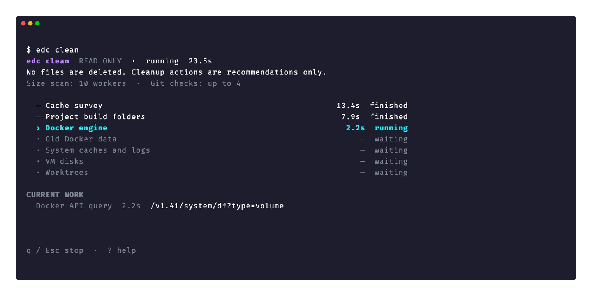

[English](disk-usage.md) | **한국어** · [README로 돌아가기](../README.ko.md)

# 디스크 사용량과 알려진 캐시

[디렉터리 디스크 사용량 (Linux와 macOS)](#디렉터리-디스크-사용량-linux와-macos) · [알려진 개발 캐시 사용량 (Linux와 macOS)](#알려진-개발-캐시-사용량-linux와-macos)


현재 UI 렌더러에 데모 데이터를 넣어 캡처한 화면입니다.

## 디렉터리 디스크 사용량 (Linux와 macOS)

**큰 디렉터리도 빠르게 탐색합니다.** 기본 4개 worker가 디렉터리를 병렬로 읽습니다. macOS에서는 `getattrlistbulk`로 metadata를 묶어서 읽으며, 디렉터리별 기록과 큰 파일만 남겨 모든 파일의 정보를 보관하지 않습니다. 실제 탐색 시간은 저장장치, 디렉터리 구조, 파일시스템 cache에 따라 달라집니다.

`edc du`는 디렉터리 아래의 디스크 사용량을 보여 줍니다. `du`처럼 할당된 block을 세고, hard link가 여러 개인 파일은 한 번만 셉니다. 아무것도 바꾸지 않으며 외부로 보내지 않습니다.

```bash
edc du                          # 현재 디렉터리
edc du /var                     # /var 아래에서 큰 항목
edc du --top 40 /var            # 40줄
edc du -B /var                  # 탐색 화면 없이 진행 상태와 크기 막대를 출력
edc du --workers 1 /var         # 디렉터리를 하나씩 읽음
edc du --cross-mounts /var      # /var 아래의 마운트도 셈
edc du --refresh 10s /var       # 화면을 10초마다 갱신
edc du --json - /var            # 항목을 metrics.rows에 담음
```

터미널에서는 탐색 화면을 엽니다. 읽는 동안에는 읽은 디렉터리 수를 보여 주고, `q`를 누르면 멈추고 그때까지 읽은 결과를 보여 주며, `Ctrl-C`는 멈춘 뒤 화면을 닫습니다. 화면은 지금 디렉터리의 항목을 큰 것부터 나열합니다. `Enter`나 `→`로 디렉터리를 열고, `←`, `Backspace`, `Esc`로 위로 올라갑니다. `↑`, `↓`, `PgUp`, `PgDn`, `g`, `G`로 커서를 옮기고, `q`로 화면을 닫으면 결과를 출력합니다. 화면에서는 파일을 바꾸거나 지우지 않습니다. pipe로 넘기거나 `--json`을 쓰거나 `NO_COLOR`를 설정하면 화면 없이 결과만 출력합니다. 화면을 열 때는 가장 큰 파일 10,000개를 남기고, 남기지 않은 파일은 디렉터리마다 `(N other files)` 한 줄로 보여 줍니다.

탐색이 끝나면 화면은 스스로 갱신합니다. 갱신할 때마다 모든 디렉터리의 수정 시각과 화면에 오른 큰 파일의 크기를 다시 보고, 바뀐 디렉터리만 다시 읽습니다. 커진 행에는 `+1.2 GB`처럼 늘어난 양이, 새 디렉터리에는 `새로 생김`이 붙습니다. 아래 줄에는 간격과 탐색 뒤로 트리 전체가 늘어난 양이 나옵니다. 간격은 5초 이상이고 직전 갱신에 걸린 시간의 50배라서, 갱신에 쓰는 시간이 2%를 넘지 않습니다. 디렉터리 13만 1천 개짜리 트리에서 갱신 한 번에 0.2~0.4초가 걸렸습니다.

- 화면의 행이 아닌 작은 파일이 제자리에서 커지면 보이지 않습니다. `r`을 누르면 열린 디렉터리를 하위까지 다시 읽습니다.
- `a`를 누르면 자동 갱신을 끄고 켭니다.
- 네트워크 파일 시스템과 끝까지 읽지 못한 탐색에서는 갱신이 꺼진 채 시작합니다. `--refresh 10s`는 간격을 고정하고 갱신을 켜며, 네트워크 파일 시스템에서도 켭니다. `--refresh 0`은 끕니다.
- `--refresh`는 화면에서만 씁니다. `-B`, pipe, `--json`과 함께 주면 종료 코드 2로 끝납니다.
- `q`로 화면을 닫으면 그 시점의 트리를 출력합니다.

출력은 `du.scan` 결과 한 줄로 시작합니다. 이 줄에는 전체 크기, 항목 수, 걸린 시간, worker 수가 있고, 그 아래에 항목이 이어집니다. edc는 가장 큰 항목부터 고르고, 디렉터리를 고르면 그 안의 항목도 후보에 올립니다. 디렉터리 줄은 `/`로 끝나고, 마지막 줄은 보이지 않은 나머지 항목의 합입니다. 화면을 닫은 뒤의 출력은 터미널 높이에 맞춰 줄 수를 정하고, pipe로 넘기면 20줄을 보여 줍니다. `--top`은 화면이 아니라 이 출력의 줄 수를 정합니다.

기본으로 한 파일 시스템 안에서만 셉니다. 경로 아래의 마운트에는 들어가지 않고, 건너뛴 마운트마다 파일 시스템 종류와 `statfs`가 알려 준 사용량을 보여 줍니다. bind mount와 overlay mount는 다른 경로와 파일 시스템을 공유하므로 사용량을 `-`로 표시합니다. 디렉터리를 자기 자신 위에 bind mount한 경우에는 그 파일이 다른 곳에 없으므로 건너뛰지 않고 셉니다.

바쁜 호스트에서도 CPU를 적게 쓰도록 기본으로 디렉터리 4개를 동시에 읽습니다. `--workers`나 `-w`로 이 수를 바꿀 수 있습니다. 디렉터리마다 기록 하나와 가장 큰 파일 몇 개만 남기므로, 메모리 사용량은 파일 수가 아니라 디렉터리 수에 따라 늘어납니다.

제한 시간(기본 60초)이 지나면 탐색을 멈춥니다. 이때 결과는 `warn`이고 `metrics.partial`은 `true`이며, 크기는 읽은 디렉터리만 센 값입니다. 제한 시간이나 `q`로 멈추면 텍스트 출력의 마지막 줄에도 부분 결과라고 표시하고, 제한 시간에 멈췄을 때는 `--timeout`을 늘린 명령을 함께 보여 줍니다. 읽지 못한 디렉터리가 있으면 결과는 `warn`이고 `-v`로 그 목록을 볼 수 있습니다. 모든 디렉터리를 읽으려면 root로 실행합니다. macOS에서는 개인정보 보호 권한 때문에 일부 경로를 읽지 못할 수도 있습니다.

항목 아래에는 경로가 속한 파일 시스템을 보여 줍니다. 마운트 지점, 종류, `df`와 같은 사용량과 전체 크기가 나옵니다. Linux에서는 그 파일 시스템에서 지워졌지만 process가 아직 열고 있는 파일도 보여 줍니다. 이 파일은 `df`에는 잡히지만 `du`로는 보이지 않습니다. 줄마다 크기, process, 지우기 전 경로가 나오며, 그 process를 재시작하거나 파일을 다시 열게 하면 공간이 돌아옵니다. 이 값은 경로 아래만이 아니라 파일 시스템 전체 기준입니다. root가 아니면 모든 process의 파일을 읽지 못하므로 값 앞에 `≥`를 붙입니다. 지워졌지만 열린 파일이 파일 시스템의 10% 이상이면 결과는 `warn`입니다.

Linux에서 경로가 파일 시스템 전체의 마운트 지점이면 숫자를 맞춰 봅니다. `not found`는 사용량에서 센 크기와 지워졌지만 열린 파일을 뺀 값이고, 마운트 아래에 가려진 파일이나 파일 시스템 metadata가 이 공간을 쓸 수 있습니다. 모든 디렉터리와 process를 읽었고 제한 시간에 멈추지 않았을 때만 계산합니다. bind mount나 하위 디렉터리를 재면 이 비교는 나오지 않습니다. JSON에서는 `metrics.filesystem`, `metrics.deleted_open`, `metrics.not_found_bytes`에 이 값이 들어갑니다.

macOS에서는 metadata를 묶어서 읽고, APFS firmlink와 mount table을 따라 경계를 구분합니다. APFS volume은 저장 공간을 공유하고 snapshot이 block을 유지할 수 있으므로, 측정한 사용량이 삭제 후 반환되는 공간과 같지는 않습니다. macOS에서는 열린 삭제 파일과 `not found` 비교를 표시하지 않습니다.

terminal에서 `--no-browse` 또는 `-B`를 주면 scan 중 spinner를 표시하고, 완료 후 크기 막대를 출력한 뒤 종료합니다. 색상은 유지하며 디렉터리 탐색만 끕니다. `NO_COLOR`, pipe, `--json`에서는 정적인 출력을 사용합니다.

어느 디렉터리가 늘었는지 보려면 두 번의 실행을 `--json`으로 저장하고 `edc report diff`로 비교합니다. `metrics.largest_dirs`에는 깊이와 관계없이 가장 큰 디렉터리 200개가 들어갑니다. `report diff`는 이 목록을 경로로 맞춰 변화가 가장 큰 디렉터리를 최대 10개 보여 줍니다. 하위 디렉터리 하나가 상위 디렉터리 변화의 90% 이상을 차지하면 상위 대신 그 하위 디렉터리를 보여 줍니다. 한쪽 목록에만 있는 디렉터리는 반대쪽 값을 그 목록의 가장 작은 크기 이하(`≤`)로 표시합니다. 같은 경로를 끝까지 읽은 두 결과만 비교합니다. hard link 이름이 두 디렉터리에 있는 파일은 먼저 읽은 디렉터리에 세므로, 실행마다 그 두 디렉터리 사이에서 크기가 옮겨 갈 수 있습니다.

`PATH`에 `docker`가 있으면 `docker ps`와 `docker inspect`로 container 목록도 읽습니다. 형식은 container마다 이름, 로그 경로, 마운트, layer 경로만 읽습니다. 이 정보로 로그 디렉터리, writable layer, 실행 중인 container의 root 파일 시스템, volume, bind mount 원본에 `volume pgdata (db-1 사용)`처럼 container 이름을 붙입니다. JSON에서는 `label`에 들어갑니다. containerd image store를 쓰면 멈춘 container의 writable layer는 마운트되어 있지 않아 이름이 붙지 않습니다. docker가 3초 안에 답하지 않으면 이름 없이 출력합니다.

## 알려진 개발 캐시 사용량 (Linux와 macOS)

**`clean`은 조사만 합니다. 파일을 삭제하거나, 표시한 정리 명령을 실행하지 않습니다.** 정리할 후보를 찾는 명령이며, `-v`로 표시한 정리 명령은 사용자가 검토한 뒤 별도로 실행합니다.

`edc clean`은 알려진 개발 캐시의 디스크 사용량을 보여 줍니다. 읽기만 하며 파일을 지우거나 바꾸지 않습니다.


`-w N` / `--workers N`은 각 폴더의 크기 측정에서 병렬로 읽는 디렉터리 수입니다. `--project`로 찾은 빌드 폴더에도 적용합니다. 기본은 4개이며, `defaults.du.workers` 설정보다 명시한 CLI 값이 우선합니다. 후보 검색과 섹션은 순차 실행합니다. worktree의 독립적인 git 확인은 worker 수 이내에서 최대 4개씩 병렬 실행하고, 같은 저장소의 worktree 목록은 한 번만 조회합니다. worker를 늘려도 전체 실행 시간이 같은 비율로 줄지는 않습니다. 진행 로그에 선택한 worker 수를 표시합니다.

```bash
edc clean                       # 알려진 캐시를 잼
edc clean -v                    # 모든 후보, 더 많은 묶음, 이유, 정리 명령 추가
edc clean --timeout 2m          # 제한 시간을 늘림
edc clean --project ~/work      # ~/work에서 빌드 폴더도 찾음
edc clean --project ~/a --project ~/b   # 루트를 더 지정하려면 옵션을 반복
edc clean --json -              # 후보를 metrics.candidates에 담음
```

후보의 위치는 세 가지 방법 중 하나로 찾습니다. `go-build`, `go-mod`, `npm`, `pnpm`, `uv`, `homebrew`, `pip`는 그 캐시를 가진 도구에 물어서 찾습니다. 도구가 `PATH`에 없으면 상태는 `tool_absent`입니다.

나머지 후보는 표의 순서대로 환경변수를 읽습니다. 처음으로 설정된 변수가 경로를 정하고, 변수가 하나도 없으면 기본 경로를 씁니다. `located_by`에 어떤 방법을 썼는지 나옵니다.

처음으로 설정된 변수가 비었거나 절대 경로가 아니면 상태는 `unknown_location`이고 이유는 `invalid_env`입니다. 다음 변수나 기본 경로로 넘어가지 않습니다.

`bunfig.toml`, `.npmrc`, `.puppeteerrc` 같은 도구 설정 파일은 읽지 않습니다. 설정 파일로 캐시를 옮겼다면 환경변수를 지정하십시오.

| 후보 | 위치를 찾는 방법 |
| --- | --- |
| `go-build`, `go-mod` | `go env GOCACHE GOMODCACHE` |
| `npm` | `npm config get cache` |
| `pnpm` | `pnpm store path` |
| `uv` | `uv cache dir` |
| `homebrew` | `brew --cache` |
| `pip` | `pip3 cache dir` |
| `xcode-derived-data` (macOS) | `~/Library/Developer/Xcode/DerivedData` |
| `swiftpm` (macOS) | `~/Library/Caches/org.swift.swiftpm` |
| `cargo-registry`, `cargo-git` | `$CARGO_HOME/registry`, `$CARGO_HOME/git`, 없으면 `~/.cargo/registry`, `~/.cargo/git` |
| `zig` | `$ZIG_GLOBAL_CACHE_DIR`, `$XDG_CACHE_HOME/zig`, 없으면 `~/.cache/zig` |
| `bun` | `$BUN_INSTALL_CACHE_DIR`, `$BUN_INSTALL/install/cache`, `$XDG_CACHE_HOME/.bun/install/cache`, 없으면 `~/.bun/install/cache` |
| `playwright` | `$PLAYWRIGHT_BROWSERS_PATH`, 없으면 `~/Library/Caches/ms-playwright` (macOS) 또는 `$XDG_CACHE_HOME/ms-playwright`, `~/.cache/ms-playwright` (Linux) |
| `puppeteer` | `$PUPPETEER_CACHE_DIR`, 없으면 `~/.cache/puppeteer` |
| `node-gyp` | `$npm_config_devdir`, 없으면 `~/Library/Caches/node-gyp` (macOS) 또는 `$XDG_CACHE_HOME/node-gyp`, `~/.cache/node-gyp` (Linux) |
| `electron` (macOS) | `$electron_config_cache`, 없으면 `~/Library/Caches/electron` |
| `xcode-device-support` (macOS) | `~/Library/Developer/Xcode`의 `*DeviceSupport` 폴더 |
| `coresimulator-caches` (macOS) | `~/Library/Developer/CoreSimulator/Caches` |
| `app-updates` (macOS) | `~/Library/Caches`의 `*.ShipIt` 폴더 |
| `app-logs` (macOS) | `~/Library/Logs` |
| `huggingface` | `$HF_HUB_CACHE`, `$HUGGINGFACE_HUB_CACHE`, `$HF_HOME/hub`, `$XDG_CACHE_HOME/huggingface/hub`, 없으면 `~/.cache/huggingface/hub` |
| `rustup-toolchains` | `$RUSTUP_HOME/toolchains`, 없으면 `~/.rustup/toolchains` |
| `ollama` (macOS) | `$OLLAMA_MODELS`, 없으면 `~/.ollama/models` |
| `journald` (Linux) | `/var/log/journal`. 후보 아래 줄에 `journald.conf`와 drop-in 파일의 제한 설정을 systemd가 적용하는 순서대로 보여 줍니다. |
| `apt-archives` (Linux) | `/var/cache/apt/archives` |
| `app-caches` (macOS) | `~/Library/Caches`의 나머지 폴더 |
| `dot-cache` (macOS) | `~/.cache`의 나머지 폴더 |

Linux에서는 표에 macOS라고 적지 않은 후보만 잽니다. Linux의 `~/.cache` 나머지 폴더는 재지 않습니다.

후보마다 우선순위가 있습니다. P1은 도구 캐시, P2는 내려받은 브라우저·바이너리, Xcode 부가 데이터, 앱 캐시, 로그이고, P3는 모델과 툴체인입니다. 텍스트 출력은 P1부터 나열하고, 같은 우선순위 안에서는 큰 후보부터 보여 줍니다.

크기는 `edc du`의 측정 코드를 재사용해 후보를 하나씩 잽니다. 경로 아래의 마운트에는 들어가지 않습니다. symlink 경로는 보고된 경로와 실제 경로를 함께 보여 주고 실제 경로를 잽니다. DerivedData는 폴더를 앱 이름별로, `rustup-toolchains`와 `app-logs`는 폴더 이름별로 묶어 보여 줍니다.

`xcode-device-support`, `app-updates`, `app-caches`, `dot-cache` 네 후보는 폴더의 1단계 항목을 하나씩 잽니다. 앞의 둘은 이름이 `DeviceSupport` 또는 `.ShipIt`으로 끝나는 항목만 잽니다. 그런 이름의 항목이 없으면 상태는 `absent`입니다.

`app-caches`와 `dot-cache`는 나머지 항목을 모두 잽니다. 앞선 후보가 잰 경로는 건너뛰고, 그 경로를 품은 항목은 품지 않은 부분만 잽니다. 건너뛴 후보는 `excludes`에 나옵니다. 결과는 항목 이름별 묶음입니다.

이 네 후보는 symlink를 따라가지 않습니다. 다른 장치에 있는 항목은 재지 않고 결과를 `partial`로 표시합니다. hard link는 edc가 재는 항목마다 한 번씩 셉니다.

앱이 폴더에 무엇을 두는지는 edc가 알 수 없습니다. `app-caches`, `dot-cache`, `app-updates`, `app-logs`는 `regenerable`이 `false`이고 다시 만드는 비용은 `unknown` 또는 `lost`입니다.

도구의 캐시 폴더만 잽니다. Hugging Face는 `hub`, Cargo는 `registry`와 `git`, Ollama는 `models`입니다. 토큰이나 자격 증명 파일은 재지 않습니다.

Xcode Archives, 시뮬레이터 기기, `Application Support`, `Containers`는 캐시로 분류하지 않습니다.

후보마다 상태가 하나 있습니다.

| 상태 | 뜻 |
| --- | --- |
| `measured` | 경로 전체를 읽었습니다. 크기가 완전합니다. |
| `partial` | 크기가 하한입니다. 읽지 못한 디렉터리가 있거나, 마운트를 건너뛰었거나, 시간이 끝났습니다. |
| `absent` | 경로가 없거나, 후보가 찾는 이름의 항목이 없습니다. |
| `tool_absent` | 도구가 `PATH`에 없습니다. |
| `unknown_location` | 도구가 실패했거나, 시간이 초과됐거나, 예상과 다른 답을 냈습니다. 환경변수가 절대 경로가 아니어도 이 상태입니다. |
| `unreadable` | 권한 오류 등으로 읽지 못했습니다. |
| `rejected` | 경로가 `/`, 홈 디렉터리, 그 상위를 덮습니다. 재지 않습니다. |
| `duplicate` | 앞선 후보와 실제 경로가 같거나 앞선 후보가 이 경로를 품고 있습니다. |
| `not_scanned` | edc가 닿기 전에 시간이 끝났거나 `Ctrl-C`를 눌렀습니다. |

`usage_bytes`는 `measured`와 `partial`에만 있고, 다른 상태에서는 `0 B`를 표시하지 않습니다. 다른 후보 안에 있는 후보는 합계에 두 번 더하지 않습니다.

텍스트 출력은 크기가 있거나 확인이 필요한 후보만 한 줄씩 보여 줍니다. `absent`, `tool_absent`, `duplicate`는 상태별로 한 줄에 접습니다. 묶음은 기본 3개를 보여 주고, `-v`는 모든 후보와 묶음 30개를 보여 줍니다. `--json`은 모두 보여 줍니다. 텍스트 출력은 홈 디렉터리 아래 경로를 `~`로 줄여 쓰고, JSON에는 전체 경로가 있습니다.

파일 시스템별 합계는 사용량이며, 정리하면 비워지는 양이 아닙니다. 텍스트 출력은 이 합계를 맨 끝에 보여 줍니다. APFS clone과 snapshot 때문에 합계가 비워지는 양보다 클 수 있습니다. hard link는 후보 하나 안에서는 한 번만 세지만, 두 후보에 걸친 hard link는 두 번 셉니다. pnpm 저장소와 uv 캐시가 hard link를 씁니다. 후보에는 회수 가능량이 없고, Docker 섹션만 엔진이 보고한 회수 가능량을 보여 줍니다.

정리 명령은 도구가 문서로 제공할 때만 보여 줍니다. `bun`, `pip`, `huggingface`, `rustup-toolchains`는 명령을 보여 주고, `cargo-registry`, `zig`, `app-caches` 등은 보여 주지 않습니다. edc는 명령을 실행하지 않습니다.

`-v`에서는 후보와 폴더 묶음마다 가장 최근 파일의 날짜도 읽어 `newest file 2026-10-19`처럼 보여 줍니다. 몇 달 동안 아무 도구도 쓰지 않은 캐시가 오늘 바뀐 캐시보다 안전한 후보입니다. 날짜는 일반 파일의 수정 시각이고 접근 시각이 아닙니다. 날짜 앞의 `≥`는 읽지 못한 폴더가 있거나 상한에서 멈춰서 더 늦은 파일이 있을 수 있다는 뜻입니다. JSON에는 `newest_write`와 `newest_partial`이 있습니다. 모든 파일을 한 번 더 읽으므로 `edc clean -v`는 측정만큼의 시간이 더 걸립니다.

후보 뒤에 섹션 네 개가 더 있습니다. 섹션마다 `metrics`에 따로 키가 있고, 섹션은 후보가 아닙니다.

| `metrics` 키 | 내용 |
| --- | --- |
| `candidates` | 위 표의 캐시 |
| `filesystems` | 파일 시스템별 사용량 합계 |
| `project_build_dirs` | `--project`로 지정한 루트의 빌드 폴더 |
| `docker` | Docker 엔진이 보고한 집계 |
| `docker_root` | 엔진이 더 이상 쓰지 않는 옛 Docker 데이터 디렉터리(Linux) |
| `system` | 큰 로그, 현재 리비전이 아닌 snap 리비전, buildx 캐시 폴더(Linux) |
| `vm_disks` | 가상 머신의 디스크 파일(예: OrbStack) |
| `worktrees` | `~/.gk/worktree`의 git-kit worktree |
| `not_measured` | 재지 않는 유형과 이유 |

섹션은 후보, 빌드 폴더, Docker, 옛 Docker 데이터, 큰 로그와 snap, VM 디스크, worktree 순서로 실행하고 제한 시간 하나를 나눠 씁니다.

파일 시스템 합계에는 다시 만들 수 있는 빌드 폴더만 더합니다. 엔진 집계, 옛 Docker 데이터, 큰 로그, VM 디스크, worktree는 어떤 합계에도 더하지 않습니다.

### 진행 상황과 소요 시간

대화형 terminal에서는 stderr에 진행 상황 보드를 표시합니다. 읽기 전용 표시와 전체 경과 시간, 정렬한 단계별 소요 시간, 현재 폴더·도구 조회를 최대 3개까지 보여 줍니다. 완료된 단계는 남기며, 단계 종료가 모든 항목의 성공을 뜻하지는 않습니다. 부분 결과와 실패는 마지막 report에서 구분합니다. 별도 전체 화면을 열지 않고 shell scrollback에 요약을 남깁니다.



`q`, Esc, Ctrl-C로 수집을 멈추면 부분 결과를 표시하고, `?`로 키 안내를 전환합니다. 붙여넣은 텍스트는 무시합니다. Ctrl-Z로 일시 중단하고 shell의 `fg`로 재개할 수 있습니다. UTF-8과 stdin·stdout·stderr의 TTY 연결이 필요합니다. 80×24를 기준으로 설계했으며, 가로 60칸 또는 세로 15줄 미만에서는 현재 단계 중심으로 줄입니다. 40×5 미만에서는 확장 안내를 표시합니다. 한글·결합 문자·이모지의 표시 폭을 기준으로 줄이며, 아랍어와 혼합 방향 문자열은 원래 순서를 유지합니다. BiDi shaping은 terminal에 따라 달라집니다. 마우스 탐색은 사용하지 않습니다.

`NO_COLOR`, `TERM=dumb`, stream 리디렉션 또는 명시적인 JSON 진행 출력에서는 terminal 제어 없이 시간 로그를 표시합니다. START·END로 단계별 시간을 남기고 RUN으로 현재 작업을 2초마다 보여 줍니다. 화면 읽기 도구를 사용할 때도 이 평문 모드를 권장합니다. spinner animation은 사용하지 않습니다.

```bash
edc clean --project ~/work -w 10
edc clean --progress --project ~/work --json report.json 2>clean-progress.log
edc clean --progress=false
NO_COLOR=1 edc clean --project ~/work
```

pipe나 JSON에서는 명시적으로 `--progress`를 주었을 때만 로그를 출력합니다. `--redact`는 진행 로그의 대상에도 적용합니다. `-v`는 최근 파일 수정 시각을 추가 탐색하므로 해당 작업도 별도 단계로 표시합니다. 진행 로그는 로컬 조사에 적용하며, `--group`은 원격 실행 출력을 사용합니다.

#### 로컬 실측 (2026-10-23)

macOS 호스트 한 대에서 `clean --project ~/work -w 10 --progress --json report.json`을 실행했습니다. 프로젝트 빌드 폴더 66개와 worktree 53개를 조사했습니다. 비교 기준 버전에도 진행 출력을 넣었으며, 개선 버전은 worktree의 독립적인 git 확인만 병렬화했습니다. 버전마다 두 번 실행한 CLI 전체 시간입니다.

| 버전 | 1회 | 2회 |
| --- | ---: | ---: |
| worktree 순차 확인 | 29.72초 | 28.85초 |
| worktree 제한 병렬 확인 | 26.97초 | 26.34초 |
| worktree 단계, 순차 | 7.16초 | 7.07초 |
| worktree 단계, 병렬 | 3.79초 | 3.66초 |

캐시 조사는 여전히 약 13–14초, 프로젝트 단계는 약 8초였습니다. 별도로 실행한 `du ~/work -w 10`은 약 201만 항목을 7.52초에 끝까지 읽었습니다. clean은 프로젝트 루트 밖의 캐시와 git-kit worktree도 조사하므로 같은 범위를 비교한 속도 수치는 아닙니다. 파일시스템 cache와 백그라운드 부하의 영향이 있는 로컬 관측값이며 속도를 보장하지 않습니다. 진행 출력 추가 전 한 번의 clean 실행은 30.94초였고, 실행 간 편차가 있어 로그 출력 비용을 정밀하게 산출한 값은 아닙니다.

### 프로젝트 빌드 폴더

`--project DIR`은 찾을 루트를 지정합니다. 루트를 더 지정하려면 옵션을 반복합니다. `--project`가 없으면 찾지 않고 `project_build_dirs`의 상태는 `no_project_root`입니다. 이 상태는 정상입니다.

루트 아래 폴더를 깊이 6까지 읽습니다. symlink는 따라가지 않고, 다른 장치의 마운트에는 들어가지 않습니다. `.git`, 찾은 빌드 폴더, 후보가 재는 경로 아래로도 내려가지 않습니다.

폴더 300,000개 또는 빌드 폴더 256개에서 멈추고, 섹션은 이유 `project_limit`인 `partial`입니다. 닿지 못한 루트의 상태는 `not_scanned`입니다.

없는 루트의 상태는 `absent`, 파일인 루트는 `rejected`입니다. 같은 루트나 다른 루트 안의 루트는 한 번만 걷고 상태는 `duplicate`입니다.

빌드 폴더는 같은 부모 폴더에 표지 파일이 있어야 합니다.

| 폴더 | 표지 파일 |
| --- | --- |
| `.zig-cache`, `zig-out` | `build.zig` |
| `target` | `Cargo.toml` |
| `node_modules` | `package.json` |
| `.build` | `Package.swift` |
| `build` | `build.gradle` 또는 `build.gradle.kts` |

이름만 같고 표지 파일이 없는 폴더는 소스일 수 있어 재지 않고 루트의 `unmarked`로 셉니다.

표지가 있는 폴더마다 git에 물어봅니다. git 저장소 밖의 폴더는 표지 파일만으로 다시 만들 수 있다고 봅니다. `git` 필드는 `none`입니다.

저장소 안에서는 폴더에 추적 파일이 없어야 합니다. git이 추적하는 파일이 있으면 `regenerable`은 `false`이고 이유는 `tracked_files`입니다. 무시 규칙이 있어도 추적 파일이 먼저입니다. `git` 필드는 `ignored` 또는 `not_ignored`입니다.

git이 실패하거나 시간이 초과되면 `regenerable`은 `false`, 이유는 `git_unknown`, `git` 필드는 `unknown`입니다. 추측하지 않습니다.

```json
{
  "kind": "cargo_target",
  "path": "/Users/me/work/app/target",
  "marker": "Cargo.toml",
  "git": "ignored",
  "regenerable": true,
  "status": "measured",
  "usage_bytes": 4831838208
}
```

`regenerable`이 `false`인 빌드 폴더는 합계에 넣지 않습니다. 후보와 경로가 같은 빌드 폴더의 상태는 `duplicate`이고, 후보 안에 있는 빌드 폴더는 `inside`를 표시해 두 번 세지 않습니다.

worktree 안의 빌드 폴더에는 `inside_worktree`가 있고, worktree 항목의 `build_dirs`에 그 수가 나옵니다. 빌드 폴더를 찾지 않았으면 `build_dirs`는 `null`입니다.

텍스트 출력은 큰 빌드 폴더 10개와 나머지 수를 보여 주고 `-v`는 모두 보여 줍니다. 루트마다 읽은 폴더 수와 `unmarked` 폴더 수가 나옵니다.

### 여러 호스트의 clean

`edc clean --group <그룹>`은 `edc remote` 인벤토리 그룹의 호스트마다 `edc clean --json -`을 실행하고 표 하나로 보여 줍니다. `edc remote`의 인벤토리 파일과 OpenSSH 설정을 그대로 쓰고, `--inventory`로 파일을 지정할 수 있습니다. 동시에 실행할 호스트 수는 인벤토리의 `parallel` 값을 따릅니다.

```bash
edc clean --group servers
edc clean --group servers --inventory ./.edc/inventory.yaml --json -
```

각 호스트의 셸 `PATH`에 edc가 있어야 하며, edc가 설치해 주지는 않습니다. edc가 없는 호스트는 `edc not found`로, SSH로 연결하지 못한 호스트는 `SSH failed`와 첫 오류 줄로 표시합니다.

표에는 루트 파일 시스템의 디스크 사용량, 후보 합계, 옛 Docker 데이터, 큰 로그, 가장 큰 항목이 나옵니다. 이전 버전 edc라서 보고하지 않는 값은 `—`로 표시하고, `--json`에는 호스트마다 한 행이 남습니다.

각 호스트의 `clean`은 읽기만 합니다. 호스트마다 자신의 폴더를 재므로 `--project`는 `--group`과 함께 쓸 수 없습니다.

### Docker 엔진

엔진에는 API socket으로 `GET`만 보냅니다. 다른 메서드는 보내지 않고 `prune` 명령도 실행하지 않습니다.

socket 경로는 `docker context inspect`에 물어서 `DOCKER_HOST`와 현재 context가 반영됩니다. `unix://` 끝점만 지원하고, 다른 끝점은 `unsupported`입니다.

`docker`가 `PATH`에 없으면 상태는 `tool_absent`, socket 파일이 없으면 `not_running`입니다. 두 상태는 정상으로 봅니다.

엔진은 API 1.52 이상이어야 합니다. 더 낮은 버전은 이유 `api_version`인 `unsupported`이고, 목록에서 집계를 계산하지 않습니다.

`types`에는 `images`, `containers`, `build_cache`, `volumes`가 하나씩 있고, 각각 `total_bytes`, `reclaimable_bytes`, `total_count`, `active_count`를 담습니다. 값은 엔진이 보고한 그대로입니다.

요청 하나가 실패하면 그 유형만 `failed`이고 섹션은 `partial`입니다. 볼륨 요청은 최대 20초까지 기다립니다.

`reclaimable_bytes`는 정리하면 비워진다고 엔진이 알려 준 양이며, 출력에서 회수 가능량을 내는 값은 이것뿐입니다. 정리 명령(예: `docker image prune -a`)은 문자열로만 보여 주고 실행하지 않습니다.

볼륨은 사용자 데이터입니다. `volumes` 항목은 `user_data`가 `true`이고 `reclaimable_bytes`와 정리 명령이 없습니다.

`docker system df`는 크기를 반올림하고 1000바이트 단위를 씁니다. edc 텍스트 출력은 1024바이트 단위를 써서 두 수치가 다릅니다. JSON에는 정확한 바이트 수가 있습니다.

### 옛 Docker 데이터 디렉터리

Linux에서는 `/var/lib/docker`를 확인합니다. 엔진이 다른 데이터 디렉터리를 쓰면 이 디렉터리가 옛 데이터 후보입니다. 엔진이 쓰는 디렉터리는 `docker.root_dir`에 있고, API 1.52보다 낮은 엔진에서도 읽습니다.

edc는 지워도 되는지 판정하지 않고, 판단에 도움이 되는 사실만 보여 줍니다. 파일을 읽기만 하며 `docker` 명령은 실행하지 않습니다.

`docker_root.roots`의 항목마다 아래 사실이 있습니다.

- `usage_bytes`, `dirs`: 디렉터리 전체와 안의 폴더별 크기
- `mounted`, `open_files`: 디렉터리 아래에 마운트나 열린 파일이 있는지. `open_files_complete`가 `false`이면 읽지 못한 process가 있습니다.
- `last_container_stop`, `newest_volume_write`: 마지막으로 활동한 날짜
- `containers`: 디렉터리에 기록된 컨테이너의 이미지, Compose 프로젝트, 종료 시각. `in_engine`, `project_in_engine`은 엔진에 같은 이름이 있는지 나타냅니다.
- `overlay`: `overlay2` 폴더를 주인별로 나눈 내역. `image_bytes`, `container_bytes`, `unused_layer_bytes`, `unknown_bytes`를 더하면 `total_bytes`입니다. 레이어 파일에는 있지만 어느 이미지도 쓰지 않는 레이어는 쓰지 않는 레이어이고, 어떤 메타데이터에도 이름이 없는 폴더는 알 수 없는 폴더입니다. `images`는 큰 이미지부터 태그와 함께 보여 줍니다. `shared_bytes`는 다른 이미지도 쓰는 부분이라 이 이미지만 지워서는 비워지지 않습니다. `containers`는 쓰기 레이어이고, `in_engine`은 엔진에 같은 태그의 이미지가 있는지 나타냅니다. 기존 overlay2 저장소의 레이어 메타데이터를 읽으며, 없으면 `overlay`도 나오지 않습니다.
- `volumes`: 볼륨별 크기, 가장 최근 파일의 날짜, 그 볼륨을 마운트한 컨테이너 `used_by`. `in_engine`은 엔진에 같은 이름의 볼륨이 있는지 나타냅니다.

항목에는 디렉터리를 지우는 `rm -rf --one-file-system` 명령이 `cleanup`으로 있고, `-v`에서 텍스트로 보여 줍니다. edc는 이 명령을 실행하지 않습니다. 디렉터리 아래에 마운트나 열린 파일이 있거나, 마운트 표나 `/proc` 전체를 읽지 못하면 `cleanup`은 비어 있습니다.

이 볼륨에는 `docker volume rm`을 쓰지 마세요. 엔진은 옛 디렉터리를 모르므로, 자기 디렉터리에 있는 같은 이름의 볼륨을 지웁니다.

`used_by`가 빈 볼륨은 이 볼륨을 쓴 컨테이너 기록이 없는 것이고, 사용자 데이터일 수 있습니다. 지우기 전에 내용을 확인하세요.

볼륨은 큰 순서로 20개까지 보이고, 나머지는 `volumes_omitted`와 `omitted_bytes`로 셉니다. `-v`가 없으면 텍스트 출력은 이름 없는 볼륨을 한 줄로 묶고 컨테이너 목록을 내지 않습니다.

컨테이너의 이름, 이미지, 라벨, 마운트, 시각은 `containers/*/config.v2.json`에서 읽습니다. 환경 변수는 담지도 출력하지도 않습니다.

엔진이 데이터 디렉터리를 알려 주지 않으면 상태는 `unknown_location`입니다. `docker`가 없거나 엔진이 꺼져 있으면 텍스트 출력에는 이 섹션이 나오지 않고 `docker_root.status`는 비어 있습니다.

### 큰 로그, snap 리비전, 빌드 캐시

Linux에서는 `/var/log`에서 100 MB 이상인 파일을 나열합니다. `/var/log/journal`은 `journald` 후보가 재므로 건너뜁니다. 현재 리비전이 아닌 snap 리비전도 나열합니다.

edc는 파일을 지우지 않고, 판단에 도움이 되는 사실만 보여 줍니다.

`system.large_logs`의 항목에는 크기와 마지막 수정일이 있습니다. `open_files`는 프로세스가 그 파일에 잡고 있는 파일 기술자 수이고, `logrotate`는 그 경로에 맞는 규칙이 있는 logrotate 설정 파일입니다. 절대 경로인 `include` 줄은 따라가며, 비어 있으면 edc가 읽은 파일에서 규칙을 찾지 못했다는 뜻이지 logrotate가 그 파일을 돌리지 않는다는 증거는 아닙니다.

`-v`에서는 명령을 텍스트로 보여 주고 edc는 실행하지 않습니다. 프로세스가 열고 있는 파일에는 `truncate -s 0`, 닫힌 파일에는 `rm`을 보여 줍니다. `/proc`을 읽지 못하면 명령을 보여 주지 않습니다.

`system.snap_revisions`의 항목에는 이름, 리비전, 현재 리비전이 있습니다. 현재 리비전은 `/snap/<이름>/current` 링크에서 읽습니다. 명령은 `snap remove <이름> --revision=<리비전>`입니다. 링크를 읽지 못한 snap은 건너뛰고 `system.snaps_unknown`으로 셉니다.

`docker buildx build --cache-to type=local`이 쓰는 폴더도 찾습니다. 이 폴더는 OCI 이미지 레이아웃이라 `oci-layout`, `index.json` 파일과 `blobs` 폴더가 있습니다. 홈 폴더 아래 1~2단계 폴더를 이름이 아니라 구조로 확인하고, 링크는 따라가지 않으며, 폴더 50,000개를 확인하면 멈춥니다.

`system.build_caches`의 항목에는 크기, 가장 최근 파일의 날짜, `open_files`가 있습니다. `docker buildx prune`은 이 폴더를 지우지 않습니다. `-v`에서는 `rm -rf <경로>`를 텍스트로 보여 주고, 프로세스가 파일을 열고 있거나 `/proc` 전체를 읽지 못하면 명령을 보여 주지 않습니다. 탐색이 상한이나 제한 시간에서 멈췄거나 재지 못한 폴더가 있으면 `build_caches_incomplete`가 `true`이고, 이때는 캐시가 더 있을 수 있습니다.

각 목록은 큰 순서로 10개까지 보이고, 나머지는 `large_logs_omitted`와 `build_caches_omitted`로 셉니다.

### VM 디스크

macOS에서는 `~/Library/Group Containers/HUAQ24HBR6.dev.orbstack/data`의 OrbStack 데이터 디스크를 잽니다. 이 파일은 sparse 파일이라 논리 크기가 아니라 할당된 block을 잽니다.

이 디스크에는 Docker 엔진 데이터와 Linux 머신이 들어 있습니다. 엔진이 OrbStack이면 `docker.inside`가 `orbstack`입니다.

엔진 집계와 디스크 크기는 같은 데이터를 다른 방법으로 본 값이라 서로 더하지 않고 어떤 합계에도 넣지 않습니다. 디스크는 사용자 데이터이고 `user_data`가 `true`입니다.

Docker Desktop이나 다른 VM의 디스크는 재지 않습니다. Linux에는 VM 디스크 항목이 없습니다.

### worktree

git-kit의 폴더인 `~/.gk/worktree`를 읽습니다. 깊이 5까지 `.git`이 있는 폴더를 찾고 그 아래로는 내려가지 않습니다. 폴더가 없으면 상태는 `absent`이고 정상입니다.

루트를 한 번 재고 worktree별 크기는 그 트리에서 읽습니다. `leftover`는 루트의 그 밖의 파일 크기입니다.

worktree를 쓰는지는 파일 수정 시각이 아니라 git 상태로 판단합니다. git은 읽기 하위 명령만 `GIT_OPTIONAL_LOCKS=0`과 `core.fsmonitor=false`로 실행해 `.git`의 파일을 바꾸지 않습니다. `git status`는 바뀐 파일을 git-lfs 같은 저장소의 clean filter로 읽으므로 쓰지 않습니다. 대신 파일의 stat을 index와 비교하므로, touch만 한 파일도 바뀐 것으로 셉니다.

worktree마다 `verdict`가 하나 있고, 아래 순서에서 처음 맞는 값을 고릅니다.

| verdict | 뜻 |
| --- | --- |
| `unlinked` | worktree의 git 디렉터리가 없음 |
| `has_changes` | 변경된 파일이나 추적하지 않는 파일이 있음 |
| `state_unknown` | git 명령이 실패해 알 수 없음 |
| `locked` | worktree가 잠겨 있음 |
| `not_merged` | 기준에 없는 커밋이 브랜치에 있음 |
| `base_unknown` | 비교할 기준 브랜치를 찾지 못함 |
| `merged_clean` | 기준에 브랜치가 들어 있고 변경이 없음 |

기준은 git 설정의 브랜치 `gk-parent`이고, 없으면 `origin/HEAD`입니다. `main`이라고 가정하지 않습니다.

`merged_clean`은 git 명령이 모두 성공해야 나옵니다. edc는 worktree를 정리하지 않으며, 실행할 명령으로 `git-kit worktree cleanup`을 보여 줍니다.

### 재지 않는 유형

출력은 재지 않는 유형을 항상 나열하며, `-v`로 유형마다 이유를 볼 수 있습니다.

- OrbStack 외의 VM 디스크, DB
- `~/.gk/worktree` 밖의 worktree
- 휴지통과 다운로드
- 시뮬레이터 기기
- SDK
- 앱 데이터
- 위치를 확인하지 못한 그 밖의 도구 캐시

제한 시간은 기본 60초이며 모든 후보와 섹션이 나눠 씁니다. P1 후보부터 재고 나머지 묶음 두 후보는 마지막에 잽니다. 시작하지 못한 섹션의 상태는 `not_scanned`입니다. 시간이 끝나면 결과는 `warn`이고 `next`에 더 긴 제한 시간의 명령을 보여 줍니다. `Ctrl-C`는 실행을 멈추고 그때까지의 결과를 남깁니다.

