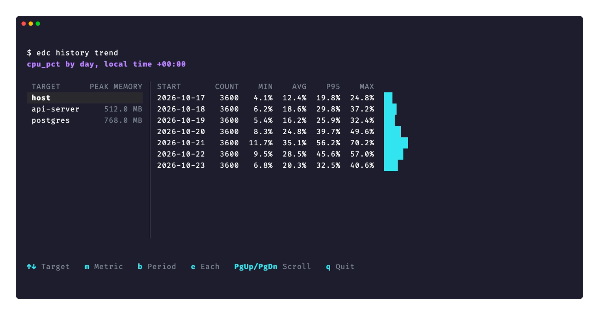
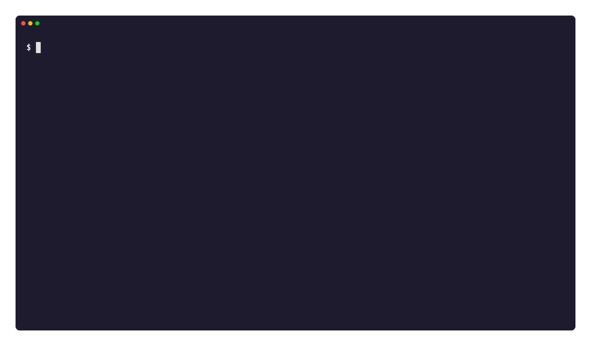

**English** | [한국어](history.ko.md) · [Back to README](../README.md)

# Recordings, history, and reports

[Incident snapshot](#incident-snapshot) · [Report diff](#report-diff) · [Report viewer](#report-viewer) · [Top recordings and history](#top-recordings-and-history) · [Cron and application logs](#cron-and-application-logs)



Screen rendered with synthetic demo data using the current UI renderer.

## Incident snapshot

`edc snapshot` saves the state of this host in the local history database by default. Add `--output <file>` to also save a JSON report. Take one snapshot before a change or an incident, and one after. Then compare the two with `edc report diff`.

The command collects diagnostic data and writes it to the history database and any requested output file. It sends nothing over the network, so it does not look up the public IP.

```bash
edc snapshot                              # default history database, no JSON file
sudo edc snapshot --output before.json    # root reads all audit and event sources
sudo edc snapshot --output after.json
sudo edc snapshot --du /var --output after.json   # also edc du of /var (Linux and macOS)
sudo edc snapshot -w --du /var --du /home         # record in the history database, no file
sudo edc report diff before.json after.json
edc snapshot --no-write --since 2h --output -  # JSON to stdout without DB recording
```

The report holds these results.

| Result | Content |
|---|---|
| `info.host` | OS, kernel release, CPU, uptime, load, swap, and open file limits |
| `info.memory` | total, available, and used memory. `warn` at 90% use or more. |
| `info.pressure` | PSI some avg10 and OOM kills since boot. `warn` at PSI 10% or more, or after an OOM kill. |
| `info.disk:<mount>` | one result for each mount that `edc info` shows. `warn` at 90% use, on a read-only mount, at 80% inode use, or when deleted files that a process still holds open take 10% of the mount or more. The largest deleted-open files are evidence. |
| `info.processes` | process and thread counts, and the 5 largest processes by RSS |
| `listen` | the listen sockets, as `edc listen` shows them |
| `audit.*` | the `edc audit` checks |
| `events.*` | the `edc events` signals in the `--since` window (default 6h) |
| `changes.*` | the `edc changes` sources in the `--since` window |
| `du.scan` | only with `--du <path>`: `edc du` of that path, with the largest directories for `report diff`. With two or more paths, each result is `du.scan:<path>`. |

A large tree can need a longer `--timeout` for `--du`. At the limit, the `du.scan` result is partial, and `report diff` does not compare its directories.

All sections run at the same time under one `--timeout` budget (default 15s). If a section does not finish within the budget and 2 more seconds, its result is `skip` with the reason. For `audit`, `events`, and `changes`, each check gets its own `skip`, so `report diff` compares the same IDs. `info.disk` cannot know the mounts, so it gets one `info.disk` skip. If a collector fails, its result is `fail` with the error. Every section is in the report.

On macOS, `audit`, `events`, `changes`, and `info.pressure` show `skip`. Without root on Linux, some audit and event sources show `skip`, not `pass`.

The file has mode 0600 because it holds account names, sudo rules, and process names. edc does not replace a file that is already at the output path, and it does not follow a symlink there. This refusal returns exit code `2`. Add `--force` to replace the file. edc then writes a new 0600 file and moves it onto the path.

`--redact` hides the host name, the home path, and IP addresses only. Account names, sudo rules, and process names stay in the report.

After saving, edc prints the database or file path, collected sections and their statuses, and commands to browse the saved data. The exit code is `1` if a result is `fail`, and `0` otherwise. Usage errors and write errors return `2`.

### Record snapshots in the history database

Snapshots are recorded by default in the SQLite database of [Top recordings and history](history.md#top-recordings-and-history). `--write [path]` (`-w [path]`) remains supported and selects a different database when a path is supplied. Add `--output` to also create JSON. Use `--no-write --output <file|->` for JSON only; `--no-write` requires `--output` and cannot be combined with `-w` or `--write`. Records stay until deleted; preview retention cleanup with `edc history prune --older-than 90d --dry-run`.

```bash
sudo edc snapshot -w --du /var                              # one record in the default database
edc history list                                            # COMMAND shows snapshot or top
edc history export --run <run-id> --output before.json      # the same report as a snapshot file
edc report diff before.json after.json
```

To record a snapshot every hour, add a cron line for root:

```
0 * * * * /usr/local/bin/edc snapshot -w --du /var --timeout 2m >/dev/null
```

edc keeps each result in `snapshot_results`, so `history export` writes the same report again. In a terminal, `history export` without `--run` lets you pick one of the last 50 snapshots. It also keeps two tables for queries over time. `snapshot_metrics` holds each numeric metric of a result as `probe`, `key`, and `value`. `du_dirs` holds the largest directories of each `--du` path as `root`, `path`, and `bytes`. The database collects the account names, sudo rules, and process names of each snapshot. `--redact` applies to the record as it does to the file.

## Report diff

`edc report` views and compares **edc diagnostic results** saved with `--json`. It supports `doctor` and other edc diagnostic commands that use the same report format. General JSON files and comparison JSON from `report diff` are unsupported. `edc log` saves command output as text separately. `edc report list [directory]` lists valid JSON reports in the specified directory (the current directory by default), newest run first, with the run time and PASS/WARN/FAIL/SKIP counts. It does not search subdirectories.

```bash
edc doctor --json report.json https://example.com
edc report list
edc report show report.json
```

Without paths, `edc report show` and `edc report diff` let you choose from up to 20 recent reports or enter another JSON file path. If no report is found, they show an example of how to save one. `edc report diff` shows the reports on one screen, with the two newest selected. Press Space to change the selection, and Enter to compare. The earlier report is always the before side. To compare in the other order, give the two paths.

`edc report diff` compares two JSON reports by probe name. It shows the status change and the scalar metric differences of each probe.

```bash
edc doctor --json before.json https://example.com
edc doctor --json after.json https://example.com
edc report diff before.json after.json
edc report diff --json diff.json before.json after.json
```

Reports require schema version `1.0`, tool name `edc`, a nonblank tool version, a run ID, and a valid nonzero run start time.

Reports require `results` and a summary object. Empty results can be `null` or `[]`. Unknown extension fields are accepted.

Each result requires a probe name and a `pass`, `warn`, `fail`, or `skip` status. Durations and summary counts must be nonnegative.

Summary counts must match the results. Invalid report input returns exit code `2`.

`STATUS SAME` and `STATUS CHANGED` compare statuses only. The JSON `same` and `changed` fields retain this rule.

The output marks a probe as `WORSE` for pass-to-warn, pass-to-fail, or warn-to-fail changes. If one probe gets worse, the exit code is `1`.

Scalar metrics present in both reports and probe durations have separate deltas. Arrays, objects, and added or removed metric keys are excluded.

An absent delta does not establish equal measurements. The collapsed viewer shows the scalar and duration delta count.

The header shows both target URLs, target hosts, and collection hostnames. Different identities produce a notice and do not block the comparison.

Missing identities appear as unavailable. JSON diff sides can include the optional `target_url` and `target_host` fields beside the collection `hostname`.

## Report viewer

If stdin and stdout are terminals, `edc report show` and `edc report diff` open a full screen viewer.

| key | action |
|---|---|
| `f` | change the filter |
| `e` | show or hide the details |
| `↑` `↓` `PgUp` `PgDn` | scroll |
| `q` | quit |

`edc report show` filters by 전체, 실패와 경고, then 실패만. `edc report diff` filters by all entries, changed statuses, then worse statuses.

The viewer leaves no output on the screen. The exit code stays the same. A pipe, a file, or `--json` gets the earlier output.



The demo opens the viewer, changes the filter, shows the details, and then compares two reports.

## Top recordings and history

`--write [path]` (`-w [path]`) appends observations to a local SQLite database. The dashboard stays open; `--count`, pipes, and `--json` retain their output behavior. Recording also allows `--process` in table mode. With no path, `-w` uses `~/.local/state/edc/history.db` on Linux or `~/Library/Application Support/edc/history.db` on macOS. An absolute `XDG_STATE_HOME` overrides the default on both platforms: `$XDG_STATE_HOME/edc/history.db`. The default directory is created with mode 0700. Without `-w` or `--write`, top starts without recording. In the dashboard, press `w` to start or stop recording. It records only full sample windows after recording starts. Each restart creates a new run in the same database; `p` pauses recording along with collection. `REC` and the saved sample count show recording status.

```bash
edc top -w
edc history list
edc top -w incident.db
edc top --process nginx --count 60 -w incident.db
edc top --count 10 -w incident.db --json samples.jsonl
edc history list incident.db
edc history top --metric memory_pct --min 90 incident.db
edc history top --from 2026-10-05T09:00:00+09:00 --to 2026-10-05T10:00:00+09:00 incident.db
edc history process --process nginx --metric cpu_pct --min 100 incident.db
edc history top --run <run-id> --limit 0 --json - incident.db
edc history trend --metric memory_pct --by hour incident.db
edc history trend --probe info.disk:/ --metric used_bytes --by day
edc history growth --root /var
edc top --process postgres -w
edc history trend --process postgres --metric rss_bytes --by day
edc history trend --process postgres --metric cpu_pct --each
edc history growth --process postgres
edc history prune --older-than 90d --dry-run
edc history prune --older-than 90d --command snapshot --yes --vacuum
```

`edc history top` and `edc history process` open interactive browsers in a terminal. Use ↑↓ to select an observation, Enter for full details, Home to follow the newest observation, and `p` to pause refresh. The host table adds disk, network, swap and other supported metrics as width allows, with a selected observation panel on wide screens. Redirected top output remains a table with disk/network/swap columns; `--json` keeps JSONL output. The process browser shows PID, CPU, RSS and command, adding MEM, disk I/O, threads and FDs when space and recorded data allow. Its details include the process start time and available limits. Existing `--process`, `--run`, time range and metric filters apply to the browser too.

Each invocation adds a separate run with host information, edc version, collection settings, start/end times, status, and sample count. `unfinished` means the run has no recorded end, which can indicate an active run or a forced termination. Normal exits flush queued samples; recording errors end observation with exit code `1`. Forced termination preserves committed transactions. A new database has mode 0600. Nothing is deleted automatically; `history prune` deletes old runs.

Host samples include the existing numeric top metrics, per-core CPU values, support flags, the actual observation interval, and the process filter active at that time. Without a process filter, recording retains the union of the CPU top five and `MEM` top five (at most ten). With a filter, it retains up to fifty processes and the total of all matches. It does not record every process. Pausing top pauses recording, and resuming establishes a fresh baseline before the next recorded rate. Process refreshes may be less frequent than host samples; `process_observed_at` identifies the refresh time. PID and precise process start time distinguish reused PIDs when start time is available.

`history list`, `top`, and `process` show newest results first. Omitting the database path selects the same default database, without creating it. `--run` selects one run; `--from` includes the start and `--to` excludes the end, using RFC3339 timestamps. `--limit` defaults to 200; `0` means all matching results. `--json <path|->` emits JSON Lines. Options precede the database path, following Go flag parsing.

`top` and `process` support `--metric <field>` with an inclusive `--min`, `--max`, or both. Use top-level numeric JSON field names, such as `memory_pct`, `disk_await_ms`, `rss_bytes`, or `disk_read_bytes_per_s`. `cpu_pct` means user+system for host samples and the existing per-core percentage for processes. Unsupported or unmeasured SQL values are NULL and do not match numeric thresholds; JSON preserves availability information. The process name/PID filter follows the same rules as `top --process`.

`trend` groups the values of one metric by `--by hour`, `day` (the default), or `week`. A period starts at the local hour, at local midnight, or at local midnight on Monday. Each row shows the count, the minimum, the average, the 95th percentile (nearest rank), and the maximum, oldest period first. Periods without a value do not show. Without `--probe`, `--metric` is a top host field. With `--probe`, `--metric` is a numeric metric of that snapshot result, such as `info.disk:/` with `used_bytes`, `info.memory` with `used_percent`, or `du.scan` with `bytes`. An unknown result or metric shows the recorded names. In a terminal, `trend` without `--metric` opens a browser. Select the host, a recorded process, or a snapshot result on the left. The right side shows the period table, with a bar for the average of each period. `m` changes the metric, `b` changes the period, and `e` shows one row for each process. For a process, a line under the table shows the RSS change per day and the possible leaks of the last 7 days, as `growth --process` does. When you quit, edc prints the command for the last table. With `NO_COLOR` or `--json <file>`, edc asks for the records, the target, and the metric one at a time instead. `--run`, `--from`, `--to`, and `--json` work as for `top`.

`trend --process <filter>` uses the process samples of the top records. The filter follows the rules of `top --process`. `--metric` is a process field: `cpu_pct`, `rss_bytes`, `threads`, `fds`, `disk_read_bytes_per_s`, or `disk_write_bytes_per_s`. For each sample, edc adds the values of all matching processes, so a service with many workers shows as one total. `--each` shows one row for each process, identified by PID and start time. `SEEN` is the percentage of samples with process data that contain a match. `PROCS` is the number of different processes in the period. `RESTARTS` counts the new processes that replaced a matching process that stopped, also when the stop and the start are in different samples. A new process without a stopped one is not a restart. A process sampled without a filter can drop out of the top list, so `RESTARTS` shows `-` for a period with such samples. If some samples come from a run without `--process`, edc prints a notice on stderr. Record with `top -w --process <filter>` to get every sample.

In a terminal, `history growth` opens a browser with ↑↓ selection, Enter details, automatic refresh, `r` refresh and `p` pause. It shows disks, recorded du roots and changed directories; `--process` shows process RSS growth. Wider screens add columns and a detail panel. Pipes and `--json` retain their text and JSONL output.

`growth` reads the snapshots of the last 7 days, or of `--from` and `--to`. For each mount, it shows the used and total size of the last snapshot and the change per day, a least-squares slope of `used_bytes`. If the use grows, it estimates the time until the mount is full at that rate. This is an estimate from a straight line, not a forecast. With fewer than 3 snapshots, or with less than 1 hour between the first and the last, edc does not estimate. For each `--du` path, `growth` compares the first and the last complete scan of the range with the rules of `report diff` and shows up to 10 directories with the largest change, with the change per day when the range is 1 day or more. A line above them shows the total size of the path in both scans, which also counts the files directly under the path. `--root <path>` shows only the directories of that path. `--json` writes one line for each mount and each path.

`growth --process <filter>` reads the top records instead of the snapshots. For each matching process, it shows the last RSS and the change per day, a least-squares slope of `rss_bytes`. edc marks a possible leak if all of these are true: the process has at least 12 samples over at least 6 hours, the RSS grows by at least 10% of the first value, and the fit of the line (R²) is at least 0.7. A possible leak is a reason to look, not a diagnosis. A cache that fills slowly can show the same pattern. The table shows up to 20 processes, possible leaks first. `--json` writes one line for each process. `--process` and `--root` cannot be used together.

In a terminal, `history prune` previews runs idle for 90 days when no age is given. Use `--older-than` to choose another age. The browser shows the current age filter, last activity, host and observation counts. Press `t` to choose 1h, 1d, 7d, 30d, 90d, 180d, 365d, or enter a custom duration such as `12h` or `2w`. Changing the age reloads the candidate list; deletion rechecks the selected age. Space toggles a run, `a` toggles all, Enter inspects details, and `d` followed by `y` confirms deletion of checked runs. `q` cancels. `--dry-run` opens a preview with deletion disabled; `--yes` keeps command output and requires an explicit age. Immediately before deletion, edc rechecks the chosen runs inside the deletion transaction and skips runs with recent activity.

`prune --older-than <age>` deletes the runs whose last activity is older than the age, with their samples and snapshot rows, in one transaction. The last activity is the latest of the start, the end, and the last sample, so a `top -w` that started long ago and still records stays. The age accepts Go durations and the units `d` and `w`, such as `90d`. `--command top` or `--command snapshot` limits the runs. edc shows the runs and samples first and deletes only after confirmation in a terminal; without a terminal it needs `--yes` or `--dry-run`. `--dry-run` only counts and does not change the file. Deleted rows leave free pages in the file, which new records reuse; edc says how much. `--vacuum` rewrites the file to give the space back. It needs free disk space about the size of the database, and other writers wait while it runs. prune does not create a missing database.

The database uses WAL so you can query while recording. Keep it on a local filesystem. External SQLite tools can inspect `runs`, `top_samples`, and `top_process_samples`; numeric fields are columns and `payload` retains JSON details, including cgroup/eBPF data. Snapshot records use `snapshot_results`, `snapshot_metrics`, and `du_dirs`. `history` opens existing databases for reading and does not create or migrate them; only `prune` without `--dry-run` writes. Unrelated databases and unsupported schema versions are rejected.

The database schema stays version 1. When `top -w` or `snapshot -w` opens a database without the snapshot tables, edc adds them and changes nothing else. The top records stay, and an earlier edc still reads and writes the same database; it ignores the snapshot tables. JSON output cannot overwrite the database or its journal files.

## Cron and application logs

`edc log` records both stdout and stderr without setup. Each run uses a separate file, so independent jobs do not wait for each other.

```cron
* * * * * /usr/local/bin/edc log -- /usr/local/bin/job --daily
```

Linux uses `${XDG_STATE_HOME:-~/.local/state}/edc/log/<command>/`. macOS uses `~/Library/Logs/edc/<command>/`.

File names include the UTC time, wrapper PID, and a unique suffix. An interactive terminal shows the generated path.

Each attempt records the command, work directory, process IDs, start and end times, duration, and exit status.

A command start failure records its cause in the file. A silent nonzero exit still produces an end record.

The default command display includes all arguments. Use `--command-display name` or `none` if arguments contain credentials.

An explicit `--output` appends to that file. `--stream stdout` or `stderr` records only the selected stream and preserves the other stream.

Commands with the same explicit output file wait for its `.lock` file. The lock remains stable across file rotation.

New files use mode `0600`. Existing log files retain their mode. Automatic command directories use mode `0700`.

### Command history

`edc log history` lists command keys based on the complete argv, in aligned Command / Last run / Runs / Failed columns. An Unknown column appears only when needed; hashes and repeated metadata are hidden in the browser overview. In a terminal, use ↑/↓ and Enter to open a key’s runs. Within history, select a run and press Enter for its working directory, full key, and source file. Esc or b goes back one screen and q quits. Selection is cyan; successful runs are green, failures red, and unknown outcomes and notices yellow. Piped output or `NO_COLOR` prints a static key list.

```bash
edc log -- ls -l /tmp
edc log history
edc log history ls
edc log history --command ls
edc log history ls -l /tmp
edc log history --failed ls -l /tmp
edc log history --key <key>
edc log history --file /tmp/job.log
edc log history --dir /path/to/logs
edc log history --follow
edc log history --follow --json - --command make
```

`history ls` prints runs of `ls` without arguments. `history ls -l /tmp` prints runs with that exact argv. Use `history --command ls` to list all argument keys for `ls`. Options are parsed only before the first command token; all following tokens are argv, including `--failed` and `--`. An optional `--` before the command ends option parsing without changing the query. `--command`, `--key`, and direct argv queries are mutually exclusive. Queries do not execute commands. Argument order and boundaries are preserved: `echo "a b"` and `echo a b` have different keys. The same argv shares a key across working directories, while statistics stay separate by directory.

Each attempt shows its start time, elapsed time, outcome, exit code, and retry number. Outcomes distinguish success, nonzero exit, timeout, signal, wrapper error, and unknown completion. The default is the latest 20 attempts; `--limit` accepts 1–1000. Elapsed time includes output draining and process cleanup. Summaries cover the displayed attempts, and average/min/max duration includes successful attempts only. Incomplete attempts are not counted as failures or included by `--failed`.

Each attempt also records its resource use in the end marker. At exit, edc reads the rusage of the child. It gives user and system CPU time and the largest resident set of one process. While the command runs, edc samples its process group. The first sample comes 0.2 seconds after the start, and then one sample comes every second. The samples give the peak and average memory of the whole group. Memory is RSS plus swap on Linux and the footprint on macOS. The samples also give the peak CPU percentage and the disk bytes that the group read and wrote.

On Linux, edc measures `docker run` and `docker exec` in the container. For `docker run`, edc reads the cgroup of the container that starts during the run. For `docker exec`, edc follows the process with the same argv in that container. If edc cannot find that process, it records the whole container and marks the scope `container`. A container process is not a child of edc, so edc cannot read its rusage. CPU time after the last sample is lost, and a run shorter than 0.2 seconds records no resources.

The run list shows the peak memory. In a terminal of 84 columns or more, it also shows the CPU time and the disk bytes. CPU time of twice the median or more is yellow. The duration uses the same rule. A running attempt is compared by its elapsed time, so the duration turns yellow before the run ends. The key list then shows `running (slow)`. The details show CPU time, average and peak CPU, memory, disk bytes, and the measured scope. Some keys have three or more earlier successful runs in the same directory. For these keys, the details also show the ratio to the median of those runs. Memory of twice the median or more is yellow. Sampled values are approximate. A process that starts and exits between two samples is not seen. Each process adds its shared pages again. A process that leaves the process group with `setsid` is not counted.

The browser reads the logs again every 2 seconds. Press r to refresh now and p to pause or resume. An attempt that holds its log lock shows RUNNING with its elapsed time. RUNNING is not a failure.

`edc history log` opens the same browser and takes the same options, so the run history is also next to the `top -w` history.

Press d to delete. In the command list, d deletes all runs of the selected command. In the run list, it deletes the selected run. edc shows the number of runs, files, and bytes, and deletes only after you press y. edc deletes a whole log file with its `.edc.N` archives and its lock file. It never rewrites a file to remove one run. So a run stays if its file also holds a run that you did not select, for example a file that you shared with `--output`. A running attempt also stays. edc reads each file again just before it deletes it, and keeps a file that changed after the browser read it. An empty command folder under the default log directory is removed.

`edc log prune --older-than <age>` deletes finished runs that started before that age, with the same rules. The age accepts Go durations and the units `d` and `w`, for example `30d` or `2w`. `--command` and `--key` limit the runs, and `--dir` or `--file` choose the logs. With `--dir` or `--file`, prune reads the oldest logs first, so it still reaches old runs in a folder over the file limits. `--dry-run` shows what it would delete without deleting it: one line for each command with the number of runs, the first and last start date, the size, and the folder. The first line names the log directory once. `-v` also lists every file. Without a terminal, prune deletes only with `--yes`.

```bash
edc log prune --older-than 30d --dry-run
edc log prune --older-than 2w --command make --yes
```

`--follow` prints one line when an attempt starts and one line when it ends. It first prints the attempts that run now. The filters `--command`, `--key`, argv, `--failed`, `--dir`, and `--file` apply. `--limit` has no effect. `--json <path|->` writes JSONL `start`, `end`, `slow`, `error`, and `summary` events. An `end` event has `duration_ratio`, `memory_ratio`, and `cpu_ratio` against the median, and `alerts` lists the values at twice the median or more. A `slow` event comes once when a running attempt takes twice the usual duration. In text mode, status lines go to stderr. Press Ctrl-C to stop.

Discovery reads `.log` files in the default directory and one subdirectory level, plus `defaults.log.output`. Rotation archives are read together. Use `--file` or `--dir` for other locations. Scans are limited to 1,000 file families, 200,000 directory entries, 128 MiB, and 10,000 attempts. At a limit, edc keeps the newest files by modification time and drops the oldest.

For the default log directory, edc keeps an index of the run metadata in `.edc-index.db` in that directory, with mode `0600`. The history, `--follow`, and prune read the index, so the file limits do not cap them; up to 100,000 runs are shown. Each read parses only the logs that changed since the last read. `edc log` itself never opens the index. The logs stay the source, and the index is only a cache. If edc cannot use the index, it reads the log files directly and prints one notice. This happens when the index is locked for more than 0.2 seconds, damaged, from another version, or in a read-only directory, and while a first build takes more than 1.5 seconds. The exit code does not change. A damaged index is moved to `.edc-index.db.corrupt-<time>` and built again. `--dir` and `--file` always read the files directly.

The run list and `--key` output show a trend line for the command: one bar per day for the last 14 days, the number of runs, the failures, and the average duration of successful runs. When prune deletes runs of the default log directory, it adds the runs that it really deleted to a daily summary in `.edc-stats.db` (mode `0600`): runs, failures, total and longest duration, peak memory, and CPU time. edc writes the summary after the deletion, so a log that changed and was kept is not counted twice. If edc stops between the two steps, the summary of that prune is lost. The trend adds these summaries to the runs that are still in the logs, so it stays complete after a prune. `d` deletes without a summary. Unlike the index, the summary cannot be built again from the logs, so edc never deletes or replaces it. If edc cannot write it, prune prints a warning and still deletes. If it is from another version or damaged, the archived days are left out of the trend with one notice. Limits, changes during reading, and malformed records produce notices, partial results, and exit code `2`. A successful query returns `0` even if historical commands failed.

New start markers record the SHA-256 argv key and command display mode. `name` hides arguments but retains the key; `none` omits the key as well. Legacy records can reconstruct keys when the complete argv is known. A legacy singleton basename cannot distinguish a no-argument invocation from name mode, so it is excluded with a notice. Hidden arguments are not reconstructed.

History reads metadata embedded in text logs. It cannot authenticate markers imitated by child output.

### Log rotation

The default maximum file size is 10 MiB. `--max-size` accepts an integer in MiB. A value of `0` disables rotation.

Rotation retains three archives by default. `--keep-files` accepts values from 1 to 100.

The archive names are `<output>.edc.1` through `<output>.edc.N`. These names are reserved for this log's rotation files.

Rotation removes only the oldest reserved archive. It does not expire files from other runs or compress them.

Use a regular file as the output. Rotation rejects symbolic links and nonregular archive paths.

If a log write fails, the wrapper stops the child process group and returns exit code `2`.

### Restart and timeout

Restart is disabled by default. `--restart on-failure` retries a nonzero exit, a child signal, or a timeout.

`--restart always` also retries a successful exit. Command start errors and log errors do not trigger another attempt.

For an exit eligible for restart, the wrapper stops remaining group members before it returns or starts another attempt.

The default limit is three additional attempts, with a five-second delay. `--max-restarts` and `--restart-delay` change these values.

An external SIGINT or SIGTERM stops the current attempt or retry delay. It prevents another attempt.

Timeout is disabled by default. `--timeout` limits each attempt, which includes the time to drain its recorded output.

On timeout, the wrapper sends SIGTERM to the child process group. After `--kill-after` (default five seconds), it sends SIGKILL.

It records `status=timeout exit=124`. If a later attempt succeeds, the wrapper returns `0`. Otherwise, it returns the last attempt's exit code.

```bash
edc log --timeout 10m --restart on-failure --max-restarts 3 -- /path/to/job
edc log --max-size 20 --keep-files 5 --output /tmp/job.log -- /path/to/job
```

The log settings also accept defaults under `[defaults.log]`. Explicit CLI options override them. The common timeout does not apply to `log`.

SIGKILL of the wrapper cannot produce an end record. Descendants outside the child's process group are outside its termination scope.

