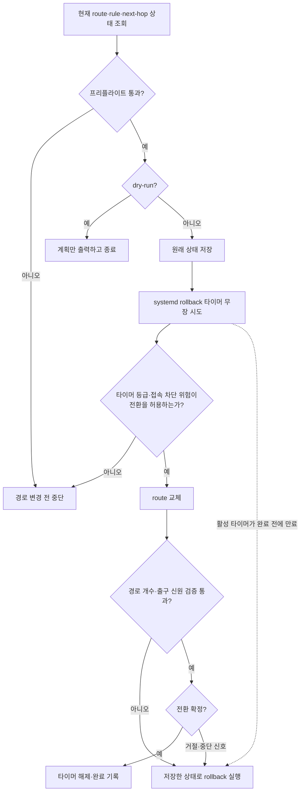
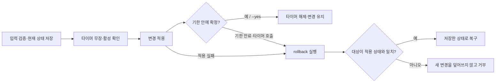
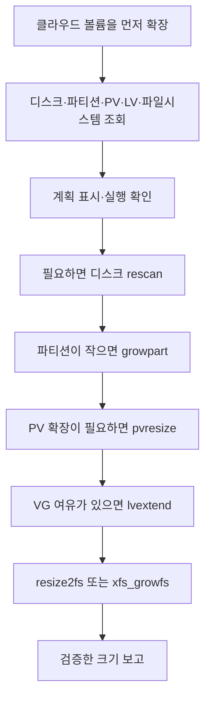

[English](host-changes.md) | **한국어** · [README로 돌아가기](../README.ko.md)

# 보호된 호스트 변경

[Route 전환](#route-전환) · [보호된 호스트 변경](#보호된-호스트-변경) · [디스크 증설](#디스크-증설)

## Route 전환

`edc route`는 gateway VM의 기본 경로를 바꾸고, 실패하면 되돌립니다. Linux에서만 동작합니다. `switch`와 `rollback`은 root 권한이 필요하고 `edc`가 `sudo`를 붙이지 않습니다.

이 명령은 경로를 바꿀 gateway VM에서 직접 실행합니다. 원격에서 조종하는 방식이 아닙니다. `edc`가 `SSH_CONNECTION`을 읽어 그 변경이 지금 세션을 끊는지 판정하기 때문입니다.

### 전환 흐름



공인 IP 신원 검증은 `expect_public_ip`가 있을 때만 실행합니다. 타이머 무장이나 활성 상태 확인에 실패했고 접속 차단 위험이 높으면 `--force` 없이는 전환을 거부합니다. 위험 판정에 따라 활성 확인이 없는 전환도 허용할 수 있으므로, 시간 만료에 따른 자동 복구에는 활성 타이머가 필요합니다. rollback 자체도 실패할 수 있으며, 실패하면 결과로 보고합니다.

```bash
edc route check                 # 현재 상태만 살펴봅니다. 아무것도 바꾸지 않습니다
edc route switch --to <name>    # 상태 저장·타이머 준비 뒤 전환하고 검증·확정합니다
edc route status                # 진행 중이거나 끝난 전환을 보여 줍니다
edc route rollback --state <f>  # 상태 파일 하나를 되돌립니다
```

`rollback`이 별도 명령인 이유는 무장한 타이머가 이 명령을 부르기 때문입니다. 타이머와 사람이 같은 코드 경로를 씁니다.

### 출구 목록

`switch --to`는 `exits.yaml`에 적힌 이름만 받습니다. next-hop 주소를 직접 입력하면 오타가 나도 커널이 exit code `0`을 돌려주기 때문에 실수가 드러나지 않습니다. 이름 목록이 그 실수를 막습니다.

```yaml
dest: default
exits:
  - name: lab-nat-01
    via: 10.0.2.1
    dev: ens3
    expect_public_ip: 203.0.113.10
  - name: lab-nat-02
    via: 10.0.3.1
    dev: ens3
    expect_public_ip: 203.0.113.20
```

`edc`는 `inventory.yaml`과 같은 순서로 `exits.yaml`을 찾습니다. `--exits <file>`로 다른 경로를 지정할 수 있습니다.

`expect_public_ip`는 그 출구가 인터넷에 내보이는 주소입니다. `edc`가 전환 뒤 공인 주소를 읽어 이 값과 대조합니다. 이 항목이 없으면 신원 확인을 건너뛰고 사람이 확정하게 남겨 둡니다.

### 안전장치

`edc`는 세 겹으로 막습니다. 각각 다른 실패를 잡습니다.

1. **프리플라이트.** next-hop의 이웃 항목을 읽습니다. `INCOMPLETE`나 `FAILED`면 바꿔도 반드시 실패하므로 거부하고 아무것도 바꾸지 않습니다. 항목이 아예 없는 것은 실패가 아니라 미확인이므로 막지 않습니다. `--force`로 거부를 넘길 수 있습니다.
2. **롤백 타이머.** 경로를 바꾸기 **전에** `edc route rollback`을 실행할 systemd 타이머를 무장합니다. 타이머는 PID 1이 들고 있어서 `edc` 프로세스가 죽어도 발화합니다. 무장이나 활성 확인에 실패하면 접속 차단 위험에 따라 허용 여부를 판정하며, 위험이 높으면 `--force` 없이는 변경하지 않습니다.
3. **검증.** 변경 전후의 대상 경로 개수를 비교하고, `expect_public_ip`가 있으면 새 출구의 공인 주소를 확인합니다.

`--seconds`로 롤백 유예를 정합니다. 10에서 900 사이이고 기본값은 120입니다.

```bash
edc route switch --to lab-nat-02 --dry-run   # 계획만 출력하고 아무것도 바꾸지 않습니다
edc route switch --to lab-nat-02 --seconds 60
```

`--dry-run`은 어떤 경로를 바꾸는지, 실행할 명령이 무엇인지, 어떤 타이머를 무장하는지, 출구가 닿는지를 보여 줍니다. root 권한이 없어도 됩니다.

전환은 기존 연결을 끊습니다. NAT 상태가 이전 출구에 남아 있어 이미 맺어진 흐름은 멈춥니다. 새로 맺는 흐름만 새 출구를 씁니다.

## 보호된 호스트 변경

접속을 막을 수 있는 호스트 변경에는 `edc change`를 씁니다. Linux에서만 동작합니다. 대상 호스트에서 root로 실행합니다.

`edc`는 대상을 바꾸기 전에 현재 상태를 저장하고 systemd 타이머를 무장합니다. 확정이 오지 않으면 타이머가 rollback 명령을 실행합니다.

### 적용·확정·복구 흐름



타이머 무장과 활성 확인에 실패하면 적용 전에 중단합니다. `route switch`와 달리 `change confirm`을 별도로 실행해 확정합니다. `--yes`를 주면 즉시 확정합니다.

SSH 공개 키 파일을 바꿉니다.

```bash
edc change apply \
  --kind authorized-keys \
  --path /home/<user>/.ssh/authorized_keys \
  --content-file /path/to/authorized_keys \
  --seconds 120
```

IPv4 방화벽 규칙을 바꿉니다.

```bash
edc change apply \
  --kind iptables \
  --rules-file /path/to/rules.v4 \
  --seconds 120
```

apply 결과의 run ID로 변경을 확정합니다.

```bash
edc change confirm --state /run/edc/change-<run-id>.json
```

타이머가 실행되기 전에 되돌리려면 같은 상태 파일 경로를 씁니다.

```bash
edc change rollback --state /run/edc/change-<run-id>.json
```

대기 중인 변경과 남은 시간을 봅니다.

```bash
edc change status
```

`authorized-keys`는 공개 키가 담긴 일반 파일을 받습니다. `iptables`는 타이머를 무장하기 전에 `iptables-restore --test`로 규칙을 검사합니다.

보호된 변경은 한 번에 하나만 실행하세요. apply 뒤에 대상이 바뀌면 `edc`는 rollback할 때 새 상태를 덮어쓰지 않고 거부합니다.

`--yes`를 쓰면 바로 확정합니다. 이 경우 rollback 유예가 사라집니다.

## 디스크 증설

AWS EBS 볼륨이나 OCI 블록 볼륨처럼 클라우드 볼륨을 키운 뒤에 `edc disk`를 실행합니다. Linux에서만 동작합니다. `grow`는 root 권한이 필요하고 `edc`가 `sudo`를 붙이지 않습니다.

```bash
edc disk check                 # 늘릴 수 있는 마운트를 보여 줍니다. 아무것도 바꾸지 않습니다
edc disk check /data           # 마운트 하나 아래의 층을 보여 줍니다
edc disk grow /data -n         # 계획만 출력하고 아무것도 바꾸지 않습니다
edc disk grow /data            # 계획을 보여 주고, 확인을 받은 뒤 늘립니다
```

### 증설 흐름



실제 구성에 필요한 확장 단계만 실행합니다. 단계마다 해당 층을 다시 읽어 검증하고, 실패하면 다음 단계로 넘어가지 않습니다. 같은 명령을 다시 실행하면 현재 크기에서 계획을 다시 세웁니다. 디스크 증설에는 rollback이 없습니다.

`edc`는 `/proc/self/mountinfo`와 `/sys/class/block`에서 디스크, 파티션, LVM 물리 볼륨(PV), 논리 볼륨(LV), 파일시스템 층을 읽습니다. 그리고 공간을 늘리는 단계만 실행합니다.

1. 디스크가 SCSI면 `rescan`합니다. OCI 문서의 순서대로 블록 하나를 직접 읽은 뒤 `/sys/class/block/<disk>/device/rescan`에 씁니다. NVMe와 virtio 디스크에는 rescan 파일이 없고, 커널이 새 크기를 바로 봅니다.
2. 파티션이 디스크보다 짧으면 `growpart <disk> <number>`를 실행합니다.
3. PV가 파티션보다 짧으면 `pvresize <pv>`를 실행합니다.
4. 볼륨 그룹에 남은 공간이 있으면 `lvextend -l +100%FREE <lv>`를 실행합니다. 남은 공간을 모두 LV에 줍니다.
5. ext3와 ext4는 `resize2fs <device>`, xfs는 `xfs_growfs -d <mount>`로 파일시스템을 늘립니다.

단계마다 층을 다시 읽어 그 층이 실제로 늘었는지 확인합니다. 어떤 단계가 실패하면 같은 명령을 다시 실행하세요. 이미 늘어난 층은 계획에서 빠지므로 실패한 단계부터 이어서 진행합니다.

시간 제한은 계획을 세우기 전의 읽기에만 적용합니다. 디스크를 바꾸는 단계는 시간 제한으로 끊지 않습니다. `edc`가 명령을 죽여도 커널은 확장을 끝까지 하기 때문입니다. Ctrl+C를 누르면 지금 단계를 끝낸 뒤 다음 단계 앞에서 멈춥니다.

늘린 크기는 되돌릴 수 없습니다. 파티션과 파일시스템은 다시 줄일 수 없고, xfs는 아예 줄일 수 없습니다. 늘리기 전에 볼륨 스냅샷을 만드세요.

다음 경우에는 거부하고 아무것도 바꾸지 않습니다.

- 파일시스템이 ext3, ext4, xfs가 아닌 경우
- 그 파티션 뒤에 다른 파티션이 있는 경우. 마지막 파티션은 번호가 아니라 시작 위치로 판정합니다. Ubuntu 클라우드 이미지는 루트인 `1`번 파티션을 디스크 맨 뒤에 둡니다.
- MBR 디스크에서 파티션이 MBR의 2 TiB 한계에 닿은 경우. 먼저 GPT로 바꾸세요.
- LV가 PV 여러 개에 걸쳐 있거나, device-mapper 디바이스가 LVM 볼륨이 아닌 경우
- `growpart`가 없는 경우. Debian과 Ubuntu에서는 `cloud-guest-utils`, RHEL에서는 `cloud-utils-growpart`를 설치하세요.

늘린 SCSI 디스크는 rescan하기 전까지 커널이 옛 크기를 봅니다. `check`와 `grow -n`은 커널 상태를 바꾸는 rescan을 하지 않습니다. 대신 아무것도 바꾸지 않는 SCSI `READ CAPACITY` 명령으로 디스크에 크기를 묻습니다. 디스크가 커널이 아는 크기보다 크면 새 크기로 계획하고, 디스크 줄에 `sda · 100.00 GB → 200.00 GB`처럼 보이며, `edc disk grow`를 제안합니다. root가 아닌 경우처럼 디스크에 묻지 못하면 `grow`가 먼저 rescan하므로 공간이 더 보일 수 있다고 알립니다. 실제 `grow`는 rescan한 뒤 커널이 보는 크기로만 계획합니다. rescan 뒤에도 디스크가 커널보다 크다고 답하면 다 쓴 디스크라고 하지 않고 오류로 멈춥니다.

늘릴 수 있는 마운트는 늘리기 전과 뒤의 크기를 보이고, 실행할 명령을 따로 `next:` 줄에 보입니다. JSON에서는 `next`에 명령이 들어갑니다.

```text
WARN  disk.check                /를 99.00 GB에서 199.00 GB로 늘릴 수 있습니다(+100.00 GB)
      next: edc disk grow /
```

OCI와 Ubuntu 클라우드 이미지의 `/boot`처럼 마지막이 아닌 파티션의 마운트는, 마지막 파티션 뒤의 빈 공간으로 다른 마운트를 늘릴 수 있으면 `check`에서 통과로 나옵니다. 그 파일시스템의 줄이 grow를 제안합니다.

`check`는 root 없이도 실행되지만, 모든 크기는 root로 실행해야 보입니다. root가 아니면 ext 슈퍼블록과 LVM 정보를 읽지 못합니다. 마운트를 주지 않으면 블록 디바이스 위에 마운트된 ext3, ext4, xfs를 모두 보여 줍니다.

`grow`는 디스크를 바꾸기 전에 확인을 받습니다. 스크립트에서는 `--yes`로 질문을 건너뜁니다. 거절하면 exit code `4`로 끝납니다.

