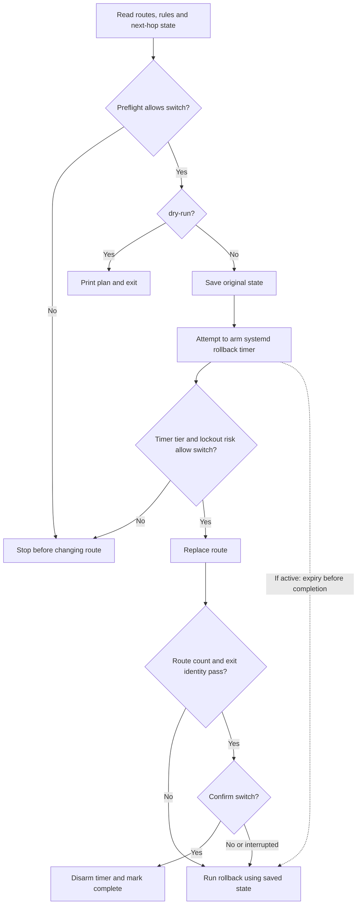
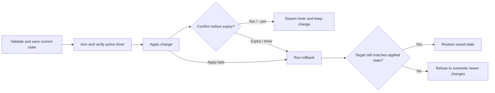
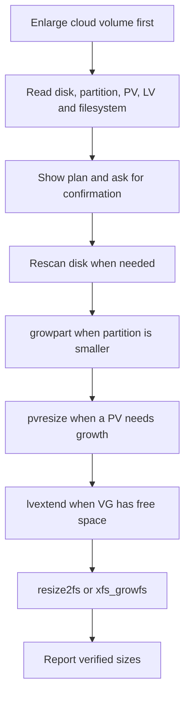

**English** | [한국어](host-changes.ko.md) · [Back to README](../README.md)

# Protected host changes

[Route switching](#route-switching) · [Protected host changes](#protected-host-changes) · [Disk growth](#disk-growth)

## Route switching

`edc route` changes the default route of a gateway VM and rolls the change back when it fails. Linux only. `switch` and `rollback` need root. `edc` does not add `sudo` itself.

Run this command on the gateway VM, not from a remote machine. `edc` reads `SSH_CONNECTION` to judge whether the change cuts your own session.

### Switch flow



The public IP identity check runs only when `expect_public_ip` is configured. If timer arming or active-state verification fails and lockout risk is high, the switch is refused unless `--force` is supplied. The risk policy can allow a switch without a confirmed timer; automatic timed rollback requires an active timer. Rollback itself can fail and reports the failure.

```bash
edc route check                 # inspect the current state, change nothing
edc route switch --to <name>    # save state, prepare timer, switch, verify, confirm
edc route status                # show a pending or finished switch
edc route rollback --state <f>  # restore one state file
```

`rollback` is a separate command because the armed timer runs it. The timer and a person call the same code path.

### Exit list

`switch --to` takes a name from `exits.yaml`. A name list prevents a typo in a next-hop address. A wrong next-hop still returns exit code `0` from the kernel, so free-form input hides the mistake.

```yaml
dest: default
exits:
  - name: lab-nat-01
    via: 10.0.2.1
    dev: ens3
    expect_public_ip: 203.0.113.10
  - name: lab-nat-02
    via: 10.0.3.1
    dev: ens3
    expect_public_ip: 203.0.113.20
```

`edc` finds `exits.yaml` in the same directories as `inventory.yaml`. Use `--exits <file>` to name another path.

`expect_public_ip` is the address that the exit presents to the internet. `edc` reads the public address after the switch and compares it. Without this field `edc` skips the identity check and asks a person to confirm.

### Safety

`edc` runs three guards. Each one stops a different failure.

1. **Preflight.** `edc` reads the neighbor entry of the next-hop. An `INCOMPLETE` or `FAILED` entry means the change fails for certain, so `edc` refuses it and changes nothing. An absent entry is unknown, not broken, so `edc` allows it. Use `--force` to override a refusal.
2. **Rollback timer.** Before the change, `edc` arms a systemd timer that runs `edc route rollback`. The timer lives in PID 1, so it fires even after the `edc` process dies. If arming or active verification fails, the lockout-risk policy decides whether the switch may continue; high risk requires `--force`.
3. **Verification.** `edc` compares the target route count before and after, and checks the public address of the new exit when `expect_public_ip` is configured.

Use `--seconds` to set the rollback grace period, between 10 and 900. The default is 120.

```bash
edc route switch --to lab-nat-02 --dry-run   # print the plan, change nothing
edc route switch --to lab-nat-02 --seconds 60
```

`--dry-run` prints the route that `edc` replaces, the exact commands, the timer that it arms, and the reachability of the exit. It needs no root.

A switch breaks existing connections. The NAT state stays on the old exit, so established flows stop. New flows use the new exit.

## Protected host changes

Use `edc change` for host changes that can block access. Linux only. Run it on the host as root.

Before `edc` changes the target, it saves the current state and arms a systemd timer. If no confirmation arrives, the timer runs the rollback command.

Change an SSH public key file:

### Apply, confirm, or roll back



If the timer cannot be armed and verified active, `change apply` stops before applying the change. Unlike `route switch`, confirmation is a separate `change confirm` command; `--yes` confirms immediately.

```bash
edc change apply \
  --kind authorized-keys \
  --path /home/<user>/.ssh/authorized_keys \
  --content-file /path/to/authorized_keys \
  --seconds 120
```

Change the IPv4 firewall rules:

```bash
edc change apply \
  --kind iptables \
  --rules-file /path/to/rules.v4 \
  --seconds 120
```

Use the run ID from the apply result to confirm the change:

```bash
edc change confirm --state /run/edc/change-<run-id>.json
```

Use the same state path to roll back before the timer fires:

```bash
edc change rollback --state /run/edc/change-<run-id>.json
```

Inspect pending changes and their remaining time:

```bash
edc change status
```

`authorized-keys` accepts a regular file with public keys. `iptables` validates the rules with `iptables-restore --test` before it arms the timer.

Run only one protected change at a time. If the target changes after apply, `edc` refuses to overwrite the new state during rollback.

Use `--yes` to confirm immediately. This removes the rollback window.

## Disk growth

Use `edc disk` after you make a cloud volume larger, for example an AWS EBS volume or an OCI block volume. Linux only. `grow` needs root. `edc` does not add `sudo` itself.

```bash
edc disk check                 # show the mounts that can grow, change nothing
edc disk check /data           # show the layers under one mount
edc disk grow /data -n         # print the plan, change nothing
edc disk grow /data            # show the plan, ask, then grow
```

### Growth flow



Only applicable growth steps run. Each step re-reads and verifies the affected layer; a failed step stops the sequence. Run the same command again to rebuild the plan from current sizes. Disk growth has no rollback.

`edc` reads the layers from `/proc/self/mountinfo` and `/sys/class/block`. A layer is the disk, the partition, the LVM physical volume (PV), the logical volume (LV), or the file system. Then `edc` runs only the steps that add space:

1. `rescan` if the disk is a SCSI disk. This step follows the OCI procedure: a direct read of one block, then a write to `/sys/class/block/<disk>/device/rescan`. NVMe and virtio disks have no rescan file. The kernel sees their new size at once.
2. `growpart <disk> <number>` if the partition is shorter than the disk.
3. `pvresize <pv>` if the PV is shorter than its partition.
4. `lvextend -l +100%FREE <lv>` if the volume group has free space. The LV gets all the free space of the volume group.
5. `resize2fs <device>` for ext3 and ext4, or `xfs_growfs -d <mount>` for xfs.

Until the rescan, the kernel still sees the old size of a SCSI disk that you made larger. `check` and `grow -n` do not rescan, because a rescan changes the kernel state. Instead they ask the disk for its size with the SCSI `READ CAPACITY` command, which changes nothing. If the disk is larger than the kernel's size, they plan with the new size, show `sda · 100.00 GB → 200.00 GB` on the disk line, and suggest `edc disk grow`. If `edc` cannot ask the disk, for example without root, it says that `grow` rescans first and can find more space. `grow` itself always plans with the size that the kernel reports after the rescan. If the disk still reports a larger size than the kernel after the rescan, `grow` stops with an error instead of reporting a full disk.

After each step, `edc` reads the layers again and checks that the layer grew. If a step fails, run the same command again. The layers that grew drop out of the plan, so the next run starts at the failed step.

The time limit applies only to the reads before the plan. It does not stop a step that changes the disk, because the kernel finishes a resize even after `edc` kills the command. If you press Ctrl+C, `edc` lets the current step finish and stops before the next step.

The grow is permanent. A partition or a file system cannot shrink back, and xfs cannot shrink at all. Take a snapshot of the volume before you grow it.

`edc` refuses these cases and changes nothing:

- The file system is not ext3, ext4, or xfs.
- Another partition starts after the partition. `edc` finds the last partition by its start, not by its number. The Ubuntu cloud image keeps the root partition `1` at the end of the disk.
- The disk uses an MBR table, and the partition reaches the 2 TiB limit of MBR. Convert the table to GPT first.
- The LV spans more than one PV, or a device-mapper device is not an LVM volume.
- `growpart` is not installed. Install `cloud-guest-utils` on Debian and Ubuntu, or `cloud-utils-growpart` on RHEL.

When a mount can grow, `check` shows the size before and after, and the command to run on its own `next:` line. JSON has the command in `next`.

```text
WARN  disk.check                / can grow from 99.00 GB to 199.00 GB (+100.00 GB)
      next: edc disk grow /
```

A mount on a partition that is not last, such as `/boot` in the OCI and Ubuntu cloud images, passes in `check` when the free space after the last partition can grow another mounted file system. The row for that file system suggests the grow.

`check` needs no root, but it shows every size only as root. Without root, `edc` cannot read the ext superblock or the LVM report. Without a mount, `check` shows the mounted ext3, ext4, and xfs file systems on block devices.

`grow` asks before it changes the disk. Use `--yes` to skip the question in a script. If you answer no, `grow` stops with exit code `4`.

