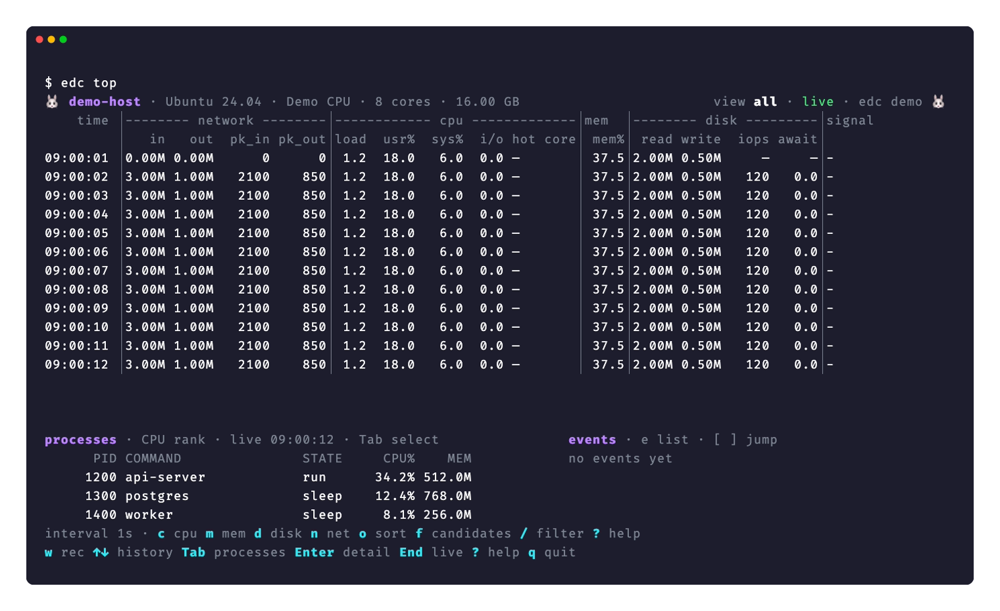

[English](monitoring.md) | **한국어** · [README로 돌아가기](../README.ko.md)

# 실시간 자원 관측

[Top 임계값](#top-임계값) · [Top 대시보드](#top-대시보드) · [Top 이벤트](#top-이벤트) · [Top JSON 출력](#top-json-출력) · [Top process 필터](#top-process-필터) · [AI 도구 사용량](#ai-도구-사용량) · [로그 읽기](#로그-읽기) · [로그 검색](#로그-검색)



현재 UI 렌더러에 데모 데이터를 넣어 캡처한 화면입니다.

## Top 임계값

`edc top`은 색을 둘만 씁니다. 노란색은 경고, 빨간색은 위험입니다. 정상 값은 terminal 기본색으로 두므로 색이 붙은 값만 살피면 됩니다.

표는 load, `usr%`, `sys%`, `i/o`, `mem_%`에 색을 넣습니다. 대시보드는 이 값에 더해 `hot core`, `await`, `err`, `drop`, pressure 값에도 색을 넣습니다.

load 임계값은 host의 core 수를 따릅니다.

| 값 | 경고 | 위험 |
|---|---|---|
| load | 0.7 × cores | 1.0 × cores |
| usr%, sys% | 70 | 90 |
| i/o | 10 | 25 |
| mem_% | 90 | 95 |
| await | 20 ms | 50 ms |
| err, drop | 1/s | 50/s |
| psi | 10 | 25 |
| hot core | 90 | — |
| process READ, WRITE | 10 MB/s | 50 MB/s |

`hot core`는 core 하나의 사용률이므로 90부터 경고만 주고 위험 단계가 없습니다. core가 여럿이면 하나가 포화해도 host 전체에는 여유가 있습니다.

process 패널은 `READ`와 `WRITE`에 위 임계값으로 색을 넣고, `STATE` 열의 `iowait`는 노란색으로 표시합니다. process 묶음의 CPU 합은 core 하나가 바쁜 수준인 80%부터 빨간색입니다.

대시보드는 `iops`, `busy%`, `swap/s`, `steal%`, `blocked`, `queue`, 바이트·패킷·TCP 속도, `signal` 열에는 색을 넣지 않습니다. 임계값이 없거나 색 없이도 수준이 드러나는 값입니다. 집계 `busy%`는 바쁜 disk가 여럿이면 100을 넘으므로 고정 임계값이 잘못된 신호를 줍니다. `cores` 막대는 `.`, `:`, `*`, `#`로 수준을 보여 줍니다.

색을 끄려면 `NO_COLOR`를 설정합니다. 파이프와 파일에는 색이 들어가지 않습니다.

`edc info`는 disk마다 막대를 그립니다. 막대는 `mem_%`와 같은 임계값을 쓰고 한 칸이 5퍼센트입니다. 막대는 색 없이도 수준을 보여 주므로 파이프에서도 정보가 남습니다.

`edc info`는 disk 사용량을 전체 크기에서 남은 공간을 뺀 값으로 셉니다. macOS에서는 여러 APFS volume이 container 하나를 나눠 쓰므로, volume 하나의 `Used` 열만 보면 다른 volume이 차지한 공간이 빠집니다.

`edc info`는 저장 장치를 쓰는 file system만 보여 줍니다. `tmpfs`, `overlay`, `snap`이 붙이는 읽기 전용 image는 숨깁니다. 램을 쓰거나 같은 disk를 두 번 세기 때문입니다. loop device 자체는 숨기지 않으므로 직접 붙인 disk image는 그대로 나옵니다.

macOS에서 `edc`는 memory 사용량을 Mach `host_statistics64` 호출로 읽습니다. free, speculative, inactive page를 빼는데, 이는 Linux의 `MemAvailable`과 같은 기준입니다. `top`의 `PhysMem` 줄은 cache를 포함하므로 97퍼센트 위에 머뭅니다.

## Top 대시보드

stdin과 stdout이 모두 terminal이면 `edc top`은 전체 화면 대시보드를 엽니다. 대시보드에는 `--count` 제한이 필요 없습니다.

| key | 동작 |
|---|---|
| `q` | 종료 |
| `p` | 일시정지와 재개 |
| `+` | interval 늘리기 |
| `-` | interval 줄이기 |
| `1`, `c`, `m`, `d`, `n` | 전체, CPU, memory, disk, network 열로 전환. `1`이 처음 보기 |
| `s` | pressure 열로 전환 |
| `o` | process 패널을 CPU, `MEM`, I/O 순으로 정렬. 누를 때마다 기준이 바뀌고, 네 번째로 누르거나 보기를 바꾸면 보기 기준으로 돌아감 |
| `v` | 박스 화면으로 돌아가기 |
| `f` | 선택한 행의 signal 보기로 이동하고, 한 번 더 누르면 process 후보 선택. 필터가 있으면 process 보기로 전환 |
| `Tab` | 이력 탐색과 process 후보 선택 사이 이동 |
| `?` | 도움말 표시. 화살표로 스크롤하고 `Esc`로 닫기 |
| `/` | process 필터 입력: command 이름이나 PID, 쉼표로 구분 |
| `i` | interface 선택 상자: 목록과 traffic을 보고 `Space`로 체크, `a` 전체, `p` physical. `Enter`로 다음 sample부터 적용하며, `-w`로 기록하는 동안에는 쓸 수 없음 |
| `Esc` | 한 단계 뒤로: 도움말, 목록, 후보 선택을 닫고, 그다음 상세나 최고치 패널 닫기, 최신 행으로 복귀, `o`로 고른 순위 해제, 처음 보기로 복귀, 마지막으로 process 필터 해제 |
| `↑`, `↓`, `PgUp`, `PgDn`, `End` | 과거 행 선택, 한 화면씩 이동, 실시간 행 추적 재개 |
| `Enter` | 선택한 시점의 상세 표시. 후보 선택 중에는 선택한 PID에 초점 |
| `h` | 최근 60초의 load, CPU, iowait, memory 최고치를 각각 시각과 함께 표시 |
| `e` | 이벤트 목록 열기. 화살표로 고르고 `Enter`로 그 시작 시점으로 이동, `e`나 `Esc`로 닫기 |
| `[`, `]` | 이전·다음 이벤트의 시작 시점으로 이동 |

기본 표의 `signal` 열은 load, CPU, iowait, memory, disk await, network errors·drops 중 가장 심각한 항목과 추가 개수를 보여 줍니다. network errors·drops는 초당 1개부터 경고로 셉니다. 패킷 수는 network 보기에서 확인합니다. network 값은 loopback을 뺀 모든 interface의 counter를 더한 값입니다. Linux에서는 edc가 있는 network namespace의 interface를, macOS에서는 켜진 interface를 읽습니다. bridge, veth, tunnel도 더하므로 같은 packet이 둘 이상의 interface에서 셀 수 있습니다. counter는 interface마다 따로 빼므로, 두 sample 사이에 생기거나 사라진 interface는 그 구간에 더하지 않습니다. 과거 행을 선택해도 수집은 계속되며 `End`로 최신 행을 다시 따라갑니다. 수집이 잠시 실패하면 마지막 행을 유지하고 다음 interval에 다시 시도합니다.

일부 interface만 더하려면 `--interface`를 씁니다. interface 이름, glob, `physical`을 쉼표로 구분해 적습니다. `physical`은 장치가 뒤에 있는 interface를 고릅니다. Linux에서는 `/sys/class/net/<이름>/device`가 있는 interface입니다. bridge, veth, bond, VLAN, tunnel이 빠지므로 같은 packet을 NIC에서 한 번만 셉니다. `all`은 모든 interface를 더하며 기본값입니다.

```bash
edc top --interface physical
edc top --interface eth0,ens5
edc top --interface 'en*' --json -
```

선택은 표, 대시보드, JSON, `--write`, `n` 보기의 장치 쪽 drop에 모두 적용됩니다. 적은 interface 이름이 시작할 때 없으면 exit code 2로 끝납니다. glob이나 `physical`에 맞는 interface가 없으면 경고를 보입니다. 맞는 interface가 생길 때까지 byte와 packet 값은 0으로 남고, `err`와 `drop`은 `—`로 보이며, JSON의 `network_health_supported`는 `false`입니다. `--interface`를 쓰면 JSON sample마다 `interface_filter`와 `interfaces`가 붙습니다. `interfaces`에는 고른 interface 중 그 구간에 traffic이 있는 interface의 값이 들어갑니다. `edc history list`는 `INTERFACES` 열에 선택을 보입니다.

매번 같은 선택을 쓰려면 설정 파일에 `defaults.top.interface`를 둡니다. macOS에서는 `physical`을 쓸 수 없습니다. 이때는 경고를 보이고 모든 interface를 더하므로, 설정 파일 하나를 Linux와 macOS host가 함께 쓸 수 있습니다.

Linux에서는 `i/o`가 경고 수준이고 I/O를 기다리는 작업이 4개 이상이면 `signal` 열에 `blocked N`을 표시합니다. macOS에는 `i/o` 값이 없습니다. `U` 상태는 page-in 대기에서도 생기므로, macOS는 `U` 상태 process가 4개 이상이고 `await`가 경고 수준이거나 memory 압박 단계가 `warn`이나 `critical`일 때 `blocked N`을 표시합니다. macOS에서는 kernel이 memory 압박 단계를 올리면 `signal` 열에 `mem pressure warn`이나 `mem pressure critical`도 표시합니다. process 묶음도 CPU 합이 80% 이상이거나 I/O 합이 50 MB/s 이상이면 `gm (200) 100%`처럼 이름과 process 수로 경고합니다. I/O 합은 disk 보기에서만 계산하므로 묶음의 I/O 경고도 disk 보기에서만 나옵니다.

기본 표는 terminal 폭에 맞춰 열을 늘립니다. 80열보다 넓으면 다음 순서로 열을 추가합니다.

| terminal 폭 | 추가되는 열 |
|---|---|
| 84 | hot core |
| 96 | disk IOPS, `await` |
| 110 | packet in/out |
| 120 | network errors·drops |
| 125 | disk `busy` |
| 143 | CPU·memory·I/O pressure(`psi`) |
| 149 | memory swap out(`swap`) |
| 161 | listen queue overflow(`listen`), softnet drop(`soft`) |
| 167 | conntrack 사용률(`ct%`) |

`signal` 열은 13~16칸을 씁니다. 경고를 적어도 하나와 나머지 경고의 개수를 표시할 수 있는 폭입니다. 남는 폭은 다른 열이 나눠 가져서, 표가 terminal 오른쪽 끝까지 찹니다. 제목 줄도 폭에 여유가 있으면 OS 이름, memory 크기, CPU 모델을 함께 표시합니다. 제목 오른쪽 끝에는 보기와 `live` 또는 `history`를 표시하고, 폭에 여유가 있으면 edc 버전도 붙입니다. 폭이 줄면 추가한 열을 바로 뺍니다.

80열보다 좁으면 전체 보기에는 CPU, memory, load, signal을 남깁니다. 다른 보기에서도 폭에 맞지 않는 열은 뺍니다. 최소 크기는 24열·8행이며, 작은 terminal에서는 도움말을 스크롤할 수 있습니다.

`--split`을 쓰면 여러 보기를 한 화면에 동시에 봅니다. 보기마다 박스가 하나씩 생기고, 박스 안에는 그 보기의 최근 sample 표가 들어갑니다.

`--split`은 `cpu`, `mem`, `disk`, `net`, `psi` 이름을 쉼표로 이어 받으며, 적은 순서대로 박스를 배치합니다. 목록 없이 `--split`만 쓰면 다섯 박스를 모두 보이고, `--split none`은 박스 없이 단일 보기로 시작합니다. 빈 값, 모르는 이름, 중복 이름은 exit 2로 끝납니다.

설정 파일의 `defaults.top.split`에 같은 문법으로 목록을 적으면 대시보드를 매번 그 목록으로 시작합니다. 명령줄에 직접 준 `--split`이 설정 값보다 우선합니다.

박스는 적은 순서를 지킵니다. terminal 폭에 들어가는 가장 적은 줄 수를 쓰고, 그 줄 수 안에서 가장 넓은 줄이 가장 좁아지도록 박스를 나눕니다. 박스 줄들은 높이를 똑같이 나눠 가집니다. 모든 박스에서 `signal` 열을 빼고, 선택한 시각의 signal을 박스 아래 한 줄로 한 번만 보입니다. cpu 박스가 화면에 있으면 mem과 psi 박스에서 `load`를 빼고, mem 박스가 있으면 psi 박스에서 `mem%`를 뺍니다. 상세, 최고치, process 패널은 단일 보기와 같은 방식으로 그 아래에 놓입니다. 같은 줄의 박스는 같은 시각의 행을 나란히 보이므로 `time` 열은 줄의 첫 박스에만 있습니다.

선택한 행은 모든 박스가 공유합니다. 방향키와 `End`는 모든 박스를 함께 움직이고, `PgUp`과 `PgDn`은 박스 하나의 데이터 행 수만큼 이동합니다. `1`, `c`, `m`, `d`, `n`, `s`를 누르면 박스 화면을 떠나고, `v`를 누르면 돌아옵니다.

박스 하나에는 데이터 행이 3개 이상 필요합니다. 박스의 데이터 행이 그보다 적으면 첫 박스를 단일 보기로 보이고 상태 줄에 이유를 안내합니다. terminal보다 넓은 박스는 뒤쪽 열을 빼고 들어갑니다. `steal%`, `retr/s` 같은 선택 열 때문에 박스 줄이 늘어나면 박스에서 선택 열을 뺍니다. 80열·24행 terminal에서 `--split`은 CPU 보기만 보이고, 80열에서 박스 다섯 개를 모두 보이려면 약 33행이 필요합니다.

macOS에서는 `psi` 박스를 생략하고 안내를 보입니다. macOS의 memory 압박 단계는 mem 박스에 있습니다. 설정 파일에 `psi`를 적어도 오류가 아니므로 Mac과 Linux가 같은 파일을 쓸 수 있습니다.

`--split`은 대시보드에서만 동작합니다. 표를 출력하는 실행(`--count`, `--json`, 파이프, `NO_COLOR`)이나 `--process`와 함께 직접 주면 exit 2로 끝납니다. 설정 값은 그런 실행을 막지 않고, `--process`와 함께면 process 보기가 유지됩니다.

`--view`로 처음 보기를 고릅니다. `all`, `cpu`, `memory`, `disk`, `network`, `pressure`, `split`을 쓸 수 있고, `Esc`를 누르면 이 보기로 돌아옵니다. 설정 파일의 `defaults.top.view`에 적으면 매번 그 보기로 시작합니다.

`--panels`로 표 아래에 늘 보일 패널을 고릅니다. `cpu`, `mem`, `disk`, `net`, `psi`, `ai`, `events`를 쉼표로 이어 적고, `none`은 패널을 모두 뺍니다.

- `cpu`, `mem`, `disk`, `psi`는 선택한 행의 요약, 최근 60초 최고치, 그 자원을 가장 많이 쓴 process 셋을 세 줄로 보입니다. 오른쪽 process 목록은 기준 하나로만 줄 세우므로, 자원마다 상위 process를 이 패널에서 봅니다. `disk` 패널을 켜면 process별 I/O도 읽습니다. `psi` 패널은 I/O를 기다리는 process를 보이고, macOS는 PSI를 수집하지 않으므로 한 줄 안내만 보입니다.
- `net`은 선택한 행의 network limit입니다. macOS는 이 값을 수집하지 않으므로 한 줄 안내만 보입니다.
- `ai`는 `edc ai`와 같은 Claude·Codex 사용량 한도입니다. 1분마다 다시 조회합니다.
- `events`는 최근 이벤트입니다.

목록 앞의 패널이 먼저 자리를 받습니다. 패널이 들어가지 않으면 패널을 자르지 않고 통째로 숨긴 뒤 상태 줄에 `+net hidden`처럼 알립니다. 뒤의 작은 패널은 남은 줄에 들어가면 보입니다. 표는 적어도 5행, 박스는 데이터 행을 적어도 3개 남깁니다.

`a`를 누르면 `ai` 패널을 켜고 끕니다. 패널을 켜기 전에는 Claude와 Codex 정보를 읽지 않습니다. `Enter` 상세나 `h` 최고치를 연 동안에는 그 패널이 패널 자리를 씁니다.

설정 파일의 `defaults.top.panels`에 같은 문법으로 적으면 매번 그 목록으로 시작합니다. 목록을 정하지 않으면 지금 배치를 그대로 씁니다. network 보기에서 `net` 패널이 보이고, 빈자리에 이벤트가 보입니다.

`defaults.top.process_sort`에 `cpu`, `mem`, `io`를 적으면 process 목록의 처음 정렬이 됩니다. `o`로 바꾸는 동작은 그대로입니다.

`--columns`로 all 보기의 열 그룹을 고릅니다. `net`, `cpu`, `mem`, `disk`, `psi`를 보이고 싶은 순서대로 쉼표로 이어 적고, `all`은 다섯 그룹을 모두 보입니다. 그룹마다 기본 열은 늘 보이고, 폭이 남으면 열을 더 붙입니다. 그룹을 빼면 그 폭을 남은 그룹이 씁니다. 이름 뒤에 `+`를 붙이면 그 그룹의 열을 다른 그룹보다 먼저 붙입니다. 예를 들어 `--columns net+,cpu,mem`은 `hot core`보다 packet과 network 오류 열을 먼저 보입니다. 설정 파일의 `defaults.top.columns`에 적으면 매번 그 목록으로 시작합니다.

목록에 `ai`를 넣으면 `claude` 그룹과 `codex` 그룹에 두 도구의 요청이 보입니다. 행마다 직전 행 뒤부터 그 행 시각까지 들어온 요청을 세므로, 같은 줄의 다른 열과 견줄 수 있습니다. 그룹마다 `req`는 요청 수이고, `tok`은 새 입력과 출력을 더한 token으로 `edc ai`의 `total`과 같은 값입니다. prompt cache에서 읽은 token은 넣지 않고, 0은 `·`로 보입니다. Claude Code는 응답이 끝난 뒤 기록을 쓰고 edc는 2초마다 읽으므로, 가장 최근 행은 2~3초 뒤에 값이 채워집니다. `all`에는 `ai`가 들지 않고, 목록에 `ai`가 있을 때만 Claude와 Codex 대화 기록을 읽습니다.

```toml
[defaults.top]
split = "net,disk"
view = "split"
panels = "net,ai,events"
process_sort = "io"
columns = "net+,cpu,mem"
```

`--view`, `--panels`, `--columns`도 `--split`처럼 대시보드에서만 동작하고, `--view`를 `--process`와 함께 주면 exit 2로 끝납니다. 설정 값은 표를 출력하는 실행을 막지 않습니다.

`edc top setup`을 실행하면 이 값들을 실제 화면을 미리 보며 고를 수 있습니다. 위쪽에는 보기, 열 그룹, 박스, 패널, process 정렬, interval 줄이 있고, 아래쪽에는 실제 sample로 그린 대시보드가 값을 바꿀 때마다 바로 바뀝니다.

- `↑`·`↓`로 줄을 고르고, `←`·`→`로 값을 바꾸거나 박스·패널 항목을 고릅니다.
- `Space`로 열 그룹, 박스, 패널을 켜고 끄고, `[`·`]`로 순서를 옮깁니다. 열 그룹 줄에서 `+`를 누르면 그 그룹의 열을 먼저 더 보입니다.
- `Tab`을 누르면 미리보기를 터미널 전체 크기로 그립니다. 배치는 저장한 뒤의 `edc top`과 같고, 상태 줄 첫 줄에만 설정 화면의 키 안내가 보입니다.
- `z`를 누르면 80×24, 120×30 크기로 바꿔 봅니다. 터미널에 들어가지 않는 크기는 건너뜁니다. 그 크기에서 숨는 패널은 패널 줄 옆에 `+net hidden at 80×24`처럼 보입니다.
- `Enter`를 누르면 저장할 `[defaults.top]` 내용을 보여 주고, `y`를 누르면 저장합니다.

`edc top setup`은 바꾼 키만 고치고 다른 키와 섹션은 그대로 둡니다. 파일 전체를 다시 쓰므로 파일 안의 주석은 남지 않습니다. 설정 화면을 연 사이에 파일이 바뀌면 저장하지 않고 exit 2로 끝나고, 저장하지 않은 변경이 있는 채로 나가면 exit 4로 끝납니다.

disk 보기에는 macOS와 Linux 모두 물리 disk의 IOPS와 평균 `await`가 추가됩니다. Linux에서는 모든 물리 disk의 합산 `busy%`와, memory 보기의 `mem%` 옆 memory pressure도 추가됩니다. 합산 `busy%`는 여러 disk가 동시에 바쁘면 100%를 넘을 수 있습니다. macOS 대시보드는 수집하지 않는 iowait, PSI, disk busy, file descriptor, listen overflow, softnet drop, conntrack, I/O 지연 열을 숨기고 도움말에 제한을 설명합니다. macOS의 memory와 pressure 보기에는 kernel의 memory 압박 단계(`kern.memorystatus_vm_pressure_level`)인 `mem lvl`이 `normal`, `warn`, `critical`로 나옵니다. CPU와 pressure 보기의 `blocked`는 `U` 상태 process 수입니다. Linux는 작업(thread)을 세므로 두 값의 단위가 다릅니다. network 보기의 interface errors·drops는 macOS와 Linux 모두 표시하며, macOS에서는 kernel의 interface 통계(`net.link.generic.ifdata`)에서 읽습니다. memory 보기의 `swap/s`는 kernel이 초당 swap으로 내보낸 byte입니다.

Linux에서는 일부 보기에 선택 열이 더 있습니다. CPU 보기의 `steal%`는 hypervisor가 다른 guest에 CPU를 내준 시간의 비율이고, `blocked`는 지금 I/O를 기다리며 멈춘 작업 수입니다. disk 보기의 `queue`는 진행 중인 I/O 요청의 평균 개수를 물리 disk마다 더한 값입니다. network 보기에는 초당 TCP 재전송 segment(`retr/s`), 보낸 RST(`rst/s`), 실패한 연결 시도(`fail/s`)가 있습니다. 선택 열은 다른 열이 모두 들어가고 `signal`에 13열 이상이 남을 때만 보입니다.

`s`는 pressure 보기입니다. macOS에서는 `mem lvl`, `blocked`, `load`, `mem%`를 보입니다. Linux에서는 CPU, memory, I/O의 `some avg10`을 퍼센트로 표시하며, 최근 10초 동안 일부 작업이 그 자원을 기다린 시간의 비율입니다. `mem full`과 `io full` 열은 memory와 I/O의 `full avg10`으로, 최근 10초 동안 실행할 수 있는 작업이 모두 동시에 기다린 시간의 비율입니다. Linux pressure 보기에는 지금 I/O를 기다리는 작업 수인 `blocked`도 `io psi` 옆에 나옵니다. CPU 보기의 `hot core`와 ASCII 막대는 코어별 사용률을 보여 주고, 24개보다 많은 코어는 앞 24개만 막대로 표시합니다.

상세 보기에는 CPU 사용률 기준 상위 세 process도 표시합니다. 목록은 관측 주기를 늘리지 않도록 최대 1초마다 백그라운드에서 갱신하며, `--write`가 없으면 대시보드에서만 수집하고 표와 필터 없는 `--json` 출력에서는 수집하지 않습니다. Linux에서는 `/proc/<pid>/stat`의 CPU tick을 직전 갱신과 비교하므로 값은 그 사이 구간의 사용률입니다. macOS에서는 `ps`가 제공하는 최근 감쇠 평균을 씁니다.

process 패널은 `PID`, `COMMAND`, `STATE`, `CPU%`, `MEM`을 보여 줍니다. 패널 폭이 넉넉하면 `MEM` 뒤에 `RSS`도 보여 줍니다. `STATE`는 `run`, `sleep`, `iowait`, `zombie`, `stop`, `trace`, `idle`, `dead`, `park` 중 하나입니다. `iowait`는 Linux의 `D` 상태로, I/O가 끝나기를 기다리며 signal로도 깨울 수 없는 상태입니다. `iowait`는 disk를 기다린다는 뜻이지, 그 process가 disk를 많이 쓴다는 증거는 아닙니다.

terminal이 60열 이상이면 `READ`와 `WRITE` 열을 붙입니다. disk 보기와 `--process`에서는 항상 붙이고, 다른 보기에서는 값이 있을 때만 붙입니다. `/proc/<pid>/io`에서 읽은, 저장 장치에 닿은 초당 byte입니다. 값을 읽지 못하면 `—`로 표시합니다. 다른 사용자의 process까지 보려면 `edc top`을 root로 실행합니다.

`MEM`은 process가 차지한 메모리입니다. macOS는 압축된 메모리까지 포함하는 physical footprint, Linux는 RSS에 swap으로 나간 양(`VmSwap`)을 더한 값입니다. RSS는 압축되거나 swap으로 나간 page를 세지 않으므로 누수로 커진 process도 RSS는 작게 보일 수 있습니다. `MEM`을 읽지 못하면 그 자리에 RSS를 흐린 색으로 보여 줍니다. macOS에서는 root나 `_windowserver`처럼 다른 사용자 소유인 process의 값을 읽지 못합니다. `sudo`로 실행하면 읽습니다.

분마다 가장 낮은 `MEM` 값이 15분 동안 오르면 `signal` 열에 `node +360.0M/12m`처럼 그 process를 표시합니다. 처음 3분의 최저값과 마지막 3분의 최저값을 비교하고, 시간은 그 두 최저값이 나온 분 사이의 간격입니다. 이 사이에 256 MiB 이상 늘어야 하고, 절반 이상의 분에서 실제로 늘어나야 합니다. 그래서 GC가 만드는 톱니나 한 번에 오른 계단은 누수로 보지 않습니다. memory 보기에서는 가장 많이 늘어난 process 하나가 크기와 상관없이 맨 앞에 오고, 늘어나는 process의 `MEM` 칸에 색이 칠해집니다. RSS로 대신한 흐린 값은 흐린 색 그대로 둡니다. 이 속도로 남은 메모리를 1시간 안에 다 쓰면 경고가 위험으로 바뀝니다. 첫 판정에는 약 15분 동안의 기록이 필요합니다. 일시정지하거나 `--interval`을 1분보다 길게 주면 기록이 비고, `edc`는 빈 구간을 건너 증가를 판정하지 않습니다.

후보 순위는 기본이 CPU, memory 보기는 `MEM`, disk 보기는 I/O입니다. `o`를 누르면 위쪽 host 열은 그대로 두고 패널 순위만 고를 수 있고, 이때 제목에 `MEM rank (o)`처럼 `(o)`가 붙습니다. I/O 순위는 다음 표본부터 모든 process의 I/O를 읽으므로 CPU는 낮고 I/O가 큰 process도 후보에 오릅니다. 다른 순위는 후보의 I/O만 읽습니다. 목록을 자르기 전에 CPU, `MEM`, `iowait` 상태 기준 상위 5개를 각각 보존하고, I/O 순위는 I/O 상위 5개도 보존합니다. 후보는 3개를 표시하고, terminal이 40행 이상이면 5개를 표시합니다.

후보 위에는 process 묶음을 최대 2줄 표시합니다. 묶음은 실행 파일 이름이 같은 process 2개 이상이며 `gm (200 procs, 150 iowait)`처럼 씁니다. 묶음 순위는 패널 순위와 같은 기준의 합(CPU, `MEM`, I/O)을 따릅니다. 묶음은 그 기준의 합이 최소값(CPU 10%, `MEM` 100 MB, I/O 1 MB/s)을 넘어야 보이고, I/O 순위에서는 `iowait` process가 있는 묶음도 보입니다. 메모리 합은 공유 page를 process마다 셀 수 있으므로 상한값이라는 뜻으로 `≤`를 붙입니다. 묶음 줄에는 PID가 없고 고를 수 없습니다.

Linux kernel은 부모가 끝난 자식을 회수할 때 자식의 I/O를 부모의 값에 더합니다. 짧게 사는 자식을 많이 띄우는 부모는 자식의 I/O까지 자기 값으로 보일 수 있으므로, 부모를 원인으로 보기 전에 자식을 확인합니다.

패널과 키 안내는 화면 맨 아래에 고정됩니다. 안내 두 줄이 한 줄에 들어가면 한 줄로 합칩니다. terminal이 145열 이상이면 process 패널은 오른쪽으로 가고, 상세·최고치 패널과 키 안내는 왼쪽에 놓입니다. 왼쪽을 쓰는 다른 패널이 없으면 왼쪽에 이벤트를 놓습니다. 89~144열에서는 이벤트를 process 패널 오른쪽에 놓습니다. `--process`를 쓰면 process 줄이 길어지므로 위아래로 쌓습니다. `Tab`으로 후보 선택에 들어가 화살표로 고른 뒤 `Enter`로 해당 PID에 초점을 맞춥니다. 후보를 고르는 동안에는 선택한 시점을 유지하고, `End`로 실시간 이력으로 돌아갑니다.

`signal` 열은 host 경고를 process CPU 후보보다 먼저 보여 줍니다. 후보가 host 경고의 원인이라고 단정하지 않습니다. process CPU는 core 하나가 100%이고, host CPU는 전체 core를 기준으로 합니다.

process 패널과 `PROCESS` 막대에는 선택한 시각을 표시합니다. host 수집이 실패하면 마지막 성공 시각을 함께 표시합니다.

interval은 200ms, 500ms, 1s, 2s, 5s, 10s, 30s, 1m 사이를 오갑니다. 일시정지를 풀면 먼저 새 기준점을 만들고, 그 다음 행부터 rate를 표시합니다.

대시보드는 이전 화면으로 빠져나가며 행을 남기지 않습니다. 대시보드를 유지하며 기록하려면 `--write <DB>`, JSON Lines로 남기려면 `--json`을 씁니다.

다음 경우에는 대시보드 대신 기존 표를 출력합니다.

- `--count`나 `--json`을 지정한 경우
- stdin이나 stdout이 terminal이 아닌 경우
- `NO_COLOR`가 설정된 경우

macOS에서 `edc`는 Mach `host_processor_info` 호출로 kernel에서 core별 CPU tick을 직접 읽고, Linux에서는 `/proc/stat`을 읽습니다. 두 운영체제 모두 모든 열이 interval을 따릅니다.

Linux에서는 `n` 화면에 conntrack 사용률(`ct%`), listen overflow/s(`listen/s`), softnet drop/s(`soft/s`)를 추가합니다. 아래 패널은 선택한 시점의 conntrack entry, TCP socket 수, listen drop·SYN cookie·conntrack drop·UDP 수신 buffer 오류와 softnet budget 초과의 초당 증가량을 보여 줍니다. `tcp_mem` 상한 대비 TCP memory page, orphan socket, TCP memory pressure 진입·메모리 부족 abort·수신 대기열 prune의 초당 증가량도 보여 주고, `/proc/net/dev`에 없는 장치 쪽 drop도 보여 줍니다. 수신 ring이 가득 차 버린 `rx_missed_errors`와 FIFO overrun인 `rx_fifo_errors`, `tx_fifo_errors`를 loopback을 뺀 namespace의 interface 전체로 더한 값입니다. `↑`/`↓`로 이전 sample을 보고, `Enter`로 그때 가장 바쁜 interface 다섯 개와 당시 설정을 펼치고, `h`로 최근 60초 최대값을 봅니다. `ct%`는 90%부터 경고, 98%부터 위험으로 표시하며 연결 실패가 확인됐다는 뜻은 아닙니다.

수집은 현재 network namespace를 기준으로 하지만 softnet 카운터와 TCP TIME_WAIT 수는 host 전체 값일 수 있습니다. TCP `CurrEstab`는 ESTABLISHED와 CLOSE_WAIT를 포함합니다. socket 수는 임시 port 사용률이 아닙니다. 카운터 읽기 실패·초기화·기준점 부재 시 rate는 `—`로 표시합니다. conntrack 상세 통계는 `/proc/net/stat/nf_conntrack`이 노출될 때 수집하며, 없으면 해당 값만 빠집니다.

`--json`의 `network_limits`에는 namespace, 설정(`settings`), 현재값(`gauges`), 누적값(`counters`), 초당 증가량(`rates`)이 들어갑니다. `counters`와 `rates`에는 `tcp_retrans_segs`, `tcp_out_rsts`, `tcp_attempt_fails`, `tcp_memory_pressures`, `tcp_abort_on_memory`, `tcp_rcv_pruned`, `nic_rx_missed`, `nic_rx_fifo`, `nic_tx_fifo`도 있습니다. `gauges`에는 `tcp_orphans`와 `tcp_memory_pages`가, `settings`에는 `net.ipv4.tcp_mem`이 있습니다. 각 값에는 `status`와 필요한 경우 `reason`이 있으며, 관측하지 못한 숫자는 생략됩니다. 파일에 저장하면 외부 도구로 실행 후 추이를 분석할 수 있습니다.

## Top 이벤트

`edc top`은 `signal` 열의 경고가 5초 이상 이어지면 이벤트로 남깁니다. 꺼졌다가 5초 안에 다시 켜진 경고는 같은 이벤트로 이어집니다. 이벤트는 최근 100개까지 메모리에만 보관하며, 대시보드를 닫으면 사라집니다.

이벤트마다 가장 나빴던 값과 그 시점에 앞선 묶음과 process를 저장합니다. 후보는 경고를 자세히 보이는 보기의 기준을 따릅니다. disk와 pressure 경고는 I/O, memory 경고는 `MEM`, 나머지는 CPU이고, network 경고에는 후보를 붙이지 않습니다. 증가 경고는 늘어나는 process를 후보로 적습니다. 후보가 원인이라고 단정하지 않습니다.

장애 하나가 여러 경고를 동시에 켜는 일이 많습니다. disk가 포화하면 `await`, `blocked`, `load`, `i/o`, `psi io`가 함께 오릅니다. 첫 이벤트에서 5초 안에 시작한 이벤트는 한 줄로 합치고, 가장 심한 경고와 나머지 개수를 `await 2034ms +4`처럼 표시합니다.

| 표시 | 뜻 |
|---|---|
| `●` | 아직 이어지는 이벤트 |
| 시각 앞의 `≤` | 첫 sample에서 이미 켜져 있던 경고. 실제 시작은 더 이를 수 있음 |
| 이력 행 시각 뒤의 `!` | 그 행에서 이벤트가 시작됨 |

아래 영역에 최근 이벤트를 표시합니다. 자리가 없으면 패널 위 한 줄에 아직 이어지는 이벤트 중 가장 심한 것을 표시합니다.

`e`를 누르면 이벤트 목록이 열립니다. 항목마다 가장 심한 경고, 함께 켜진 경고의 최고값, 후보를 보여 줍니다. `Enter`를 누르면 그 항목의 시작 시점으로 이동합니다. 이력은 500행만 보관하므로 오래된 이벤트는 요약만 남습니다. `[`와 `]`는 이전·다음 항목의 시작 시점으로 이동합니다.

## Top JSON 출력

`--json`을 쓰면 sample마다 JSON 객체를 한 줄씩 씁니다. stdout으로 보내려면 `-`를 씁니다. 경로를 주면 mode 0600으로 새 파일을 만듭니다.

```bash
edc top --count 5 --json -
```

각 줄에는 `time`, `hostname`, `cores`, 초당 byte 단위 network·disk rate, 퍼센트 단위 CPU 값, `load1`, `memory_pct`, 초당 byte 단위 `swap_out_bytes_per_s`가 들어갑니다. macOS와 Linux 모두 network errors·drops와 disk IOPS·await를 내보냅니다. Linux에서는 disk busy, PSI `some avg10`, memory·I/O PSI `full avg10`도 추가되며, `*_health_supported`, `disk_busy_supported`, `psi_supported`가 지원 여부를 표시합니다. `memory_pressure_supported`는 host가 memory 압박 단계를 알려 줬는지를 표시하고, 그때 macOS는 `memory_pressure`(`normal`, `warn`, `critical`)를 추가합니다. `--json`은 표와 헤더를 없앱니다.

## Top process 필터

`--process <filter>`는 process 목록을 지정한 process로 좁힙니다. filter는 쉼표로 구분한 목록입니다. 숫자는 PID와 같아야 하고, 그 밖의 항목은 command 이름의 일부와 대소문자를 가리지 않고 맞아야 합니다. 항목 하나라도 맞으면 목록에 남습니다. command 이름은 Linux에서는 kernel이 15자로 자르는 `comm`, macOS에서는 실행 파일 경로입니다.

```bash
# 대시보드: process 보기로 열리고, Enter로 가장 바쁜 process를 봅니다
edc top --process output-mesh
# JSON 줄: sample마다 processes 배열을 더합니다
edc top --process 4321,worker --json /tmp/edc-host.jsonl
```

`--process`를 주면 대시보드 제목 아래에 강조된 `PROCESS` 막대가 나옵니다. 막대에는 필터와 맞은 process들의 현재 값이 나오고, 터미널이 좁으면 뒤쪽 값부터 뺍니다. 대시보드는 process 보기로 열립니다. 행마다 한 시점에 맞은 process 묶음의 값을 보여 줍니다. 맞은 개수, CPU% 합(core 하나가 100), 메모리(`mem`), thread 수, 열린 파일 수, 초당 디스크 읽기와 쓰기입니다. `--ebpf`를 주면 run-queue 평균 대기와 block I/O 평균 지연(ms)도 보입니다. 읽지 못한 값은 `—`로 나옵니다. `1`을 누르면 host 열로, `f`를 누르면 process 보기로 돌아갑니다. `Enter`는 선택한 행에서 가장 바쁜 process를 보여 줍니다.

대시보드를 실행하는 중에도 process를 고를 수 있습니다. 행을 고르고 `f`를 누릅니다. 첫 signal이 `await 65ms`처럼 host 값이면 해당 보기를 엽니다. `f`를 한 번 더 누르거나 process signal에서 누르면 후보 선택으로 이동합니다. 화살표로 고르고 `Enter`로 해당 PID에 초점을 맞춥니다. `/`로 필터를 입력합니다. `Esc`는 후보 선택을 닫고, 선택 중이 아닐 때는 필터를 지웁니다. 다른 필터로 수집한 행의 process 값은 `—`로 나옵니다.

filter는 CPU 상위로 자르기 전에 적용하므로 CPU가 낮은 process도 맞으면 목록에 남습니다.

대시보드 상세 보기는 두 줄입니다. 첫 줄은 맞은 process 전체의 합으로, 개수, CPU, 메모리, thread, 열린 file descriptor, 디스크 I/O입니다. 둘째 줄은 CPU가 높은 세 개와 나머지 개수 `+N`입니다. 이때 `signal` 열은 맞는 process만 반영합니다.

`--json`에서는 sample에 필드 두 개가 더해집니다. `processes`는 맞는 process를 CPU가 높은 순으로 최대 50개 담습니다. `process_total`은 맞은 process 전체의 합으로 `count`, `cpu_pct`, `rss_bytes`, `memory_bytes`, `threads`입니다. CPU는 core 하나가 100%이고, 맞는 process가 없으면 `processes`는 `[]`입니다. process마다 들어가는 필드는 다음과 같습니다.

| 필드 | 뜻 |
|---|---|
| `pid`, `started` | `started`는 UTC 시작 시각입니다. PID는 재사용될 수 있어 `(pid, started)`가 process 하나를 가리킵니다. |
| `command`, `cpu_pct`, `rss_bytes` | 이름, 직전 refresh 이후 CPU, 상주 memory |
| `memory_bytes` | process가 차지한 메모리. macOS는 physical footprint, Linux는 RSS와 `VmSwap`의 합. `process_total`에서는 하나라도 읽지 못하면 빠짐 |
| `threads` | thread 수 (Linux·macOS) |
| `fds` | 열린 file descriptor 수 (Linux) |
| `disk_read_bytes_per_s`, `disk_write_bytes_per_s` | 초당 disk I/O byte. Linux는 `/proc/<pid>/io`, macOS는 libproc 기준 |

`edc`가 읽지 못한 필드는 0이 아니라 빠집니다. Linux에서 `fds`와 디스크 필드는 같은 사용자거나 root여야 읽습니다. 이 값은 목록에 남은 process만 읽으므로 많이 맞는 filter도 읽는 process는 최대 50개입니다. macOS는 libproc으로 thread 수와 disk I/O를 수집하고, `fds`는 수집하지 않습니다. macOS CPU 값은 기존 `ps`의 최근 감쇠 평균을 유지합니다. 디스크 rate는 같은 process를 두 번 읽어야 나오며, 대시보드는 기준점 대기나 libproc 오류를 표시합니다. `--process`가 없으면 `--json` 출력에 이 필드들이 없습니다.

`no ev`는 eBPF 관측기가 켜져 있지만 해당 구간에 이벤트가 없었다는 뜻입니다. 지연이 0이라는 뜻은 아닙니다.

`--process`는 대시보드나 `--json`, `--write`에서 쓸 수 있습니다. 표에는 process 열이 없으므로 `edc top --process x --count 5`는 종료 코드 `2`로 멈춥니다.

### 프로세스 자원 한도 (Linux)

`--process`의 프로세스 패널은 선택한 프로세스의 FD 사용량과 soft limit을 표시합니다. 이력 행에서 `Enter`를 누르면 목록에 남은 프로세스의 자원 한도를 확인할 수 있습니다.

cgroup v2에서는 그룹 메모리 사용량과 로컬 한도, 로컬 OOM·OOM kill 횟수, 관측 구간의 CPU throttling 횟수와 시간을 표시합니다. 같은 그룹은 상세 화면에 한 번만 표시하며, 그룹 값을 프로세스별 값으로 합산하지 않습니다.

메모리 사용량에는 하위 그룹이 포함되지만 표시한 로컬 한도에는 상위 그룹의 한도가 반영되지 않습니다. OOM 횟수는 해당 그룹이 만들어진 뒤의 누적값이며 하위 그룹의 이벤트는 제외합니다. CPU throttling 값은 그룹 자체의 CPU 한도에서 발생한 값이며 상위 그룹 한도에서 발생한 값은 포함하지 않습니다.

CPU 첫 표본은 비교 기준만 수집합니다. 카운터가 감소하거나 관측이 끊기면 기준을 다시 수집합니다.

JSON에는 프로세스별 `limits.fd`와 `limits.cgroup`이 추가됩니다. 각 지표는 `status`와 필요한 경우 `reason`을 제공하며, 읽지 못한 수치는 0 대신 생략합니다. 무제한 FD·메모리 한도는 별도의 boolean 필드로 구분합니다.

미지원, 권한 부족, namespace에서 접근할 수 없는 경로, 읽기 오류를 구분합니다. cgroup v1과 macOS의 자원 한도는 미지원으로 표시합니다. 수집 기준은 [Linux cgroup v2 인터페이스](https://docs.kernel.org/admin-guide/cgroup-v2.html)를 따릅니다.

### `-d`로 CPU 대기와 I/O 지연 보기

`-d` 또는 `--detail`은 `/proc`으로는 얻을 수 없는 값을 더합니다. 맞은 process가 CPU를 기다린 시간과 block I/O에 걸린 시간입니다. `--process`가 필요합니다. Linux에서는 root나 `CAP_BPF`와 `CAP_PERFMON`, 커널 BTF도 있어야 합니다. 없으면 `edc top`은 종료 코드 `3`으로 멈추고, 지원하지 않는 호스트인지 capability가 빠졌는지 알려 줍니다. Linux 5.15와 6.17에서 시험했습니다. Linux 5.15의 `sched_switch` tracepoint는 `prev_state`를 넘기지 않으므로, 그 커널에서는 `edc`가 task 상태를 직접 읽습니다.

`--ebpf`도 같은 옵션입니다. 이전 이름을 쓰는 스크립트를 위해 남겨 두었습니다. 대시보드에서는 `--process` 없이 `-d`만 줘도 됩니다. 이때 값은 `f`나 `/`로 process를 고른 뒤부터 나옵니다. 이 옵션을 주면 `PROCESS` 막대와 process 보기에 run-queue 대기와 I/O 지연이 함께 나옵니다.

```bash
sudo edc top --process output-mesh -d
sudo edc top --process output-mesh -d --json /tmp/edc-host.jsonl
```

대시보드는 상세 보기에 세 번째 줄을 더합니다. 예: `ebpf 1s · runq 7584 avg 5.80ms p95 <16.384ms · io 704 avg 0.07ms p95 <0.256ms`. Linux에서는 이 줄 끝에 대기 시간이 긴 syscall 세 개가 붙습니다. 예: `· wait futex 1.20s epoll_wait 800.00ms read 12.00ms`. `--json`에서는 process마다, 그리고 `process_total`에 `ebpf` 객체가 붙습니다.

| 필드 | 뜻 |
|---|---|
| `window_s` | 이 개수가 다루는 시간(초). 직전 sample 이후입니다. |
| `io_supported`, `p95_supported` | 이 source가 block I/O를 세고 분포를 남기는지입니다. `ebpf`는 둘 다 `true`, `libproc`은 둘 다 `false`입니다. |
| `runq_count`, `runq_avg_ms`, `runq_p95_ms` | Linux에서는 process의 thread가 실행 가능 상태가 된 뒤 CPU를 받기까지의 횟수와 대기 시간입니다. macOS에서는 이 시간 동안의 context switch 수와 switch 한 번당 평균 대기이고 p95는 없습니다. `cpu_pct`가 낮은데 대기가 길면 CPU가 모자란 것입니다. |
| `io_ops`, `io_bytes`, `io_avg_ms`, `io_p95_ms` | process가 낸 block I/O 요청 수, byte, 요청부터 완료까지의 시간 |
| `waits` | Linux 전용입니다. 이 시간 동안 대기가 가장 긴 syscall을 최대 5개 보여 줍니다. 대기는 process의 스레드가 잠들며 CPU를 떠날 때 시작해 다시 실행될 때 끝납니다. 항목마다 `syscall`, `count`, `total_ms`가 있습니다. `-`는 page fault처럼 syscall 밖에서 기다린 대기입니다. |
| `context_switches`, `unreadable` | macOS 전용입니다. 이 시간 동안의 context switch 수(`runq_count`와 같은 값)와 macOS가 읽지 못하게 막은 process 수입니다. |

`p95`는 95번째 백분위가 든 2의 거듭제곱 구간의 위쪽 경계라서 실제 값은 그 아래입니다. 이벤트가 없으면 지연 값은 빠집니다. `process_total`은 맞은 process 전체를 합치고, p95도 합친 분포에서 구합니다. `edc`는 맞은 process 중 가장 바쁜 4096개까지 감시합니다.

- block I/O 요청은 그것을 낸 task에 속합니다. 동기 읽기, direct I/O, `fsync`는 그 process로 잡힙니다. 버퍼 쓰기는 나중에 커널 flusher가 내므로 `kworker`로 잡힙니다. 그 byte는 `disk_write_bytes_per_s`를 쓰세요.
- `edc`가 커널의 PID를 자신이 속한 PID namespace 기준으로 바꾸므로 컨테이너 안에서도 필터가 맞습니다.
- process가 나타난 뒤 첫 sample에는 `ebpf` 객체가 없습니다. `edc`가 그 process를 감시하기 시작할 때부터 세기 때문입니다.
- `ebpf` 객체의 `source`는 값을 센 방법입니다. Linux는 `ebpf`, macOS는 `libproc`입니다.
- 대기는 끝난 sample에서 셉니다. window 내내 잠든 스레드는 그 window에 더해지지 않습니다. 대기에는 깨어난 뒤 CPU를 기다린 run-queue 대기도 들어 있으므로 `waits`와 `runq_avg_ms`를 더하지 마세요. `edc`가 process를 감시하기 시작한 뒤에는, 스레드가 한 번 깨어난 다음부터 그 스레드의 대기를 셉니다.

macOS에는 scheduler와 block I/O event를 주는 공개 hook이 없습니다. 그래서 `-d`는 root 없이 libproc의 누적 counter로 CPU 대기만 셉니다. 대기 시간은 실행 가능했던 시간에서 CPU를 쓴 시간을 뺀 값이고, `runq_count`는 그동안의 context switch 수입니다. 따라서 `runq_avg_ms`는 switch 한 번당 평균 대기입니다. 분포가 없어 `runq_p95_ms`는 빠지고, I/O 값은 셀 수 없으므로 `io_*` 필드가 없습니다. 대시보드는 그 칸을 `n/a`로 보입니다. root가 아니면 macOS는 다른 사용자의 process를 읽지 못하게 막습니다. `edc`는 그 수를 `unreadable`에 세고, 맞은 process를 하나도 읽지 못했으면 `runq_*` 필드를 빼며, 대시보드에는 `root`를 보입니다. x86_64 build는 Rosetta에서 `-d`를 멈춥니다. 번역된 시계가 kernel counter와 맞지 않을 수 있기 때문이니 arm64 build를 쓰세요.

```bash
edc top --process Safari -d
```

macOS의 process `STATE`에서 `U`(uninterruptible wait)는 Linux의 `D`처럼 `iowait`로 보이고 blocked 후보에 들어갑니다.

## AI 도구 사용량

`edc ai`는 이 host에서 Claude Code와 Codex가 쓴 token을 보여 줍니다. 두 도구의 계정 한도와 reset 시각도 함께 보여 줍니다.

```bash
edc ai                      # 대시보드 (q로 종료)
edc ai --count 3            # sample 3개를 표로 출력
edc ai --count 1 --json -   # 한 줄 JSON
```

터미널에서는 대시보드를 엽니다. 표의 한 행은 한 구간이고, 구간은 10s, 1m, 5m, 1h 중 하나입니다. `+`와 `-`로 구간을 바꿉니다. `▸` 행은 아직 끝나지 않은 구간입니다. `↑`, `↓`, PgUp, PgDn, End로 24시간 기록을 오갑니다. `Σ` 행은 최근 10분, 1시간, 24시간의 합계입니다.

token은 이 host의 로그에서 셉니다. 2초마다 새로 붙은 줄만 읽습니다.

- Claude Code: `~/.claude/projects/**/*.jsonl`. 같은 메시지는 한 번만 셉니다.
- Codex: `~/.codex/sessions`에 쌓이는 누적 token 수의 증가분입니다.

표는 이 host만 셉니다. 다른 기기나 claude.ai에서 쓴 양은 한도 비율에만 나타납니다.

`in`은 새로 보낸 입력이고, `cache`는 prompt cache에서 읽은 입력입니다. `total`은 `in + out`이고 `cache`는 넣지 않습니다. cache 읽기는 대화가 길수록 커져서 실제로 처리한 양을 가리기 때문입니다. `hit`은 `cache / (in + cache)`를 내림한 값입니다. Claude의 `in`에는 cache에 새로 쓴 token도 들어가므로, 이 token은 miss로 셉니다. 입력이 없는 구간의 `hit`은 `-`로 표시합니다. `--json`에는 소수점 한 자리의 `cache_hit_percent`가 들어가고, 입력이 없는 구간에서는 이 필드를 뺍니다. 표는 88열이 필요합니다.

한도 상자는 한도 구간마다 사용률, reset 시각, 남은 시간을 보여 줍니다.

- Codex: `codex app-server`를 띄워 묻습니다. `codex` 명령이 `PATH`에 있어야 합니다.
- Linux의 Claude: Claude Code의 `/usage`가 쓰는 API인 `https://api.anthropic.com/api/oauth/usage`를 부릅니다. 이때 `~/.claude/.credentials.json`의 token을 보냅니다. edc는 이 token을 출력하거나 저장하거나 갱신하지 않습니다.
- macOS의 Claude: Claude Code의 상태 줄이 `edc ai statusline`에 넘긴 사용량을 읽습니다. 이 절의 끝을 봅니다.

Claude 사용량 API는 공개 문서가 없고, 자주 부르면 HTTP 429로 거절합니다. 그래서 edc는 최소 5분 간격으로 부릅니다. 429를 받으면 10분, 20분, 최대 30분으로 간격을 늘립니다. 다음 조회 전까지는 저장한 값과 그 값이 얼마나 오래됐는지를 보여 줍니다.

`--poll`은 한도 조회 간격입니다. 기본값은 60s이고 30s 이상이어야 합니다. Linux의 Claude는 이와 별도로 5분 이상 간격을 지킵니다.

터미널이 아니거나 `--count` 또는 `--json`을 주면 대시보드 대신 sample을 출력합니다. `--count N`은 sample N개를 출력하고 끝나며, 0이면 멈출 때까지 계속합니다. `--json <경로|->`는 sample마다 JSON 객체 하나를 씁니다. 파일은 mode 0600으로 만듭니다.

감지한 reset은 `ai-resets.jsonl`에, 마지막 Claude 값은 `ai-claude.json`에 남깁니다. 두 파일은 history DB와 같은 디렉터리에 있습니다. 위치는 [Top 저장과 이력 조회](history.ko.md#top-저장과-이력-조회)를 봅니다.

macOS의 Claude Code는 token을 Keychain에 둡니다. edc는 Keychain을 읽지 않습니다. 대신 Claude Code가 상태 줄 명령에 넘기는 5시간·7일 한도를 씁니다. `edc ai statusline`이 이 값을 같은 디렉터리의 `ai-claude-statusline.json`에 남깁니다.

상태 줄을 연결하려면 edc를 계속 쓸 위치에 먼저 설치한 뒤 다음 명령을 실행합니다. 이 명령은 실행한 edc의 경로를 설정에 넣습니다.

```sh
edc ai statusline install
```

이 명령은 `~/.claude/settings.json`의 `statusLine.command`만 바꿉니다. 원래 명령은 그대로 실행되므로, `cship`은 `edc ai statusline -- cship`이 됩니다. 원래 파일은 `settings.json.edc-backup`에 남습니다. 되돌리려면 `edc ai statusline uninstall`을 실행합니다.

값은 Claude Code가 마지막으로 요청했을 때의 값입니다. 상자에는 경과 시간을 늘 보여 주고, 텍스트 출력은 1분 이상 지난 값에만 `updated` 줄을 더합니다. 상태 줄 입력에 요금제가 없으므로 macOS의 상자에는 요금제 이름이 나오지 않습니다.

## 로그 읽기

`edc view <file>`은 로그를 색으로 읽습니다. 터미널에서는 파일 끝에서 화면을 열고, 파일이 늘어나면 새 줄을 따라갑니다. `-f`는 필요 없습니다.

```bash
# 화면: 마지막 10,000줄, 이후 새 줄
edc view /var/log/nginx/access.log
# 화면과 통계에 더 많은 줄을 보관
edc view -n 50000 app.log
# 다른 명령의 출력 읽기
kubectl logs -f deploy/api | edc view
# pipe: 바이트를 그대로 내고, -f는 tail -F처럼 따라감
edc view -f app.log | grep timeout
```

`edc view`는 세 가지 형식을 읽습니다. 형식은 처음 줄들을 보고 정합니다.

| 형식 | 예 | 색 |
| --- | --- | --- |
| access | nginx와 Apache의 common, combined 로그 | status 범주, 시각은 회색 |
| json | 줄마다 JSON 객체 하나 | level, 시각은 회색, 나머지 키는 `key=value` |
| level | `2026-10-26 10:00:00 ERROR message` | level 낱말, 시각은 회색 |

level은 `ERROR`, `WARN`처럼 대문자 낱말이거나 `level=` 값이어야 합니다. 본문에 나온 소문자 "error"는 level로 보지 않습니다. level 형식에서 level이 없는 줄은 바로 위 줄에 속합니다. 그래서 stack trace가 오류 줄과 함께 묶입니다.

↑나 PgUp을 누르면 목록이 멈추고, 머리 줄에 `paused`와 새 줄 수가 나옵니다. End, `l`, Esc를 누르면 다시 따라갑니다. `/`로 글자 filter를 걸고, Enter로 줄의 필드와 줄 전체, 그 아래 stack trace 줄을 봅니다.

통계 패널은 초당 줄 수, 오류 수, status 범주나 level별 수, 마지막 오류, 상위 path와 client를 보여 줍니다. 화면이 보관한 줄(기본 10,000줄)만 셉니다. 터미널이 120열 이상이면 패널을 오른쪽에, 그보다 좁으면 목록 아래에 둡니다. `i`로 패널을 숨깁니다.

logrotate가 파일을 옮기면 옛 파일의 나머지를 읽은 뒤, 그 자리를 표시하고 새 파일을 처음부터 읽습니다. 파일이 작아지거나, 제자리에서 다시 쓰여 마지막으로 읽은 바이트가 그 자리에 없으면 처음부터 다시 읽습니다.

출력이 터미널이 아니거나 `NO_COLOR`가 설정되어 있으면 `cat`처럼 바이트를 그대로 냅니다. `-n N`은 마지막 N줄을 내고 한 줄은 64 MB까지만 보관합니다. 더 긴 줄은 앞부분만 남기고 잘린 줄 수를 stderr에 알립니다. `-f`는 `tail -F`처럼 파일을 따라가고, `-n` 없이 주면 마지막 10줄부터 시작합니다.

## 로그 검색

`edc grep <pattern> [path...]`는 로그를 검색합니다. 출력은 `grep`과 같습니다. 파일이 여럿이면 경로를, `-n`이면 줄 번호를 붙이고, `-C N`은 앞뒤 줄을 더합니다. 디렉터리는 안의 파일을 모두 찾고, binary 파일은 건너뛰며, `.gz`는 풀면서 차례로 읽습니다.

```bash
# 디렉터리에서 문자열 검색
edc grep timeout /var/log/app/
# 최근 10분의 5xx 응답
edc grep --since 10m --ordered --status 5xx /var/log/nginx/access.log
# 가장 최근 오류 20건, stack trace 포함
edc grep --level error --last 20 app.log
# 정규식, 대소문자 무시, 앞뒤 2줄
edc grep -E -i -C 2 'order=[0-9]+' app.log
# 다른 명령의 출력
kubectl logs deploy/api | edc grep -i refund
```

`--level`, `--status`, `--since`, `--until`이 있으면 첫 인자가 실제 파일이나 디렉터리일 때 패턴을 생략할 수 있습니다.

`edc grep`은 세 가지 방법으로 `grep`보다 적게 읽습니다.

| 옵션 | 건너뛰는 것 |
| --- | --- |
| `--since`와 `--ordered` | `--since`와 `--until`은 시각으로 줄을 거릅니다. 로그가 시간 순서면 `--ordered`를 줍니다. 그러면 16곳을 찍어 순서를 확인하고, 마지막 시각이 `--since`보다 이른 파일을 건너뛰고(`.gz`는 수정 시각으로), 시각을 이진 탐색해 `--since` 근처부터 읽습니다. 수 GB 로그의 최근 구간도 수 MB만 읽습니다. `--ordered`가 없으면 파일 전체를 읽습니다. 몇 곳의 표본으로는 표본 사이의 짧은 역행을 알 수 없기 때문입니다. |
| `--last N` | 파일 끝에서 거꾸로 읽어 N건을 찾으면 멈춥니다. |
| index | 64 MB 이상인 파일을 24시간 안에 두 번째로 검색하면 캐시 디렉터리에 index를 만듭니다. 다음 검색부터는 패턴, 시각, level, status가 있을 수 있는 블록만 읽습니다. index의 시각 범위는 정확하므로 `--ordered` 없이도 동작합니다. |

index는 1 MB 블록마다 글자 trigram, 시각 범위, level, status 범주를 기록하며 크기는 파일의 0.8%입니다. 파일의 첫 검색은 `grep`처럼 전체를 읽고 표시만 남깁니다. `--index`는 지금 만들고, `--no-index`는 쓰지 않습니다. 파일이 줄거나 첫 블록이나 마지막으로 index한 블록이 바뀌면 index를 버립니다. 블록이 checksum과 맞지 않으면 index를 버리고 파일 전체를 읽습니다. 블록의 20%보다 많이 맞을 수 있으면 파일을 순서대로 읽습니다.

index는 로그가 뒤에만 쌓인다고 가정합니다. 제자리에서 고친 파일은 크기가 줄거나 첫 블록이나 마지막 index 블록이 바뀌기 전까지 index를 그대로 쓰므로, 그런 파일에는 `--no-index`나 `--verify-index`를 쓰세요. stderr가 터미널이면 검색마다 index를 썼는지, 만들었는지, 왜 쓰지 않았는지 알립니다. `--verify-index`는 index 결과를 전체 읽기와 비교합니다.

`--level warn`은 warn 이상인 줄입니다. stack trace 줄은 그 `ERROR` 줄의 level과 시각을 물려받습니다. `--status`는 `5xx`, `404`, `500-503`을 쉼표로 이어 받습니다. `--since`와 `--until`은 `10m`, `2h`, `1d`, `2026-10-27 09:00`, `09:00`을 받습니다.

종료 코드는 맞는 줄이 있으면 0, 없으면 1, 오류가 나면 2입니다.
